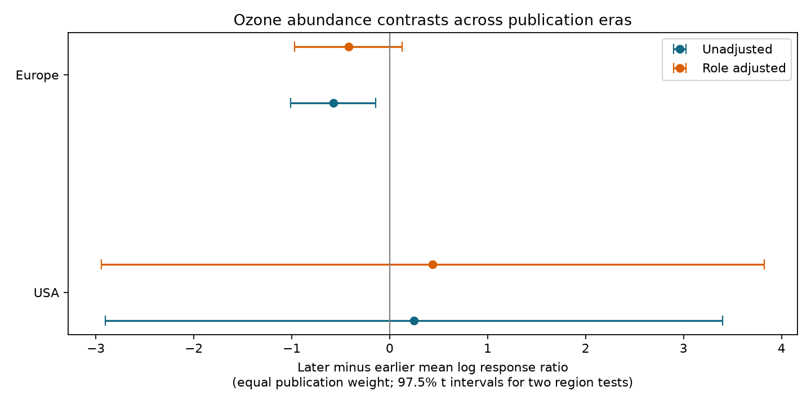

# Later-minus-earlier ozone abundance contrasts had opposite signs in US and European samples from a 2024 invertebrate data release

We tested whether lower ozone response ratios in later publications repeat in two regions. They did not. The later-minus-earlier contrast was +0.250 in the US sample and -0.578 in the European sample. These are mean log response ratios for the source abundance class. Only the European interval excluded zero in the primary model. Role adjustment made that interval include zero. The small samples and changes in the observed roles prevent a common time interpretation.



## Question and prior evidence

Ryalls et al. (2024) report that adverse invertebrate responses to air pollution became stronger with publication year. Their full meta-analysis includes several pollutants, outcomes and taxonomic groups. We ask a narrower question: does the direction of an era contrast repeat for the ozone abundance class in the USA and Europe? Could changes in ecological roles in the observed sample explain some of the contrast? The article motivates this test; we do not repeat its model or claim to refute its broader result. [Source article](https://doi.org/10.1038/s41467-024-49729-5).

This question matters for use of past pollution studies in future biodiversity assessments. A trend in the evidence can arise from new exposure conditions, new taxa, new methods or study selection. Publication year does not measure field observation year or climate change. The release has no common weather, temperature or observation-effort variable. Thus it cannot test whether warming or weather extremes caused a change in ozone sensitivity. We test the pollution and evidence-selection part of the research objective.

We searched the SCI campaign before we chose the question. A prior role-support audit found little direct overlap between beneficial invertebrates and pests. A dose-support audit found little direct support for abundance dose comparisons. These use the same source archive. They are prior work, not independent confirmation of our results. We add an era contrast, separate regional models, role-support checks, and sensitivity estimates. Search results are in `files/campaign_search.json`. The search was limited and does not establish global novelty.

## Source and selection

We read the first worksheet of Supplementary Data 1 for DOI 10.1038/s41467-024-49729-5. The exact file has 981 rows. We select `Pollutant2 = O3` and `Performance2 = abundance`. This gives 84 rows from 20 publication identifiers. All selected control and elevated means are positive. Five rows have no role label; we retain them as `Unknown`. We retain repeated record identifiers as separate spreadsheet rows.

We select USA and six European countries: Finland, Germany, Hungary, Norway, Switzerland and the UK. These two regions give 69 rows from 15 publication identifiers. The other five publications, from Argentina and China, are all in the later era and cannot support a within-region era contrast. They appear only in the coverage summary. We make no claim about all North America or all Europe.

The source abundance class is broad. It includes trap catches, infestation density, numbers of individuals, pollinator visits per flower per hour and aphid mass. These do not all measure population abundance. A lower ratio means a lower measured outcome under elevated ozone; it need not mean lower true population density or reduced ecosystem service. We use the source label to avoid selecting measurements by their result. A sensitivity analysis excludes labels containing `mass`.

The workbook SHA-256 is `a81ed92c937fc7016708e46526940164626bdf8a7e6a3eb25d4afaae9b9d1436`. We use the existing shared file at `./datasets/ryalls2024-invertebrate-pollution-moesm4/supplementary_data_1.xlsx`. `files/provenance.json` records its source URL, resolved shared path, size and version. No download or source record table is in this bundle.

## Method and assumptions

For each selected row we calculate `y = ln(Xe / Xc)`, where `Xe` is the elevated-ozone mean and `Xc` is the control mean. We first average y within each publication and role. We then give each publication a total weight of one, divided equally among its observed roles. Thus a publication with many measurements or many roles has no greater total weight. A publication's estimate gives each observed role equal weight, not each row equal weight. This is a descriptive target, not an inverse-variance meta-analysis. We do not use sample-size corrections from the source model.

The earlier era ends in 2004. The later era starts in 2005. We chose this split after inspection of source coverage, before we fitted these models. It is an exploratory split, not a registered test. The actual selected years range from 1988 to 2022. We fit each region separately. The primary weighted regression is `y ~ later_era`. Its coefficient equals the later minus earlier mean under the above weights.

We also fit `y ~ later_era + role`. This assumes one common era contrast across roles and one additive role offset across eras. Some roles occur in only one era. Inference then depends on links through roles that occur in both eras. This model does not directly estimate a time change in beneficial invertebrates. A further check keeps only roles found in both eras and restores equal total weight for each retained publication.

We use a publication-cluster sandwich covariance with the standard finite-sample factor `G/(G-1) * (N-1)/(N-p)`. Here G is the publication count, N is the publication-role row count and p is model rank. We use t quantiles with G-p degrees of freedom. Primary intervals are 97.5% intervals for two regional tests. This is a Bonferroni family-wise 95% construction if the individual intervals are valid. With six or nine publications, sandwich and t approximations can be poor. These are conditional model intervals, not a guarantee of population coverage. Role-adjusted and restricted samples are sensitivity checks, not extra confirmatory tests. Their displayed intervals use the same quantile rule but do not correct for all exploratory checks.

Publication identifiers must represent separate evidence clusters for this covariance calculation. Shared field programmes or controls across papers can violate this assumption. Nonrandom era labels also prevent a causal time interpretation. We do not use record counts as independent replication counts.

## Results

| Region and era | Publications | Records | Mean log response ratio |
| --- | ---: | ---: | ---: |
| USA, 1988-2004 | 4 | 15 | -0.008 |
| USA, 2005-2011 | 2 | 9 | +0.242 |
| Europe, 1989-2004 | 3 | 9 | +0.098 |
| Europe, 2009-2022 | 6 | 36 | -0.479 |

| Region | Primary contrast and 97.5% interval | Role-adjusted contrast and interval |
| --- | --- | --- |
| USA | +0.250 [-2.901, +3.401] | +0.439 [-2.946, +3.825] |
| Europe | -0.578 [-1.012, -0.143] | -0.421 [-0.971, +0.129] |

The European primary estimate has a negative interval. The US estimate has the opposite sign and a very wide interval. We did not test a direct region-by-era difference. Opposite point estimates do not establish different population effects between regions.

The role coverage is uneven. In Europe there are no beneficial rows in the earlier era. The later era has 22 beneficial rows from four papers. In the USA, beneficial rows occur in three earlier papers and no later paper. Both regions have other herbivores and significant pests in both eras. Five European rows with unknown role occur only in the later era. Counts by role are in `files/support.csv`; papers with several roles appear in several role counts.

When we keep only roles found in both eras, the unadjusted contrasts are -0.169 in the USA and -0.319 in Europe. Their intervals include zero. Role-adjusted contrasts on that common-role sample are +0.243 and -0.343, also with intervals that include zero. This selection changes the target sample and does not estimate responses of missing beneficial groups.

Removing aphid mass changes no US result. In Europe it makes the adjusted contrast more negative: -0.496 [-0.944, -0.049]. Thus loss of a clear adjusted interval in the full sample is sensitive to the broad outcome definition. We cannot conclude that role composition explains the whole European contrast.

After omission of each publication in turn, unadjusted European estimates remain negative, from -0.649 to -0.479. Adjusted European estimates range from -0.501 to -0.293. US estimates cross zero under both specifications. These are influence checks on point estimates, not tests. `files/leave_one_out.csv` gives all results. No extra covariates or outcome choices were searched to obtain a preferred sign.

## Observation bias and limits

Equal publication weight prevents many extracted rows from one paper from dominating the comparison. Role adjustment and common-role selection address one measured change in sample composition. Neither method corrects publication bias, omitted studies, selective outcomes, detection changes, sampling effort or changes in trap methods. Trap catch and flower visits can change without a change in true population size. The role classification and means are taken from the source; we did not re-extract all primary studies.

The two regional samples share no publication identifiers. They are not controlled spatial replications of one experimental protocol. Their methods, taxa, exposure doses and study years differ. The USA later sample has only two papers and ends in 2011. There is no early Argentine or Chinese comparison. The source review's search cutoff was 10 November 2022. Results do not describe all work available in 2026.

We find no repeated negative era contrast across these two regional samples. This does not show that ozone is safe, that pollution harm did not change, or that the original multi-outcome meta-analysis is wrong. A climate-by-ozone explanation needs measured weather and comparable exposures across repeated biological samples. This release cannot supply that test. A useful next dataset would pair both ecological roles with the same count protocol, report weather and exposure duration, and repeat sites across years and regions.

## Reproduce and inspect

Use Python 3.12 with `files/requirements.txt`; exact library versions are in `files/environment.json`. From an extracted publication run:

```bash
python files/retrieve.py --external-dir /tmp/ozone_era_source
python files/analyze.py --source /tmp/ozone_era_source/supplementary_data_1.xlsx --output /tmp/ozone_era_results
python files/validate.py --source /tmp/ozone_era_source/supplementary_data_1.xlsx --results /tmp/ozone_era_results
```

The retrieval and analysis scripts reject destinations inside the signed publication. The retrieval script checks the exact source hash. On the campaign machine, use the shared path above with `--source` to avoid a new download. Tables and code are the main reproducible evidence; PNG bytes can differ across plotting environments.

`files/checks.json` confirms the direct weighted-mean identity. `files/independent_checks.json` confirms an independent openpyxl parse and matrix calculation of all four primary and adjusted coefficients and standard errors. The maximum difference is less than 1.1e-15. `files/estimates.csv` contains all twelve model results. `files/era_means.csv` includes coverage in the excluded region group. `files/support.csv` has the role and era counts. These are aggregate results, not record-level source extracts.

## Attribution and worker record

Data source: Ryalls, J. M. W.; Bishop, J.; Mofikoya, A. O.; Bromfield, L. M.; Nakagawa, S.; Girling, R. D. (2024). *Air pollution disproportionately impairs beneficial invertebrates: a meta-analysis*. Nature Communications 15, 5447. DOI: 10.1038/s41467-024-49729-5. Source article and covered supplements are CC BY 4.0. We select ozone abundance rows and make new aggregate era comparisons and a new figure. See `files/EXTERNAL_DATA_NOTICE.md`. No external license is replaced by this package.

Campaign: 11_07_2026. Job: sci-1107-dell-climate-pollution-biodiversity-a2d6e0d7999b. Topic: climate-pollution-biodiversity. Machine: dell. Account: codex-andrii. Model: gpt-6.1-sol, high reasoning effort. Date: 2026-11-09. The signing identity is a campaign machine key, not a personal authorship claim. This package contains no private key. All scientific computations have stopped.
