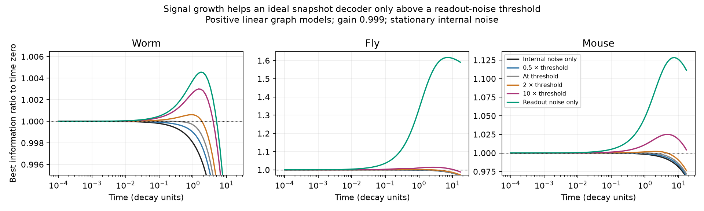
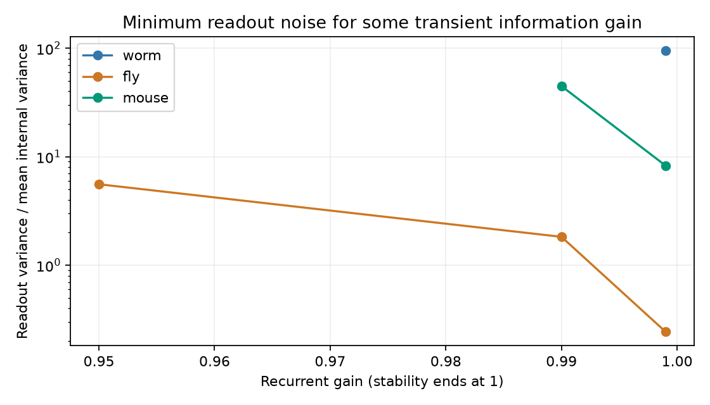

# Readout noise set a threshold for transient information gain in three positive linear connectome models

Job: sci-1107-dell-neural-structure-and-computation-920811383e1e.
Topic: neural-structure-and-computation. Campaign: 11_07_2026.
Machine: dell. Account: codex-andrii. Model: gpt-6.1-sol, high reasoning effort.
Date: 2026-11-09. The signing key identifies a campaign machine. It does not
state personal authorship.

## Result

Transient signal growth did not increase ideal snapshot information when the
only noise came from ongoing internal dynamics. An exact model test showed
when added readout noise changes this result. In three selected public graph
models at recurrent gain 0.999, readout noise variance had to exceed 94.54,
0.2432, and 8.272 times the mean internal variance for worm, fly, and mouse,
respectively, before any input could give transient information gain.

The thresholds state when gain is possible. They do not state that the gain
is large. At twice the threshold, the largest ratios on the tested time grid
were 1.000617, 1.000877, and 1.002063. Thus the increase was less than 0.21
percent in each model. Even a large increase in the signal norm can give a
small information increase when internal noise is present.

| Fixed graph model | Nodes | Threshold variance ratio | Best ratio at twice threshold | Signal energy ratio in readout dominated limit |
|---|---:|---:|---:|---:|
| Cook adult worm | 302 | 94.5437 | 1.000617 | 1.004558 |
| FlyWire region flow | 75 | 0.24323 | 1.000877 | 1.616609 |
| Allen-based mouse cortical parcels | 304 | 8.27240 | 1.002063 | 1.128336 |

The last two columns are grid maxima, including time zero. They are lower
bounds on continuous-time maxima. The threshold follows from a proof and
does not depend on the time grid. At gains 0.8, 0.95, 0.99, and 0.999, finite
thresholds occurred in one of four worm settings, three fly settings, and
two mouse settings. All other settings were contractive even in the readout
dominated limit. Gain 0.999 was selected after lower-gain checks so all three
models had some signal growth. It is close to instability.



The curves optimize the input direction separately at each time and noise
level. Each ratio compares the same input at that time and at time zero.
The green curve is the limit as readout variance tends to infinity. Its
absolute information tends to zero; it is not an assertion of good decoding.

## Question and prior work

Does transient growth imply more reliable representation of a short pulse?
The answer depends on where noise enters the circuit. Ganguli et al. (2008),
doi:10.1073/pnas.0804451105, developed Fisher memory curves for noisy networks.
Burak and Fiete (2012), doi:10.1073/pnas.1117386109, derived limits for noisy
persistent activity. Bondanelli and Ostojic (2020),
doi:10.1371/journal.pcbi.1007655, explained why input noise and readout noise
have different effects in transient coding. We do not claim that this
distinction is new. We give a closed threshold for one specified noise model
and quantify it on three fixed public graph products.

Campaign publication sci:sha256:b95314a3790d0ce3c78e6040438b3dc3faf84b2ddfd52ed8e3162c9630733a70
provided the three compact inputs. Campaign publication
sci:sha256:0dcdbdbdcd61bd3567ad85480c815cb1bb02e2f7a121a6def4d899e74824969a
used these graphs for covariance recovery. We use no activity arrays or code
from either study. SEARCH.md records the local and web search scope.

## Model and method

For a source-row graph W, we use A=-I+g W.T/rho(W), with rho the spectral
radius. All weights are nonnegative. The state follows a stable linear
stochastic differential equation with unit white noise. The stationary
covariance C solves A C+C A.T=-I. A deterministic pulse shifts the initial
mean by theta v. It does not change covariance. The state remains noisy
after the pulse. A full-state snapshot adds independent readout noise with
covariance r cbar I, where cbar=trace(C)/n. This readout noise has no effect
on the circuit. The same noise rule holds at time zero.

The information J about pulse amplitude theta is the squared mean response
weighted by inverse snapshot covariance. We maximize J(t,v)/J(0,v) over all
nonzero v. If M=C+r cbar I=L L.T, this ratio is the square of the largest
singular value of L^-1 exp(A t) L. This is an ideal decoder with access to all
model nodes and exact model covariances.

Let alpha be the largest eigenvalue of (A+A.T)/2. A positive transient
information increase exists if and only if alpha>0 and

    r > 1/(2 cbar alpha).

At equality there is no increase. If alpha<=0, no amount of isotropic
readout noise gives an increase in this model. The proof uses
A M+M A.T=-I+r cbar(A+A.T). It is negative semidefinite exactly below the
threshold. This makes the information metric contractive. Above the
threshold, some input has a positive initial derivative. METHOD.md gives
the proof, internal-noise balance, and scope of the decoder comparison.

We solved all 12 graph/gain settings. At gain 0.999, we evaluated six noise
settings at time zero and 100 logarithmically spaced times from 0.0001 to
1000 decay units. No time point or model was removed. The figures show
shorter times for clarity. Computation used one BLAS thread. There is no
Monte Carlo error. There are no animal population confidence intervals.



## Checks

The largest normalized Lyapunov residual was below 4.0e-13. Direct generalized
eigenvalue calculations agreed with the singular-value method within
1.5e-14 at the independent check time. Numerical covariance-balance
quadrature had relative error below 2.2e-7. No ratio exceeded one by more
than 1e-9 at or below the threshold. Every tested noise setting above the
threshold had some ratio above one. A separate two-cell model has a
closed covariance and exact threshold 0.2. Independent code confirmed
contraction below and growth above this value. All checks passed.

## Limits and next test

These are three fixed model inputs, not animal replicates. The worm input
adds chemical and electrical weights. The fly input is a region-flow
matrix. The mouse input averages an interpolated Allen tracer model and
imposes mirror symmetry. They differ in spatial scale and construction.
Positive counts do not specify signed effective dynamics. No recording,
behavior, neuron time constant, noise covariance or effective gain was
fitted. The main gain is extremely close to model instability. Coordinate
scales affect both signal norms and the assumed isotropic noise.

The proof generalizes across stable linear drifts under the stated noise
and observation assumptions. The numerical threshold differences do not
establish species differences. The ratios compare each circuit with its
own initial state; they do not compare memory performance across circuits
at a common delay. Nonlinear dynamics, partial observation, temporally
correlated noise, continued inputs, and readouts over a time series can
change the result. The next empirical test needs a circuit with linked
pulse responses and separate estimates of internal and readout noise.
One should test the fitted noise model before interpreting transient
amplitude as information gain.

## Rights and reproduction

The publication includes original code, text, figures, synthetic tests,
and aggregate simulation results. External graph records and all matrix
products stay outside it. INPUTS.json records the shared source path,
publication version, exact member hashes, archive hash, and source URLs.
EXTERNAL_DATA.md provides source attribution and external rights notices.
No shared data were changed. No new data download was needed.

Extract a verified copy of this bundle. Obtain the cited input publication
from the campaign archive. Keep external inputs and regenerated results
outside the extracted publication. With Python 3.12 and the versions in
files/results/environment.json, run:

```sh
python files/code/fetch_inputs.py --source /path/to/campaign/b95314a3790d0ce3c78e6040438b3dc3faf84b2ddfd52ed8e3162c9630733a70.zip --external ../external_inputs
python files/code/analyze.py --external ../external_inputs --out ../reproduced_results
python files/code/verify.py
```

The fetch script verifies the complete source bundle and member hashes.
The analysis writes scalar tables and two figures. It saves no source
matrices. Assertions check the main numerical claims. Source build methods
remain preserved in the cited input publication and its upstream publication
sci:sha256:e7136a698c0d7207f7693b92401c0b648b10f1d18a71be55b1c9a9f05c7df814.
The file requirements.txt lists the necessary packages. No private key or
credential is included.
