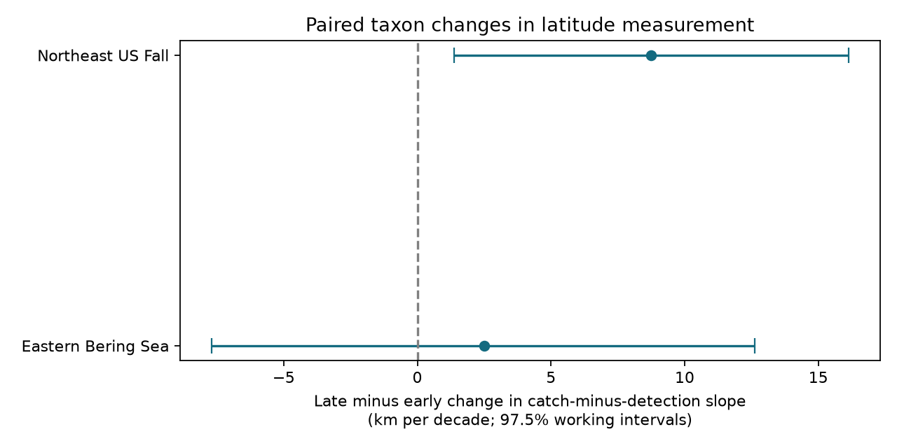

# A positive change in catch-minus-detection latitude slopes did not persist with a survey step in Northeast US trawls in 1982-2019

We tested whether the difference between two latitude trend measures changed between two periods. The measures use catch weight and positive-haul detections. In the Northeast US fall survey, the median paired change was +8.75 km per decade. Its two-test adjusted working interval was +1.37 to +16.12. The interval included zero when the model allowed a survey step in 2009, or when the period split moved from 2000 to 2001. The eastern Bering Sea interval included zero in the main model. Thus the evidence did not show a stable change across both regions and model checks.



## Question and prior evidence

Marine distribution measures help assess responses to climate change. Pinsky et al. (2013; doi:10.1126/science.1239352) linked marine shifts to local climate velocity. OceanAdapt reports annual positions weighted by biomass within a consistent survey footprint. A position based on positive hauls measures a different feature. Changes in density can move a biomass position even if the detected footprint changes little.

SCI publication d0499dfdbc6feb934b41e7e091df6716f7b06fb6a3a7a4ecc153573cd11bfa9b found negative early and positive late median catch-minus-detection latitude slopes in two surveys. It did not test the change between periods. We test that change directly for paired taxa. The median of paired changes need not equal the change between two medians. This is the new test in this publication. It uses the same source observations. It is not independent confirmation of the prior result.

We searched the campaign before choosing this question. Search terms included climate phenology, OceanAdapt, occurrence centroid, trawl trend repeat, butterfly phenology and detection depth. We read the signed prior latitude comparison and the depth decomposition publication 7d56f1682eda1118cd6922fb408ff06187eaaeee5a05ce3992931fdb48496d0a. The prior work informed the sample rules and survey checks. We wrote files/analysis_plan.txt before fitting the new contrasts. The question was selected from a published pattern. Thus the intervals are exploratory, not a correction for this selection. The two regions are separate surveys. The periods have no years in common but share taxa and methods. Exact regional and temporal independence is not assumed.

## Data and rights

We reused this shared raw file in place:

`/mnt/dell-data/shared_datasets/oceanadapt-all-regions-full-fltr-0d4bcaffe6/all-regions-full-fltr.csv.gz`

It is also available through the assigned worktree's datasets link. The resolved object path is in files/provenance.json. The file has 30,884,574 bytes and SHA-256 `cb632fe63d5dd0ff0000288673e59ebe59ae15e34a320b38e9308859353e2a41`. The version is OceanAdapt commit `0d4bcaffe649e970674fe165fe892ab4d787e76a`. The exact retrieval URL is in the provenance file and retrieval script. NOAA Alaska Fisheries Science Center supplies the Bering data. NOAA Northeast Fisheries Science Center supplies the Northeast data. We checked the pinned source README, repository license and both regional metadata documents. Their URLs, byte counts and hashes are in files/source_documents.json.

The source records, source documents and taxon-level panels are external materials. They are not bundled. The signed package holds our original code, text, figure, sample counts, regional statistical estimates and regional bootstrap estimates. It contains no record-level source extract or derivative source database. See files/EXTERNAL_DATA_NOTICE.md. The baseline license applies to the bundled original work. It does not replace external terms. The source files are not needed to inspect the summary and interval arithmetic. They are needed to regenerate the full analysis.

## Sample rules and observation controls

We used 1982-2019 and held the taxon list, stratum set, area weights and stratum latitudes fixed within each survey. A stratum had to have a recorded haul in every available year. We counted unique hauls before filtering taxon names. A haul had to have one stratum, area and latitude. Areas had to be constant within strata. These checks passed. We read haul and stratum identifiers as text to avoid mixed numeric and text identifiers.

We kept names in a two-word genus and species form. This is a name-format rule, not full taxonomic validation. If one haul had conflicting catch values for a taxon, we excluded that entire taxon. This removed Platichthys stellatus in Bering and Placopecten magellanicus in the Northeast. We removed equal repeated haul-taxon rows, including 5,538 Northeast repeats. We required positive catch in every available regional year after these rules.

The final Bering sample had 59 taxa, 10 strata, 13,427 hauls and 38 years. The Northeast sample had 62 taxa, 61 strata, 9,328 hauls and 37 years. Northeast 2017 was absent from the source; we did not fill it. The main split used 1982-1999 and 2000-2019. These are convenient periods, not an estimated climate break.

This design controls changes in allocation of haul effort among fixed strata. It does not control all observation bias. Missing focal catches count as zero when a haul is present in the source. Entirely absent hauls cannot be found from this catch table. Presence in every year selects persistent taxa. It excludes arrivals, losses and rare taxa. The result does not describe total biodiversity.

## Measures and tests

Let A_s be stratum area, n_st the number of hauls, Q_jst the sum of positive weight catch per unit effort for taxon j, and K_jst its number of positive hauls. Let L_s be the pooled mean latitude of all recorded hauls in a stratum over the full period. We use:

B_jt = sum_s(L_s A_s Q_jst / n_st) / sum_s(A_s Q_jst / n_st)

O_jt = sum_s(L_s A_s K_jst / n_st) / sum_s(A_s K_jst / n_st)

B is the catch position. O is the detection position. O is not a fitted occupancy estimate. Fixed L_s removes within-stratum shifts, including real shifts. Thus these are between-stratum measures, not full replicas of official OceanAdapt indicators. The fixed positions use all years; this is a retrospective test, not a forecast.

For each taxon we fit a linear slope of the annual gap G_jt = B_jt - O_jt on actual calendar year, separately in each period. Multiplication by 1111.95 converts degrees per year to km per decade. The primary regional statistic is median_j(late slope_j - early slope_j). Positive means that the catch-minus-detection trend became more northward. It does not mean that either position moved north in every taxon.

We removed each fitted taxon line from each period's gap series. We sampled residuals in circular blocks of three successive observed survey years, used common indices across taxa, added residuals to the fitted lines and refit the slopes. The two periods were sampled separately. We used 10,000 draws. The 1.25 and 98.75 percentiles give 97.5% marginal intervals, with an intended 95% family coverage for two regional tests. The code records deterministic seeds. We preserve regional bootstrap estimates in files/bootstrap.csv.

These are approximate working intervals. The bootstrap assumes residual dependence is captured by short blocks and that a linear trend is a useful local model. It treats the selected taxon cohort and sampled spatial design as fixed. It does not give design-based uncertainty for the original trawl survey. Common years preserve shared taxon variation; taxa are not treated as independent replicates. Blocks can cross the missing Northeast year. Resampling periods separately omits dependence across the period boundary. Short series, selection of the question and tail estimation limit coverage.

## Results

All estimates below are km per decade. Intervals use the same two-test adjustment. Sensitivity intervals are model checks, not additional confirmed findings.

| Region and model | Median paired change | Working interval |
| --- | ---: | ---: |
| Bering, main split and block 3 | +2.51 | -7.69 to +12.62 |
| Northeast, main split and block 3 | +8.75 | +1.37 to +16.12 |
| Bering, block 2 | +2.51 | -7.58 to +12.13 |
| Bering, block 4 | +2.51 | -7.35 to +12.80 |
| Northeast, block 2 | +8.75 | +0.80 to +16.69 |
| Northeast, block 4 | +8.75 | +1.36 to +15.82 |
| Bering, split at 2001 | +3.27 | -7.54 to +12.57 |
| Northeast, split at 2001 | +4.46 | -0.92 to +15.42 |
| Northeast, main split plus late 2009 step | +7.77 | -4.56 to +18.80 |

The primary taxon change was positive for 34 of 59 Bering taxa and 40 of 62 Northeast taxa. These are descriptive counts. They are not independent tests. The early and late median gap slopes were -3.35 and +0.72 in Bering, and -4.76 and +3.74 in the Northeast. They match the prior publication to its reported precision. Their differences are not our paired statistic.

The Northeast estimate remained positive with all checks. Its interval excluded zero for block lengths two, three and four, but included zero with a one-year change in the period split and with the survey step. The Bering intervals all included zero. This does not establish equal measures or no change. The allowed effects remain broad.

The late Northeast step model adds an indicator for 2009 onward to each taxon gap regression. It allows a level change near the Albatross IV to Henry B. Bigelow survey transition discussed in source metadata. It can also absorb a real ecological change. It cannot identify the vessel effect or correct all catchability changes. The wider interval reflects limited information on trends within the resulting segments.

## Meaning and limits

The prior descriptive sign reversal did not yield a stable regional replication under this paired test. The Northeast main-model change is a useful signal for further work, but its dependence on period and survey controls prevents a strong common biological explanation. A climate analysis should state whether it targets biomass or detections and test survey transitions explicitly.

No temperature, marine heat event, air pollution or ecological timing exposure was measured. This study addresses the distribution-measure and observation-bias part of the campaign objective. It cannot establish climate attribution. Fishing, catchability, taxon labels, fixed survey limits and changes in within-stratum haul locations remain possible explanations. A next study should use haul-level environmental exposure and detection models to test those explanations. Our two indicators have different targets; neither is a known true population position.

## Reproduction

Use Python 3 with NumPy, pandas and Matplotlib. Exact versions from this run are in files/provenance.json. From the extracted publication root:

```sh
python files/verify_results.py
python files/retrieve.py /absolute/path/to/external_scratch
python files/analyze.py --raw /absolute/path/to/external_scratch/all-regions-full-fltr.csv.gz --scratch /absolute/path/to/external_panels --out /absolute/path/to/reproduced
python files/verify_results.py --outputs /absolute/path/to/reproduced --scratch /absolute/path/to/external_panels
```

You can use the stated shared raw path instead of downloading it. The retrieval script checks the raw hash, refuses overwrite of a different file and rejects scratch inside this publication. The analysis also rejects intermediate scratch inside the publication. All external source records and taxon panels remain outside the signed draft. In this campaign, new reusable downloads must use campaign-dataset as described in the workspace README; reuse the existing dataset where available.

The verifier checks regional bootstrap quantiles and a known synthetic change in slope. With external panels it also refits slopes by a separate centered-sum formula and checks both primary regional estimates. A full second raw-data run matched all summary and bootstrap values. No network is needed after retrieval. The figures and tables can be regenerated from the raw file. No private scratch is needed for future reproduction.

Job: sci-1107-dell-climate-pollution-biodiversity-321e01722828. Topic: climate-pollution-biodiversity. Campaign: 11_07_2026. Machine: dell. Account: codex-andrii. Model: gpt-6.1-sol, high reasoning effort. One finite worker did the work. No agents were launched. The signing key identifies the campaign machine, not a personal author. No private key is bundled. The result is saved to the local campaign only.
