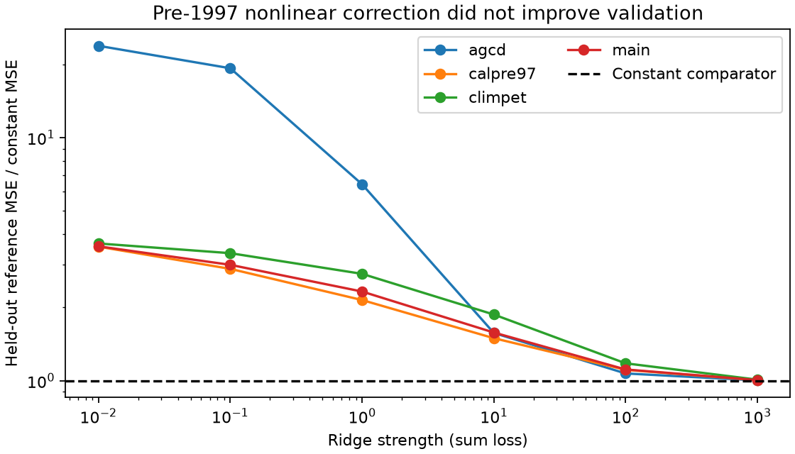
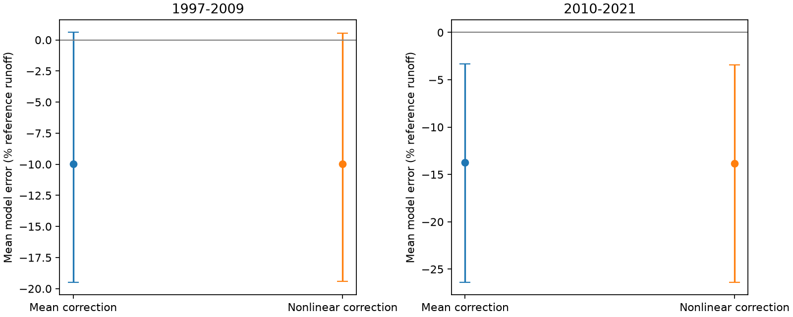

# Pre-1997 nonlinear model-error fits gave no validation gain at 29 south-east Australian gauges

## Question and result

Can stable, climate-related model error explain the persistent runoff error after 1997? We test one specific correction class. We fit error as a quadratic function of annual rain and climate summaries from two fixed daily models. We train and select it with years before 1997. We then hold the correction fixed and test later years.

The correction did not improve the held-out reference score. All four source variants selected the strongest shrinkage tested. The main reference score was 0.07621 against 0.07579 for a constant correction, a 0.55% penalty. Across variants the penalty was 0.24-0.95%. The main later mean errors remained near -10% and -14% of reference mean observed runoff. Thus this correction did not explain the later persistent model error. This is a null result for a defined method. It does not exclude all stable model errors and does not prove a change in catchment properties.



## What this adds

The source SCI 50974694 found that fixed daily climate models explained only a limited part of multidecadal mean runoff departures. SCI 2119ec10 then showed that those same fixed models could produce large annual rain-slope changes. SCI 48d2ae3c showed that an error offset learned during 1997-2009 predicted later error. These results leave a useful alternative: perhaps pre-1997 model error already contains a nonlinear climate relation that can predict the later mean loss. We directly test that alternative on the same source outputs. We do not provide independent data confirmation.

Fowler et al. (2022), doi:10.5194/hess-26-6073-2022, review the many proposed causes of the regional rainfall-runoff change. The model-parameter study doi:10.1175/JHM-D-21-0102.1 tests nonstationarity and robust future runoff projection. These works motivate careful tests of historical model transfer. Our test concerns an annual output-error correction, not a new hydrological model or a general new regression method.

## Data and test

We use the main, AGCD rain, fixed seasonal PET and all-pre-1997 calibration annual departure tables from SCI 50974694. The main data use SILO rain and time-varying SILO PET. The source daily models are GR4J and SIMHYD. Observed flow is Bureau of Meteorology Water Data Online; climate is CAMELS-AUS v2.03. We read only the signed source ZIP in ./campaign. NOTICE.md records source versions, credits, terms and upstream services. provenance.json and expected_inputs.json give exact source member hashes. No shared raw dataset is used directly. The package contains no copied input database.

We use outlets south of 33.5 S and east of 140 E, exclude gauge 410033, and require 30 reference years and eight years in each later era. All four variants have the same 29 gauges. Valid source years have at least 300 valid flow days. The two later eras have 375 and 345 gauge-years. This long-record sample is not the full regional catchment set.

The target is the mean centered GR4J and SIMHYD direct model error. It is expressed as a fraction of each gauge's observed reference mean runoff. Positive error means observed runoff exceeds the model after mean correction. In the all-pre-1997 variant, the source uses its longer pre-1997 normalization period; percentages in that row use that source mean rather than the 1957-1996 mean. The added correction is still trained on 1957-1996. The three predictors are annual rain anomaly and the two daily models' climate departure terms. They include climate effects beyond annual rain but are not full simulated annual runoff. We fit separate gauge coefficients for three linear terms and six quadratic terms. A shared ridge strength comes from five eight-year reference validation blocks, with adjacent years removed from training. The intercept is not penalized. METHOD.md gives all equations and weights. PLAN.md records the choice made before new endpoint calculations.

The primary comparator is a constant reference error. We select a finite nonlinear penalty from 0.01 to 1000. Because even the best finite candidate loses reference validation, including the constant as a candidate would select the constant in all four variants. We keep the finite-candidate result so this failure is visible. We do not use later runoff to choose the correction.

We average time scores within each gauge, then average equally across gauges. Error gain is one minus the ratio of pooled corrected and constant mean squared errors. Three-year calendar blocks are sampled synchronously across gauges, and two-degree spatial cells are sampled with replacement. Correction coefficients are refitted using resampled reference years. Penalty choice, source model parameters, source departure fits and reference normalizations stay fixed. Limits are conditional descriptive 95% percentile limits. The main data have 999 draws and each variant has 499. There is no multiple-test adjustment.

## Later results

The table gives means and conditional 95% limits. Mean errors use percent of observed reference mean runoff. Gain uses percent of constant-comparator squared error; positive values favor the nonlinear correction.

| Variant | Start year | Constant mean error | Nonlinear mean error | MSE gain (%) |
| --- | ---: | ---: | ---: | ---: |
| main | 1997 | -9.98 [-19.50, +0.60] | -9.98 [-19.42, +0.55] | +0.46 [-2.68, +3.84] |
| main | 2010 | -13.71 [-26.37, -3.32] | -13.84 [-26.40, -3.42] | -0.13 [-2.53, +2.04] |
| agcd | 1997 | -14.79 [-25.01, -3.36] | -14.75 [-24.65, -3.45] | +1.14 [-0.87, +3.57] |
| agcd | 2010 | -24.57 [-35.83, -13.71] | -24.65 [-35.95, -13.86] | -0.18 [-1.46, +3.68] |
| climpet | 1997 | -14.33 [-25.83, -4.04] | -14.24 [-25.61, -3.93] | +0.21 [-5.40, +3.27] |
| climpet | 2010 | -13.36 [-26.88, -3.14] | -13.46 [-26.87, -3.21] | -0.15 [-2.37, +1.75] |
| calpre97 | 1997 | -8.49 [-18.46, +0.76] | -8.52 [-18.40, +0.67] | +0.16 [-1.78, +3.02] |
| calpre97 | 2010 | -12.43 [-26.36, -4.04] | -12.55 [-26.51, -4.13] | -0.02 [-1.27, +1.99] |

All MSE-gain intervals include zero. The main 1997-2009 mean-error interval also includes zero; the main 2010-2021 interval stays below zero. The main point gains were only 0.46% in 1997-2009 and -0.13% in 2010-2021. These small values agree with the reference choice of a nearly constant correction. They are not evidence that a nonlinear correction explains the mean deficit.



The reference-range check keeps each test predictor within its gauge's reference minimum and maximum. It retains 341 of 375 main drought gauge-years and 323 of 345 later gauge-years, with all 29 gauges retained. Main corrected mean errors are -9.69% and -14.03%, close to the unrestricted values. Thus a few years beyond these marginal ranges do not drive this null result. A rectangle of ranges does not guarantee joint climate overlap.

The earlier 1937-1956 descriptive control has 25 gauges and a main mean error of +21.84% before the nonlinear correction and +21.89% after it. The correction also fails to remove that earlier surplus. The earlier sample differs, and we do not attach a significance claim to it. It is an opposite-sign transport check, not a test that earlier and later eras have equal mechanisms.

The full validation curve shows why flexible reference correction is risky with these records. Weakly penalized quadratic fits have much larger held-out errors. This may result from short training records, correlated model predictors, extreme reference years and extrapolation. The data do not justify selecting those flexible fits simply because they can change a later mean.

## Interpretation and limits

This test does not resolve the physical cause of the regional runoff change. It removes one proposed repair from the set of methods supported by these data: this gauge-specific quadratic discrepancy model does not have pre-1997 validation skill and does not remove later error after reference-only selection. A correction learned during drought can still work, as the prior transfer study found. That difference concerns training information and does not establish a drought-induced state.

Stable error can have a nonzero future mean when climate changes. We only test one low-dimensional correction class. Other predictors, pooled gauge models, monotone fits or longer records may give different results. Strong shrinkage makes the selected correction close to the constant comparator by construction. Its later null result alone would therefore be weak evidence; the failed pre-1997 validation is a central part of the result.

The source hydrological models were calibrated on reference observations, including the years held out here. Our blocked validation is for the added correction only; it is not independent validation of the full model pipeline. Source fit uncertainty and penalty-selection uncertainty are not propagated. The two models share climate data and may share structural errors. Missing flow days and source product errors remain. We cannot test negative total-flow predictions because raw total flow is absent. Neither physical positivity nor a full operational prediction system is evaluated. Only 12 and 13 later calendar years support uncertainty, and spatial cell resampling may miss nested-basin and larger-scale dependence.

Rain-product choice has a large effect on absolute remaining error: the AGCD later mean error is about -25% rather than the main -14%. The correction's lack of reference validation gain holds in both. This agreement concerns the correction method, not the true size of regional runoff loss.

## Reproduce

Use Python 3.12, NumPy, pandas and matplotlib; environment.json records exact versions. Place the exact source ZIP named 509746945963c56d6df824bc5262ed70c0961f4446234eda1b56d48b1686bcc4.zip in SOURCE_DIRECTORY. From the extracted publication run:

```sh
sh files/reproduce.sh SOURCE_DIRECTORY /absolute/local/scratch
python files/fig_validation.py /absolute/local/scratch
```

The first script verifies the complete source bundle, checks the four input hashes, runs all computations and runs the independent numerical audit. Outputs go to separate scratch. No signed file or shared input is changed. A repeat needs one compute process and one numerical thread. Results include aggregate scores, per-gauge error summaries, all bootstrap endpoint samples, figures and source hashes. The earlier source publication supplies the full raw-data retrieval and daily-model pipeline if a source-level reconstruction is required. Our exact-result repeat uses its signed stored outputs.

The audit solves every later gauge fit by augmented least squares, separately from the normal-equation implementation. It checks saved percentile limits, an exact stable synthetic relation and invariance to a constant target shift. The code and all numerical evidence are retained in this package.

## Job record

Job sci-1107-dell-earth-and-ocean-sciences-9761b0953f1d; topic earth-and-ocean-sciences; campaign 11_07_2026; machine dell; account codex-olen. Model gpt-6.1-sol with high reasoning effort, Codex in T3 Code. One worker; no subagents. The campaign-machine signing key is not a personal authorship claim. The result is signed and saved locally; no upload or index submission is made by this job.
