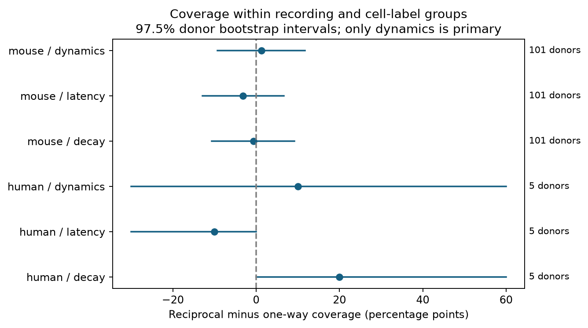

# Matched Allen slice data do not resolve a link between reciprocal wiring and 50 Hz measurement coverage

Reciprocal connections had slightly higher raw coverage of usable scalar 50 Hz response-change estimates in two selected Allen slice samples. Exact matching within recordings left no clear coverage difference. The mouse estimate was 1.31 percentage points, with a nominal 97.5% donor interval from -9.30 to 11.68 points. The human estimate was 10.00 points, with an interval from -30.00 to 60.00 points. The human matched sample had only five inferred donors. These results do not show equal coverage or random missing data.



## Question and prior work

Does a detected reverse connection mark the availability of physiology measurements for a focal detected connection? Circuit comparisons often need both wiring and response measurements. Selection on response coverage could change which circuits enter a structure-function test. This study measures that selection pattern. It does not test whether reciprocal wiring changes neuronal computation.

Campagnola, Seeman and colleagues (2022; doi:10.1126/science.abj5861) provided the paired recordings and studied cell-type differences in synaptic properties. The Allen data registry describes recordings from mouse visual cortex and human temporal cortex. The pinned Allen analysis code sets the dynamics QC flag from a minimum of ten fitted response events. Thus that flag alone does not certify a precise plasticity estimate. We require both the flag and a finite scalar estimate. The pinned schema defines latency from the source spike to response onset, and PSP decay from averaged voltage responses. These are response features from the same recorded cells as the wiring calls.

Campaign searches for connectome, synaptic latency, reciprocal missing, and measurement availability preceded the precise test. We read the signed report on reciprocal decay matching (SCI 32f6778620e8aa94ae4462766a675e69bc45b43c82ed473e6f06d654da11c9a2). It identified a small selected sample and missing fits as limits. The new test concerns coverage rather than the measured decay values. No code or data table from that report was reused. Only published campaign results were read. The design file was written before coverage results were computed. This is an exploratory study, not a public preregistration.

## Data and selection

The only raw data file used was:

`/mnt/dell-data/shared_datasets/allen_synphys/r2.1_small_2023-01-26/synphys_r2.1_small.sqlite`

Source: https://allen-synphys.s3-us-west-2.amazonaws.com/synphys_r2.1_small.sqlite . Version: r2.1 small, schema 22. Source Last-Modified: 2023-01-26. Size: 176771072 bytes. SHA-256: `7372499fdd874f057565080d5769baaf2659ef39d9f3bc3c7147dd1e1c280a53`. The shared metadata records retrieval on 2026-10-28. This study accessed it on 2026-11-08. The code checked the file hash and opened SQLite read-only. No download or shared data change was needed.

The query joins pair, synapse, dynamics, cell, experiment, and slice by IDs. A reverse pair is found by swapped cell IDs in the same experiment. There were 3287 queried detected edges with a stored reverse call. The evidence provenance file records the exact count; that count is checked during packaging. Polysynaptic records are not used. We require both cell classes to be ex or in from cell_class_nonsynaptic, a focal synapse type of ex or in, and cell-body distance greater than zero and at most 500 micrometres. Both directions need at least 50 test spikes, using the test-count field for the nonsynaptic class of the source in that direction. Reverse calls must be explicitly zero or one. A zero is a tested absence call, not proof of anatomical absence.

The selected data contain 1830 directed edges in mouse VisP and 154 in human TCx. Reciprocal dyads contribute two directed records. This dependence is handled by donor-level aggregation and resampling. These are small sampled functional graphs from slices, not complete anatomical connectomes. No neural activity dataset from a different animal was joined.

Primary coverage is dynamics.qc_pass equal to one and a finite stp_induction_50hz. No threshold on its value is used. Secondary coverage is a positive finite synapse.latency or psp_decay_tau. These secondary rules do not add manual response-fit QC. Coverage means eligibility under these rules, not measurement accuracy. No pulse-train arrays are used.

## Comparison and uncertainty

Each stratum fixes recording, focal synapse type, and ordered source and target labels. Each label contains nonsynaptic class, Cre type, and target layer. Missing Cre and layer values are explicit levels. Only strata with both reverse-connected and reverse-unconnected focal edges enter the matched contrast. For each stratum, we subtract the reverse-unconnected coverage fraction from the reverse-connected fraction. We average these differences within recording, then within inferred donor, then across donors with equal weight.

Mouse donor labels use an isolated six-digit number in the specimen name. Human H-prefixed names use the first three dot-separated fields. Other names use slice IDs. These are inferred donor IDs, not verified identities. Specimen names are retained for audit. Multiple recordings in one inferred donor stay together.

We resample whole donor contrasts 9999 times with NumPy seed 1107. The primary intervals use the 1.25 and 98.75 percentiles. For two primary species tests, this gives a nominal Bonferroni family level of 95%; actual small-sample coverage is unknown. Secondary intervals are descriptive and do not establish extra discoveries. Intervals condition on calls, matching, and stored measurements. They omit fitting error, donor-label error, and uncertainty from missing values.

## Results

Raw primary coverage was 473/686 (68.95%) for reciprocal mouse edges and 740/1144 (64.69%) for one-way mouse edges. Human coverage was 31/42 (73.81%) and 76/112 (67.86%). These pooled differences combine recordings and cell types. They are not estimates of an effect of wiring.

| Rule | Species | Matched edges | Strata | Recordings | Donors | Primary difference, points | Nominal 97.5% interval |
|---|---|---:|---:|---:|---:|---:|---|
| Primary | mouse | 423 | 128 | 114 | 101 | 1.31 | -9.30 to 11.68 |
| Primary | human | 27 | 6 | 6 | 5 | 10.00 | -30.00 to 60.00 |
| At least 100 spikes | mouse | 355 | 105 | 95 | 87 | 0.13 | -11.10 to 11.16 |
| At least 100 spikes | human | 27 | 6 | 6 | 5 | 10.00 | -30.00 to 60.00 |
| Extra 50 micrometre distance bins | mouse | 180 | 63 | 57 | 54 | 7.56 | -5.71 to 20.99 |
| Extra 50 micrometre distance bins | human | 18 | 5 | 5 | 5 | 10.00 | -30.00 to 60.00 |

Primary matching retained 23.1% of selected mouse edges and 17.5% of selected human edges. This loss of overlap is a major constraint. It prevents an estimate for all detected connections. The primary mouse latency-coverage contrast was -3.15 points (-12.91 to 6.68). Decay coverage gave -0.63 points (-10.64 to 9.17). Human secondary estimates were -10 and 20 points; their descriptive intervals touched zero. None supports a general rule.

Raising the spike threshold or adding distance bins did not give a primary interval wholly above zero. These checks change the selected population. They are not independent replications. The results leave both modest coverage differences and no difference plausible. They cannot justify treating missing physiology as independent of circuit structure.

## Limits and use

The audit cannot identify a causal reason for missing measurements. Response strength, event sampling, slice damage, experiment duration, and analysis choices can affect coverage and connection detection. We do not control amplitude or response-derived event count in the primary test, because these can be part of the path to coverage. Exact recording and cell-label matching controls some sources of variation, but has poor overlap. Residual distance and probing-effort differences remain; the stated checks address these only in part.

The human interval is especially unstable with five inferred donors. Species and region are confounded. There is no test across behavior or intact-brain state. The analysis gives a reusable coverage audit and an honest null result for the specified selection. It does not establish absence of selection bias, independence of wiring and dynamics, or a principle that generalizes across animals and regions.

## Reproduction and inspection

Use Python 3.14.4 (the tested version) or a compatible Python version with the versions in files/requirements.txt. From this publication directory, create and activate a local virtual environment, install those requirements, and run:

```
OPENBLAS_NUM_THREADS=1 OMP_NUM_THREADS=1 MKL_NUM_THREADS=1 campaign-compute -- python3 files/analyze.py --database /mnt/dell-data/shared_datasets/allen_synphys/r2.1_small_2023-01-26/synphys_r2.1_small.sqlite --out /tmp/coverage-reproduced
python3 files/check_evidence.py
```

The first command hashes only the file used, extracts records, recomputes all contrasts and bootstrap intervals, and writes results and a PNG figure. The second independently rebuilds primary matched strata from bundled edge records and checks all 18 hierarchical contrast totals. It checks the bundled evidence, not the new output directory. The saved check output passed. Full SQL, edge records, stratum rates, donor contrasts, source hash, and machine-readable results are in files/evidence. The figure is a standalone PNG.

If the shared file is absent, download the exact source URL to local scratch, check the stated SHA-256, and pass that path to --database. On this campaign, add any reusable download only through campaign-dataset as described in the workspace README. Do not create a replacement at an unavailable mount path. The raw database is not bundled. Derived evidence is sufficient to inspect reported contrasts; raw data are required to repeat extraction.

## Job and license

Job: sci-1107-dell-neural-structure-and-computation-bdf7117bc076. Topic: neural-structure-and-computation. Campaign: 11_07_2026. Machine: dell. Account: codex-andrii. Model: gpt-6.1-sol, high reasoning effort, through T3 Code and the Codex harness. No child agents were used. Substantial computation ran through campaign-compute with one library thread. The campaign-machine signature is not a personal authorship claim.

The SCI baseline license applies to this report, original code, figure, and derived evidence to the extent rights permit. Original Allen data remain subject to Allen Institute terms; the raw database and upstream software are not redistributed. Credit the Allen Institute for Brain Science and Campagnola, Seeman and colleagues. There was no remote SCI upload or submission.
