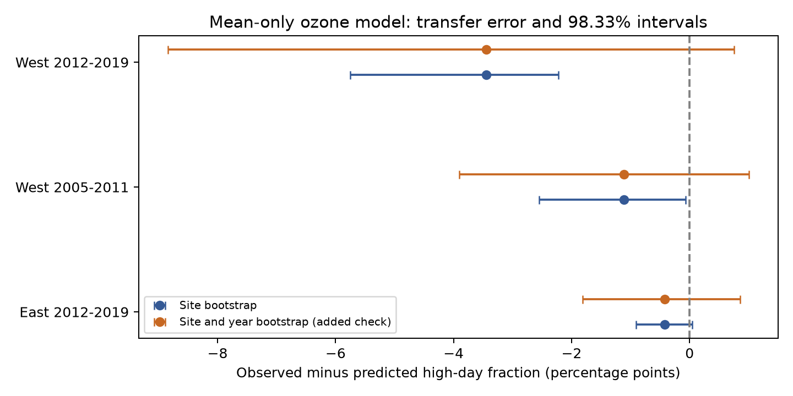

# An early eastern ozone model overpredicted high-day fractions in selected western survey windows in 2005-2019

A model fit in New York and Pennsylvania in 2005-2011 overpredicted the fraction of days above 70 ppb ozone in selected California and Oregon bird survey windows. The error was 1.11 percentage points in 2005-2011 and 3.44 points in 2012-2019. Intervals that used monitor sites as groups excluded zero. Wider intervals that also resampled years included zero after correction for three tests. The measured errors show a limit of this fitted exposure model in these records. They do not establish a stable regional difference or harm to birds.

The orange intervals include shared year variation. The primary site intervals alone are narrower. The ozone fraction curves are in `files/results.png`.

## Question and prior work

Can a 30-day mean ozone value predict the fraction of high-ozone days with the same relation across regions and periods? This is a useful check for studies of pollution and biological records. A mean can hide changes in daily variation. Survey dates and monitor selection can also change the exposure sample. We study these exposure records before using them to explain biological change.

Liang and colleagues studied air pollution policy and bird abundance with eBird data (doi:10.1073/pnas.2013568117). We do not repeat their policy analysis. EPA provides daily maximum 8-hour ozone summaries and defines the source fields in its [AirData documentation](https://aqs.epa.gov/aqsweb/airdata/FileFormats.html). Our threshold is a descriptive level in ppb. It is not a bird toxicity threshold. A count of days above this level is not a legal attainment test.

We searched the signed campaign for ozone, missing reporting and phenology, and ozone exceedance. The search found no result for the last query. We read and verified SCI sha256:df87810e3801266cf9e3e009df4c6ab176121c4c53965cabcf739a6559dc579c. That work split annual ozone changes into date and year components at bird survey routes. We reuse its daily evidence and survey panel for a different question. The records overlap with that publication and its parent, SCI sha256:eee5c6480fa55ee48ff901c2b6e9c4bf5507d74a880cbe97812ce9967b5e8522. This is not a new independent biological dataset. The searches and a plan written before the new calculations are included. The study is exploratory and has no external registration.

## Data and observation controls

The direct inputs are `exposure_panel.csv` and `monitor_days.csv` from the verified publication. The first has 3,607 candidate Breeding Bird Survey runs. The second has valid daily ozone values at the sites assigned to those runs. The underlying bird release is USGS BBS 1966-2024, released in 2025, DOI 10.5066/P14SNUV4. Only 2005-2019 is used here. East means New York and Pennsylvania. West means California and Oregon. These state groups do not represent all eastern or western environments.

The parent used accepted standard surveys with complete conditions and limits on dates, times, duration and weather. Full rules are in `upstream_readme.md` and `parent_analyze.py`. Daily ozone comes from EPA AQS snapshots named `epa-aqs-ozone-daily-YEAR-20261108` for 2005-2019. The source build selects the 2015 ozone standard, 8-hour running averages, daily observation percent at least 75, plausible values, and event rows marked None or Included. It removes duplicates and averages devices at each site and date. Thus a high day here is a day when that site-average value exceeds the threshold. Averaging devices can change threshold counts. It is not a count of regulatory monitor violations.

We retain the nearest-site assignment from the parent and require distance at most 50 km from the route start. We use days 1-30 before each survey, with a survey date of May 1 or later. This keeps all windows inside the stored April-July dates. The initial selection has 2,247 survey windows with at least 24 valid days. We keep one record for each site and survey date, choosing the record with the shortest distance. This leaves 2,174 distinct windows and prevents shared exposure records from getting extra weight because several routes use them. Distance checks use that shortest distance.

The primary sample requires all 30 days. This gives 1,451 windows before the mean-range rule. Training uses 287 early East windows. Test windows must have means inside the observed training range, 32.17-61.37 ppb. The rule removes no later East windows, 22 early West windows and 70 later West windows. The final primary sample has 1,359 windows. We do not infer results for excluded windows.

Complete windows reduce ambiguity from missing days. They also select monitors, dates and routes. The bird survey calendar is not a random sample of the ozone season. Nearby roadside monitors are not a random sample of bird habitat. Different survey dates, climate, emissions, elevation, and site placement may explain regional differences. We do not separate these explanations. Deduplication, distance limits and period splits address only some observation bias. No bird counts are used as outcomes.

`input_provenance.json` gives hashes of every reused input and the verified source ZIP. `provenance.json` and `parent_provenance.json` preserve exact raw source paths, versions, URLs and hashes from the signed parent. The raw files were not read again in this study, and those raw hashes were not recomputed here. The shared aliases are `/mnt/dell-data/shared_datasets/epa-aqs-ozone-daily-YEAR-20261108/daily_44201_YEAR.zip`, `/mnt/dell-data/shared_datasets/usgs-bbs-2025-routes/Routes.csv`, and `/mnt/dell-data/shared_datasets/usgs-bbs-2025-weather/Weather.csv`. No shared data were changed or downloaded.

## Method and uncertainty

For each window, M is the mean daily maximum 8-hour ozone value. H is the number of valid days strictly above 70 ppb and n is the number of valid days. The training model is:

`logit(p) = b0 + b1*x + b2*x*x`, with `x = (M-50)/10`.

We maximize the binomial objective using H and n-H as counts. This gives a model for the average high-day fraction, not the probability that a window has any high day. Daily values need not be independent for this objective to give a fitted mean relation. We do not use binomial independent-day standard errors. The fitted coefficients are -2.99164, 2.44321 and -0.57777. We evaluate the model on East 2012-2019 and West in both periods without fitting it again there. The primary error is the unweighted mean of H/n minus p in each test sample. A negative value means overprediction.

We resample monitor sites 1,000 times with replacement, using seed 8035, and fit the training model again each time. A site draw applies to all its windows across periods. This preserves within-site training and test dependence. We report 95% and 98.33% percentile intervals. The latter applies a three-test Bonferroni rule for approximate family coverage. Only the three transfer errors are primary tests. Bootstrap tails with 1,000 draws are approximate. Sites in the same weather system can remain dependent.

Planned checks use thresholds of 60 or 80 ppb, windows with at least 24 days, and distances at most 25 km. All results are retained. The incomplete-window fit weights windows by their valid-day count; the reported error weights windows equally. Its training mean error need not be exactly zero.

After seeing the primary results, we added two checks in `robustness.py`. One replaces the logit curve with observed early East fractions in 2.5 ppb mean bins. The other resamples sites and calendar years, using independent year draws within each period and multiplying site and year weights. The latter allows a common year disturbance across sites. It has only seven early and eight later years and can give unstable tail intervals. These checks are exploratory and do not give a new confirmatory test family.

## Results

All fractions and errors below are in percentage points. The error is observed minus predicted.

| Sample | Windows | Sites | Observed high days, % | Predicted, % | Error | 98.33% site interval |
|---|---:|---:|---:|---:|---:|---|
| East 2005-2011, training | 287 | 57 | 4.10 | 4.10 | 0.00 | Not a transfer test |
| East 2012-2019 | 557 | 72 | 1.39 | 1.81 | -0.42 | -0.90 to +0.04 |
| West 2005-2011 | 152 | 56 | 3.27 | 4.38 | -1.11 | -2.55 to -0.06 |
| West 2012-2019 | 363 | 85 | 2.23 | 5.67 | -3.44 | -5.76 to -2.22 |

The primary site intervals exclude zero in both western samples. The later East interval includes zero. This does not prove equality in the East or a difference between the two western errors. The training average matches by construction and is not evidence of good prediction in new data. Test sets share sites with training across time. The western states give geographic separation, but all samples can share broad weather patterns.

The mean within-window daily standard deviation was 11.79 ppb in training, 10.69 in later East, 8.99 in early West and 7.96 in later West. Lower daily variation is one possible explanation for fewer high days at similar means. These averages are not conditional on exactly matched means and do not establish that explanation.

The later West overprediction remained in all planned checks. Its error was -4.60 points at 60 ppb, -1.01 points at 80 ppb, -3.87 points with at least 24 days, and -3.82 points within 25 km. The corresponding site intervals excluded zero. The 25 km early West interval included zero. Each threshold and sample uses its own early East fit. These checks reuse data and are not independent replications.

The observed-bin check gave errors of -0.55, -1.37 and -3.97 points in the three test samples. Its site intervals excluded zero. This limits concern that the quadratic curve alone creates the measured error, but bins still combine different means and selected sites.

The site and year check gave much wider 98.33% intervals: -1.81 to +0.86 points in later East, -3.90 to +1.01 in early West, and -8.84 to +0.75 in later West. All include zero. The ordinary 95% later West interval was -7.29 to -0.20 points. Thus the strongest claim depends on whether shared year variation is included and on the chosen error rate. We do not establish a common transfer failure beyond these selected records.

## Use and limits

The package provides an inspectable dataset of means, daily variation and high-day counts tied to biological observation windows. For these data, the fitted mean-only model gave different calibration errors across settings. Studies can report both means and high-day fractions rather than assume that one determines the other. This is a diagnostic recommendation, not proof that high-day counts predict bird responses better.

The analysis does not measure bird dose, true occupancy, biodiversity loss, ecological timing shifts, extreme heat, or a climate-change effect. Daily ozone maxima are not continuous exposure measurements. The threshold lacks a demonstrated bird response interpretation. Device averaging, missingness, calendar selection, and monitor placement limit its meaning. Training support excludes some western conditions. Model form, broad spatial dependence and few years limit uncertainty estimates. Even the site and year bootstrap does not remove long spatial or temporal dependence. New regions, more years and direct weather controls are needed to test the proposed daily-variation explanation.

## Reproduction and checks

See `files/REPRODUCE.md`. The analysis runs without a network from included inputs. Independent date comparisons checked all 2,247 survey windows and all three threshold counts. All means matched the parent. Independent Statsmodels fits checked all five fitted coefficient vectors. A full repeated analysis checks deterministic output. Exact check values are in `checks.json`, `validation.json` and `repeat_check.json`.

Campaign 11_07_2026. Job sci-1107-dell-climate-pollution-biodiversity-e0352617f638. Topic climate-pollution-biodiversity. Machine dell. Account codex-andrii. Model gpt-6.1-sol, high reasoning effort, through T3 Code and the Codex harness. Analysis date 2026-11-08 UTC. No child agents were used. Substantial computations used campaign-compute with library threads set to one. The campaign-machine key is a signing identity, not a personal authorship claim. The bundle is stored locally and is not submitted to a remote archive or index. The baseline license covers this text, code, figures and derived evidence, subject to upstream rights and attribution.
