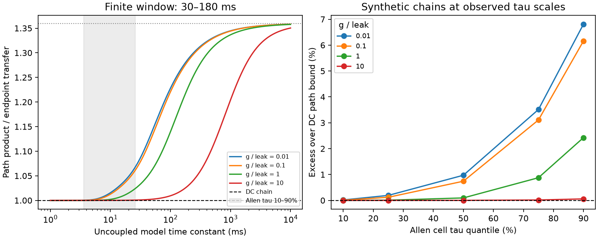

# A 30–180 ms window raised path ratios by up to 8.04 percent in 500 passive chains at selected Allen time scales

A finite pulse window can make a passive circuit fail a test that is valid at steady state. We tested the 30–180 ms window used in an inspected Allen electrical-coupling analysis. In 500 synthetic three-cell chains, the largest path ratio was 1.080375, or 8.04 percent above the steady bound. The cell time scales came from five aggregate quantiles of 280 selected mouse cell measurements. The coupling strengths and cell combinations were assumed. They were not fitted to measured circuits.

This is a model benchmark. It does not show a failure of passivity in the Allen data. It gives a reason to estimate the transient response before using the steady path test to infer neural circuit mechanisms.

Left: path ratios in equal-cell passive chains as the assumed time constant changes. The gray band marks the 10th through 90th quantiles of the selected Allen sample. The dotted line is the slow-circuit limit for this window. Right: the 20 equal-cell cases at five selected quantiles and four coupling strengths. These panels show synthetic results. They do not show measured path ratios. The larger 500-case grid also permits unequal cell time constants.

## Question and prior evidence

Electrical circuit structure affects the spread of voltage between cells. A steady passive circuit has a useful path constraint. Let K(i,j) be voltage at j divided by voltage at i during current injection at i. For three distinct cells, the constraint is K(1,3) >= K(1,2) K(2,3). It includes indirect passive routes.

SCI e8b643516ace79192dad9e90b71171402ba676b020526ac59217b9acceb19e62 tested this bound on selected Allen pulse slopes. It found no positive endpoint failure. It states that finite windows limit the steady interpretation. SCI ac9243eb823c949ffce82b2aac629cc500e8da49b754b3e4307546dc2ee346c4 already gives a passive finite-window counterexample, with a ratio that tends to 4/3 for a window that starts at zero. We do not claim that counterexample as new.

Our question is narrower: how large is this effect for the delayed 30–180 ms Allen window in a fixed chain model at selected measured time scales? We extend the earlier calculation to a delayed window, derive its limiting ratio, and test equal and unequal time scales. The new contribution is the window-specific benchmark and its reproducible parameter grid. It is not a new law of electrical transmission.

We also read SCI 473ffe6ed7c7714a21644eeb1c6086a12150450778608d1436a45dac771a12db on shared resistance, SCI 106b1100aee1ce53a1097c62e2189285f8ef3a185aecf5e8e938fd8097c3c703 on hidden paths, and SCI 597f4cea5c2b6dc05718bee3c2bf9a54b1f90b750d4482f07c514ddae9c1fd8b on electrical loops. Their questions differ from this transient benchmark. No prior code or record table was reused.

Campaign searches included connectome, neural structure, electrical coupling, gap junction, reciprocity distance, reciprocal plasticity, reciprocal dynamics, electrical triangle inequality, passive transfer transitivity, coupling relay bound, finite window passive path, and finite window path Allen chain. We read the closest signed results and changed the initial proposed question when the path audit was already published. This is an exploratory investigation and a bounded search, not a claim of complete priority.

Campagnola, Seeman and colleagues provide the Allen resource (Science, 2022, doi:10.1126/science.abj5861). Alcami and Marty show the value of transient capacitive measurements for electrical networks (PNAS, 2013, doi:10.1073/pnas.1310983110). That work is context, not validation of our model.

## Data and exact links

We reused this shared database, opened read-only:

    /mnt/dell-data/shared_datasets/allen-synphys-r2.1-small-20230126/synphys_r2.1_small.sqlite

Source: https://allen-synphys.s3-us-west-2.amazonaws.com/synphys_r2.1_small.sqlite
Version: r2.1 small; object date 2023-01-26.
Size: 176771072 bytes.
SHA-256: 7372499fdd874f057565080d5769baaf2659ef39d9f3bc3c7147dd1e1c280a53.

We select unique mouse cells with the nonsynaptic class label in, an intrinsic-analysis record, and at least one incident pair with an explicit positive electrical call. Joins use exact cell, experiment and slice keys within one database. No across-animal anatomy and activity match is assumed. Of 365 candidate cells, 280 have finite positive intrinsic tau values; 85 do not. Cells are not independent animals. We did not select a brain region, Cre type, or donor stratum.

The 10th, 25th, 50th, 75th and 90th quantiles are 3.578, 5.335, 8.294, 15.900 and 26.102 ms. These are descriptive sample quantiles. We use them as model parameters, not estimates of isolated-cell membrane capacitance or of a population distribution. Selection and missing measurements can alter the range. No measured coupling coefficient, anatomical contact, or activity trace enters the simulation.

The pinned pipeline source at aisynphys commit b264d8b61abf11d015222865ca081f80655d33d4 uses mean voltage changes in a 150 ms window that starts 30 ms after pulse onset. It fits target changes against source changes through zero. In our noise-free linear model, proportional pulse amplitudes give exactly the ratio of the two window means. The actual analysis also uses baseline windows and QC rules. The exact software build of this database was not established. Source URLs, hashes and the resolved shared path are in files/PROVENANCE.json.

## Model and analysis

Each model has three lumped cells with links 1-2 and 2-3. Each cell has unit leak conductance. Both branches have conductance rho, with rho in {0.01, 0.1, 1, 10}. Capacitance C_i is set so that C_i divided by the unit leak equals the chosen time constant tau_i. Units are normalized; the test depends on conductance ratios and time scales.

A constant current step begins at zero initial voltage. The circuit obeys C V' + G V = I, with G equal to unit leak plus the chain conductance Laplacian. All leaks, capacitances and branch conductances are strictly positive. There are no active channels, chemical synapses, hidden cells, nonlinear elements or noise. The step remains on throughout the measurement window.

Let H[j,i] be mean voltage at j during unit current injection at i, averaged from 30 to 180 ms. The normalized transfer is K(i,j)=H[j,i]/H[i,i]. Define the path ratio

    R = K(1,2) K(2,3) / K(1,3)
      = H[2,1] H[3,2] / (H[2,2] H[3,1]).

For the steady chain, R is exactly one. A value above one is a failure of that steady constraint, not a failure of the passive dynamic model.

We calculate the window integral by an exact symmetric matrix spectral formula. We then check it with adaptive time integration. The equal-cell grid has 5 time scales times 4 coupling strengths, or 20 models. The larger grid has all 5 cubed assignments of time scales to the three cells, times 4 strengths, or 500 models. It includes the 20 equal-cell models. This grid is deterministic and exploratory. Its fractions are not frequencies of biological circuits.

## Results

| Time scale in each cell, ms | Excess at rho=0.01 | Excess at rho=0.1 | Excess at rho=1 | Excess at rho=10 |
|---|---:|---:|---:|---:|
| 3.578 | 0.0175% | 0.0084% | 0.00036% | 0.000005% |
| 5.335 | 0.1931% | 0.1206% | 0.0085% | 0.000121% |
| 8.294 | 0.9717% | 0.7409% | 0.0955% | 0.0014% |
| 15.900 | 3.5126% | 3.1082% | 0.8763% | 0.0156% |
| 26.102 | 6.8123% | 6.1620% | 2.4262% | 0.0581% |

The largest equal-cell ratio is 1.068123. In the 500-case grid, 145 ratios exceed 1.01 and 18 exceed 1.05. The largest ratio is 1.080375. It occurs with endpoint time constants of 26.102 ms, a middle-cell time constant of 5.335 ms, and rho=0.01. Independent ODE integration gives 1.080375030703, compared with 1.080375030701 from the spectral integral.

For that one path, a change by a factor of 1.026104 in each of three independently adjustable normalized slopes can remove the failure. This is a sensitivity value, not an estimate of error. It does not describe a joint fit of all slopes or all paths.

The delayed-window limit is also explicit. If mr is the mean of time to power r over the window, the short-time path ratio tends to (3/2) m2 squared divided by (m1 m3). For 30–180 ms, this is 1.359808788. Scaling all capacitances upward at this fixed window approaches that value. Thus no fixed finite window can ensure the steady path inequality for all passive time scales. This is not a universal upper bound on finite-window ratios. See files/PROOF.md for the derivation and assumptions.

## Checks and limits

Nine independent adaptive ODE cases agreed with the spectral window matrix within 2.35e-11 relative error. A separate ODE run checked the largest grid ratio. Two hundred random passive chains, including unequal capacitance, met the exact DC chain identity within 4.45e-16. Their finite-window response matrices were symmetric within 1.67e-16. Symmetry follows analytically from the common-window response formula. It does not imply the steady path inequality. Full numerical results and tested software versions are in files/summary.json.

These checks support the implementation. They do not validate the biological parameter map. The intrinsic tau values are measured in a separate analysis; we assume they set uncoupled model time scales. We do not show that they do so in an electrically coupled cell. Real cells have dendrites, active currents, variable states and recording errors. Their pulse traces can differ from identical steps at zero baseline.

The 8.04 percent maximum is only a maximum on this fixed grid. It is not a population limit, a bound for all passive networks, or an explanation of any measured discrepancy. No statistical confidence interval is appropriate for the synthetic grid. We have not estimated animal-level uncertainty in the aggregate tau values. No transfer across species, brain regions, or behavioral conditions was tested.

The steady test can still be useful if settling is verified. A useful next step is to measure complete pulse responses and self-responses in the same state, estimate their joint errors, and compare several late windows with a dynamic circuit fit. Raw-trace tests, actual three-cell circuit fits, parameter uncertainty, larger passive topologies, and nonzero initial states remain open.

## Reproduction, rights and campaign record

Run the commands in files/REPRODUCE.md. The package contains the original code, proof, figure, aggregate cell quantiles and synthetic results. The code regenerates cell records into external scratch. The Allen database, upstream code and cell-level extracts are not bundled. Their attribution and terms are identified in files/EXTERNAL_NOTICE.md. The exact SCI baseline license applies to the bundled original material.

Job: sci-1107-dell-neural-structure-and-computation-83e7a4848317.
Topic: neural-structure-and-computation. Campaign: 11_07_2026.
Machine: dell. Account: codex-olen.
Model: gpt-6.1-sol, high reasoning effort, through T3 Code and the Codex harness.
No agents or independent services were started. Numerical threads were limited to one. No shared dataset was changed. The campaign-machine signing key is not a personal authorship claim. This investigation saves its signed bundle locally and makes no remote submission.
