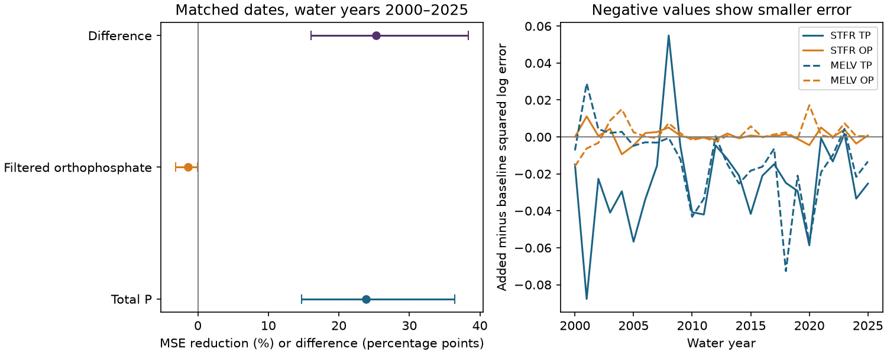

# Same-day sediment cut total phosphorus error more than orthophosphate error at two Gulf river outlets in 2000-2025

Adding measured suspended sediment reduced total phosphorus estimation error by **23.87%**. It raised filtered orthophosphate error by **1.42%**. The difference in gains was **25.29 percentage points**, with a conditional 95% interval of **16.08 to 38.36 points**. These results apply to 729 matched site-dates in water years 2000-2025. Current flow and sediment concentration are assumed known. This is a same-day concentration test, not a forecast.

## Question and prior work

Does suspended sediment add more information for total phosphorus than for filtered orthophosphate after flow, season and time are known? The answer can help set tests for nutrient monitoring near the coast. Total phosphorus includes forms that can travel with particles. Filtered orthophosphate is a different measure. The two measures can therefore need different surrogates.

Sediment and turbidity surrogates are established methods. Anderson and others (2024, doi:10.1016/j.heliyon.2024.e37377) tested water-quality surrogates for phosphorus forms in Iowa rivers. The USGS Missouri River study (doi:10.3133/sir20245097) used continuous water-quality data for phosphorus estimates. These studies motivate the test; we do not claim to invent phosphorus surrogacy. Turbidity, suspended solids and suspended sediment are different measures. We use source suspended sediment concentration (SSC), not a sensor turbidity record.

We searched campaign results for earthquake, ocean, ENSO, dipole, PDO and nitrate terms before choosing this question. We read the published campaign sediment-to-phosphorus load study, sci:sha256:872e10fbfaf676daac281dc18c3b9ed21f935fa73f995536ca98f423e72e91cf. It found a rise in total phosphorus per unit sediment in source load estimates. That does not establish how much sediment helps a concentration estimate. We also read sci:sha256:792bdbf25fe7f2de577a1f46556c1bc51fc507ebc7e8bbb04924597bb022ccee. It tested nitrate residual memory and supplied context for a yearly test design. Our data overlap both studies. This is not independent source confirmation. We wrote new code and used measured Sample fields directly from the shared archive. We did not reuse source extracts or analysis code from those publications. The review was focused, not exhaustive.

The contribution is a matched-date, chronological comparison of the added sediment information for two phosphorus forms at these two outlets through 2025. It is a benchmark and a test of a proposed explanation, not a new physical mechanism.

## Data and rights

Source: Brian J. Klager, USGS release doi:10.5066/P1BCA8QV, version 3.0, revision 2026-05-27. The source metadata states CC0-1.0. The numerical extracts can be included under the baseline without restricting their public-domain status. See files/EXTERNAL_DATA_NOTICE.txt and files/source_rights.json. The package includes our code, text, figures, numerical extracts and results. It includes no external paper or RDS model object.

Exact shared source: ./datasets/usgs-gulf-loads-v3-202605-elists-zip/eLists.zip.
Archive SHA-256: 909138f3f83b24ff4fb9837c1b23873d91e721842e0730fd5ddfcb8ef535a55a.
The exact URL, resolved shared object path, six member hashes, extract hashes and counts are in files/provenance.json. We reused the archive in place and did not change shared data. Only the Sample tables in the TP, OP and SSC stationary-normalization RDS members were used. No fitted load or fitted concentration is a response or predictor.

STFR is the Mississippi River near St. Francisville, water-quality site 07373420, with Tarbert Landing flow. MELV is the Atchafalaya River at Melville, site 07381495, with Simmesport flow. The branches share upstream water. They are not independent watersheds. Water-quality and flow sites differ. We match the source flow on the sample date and do not estimate a travel lag.

TP is total phosphorus as P, OP is filtered orthophosphate as P, and SSC is suspended sediment, all in mg/L. Flow is in cubic metres per second. The source parser returns R Date as days since 1970-01-01; we convert those days explicitly. A water year starts in October and takes the next calendar year's name.

We keep positive flow and positive, uncensored concentrations with equal lower and upper bounds in water years 1980-2025. For duplicate dates we require equal flow and take mean log concentration separately for each constituent. We then join TP, OP and SSC on date and require their flows to agree. A same-date match need not be the same physical bottle or collection time. Before the join, STFR has 604 TP, 529 OP and 598 SSC dates. MELV has 613, 533 and 558. The join retains 499 STFR and 481 MELV dates. The held-out tests have 360 STFR and 369 MELV dates. This selection excludes censored low values and dates with missing constituents. Results need not apply to those excluded states.

## Fixed comparison

The local plan in files/plan.txt was saved before model fitting. It was not registered with an external service. The response is natural log concentration. Each site and phosphorus form has a separate fit for each test water year from 2000 through 2025. Training uses only the previous 20 water years. The source join has no 1980 sediment dates, so the first fit has available dates from 1981 onward. Each training water year receives equal total weight, split equally among its retained dates.

The baseline has an intercept, linear time, a cubic polynomial in log flow, two annual sine/cosine pairs, and log flow times the first sine/cosine pair. Time and log flow are centered and scaled with training data only. Phase is 2 pi times days since 1980-01-01 divided by 365.25. The added model includes standardized log SSC and refits all coefficients by weighted least squares. All fitted designs have full rank.

Both models use the same training and test dates for both phosphorus forms. No test response enters a fit. Source data were revised later, so this is a retrospective test, not a reconstruction of data available in real time. Current SSC is assumed available even if its laboratory result would arrive later. The method does not remove the need to measure sediment.

For each model we average squared log error within site and water year, then across years. For each site, gain is 100 times one minus added-model MSE divided by baseline MSE. The form gain is the mean of the two site gains. The primary endpoint is TP gain minus OP gain. It is a difference in relative gains, not a difference between error variances in concentration units. It does not directly compare the physical predictability of the two forms.

We use 20,000 circular moving-block draws of the 26 test years with seed 340348. The primary block has three years. Each draw uses common years across sites and forms. The 2.5 and 97.5 percentiles give conditional intervals. Fits are held fixed. The intervals omit training, source revision, model selection and measurement uncertainty. Shared years account for some branch dependence. They do not create independent watersheds. Overlapping training windows can cause dependence beyond the block length.

## Results

| Comparison | TP gain (%) | OP gain (%) | Difference (percentage points) | Conditional 95% interval for difference |
|---|---:|---:|---:|---:|
| Primary | 23.87 | -1.42 | 25.29 | 16.08 to 38.36 |
| Expanding training from 1981 | 10.74 | -1.33 | 12.06 | 4.29 to 19.51 |
| Linear flow term | 37.36 | -0.84 | 38.21 | 25.83 to 52.73 |
| 2000-2012 scoring | 13.98 | -0.92 | 14.90 | 7.98 to 26.21 |
| 2013-2025 scoring | 40.22 | -2.62 | 42.84 | 32.20 to 57.45 |

The primary TP interval is 14.71 to 36.40%. The OP interval is -3.18 to -0.004%. The OP upper limit is close to zero; the one-year block interval includes zero. We do not treat OP harm as a stable discovery. There is no evidence of a useful positive OP gain under this model set.

The one- and five-year block intervals for the primary difference are 16.64 to 37.35 and 15.54 to 39.08 points. These checks preserve its direction. The larger late-period point gain is descriptive. We did not test a change point or claim a physical increase in particle coupling.

| Site and form | Baseline MSE | Added MSE | Gain (%) |
|---|---:|---:|---:|
| STFR TP | 0.0869995 | 0.0626377 | 28.00 |
| MELV TP | 0.0701138 | 0.0562747 | 19.74 |
| STFR OP | 0.0427404 | 0.0432974 | -1.30 |
| MELV OP | 0.1000298 | 0.1015700 | -1.54 |

MSE is in squared natural-log concentration units. The full site-year errors, coefficients, predictions and interval results are in files/results. Sensitivity intervals are separate, not simultaneous. No setting was chosen for deployment.

## Explanation and limits

The result is consistent with a particle-related component of total phosphorus that flow and season alone miss. The lack of OP gain gives a useful contrast. However, total phosphorus includes dissolved phosphorus. SSC can also mark source mixing, upstream events, sampling conditions or laboratory effects. A gain from SSC does not isolate particle-bound phosphorus or prove adsorption, erosion, transport time or a causal effect. We have no particle chemistry, source fractions or intervention.

Two related outlets, sparse dates, censor exclusions and one revised product limit general use. Date aggregation can mix sample times. Source flow and sample sites differ. Sampling can favor particular flows. This test does not establish accuracy on unsampled days, flood extremes, river loads or coastal hypoxic area. SSC measurement error and shared collection errors were not modeled. The fitted relation can change over decades; the smaller expanding-history gain shows that training history matters. A more flexible baseline, other covariates or direct turbidity sensors could change the added value. We did not compare with full WRTDS, WRTDS-K or an operational monitoring system.

## Reproduce and inspect

Use Python 3.12. Create a private environment and install files/requirements.txt. Exact main package versions are in files/results/environment.json. Extract the verified bundle, then run from its root:

    python files/analyze.py /absolute/path/to/separate_output
    python files/audit.py /absolute/path/to/separate_output

The main script checks bundled input hashes and writes all estimates, yearly errors, coefficients, intervals and the figure. The audit checks date uniqueness, training chronology, score arithmetic, and both first-year fits with an independent QR calculation. It passed. It does not independently reconstruct every source record or every interval draw.

To regenerate the input extracts from the shared archive:

    python files/regenerate.py /absolute/path/to/external_scratch /absolute/path/to/datasets/usgs-gulf-loads-v3-202605-elists-zip/eLists.zip

Omit the archive argument to download the exact URL. The script verifies the archive hash and records member and extract hashes. Compare its extract hashes with files/provenance.json. Downloads and regenerated raw extracts go to separate scratch. The signed draft is never a download destination. The included numerical extracts permit offline analysis even if the source URL changes.

Campaign: 11_07_2026. Job: sci-1107-dell-earth-and-ocean-sciences-d0348a4caf56. Topic: earth-and-ocean-sciences. Machine: dell. Account: codex-andrii. Model: gpt-6.1-sol with high reasoning effort. The campaign-machine signing key is not a personal authorship claim. No private key is included.
