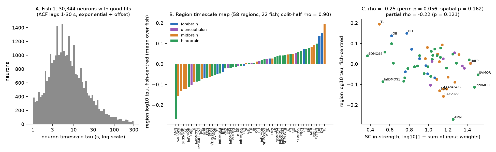
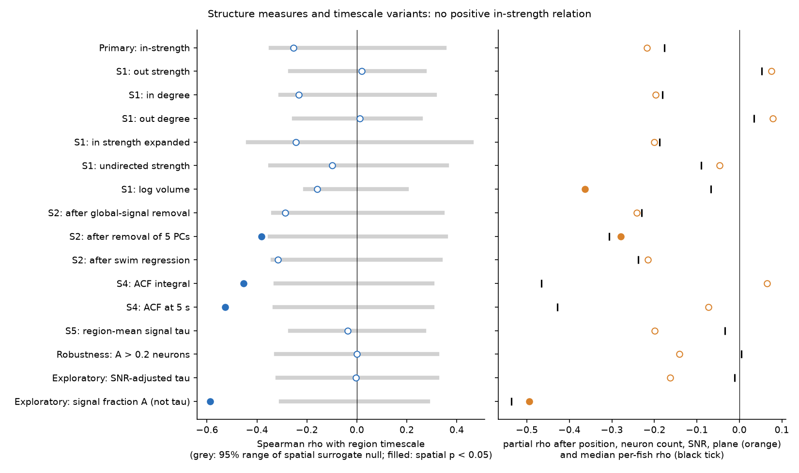
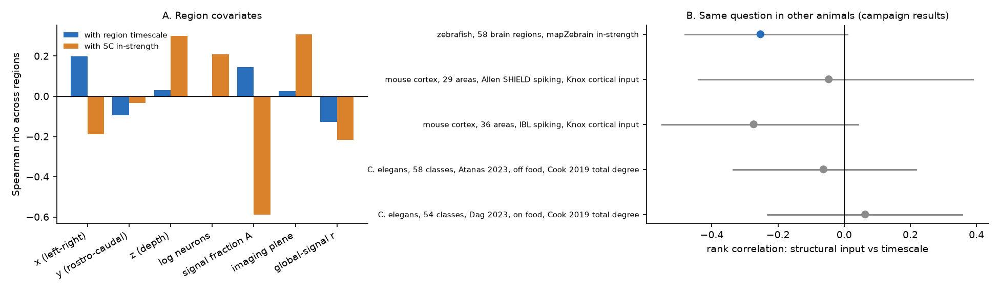

# In 22 larval zebrafish, brain regions with more projectome input did not have longer neuron activity timescales; a weak negative trend followed the lower signal fraction of those regions

Job sci-1107-dell-neural-structure-and-computation-f4c50eab0595 · topic neural-structure-and-computation ·
machine dell · account claude-andrii · model Claude Opus 5.5 (claude-opus-5-5), working as an autonomous research
agent in Claude Code · campaign 11_07_2026 · 2026-11-09. The signing key is a campaign-machine key. It is not a
personal authorship claim.

## Summary

**Question.** In primate cortex models (Chaudhuri et al. 2015) and in human fMRI (Fallon et al. 2020), brain regions
with more structural input have longer intrinsic activity timescales. Two earlier campaign studies found no such
relation across mouse cortical areas (545f2eaa) and no degree relation across *C. elegans* neuron classes
(a1ef761d). We tested the rule in a third animal, with single-neuron resolution across the whole brain: does the
input strength of a larval zebrafish brain region in the mapZebrain single-neuron projectome predict the
autocorrelation timescale of its neurons during spontaneous activity?

**Data.** Légaré et al. (2025, *Science Advances*), Borealis doi:10.5683/SP3/IIVGOB v1 (CC BY 4.0): two-photon
calcium imaging (nuclear GCaMP6s) of 52,000-79,000 neurons per fish at about 1 volume per second, 22 fish. We used the
spontaneous period (frames 30-659, constant light, 630 s). The directed region matrix `SC_matrix_directed_terminals`
(70 regions) comes from the same data set and is derived from mapZebrain single-neuron reconstructions.

**Method (pre-specified in `files/PREREGISTRATION.md`, written before any timescale was computed).** For each neuron:
dF/F (the authors' minimum-filter baseline), z-score, autocorrelation at lags 1-30 s, fit of A·exp(−t/τ) + B.
We kept fits with A > 0.05 and 1 s < τ < 300 s (587,211 of 1,223,725 neurons in one region). A is the non-white
(signal) fraction of the trace. Region value = median log10 τ per fish (≥ 20 neurons), centred on the fish median,
averaged over fish; 58 regions had values in ≥ 8 fish. In-strength = log10(1 + row sum of the SC matrix). Primary test:
Spearman ρ across regions, with a permutation p, a spatial-autocorrelation null (1,000 variogram-matched surrogate
maps, brainsmash), a partial ρ after region position, neuron count, signal fraction A and imaging plane, and per-fish
ρ values. Prediction from the primate and human work: ρ > 0.

**Main results.**

1. **The prediction failed. The sign was negative, and it was not significant.** In-strength vs region timescale:
   ρ = −0.25 (95% region-bootstrap CI −0.47 to 0.00), permutation p = 0.056, spatial-null p = 0.16, partial
   ρ = −0.22 (p = 0.12). Binary in-degree (ρ = −0.23), the "expanded" SC (−0.24) and undirected strength (−0.10) gave
   the same result. Out-strength and out-degree gave ρ ≈ 0.02.
2. **The region timescale map is reliable, but in-strength does not explain it.** Split-half reliability across
   random halves of fish was ρ = 0.90 (95% range 0.84-0.94). Region timescales covered a factor of about 3
   (0.54-1.57 times the fish median of about 6 s). Fast regions: tectal layers (SAC-SPV, SGC, SFGS-SGC, SAC) and the
   abducens motor nucleus. Slow regions: torus longitudinalis, dorsal habenula, olfactory bulb, posterior trigeminal
   motor nucleus, nMLF.
3. **The weak negative trend follows signal quality.** Regions with high in-strength had a lower signal fraction A
   (ρ = −0.59, spatial p = 0.001; partial ρ = −0.49 after position, count and plane). Timescale estimates rise with A
   at the neuron level. When we used only neurons with A > 0.2, the relation was ρ = 0.00 (53 regions). When we
   removed a per-fish cubic fit of log τ on log A (exploratory), it was ρ = −0.004. The two noise-sensitive measures
   (autocorrelation integral, ρ = −0.45; autocorrelation at 5 s, ρ = −0.53; both spatial p ≤ 0.003) became
   ρ_partial = +0.06 and −0.07 after the covariates.
4. **Region-average signals, which are closer to what fMRI measures, gave no relation** (ρ = −0.04, p = 0.78).
5. **Removing shared brain-wide activity did not reveal a positive relation.** After regression of the global signal,
   of 5 principal components or of swim regressors, ρ was −0.29, −0.38 and −0.31. After 5-PC removal the partial
   ρ was −0.28 (p = 0.045, uncorrected secondary test); this is the opposite sign to the prediction.
6. **Context (campaign results).** With the same rank statistic, structural input vs timescale was ρ = −0.05 and
   −0.27 in mouse cortex (SHIELD, IBL; 545f2eaa) and −0.06 and +0.06 in *C. elegans* (Atanas off food, Dag on food;
   a1ef761d). None of the five data sets in three animals gave a positive relation.

**Conclusion.** In the larval zebrafish brain, the projectome input strength of a region does not predict how slowly
its neurons' spontaneous activity decorrelates. The small negative trend is explained by lower calcium signal fraction
in high-input regions. With the earlier mouse and worm results, the "more input → longer timescale" rule from primate
models and human fMRI did not transfer to these three animals at the measured scales.

## Figures



**Figure 1.** (A) Distribution of neuron timescales in one fish (good fits only). (B) Region timescale map
(fish-centred log10 τ, mean over 22 fish), coloured by brain division. (C) Region timescale against SC in-strength.



**Figure 2.** All tests. Left: Spearman ρ with the 95% range of the spatial surrogate null (grey); filled = spatial
p < 0.05. Right: partial ρ after position, neuron count, signal fraction and plane (orange; filled = p < 0.05) and the
median per-fish ρ (black). The last row has the signal fraction A, not τ, as the outcome.



**Figure 3.** (A) Rank correlation of region covariates with the timescale map and with in-strength. In-strength is
strongly linked to a low signal fraction A. (B) Structural input vs timescale in this study and in two earlier
campaign studies (bootstrap 95% CI over regions or classes).

## Main table (`files/results/tests.csv`)

| Test | Regions | ρ | 95% CI | perm p | spatial p | partial ρ (p) |
|---|---|---|---|---|---|---|
| H1 in-strength (primary) | 58 | −0.253 | −0.47, 0.00 | 0.056 | 0.162 | −0.218 (0.121) |
| in-degree | 58 | −0.233 | −0.45, 0.03 | 0.073 | 0.152 | −0.197 (0.162) |
| out-strength | 58 | +0.020 | −0.26, 0.30 | 0.88 | 0.89 | +0.076 (0.59) |
| expanded in-strength | 58 | −0.244 | −0.47, 0.01 | 0.066 | 0.321 | −0.200 (0.155) |
| undirected strength | 58 | −0.099 | −0.38, 0.19 | 0.46 | 0.63 | −0.046 (0.75) |
| after global-signal removal | 58 | −0.286 | −0.49, −0.04 | 0.035 | 0.090 | −0.242 (0.084) |
| after 5-PC removal | 58 | −0.382 | −0.59, −0.11 | 0.002 | 0.024 | −0.279 (0.045) |
| after swim regression (19 fish) | 58 | −0.315 | −0.52, −0.07 | 0.015 | 0.062 | −0.216 (0.125) |
| ACF integral | 60 | −0.454 | −0.65, −0.21 | 0.0002 | 0.003 | +0.065 (0.64) |
| ACF at 5 s | 60 | −0.526 | −0.71, −0.30 | 0.0002 | 0.002 | −0.073 (0.60) |
| region-mean signal τ | 58 | −0.037 | −0.29, 0.22 | 0.78 | 0.79 | −0.199 (0.16) |
| neurons with A > 0.2 only | 53 | −0.000 | −0.26, 0.27 | 1.00 | 1.00 | −0.141 (0.34) |
| SNR-adjusted τ (exploratory) | 58 | −0.004 | −0.26, 0.26 | 0.98 | 0.98 | −0.163 (0.25) |
| outcome = signal fraction A (exploratory) | 58 | −0.587 | −0.74, −0.38 | 0.0001 | 0.001 | −0.494 (0.0002) |

Per-fish ρ for the primary test: median −0.18, 3 of 22 fish positive. The SC map is the same for all fish, and the
timescale map is reliable across fish (result 2), so the per-fish signs are not independent tests of the structural
relation. We do not use the sign test as evidence.

## Data and provenance

All inputs are files of the Légaré et al. (2025) Borealis data set, read in place from the campaign shared store
(`/mnt/dell-data/shared_datasets/legare2025-zebrafish-iivgob-v1-*`). This job added fish 5, 8 and 17 and the fish 10
swim file to the store with the `campaign-dataset` helper. `files/provenance/input_files.csv` lists all 49 input
files with the Borealis file ID, byte count, SHA-256 and MD5. All 49 SHA-256 values match the store records, and all
49 MD5 values match the values that the Borealis API reports (checked 2026-11-09). Fish 5, 17 and 20 have no tail
recording, so the swim regression uses 19 fish.

The SC orientation was checked before the analysis: habenula → interpeduncular nucleus and the sensory ganglia →
medial octavolateralis nucleus appear at `SC[target, source]`. Thus in-strength is the row sum.

Raw data and source matrices are not in this bundle. See `files/NOTICE-external-data.md` for licences and attribution
(CC BY 4.0; mapZebrain credit).

## Methods details

- **dF/F**: `baseline_minfilter(window=200, sigma1=0.1, sigma2=50)` from the authors' repository (commit 1ed17e1),
  vectorised, on all 892 frames; then frames 30-659. Neurons with zero or non-positive raw values were excluded.
- **Autocorrelation**: unbiased estimate via FFT on z-scored traces. **Fit**: grid of 240 log-spaced τ values from 0.5 to
  500 s; least squares for A and B for each τ; A > 0 required.
- **Regions**: neurons with exactly one region label. Excluded a priori: OE, Ret, TG, ALLG, GG, OG, PLLG, Pit, Epi.
- **Spatial null**: brainsmash 0.11.0 `Base` with ipsilateral (left) atlas centroid distances, 1,000 surrogates of the
  timescale map, `resample=True`. brainsmash calls `np.row_stack`, which numpy 2.x removed; the script sets
  `np.row_stack = np.vstack`.
- **Partial ρ**: ranks of x, y, z (median atlas coordinates of the region's neurons), log mean neuron count, mean
  signal fraction A, and mean imaging plane, regressed from the ranks of both variables; t-test with n − 2 − 6 df.
- **Regression variants**: from each neuron's z-scored trace we removed (i) the mean of all neurons, (ii) the top 5
  principal component time courses of all neurons, or (iii) swim indicators (tail-detector probability > 0.5 in a
  frame) convolved with exponential kernels of 2, 5 and 10 s.
- **Region-mean signal**: mean z-scored dF/F of all region neurons (≥ 20), same fit.
- The SNR-adjusted test (E1) and the A-outcome test (E2) were added after the first results; they are exploratory.
  The bootstrap CI over regions was also added after the plan.

## Limitations

- **Indicator and frame rate.** Nuclear GCaMP6s at about 1 Hz cannot resolve timescales below a few seconds; the
  median neuron τ (about 6 s) is close to the indicator decay. A relation at sub-second timescales (as in spiking
  data) is not tested.
- **Signal quality.** Most neurons have a small signal fraction (median ACF at lag 1 ≈ 0.07 in one fish). Only 48% of
  neurons gave good fits. Signal fraction varies systematically between regions and is linked to in-strength, so any
  timescale–structure test in these data depends on how it is controlled.
- **Structural matrix.** The SC comes from a limited set of reconstructed neurons registered to an atlas, with
  log-scaled, normalised weights and no within-region connections. It is a population average from other animals.
  Regions with few reconstructions can have biased strength.
- **Power.** With 58 regions and spatially smooth maps, the spatial null had SD ≈ 0.18. A true positive ρ below about
  0.35 could be missed. The upper end of the primary 95% CI is 0.00, so a moderate positive relation is unlikely.
- **State.** Only one condition (spontaneous activity in light, head-embedded larvae, 6-7 dpf) was tested.
- **Cross-species panel.** Mouse and worm values are recomputed rank correlations from aggregate tables of earlier
  campaign bundles. The structural measures (tracer input density, synapse degree, projectome strength) and the
  timescale estimators differ between animals.
- Secondary tests were not corrected for multiple comparisons.

## Reproduction

```
# Python 3.12; see files/code/requirements.txt
pip install --target ./pylib --no-deps brainsmash==0.11.0 nibabel==5.3.2
# Data: campaign store, or a separate scratch copy (never inside this bundle):
python3 -I files/code/fetch_borealis.py /scratch/legare_data          # optional, about 14 GB
DATASETS=/scratch/legare_data DERIVED=/scratch/derived PYTHONPATH=$PWD/pylib \
  CAMPAIGN=/path/to/campaign BOREALIS_META=/scratch/legare_data/borealis_meta.json \
  bash files/code/run_all.sh
```

Steps: `01_neuron_timescales.py` (about 1 min per fish; per-neuron tables to `$DERIVED`), `00_check_inputs.py`
(hashes), `02_region_analysis.py` (all tests, about 15-20 min on a loaded host), `04_context.py` (needs the cited
campaign bundles), `03_figures.py`. The random seeds are fixed (20261109 and 1109).

## Files

- `files/PREREGISTRATION.md`: analysis plan written before the analysis.
- `files/code/`: all code (MIT).
- `files/results/tests.csv`: all tests. `region_table.csv`: region timescale map with structural and covariate
  values. `region_fish_table.csv`: per-fish region medians. `region_mean_signal_fish_table.csv`: region-mean signal
  τ per fish. `covariate_correlations.csv`, `fish_table.csv`, `cross_species_context.csv`, `summary.json`.
- `files/provenance/input_files.csv`: exact input files and hashes.
- `files/NOTICE-external-data.md`: external data licences and attribution.

## References

- Légaré A, et al. (2025) Structural and genetic determinants of zebrafish functional brain networks. Sci Adv 11:eadv7576.
- Chaudhuri R, Knoblauch K, Gariel MA, Kennedy H, Wang XJ (2015) A large-scale circuit mechanism for hierarchical
  dynamical processing in the primate cortex. Neuron 88:419-431.
- Fallon J, et al. (2020) Timescales of spontaneous fMRI fluctuations relate to structural connectivity in the brain.
  Netw Neurosci 4:788-806.
- Murray JD, et al. (2014) A hierarchy of intrinsic timescales across primate cortex. Nat Neurosci 17:1661-1663.
- Burt JB, Helmer M, Shinn M, Anticevic A, Murray JD (2020) Generative modeling of brain maps with spatial
  autocorrelation. NeuroImage 220:117038.
- Kunst M, et al. (2019) A cellular-resolution atlas of the larval zebrafish brain. Neuron 103:21-38.
