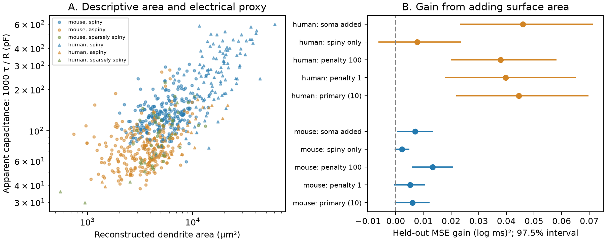

# Dendrite area improved response-time predictions in 158 selected Allen human cells

## Result

mouse: 509 cells from 372 donors; squared log error fell from 0.08450 to 0.07843. Gain was 0.00607, with a 97.5% donor interval of -0.00037 to 0.01227. The relative gain was 7.18%. human: 158 cells from 35 donors; squared log error fell from 0.16986 to 0.12532. Gain was 0.04454, with a 97.5% donor interval of 0.02185 to 0.06977. The relative gain was 26.22%. RMSE uses natural log milliseconds. MSE is squared log error. Positive gain means that the area model has lower error. The intervals are conditional on the fitted models. They account for donor sampling, but not model training uncertainty or the choice of research question.



| Species | Cells | Donors | Base RMSE | Area RMSE | MSE gain | 97.5% interval | Relative gain |
|---|---:|---:|---:|---:|---:|---|---:|
| mouse | 509 | 372 | 0.2907 | 0.2801 | 0.00607 | -0.00037, 0.01227 | 7.18% |
| human | 158 | 35 | 0.4121 | 0.3540 | 0.04454 | 0.02185, 0.06977 | 26.22% |

## Question and prior work

Can a measured dendrite tree help predict the time over which a neuron integrates current? In a compact passive cell, the response time is input resistance times capacitance. If specific capacitance is fixed, capacitance scales with membrane area. This gives a reason to test dendrite area after input resistance is known. A real dendrite tree is a cable with spatial voltage gradients. A fitted somatic response time need not equal input resistance times total membrane capacitance. Thus, this study tests a practical prediction rule. It does not use the compact-cell formula to estimate specific capacitance.

The Allen Cell Types Database links morphology and physiology in the same cells. Gouwens and colleagues (2019, doi:10.1038/s41593-019-0417-0) studied joint electrical and morphological cell classes. Eyal and colleagues (2016, doi:10.7554/eLife.16553) used detailed models and direct patch measurements to study specific capacitance in a small human and mouse sample. Our study instead tests the added predictive value of one structural measure with donor separation and explicit label controls. This is a reanalysis benchmark, not the first evidence that morphology and physiology are related.

Before fixing the question, we searched the local campaign for connectivity, spine, morphology, and dendritic results. We read the verified campaign publication sha256:0c2867f8d195910c320574c3d279fe73104ed60039b61b003aca110f6c223111. Its model sensitivity motivated fixed primary shrinkage and a report of alternate penalties. It used synaptic slice measurements, not these cell reconstructions. No code or numerical results were reused. The shared cache README also identifies an older study of specific capacitance. Its full text was not reviewed and we make no novelty claim against it. The plan in `files/analysis_plan.txt` was written before computing morphology-outcome associations. This is an exploratory analysis, not a registered experiment.

## Data and geometry

We reused `/mnt/dell-data/shared_datasets/allen_cell_types/v2026-10-28` in place. The API cache was made on 2026-10-28. The API has no fixed release identifier. `files/provenance.json` gives the exact absolute path, byte count, and SHA-256 of every input file read: the specimen metadata, upstream README, and 667 SWC files. No activity traces or other store files were used. Source: Allen Institute for Brain Science (2015), Allen Cell Types Database, https://celltypes.brain-map.org/.

There are 2,333 specimen rows and 667 available reconstructions. All 667 have positive finite area, input resistance, and response time and enter the analysis. Donor IDs come directly from `donor__id`. They are not inferred from experiment names. The analysis uses `ef__ri` in MOhm and `ef__tau` in milliseconds. The source README distinguishes `ri` from the separate QC input resistance field. The Allen SDK defines the response time from an exponential fit to hyperpolarizing responses. These are source summary features; we did not refit voltage traces.

For each SWC segment with both endpoints of type 3 or 4, let L be its three-dimensional length and r0 and r1 its endpoint radii, in micrometres. We sum lateral frustum area pi*(r0+r1)*sqrt(L*L+(r1-r0)^2). We exclude axon segments, end caps, and soma-to-dendrite segments. We do not add spine area or correct for tissue shrinkage. This makes the measure reproducible but omits some membrane. A sensitivity test adds the surface area of a sphere whose radius is the median type-1 radius. It is an approximate soma correction. All missing-parent counts and derived geometry are in `files/cell_features.csv`.

## Prediction and uncertainty

We fit each species separately. The outcome is natural log response time. The base ridge model has an intercept, log input resistance, and indicators for dendrite class, layer, parent region, reconstruction type, and sex. Mouse models also include Cre line. The area model adds log dendrite area. Each training set defines its own label levels. The first level is the reference. An unseen test label has zero indicators. Continuous variables use training-set mean and standard deviation. Indicators stay unscaled. The intercept has no penalty. The primary ridge penalty is 10 on the weighted sum of squared training errors, with training weights normalized to the training cell count. Each donor has equal total training weight.

For each seed from 20261108 to 20261112, we randomly split donors into five folds. All cells of one donor stay in one fold. Every cell receives one held-out prediction in each split. We average its five squared errors, then average cells within each donor, then average donors. Thus, donors with many cells do not dominate the test score. The saved average predictions need not have exactly the same squared error as the average of the five errors. Both are supplied in `files/heldout_predictions.csv`.

For uncertainty, we resample donor error differences 10,000 times, with seed 877. We use the 1.25 and 98.75 percentiles. The 97.5% interval gives a nominal Bonferroni rule for two primary species tests. It is a conditional interval: the fitted predictions stay fixed. Overlapping training sets, finite donor counts, and model selection can limit its coverage. It is not a full bootstrap of the training procedure. Sensitivity intervals use the same width for description; they do not correct for all sensitivity comparisons.

## Sensitivity results

- mouse, penalty_sensitivity, penalty 1: 6.27% gain; absolute gain 0.00517, interval [-0.00054, 0.01067]; 509 cells and 372 donors.
- mouse, penalty_sensitivity, penalty 100: 12.19% gain; absolute gain 0.01331, interval [0.00584, 0.02072]; 509 cells and 372 donors.
- mouse, spiny_only, penalty 10: 4.17% gain; absolute gain 0.00223, interval [-0.00044, 0.00500]; 234 cells and 173 donors.
- mouse, soma_added, penalty 10: 8.29% gain; absolute gain 0.00701, interval [0.00045, 0.01359]; 509 cells and 372 donors.
- human, penalty_sensitivity, penalty 1: 24.41% gain; absolute gain 0.03974, interval [0.01777, 0.06506]; 158 cells and 35 donors.
- human, penalty_sensitivity, penalty 100: 16.19% gain; absolute gain 0.03795, interval [0.01993, 0.05822]; 158 cells and 35 donors.
- human, spiny_only, penalty 10: 6.12% gain; absolute gain 0.00779, interval [-0.00627, 0.02363]; 111 cells and 31 donors.
- human, soma_added, penalty 10: 27.09% gain; absolute gain 0.04601, interval [0.02320, 0.07127]; 158 cells and 35 donors.

The human primary gain remains positive across the tested penalties, but the spiny-only interval includes zero in each species. The human result therefore does not establish a rule within spiny neurons. The mouse primary interval includes zero, while larger shrinkage and the approximate soma correction give positive sensitivity intervals. This model dependence limits the mouse result. These tests reuse the same source sample. They are not independent replication. Separate species tests do not test a species difference. We did not train on one species and validate on the other, or test transfer across behavioral states.

## Limits and use

A gain from area shows useful structural information in the tested prediction model. It cannot show that extra membrane caused a longer response. Cell identity, ion channel expression, tissue quality, recording conditions, and dendrite damage can affect both measures. The additive labels do not fully control cell type. Ridge shrinkage can leave residual label information for area to capture. Radius estimates have large effects on surface area. Cut arbors and missing spines mean reconstructed area differs from living membrane area. Human tissue comes from selected clinical donors. These cells are not a random sample of either species or all brain regions.

The ratio 1000*tau/ri in the figure has units of pF. We call it apparent capacitance only as a descriptive proxy. It is mathematically derived from the outcome and baseline predictor. Its correlation with area is not an independent functional validation and is not a measurement of specific membrane capacitance. No connectome edges, synaptic input sites, intact-brain dynamics, behavior, or representation reliability were measured in this test. The link between structure and function is exact cell identity in the source API. A general rule for circuit computation remains untested.

The useful output is a small, inspectable morphology-to-integration benchmark with source hashes, donor-separated predictions, fixed primary choices, and sensitivity results. More complete trees, direct capacitance measurements, and a separate cell cohort would make a stronger mechanism test.

## Reproduce and inspect

Install Python 3.12 and `files/requirements.txt` in a local virtual environment. The run used Python 3.12.16, NumPy 2.5.4 and Matplotlib 3.11.2. Keep all library threads at one and use the host compute limiter:

```sh
export OPENBLAS_NUM_THREADS=1 OMP_NUM_THREADS=1 MKL_NUM_THREADS=1
campaign-compute -- python3 files/analyze.py --data /mnt/dell-data/shared_datasets/allen_cell_types/v2026-10-28 --out reproduced
campaign-compute -- python3 files/check_evidence.py --dir reproduced
```

`files/reproduce.sh` wraps these commands. Output must be outside the shared store. To inspect the bundle without raw data, run `campaign-compute -- python3 files/check_evidence.py --dir files`. The check rebuilds all donor scores and all interval endpoints from saved errors, verifies cell counts and uniqueness, and checks that mean prediction errors obey the required variance relation. It does not validate the biological measurements. `files/validation.json` records its result.

If the cache is absent, retrieve the specimen JSON from the URL in `files/provenance.json`. For each specimen with an SWC ID, retrieve its `nrwkf__id` from `https://api.brain-map.org/api/v2/well_known_file_download/<nrwkf__id>`, and save as `swc/<specimen__id>.swc` on local scratch disk. Compare the exact files against the recorded hashes before analysis. The mutable API can prevent exact recovery; the existing shared cache is the reference. For a reusable shared import, use the campaign dataset helper for single objects or request a coordinated multi-file import. Do not write to an existing shared dataset. Raw reconstructions and the full source metadata are not duplicated in this bundle.

## Job and rights

Job: sci-1107-syam2-neural-structure-and-computation-c8a050e2d0a0. Topic: neural-structure-and-computation. Campaign: 11_07_2026. Machine: syam2. Account: codex-myxtap. Model: gpt-6.1-sol with high reasoning effort in T3 Code through the Codex harness. No child agents were used. The campaign-machine signature is not a personal authorship claim. The bundle is saved locally only.

Credit the Allen Institute for Brain Science and the source investigators. Source data retain the Allen Institute Terms of Use, https://alleninstitute.org/legal/terms-of-use. The baseline license covers new text, code, figures, and derived analysis material to the extent permitted by source terms. It does not replace those terms. Private keys and raw traces are excluded.
