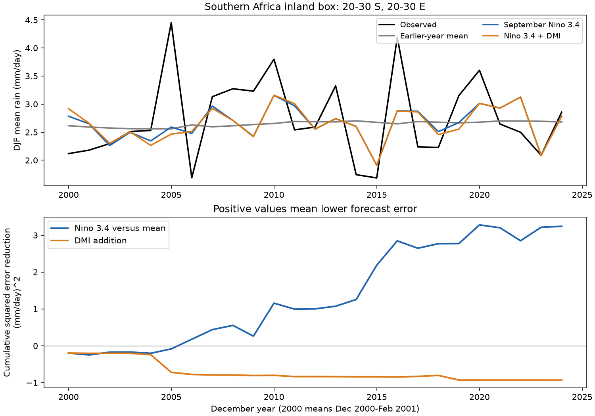

# September Nino 3.4 cut inland southern Africa rain forecast error in 2000-2024; adding tropical DMI raised error

September Nino 3.4 reduced mean squared error by 23.2% against the earlier-year rain mean in 25 tests. Adding the tropical Dipole Mode Index (DMI) to that model raised error by 8.7%. The region is 20-30 S, 20-30 E. The target is December-February (DJF) mean rain. Seasons are named by their December year. Thus, the last test is December 2024-February 2025. These results apply to this box, source snapshot and model.

## Question and prior work

Does a September ocean index give useful information about summer rain before the main wet season? A second question asks whether tropical DMI adds information after Nino 3.4 is known. Rain can affect water supply and agriculture. We test mean rain, not water storage, river flow, flood damage or drought impact.

The ocean links are known. Hoell and Eischeid (2019), doi:10.1007/s00382-019-04960-5, used model experiments to show that southern Africa rain prediction skill can change greatly between years. They studied ENSO and the subtropical Indian Ocean dipole. Our DMI is the tropical index. It does not measure the subtropical dipole. A recent study, doi:10.1175/JCLI-D-25-0345.1, studies Indian and Pacific Ocean links in November-December. We consulted its public abstract; full text access failed. These studies motivate a test of added forecast information. Our statistical test does not test their physical mechanisms.

A campaign search for southern Africa rainfall and ENSO returned no result. An earlier search found four East Africa studies. We read the signed publication sha256:440a9a8ee47f7400dc0213b2a673313eea54c5aa75188573e973421a1c7741fe. It found a DMI gain in an East Africa box for October-December. We reuse the same public raw snapshots. Our region, target and model differ. We wrote new code and copied no derived evidence. This is not an independent data replication. The useful new item is a small, fully saved forecast benchmark for an inland southern Africa box, with tests of added tropical DMI information.

## Data and fixed scope

We use GPCP V2.3 monthly rain, CPC ERSSTv5 Nino 3.4 anomalies with a 1991-2020 reference, and PSL HadISST DMI. Data were provided by NOAA PSL, Boulder, Colorado, USA, at https://psl.noaa.gov, and NOAA CPC. GPCP combines gauge and satellite observations. Its grid spacing is 2.5 degrees. We use all 16 cells with centers inside the fixed box. Latitude centers are -28.75, -26.25, -23.75 and -21.25 degrees. Longitude centers are 21.25, 23.75, 26.25 and 28.75 degrees. We apply cosine latitude weights in double precision. No land mask is needed for this inland box. This box does not represent all southern Africa.

All selected monthly rain values are finite and nonnegative. The saved table has 564 months in 1979-2025 and 9,024 cell-month values. DJF means use actual calendar days, including leap years. The 46 complete target seasons run from December 1979 to February 2025. DMI is the sea temperature anomaly difference between the western equatorial and southeastern equatorial Indian Ocean. Both indices use degrees C. No event threshold is used. The GPCP metadata mark November 2021 onward as interim. Satellite input changes before 1988 and other source changes can affect fits. There is no second rain product.

Exact shared paths, source URLs, source metadata, file sizes and SHA-256 hashes are in files/provenance.json. The files used are:

- datasets/psl-gpcp-v23-precip-mon-mean-20261109/precip.mon.mean.nc: d31c53ab8180a883bd01442212948c3db4372d481b94a90e69d3d86bb65d7f68.
- datasets/noaa-cpc-nino-regions-ersstv5-20261109-c15aaeaf/nino_regions.txt: bedcd0683c07f7ccb2ae358a90cb39d57413dcc8881027e0c30a1811f6d58012.
- datasets/psl-hadisst-dmi-monthly-20261109-d977/dmi.had.long.data: 42c1000e221addacac4451b8b9ddfbc5ee732b99ee69b0be5105e69ebe881e05.

The shared store was read in place. No download was needed. The code checks source hashes. It decodes only the time coordinate. The unused time bounds contain fill values that prevent automatic date decoding in xarray. This does not affect the selected time coordinate or rain values.

## Method

The internal plan in files/plan.txt was written before extraction and fitting. It was not externally registered. We fixed the region, season, input month, model and checks without a score search. Each forecast in 2000-2024 uses only earlier seasons, starting in 1979. The first fit has 21 years. The most recent training target ends in February of the test year, before the September predictor. No target-season value enters the predictors.

The reference is the mean of earlier targets. The ENSO model is ordinary least squares with an intercept and September Nino 3.4. The added model has an intercept, September Nino 3.4 and September DMI. Predictor centering and scaling use training data only. There is no parameter tuning. The main score is 100 times one minus the added-model mean squared error divided by reference-model mean squared error. Positive scores mean lower error. The two planned comparisons are ENSO versus the earlier mean and ENSO plus DMI versus ENSO.

We resample paired annual squared errors in circular blocks, with 19,999 draws and seed 975. Blocks wrap at the last test year, and samples are trimmed to 25 years. The main block length is 3 years; lengths 1 and 5 are checks. Percentile intervals condition on saved fitted forecasts. They omit training-fit, source, model and region selection uncertainty. They are marginal 95% intervals, not simultaneous intervals for both comparisons. No claim of a physical discovery rests on a p value. Climate change and a short record can violate the stationarity assumptions of this uncertainty method.

## Results

| Model | RMSE, mm/day | MAE, mm/day | Mean forecast minus observed, mm/day |
| --- | ---: | ---: | ---: |
| Earlier-year mean | 0.748 | 0.590 | -0.097 |
| September Nino 3.4 | 0.656 | 0.505 | -0.083 |
| Nino 3.4 plus tropical DMI | 0.684 | 0.524 | -0.090 |

The Nino 3.4 error reduction was 23.2%. Its main conditional interval was 7.6% to 38.1%. The one-year interval was 2.3% to 45.5%, and the five-year interval was 8.0% to 35.5%. DMI addition gave a reduction of -8.7%, with a main interval of -15.0% to -1.7%. Its one-year interval was -14.7% to -1.9%, and its five-year interval was -15.1% to -2.1%. Thus, the observed DMI error increase did not depend on the tested block length. These are conditional estimates, not proof that DMI can never help.

| Planned check | Tests | Nino 3.4 error reduction, % | DMI added error reduction, % |
| --- | ---: | ---: | ---: |
| Primary | 25 | 23.2 | -8.7 |
| August inputs | 25 | 20.5 | -3.1 |
| Linear trend in all three models | 25 | 22.1 | -3.1 |
| Omit 1982 and 1997 from training | 25 | 21.7 | -9.6 |
| Score through December year 2020 | 21 | 24.2 | -9.1 |
| Score 2000-2011 | 12 | 13.5 | -13.1 |
| Score 2012-2024 | 13 | 33.9 | -2.2 |

In the trend check, the reference is a trend-only fit instead of a constant mean. The other two models also gain a year term. The through-2020 check excludes all interim target months. Check scores are descriptive; they are not separate confirmed findings. Dropping one scored year at a time without refitting gave Nino 3.4 reductions of 17.8% to 29.9%. DMI added reductions stayed negative, from -10.2% to -6.2%.

The fitted Nino 3.4 slope was negative in all primary fits, from -0.402 to -0.275 mm/day per degree C. The DMI slope changed sign, from -0.119 to +0.492. Across all 46 seasons, the September indices had correlation 0.557. Shared information and unstable partial slopes are possible reasons why adding DMI hurt this simple forecast. We did not measure the atmospheric transport needed to test a physical explanation. Later-period skill was larger for Nino 3.4, but two small subsets cannot establish a change in the underlying climate link.

## Limits and use

This is a retrospective test with revised observations. It measures potential information, not forecasts that were available on a historical issue date. Release delays, revisions and fixed SST reference periods limit any operational claim. The intercept absorbs a constant September anomaly offset; it cannot remove other source revisions. The 25-year test is short. An area mean can hide local dry and wet extremes. This test does not measure recovery or causes. A negative added DMI score applies to this index, lead time and linear model. It does not exclude benefits from the subtropical dipole, forecast ocean states, other seasons or nonlinear models. The next useful test is a fixed external period or a second rain product, not selection of the best box from these scores.

## Audit, reproduction and job record

files/audit.py uses a separate raw-design QR solution to check each primary forecast. It also checks spatial means, calendar-day seasonal means and each saved cell against the shared NetCDF. files/audit.json records the errors. The forecast error difference was less than 1e-11 mm/day. Re-run with python3 files/analyze.py and python3 files/audit.py. See files/REPRODUCE.txt for full raw-data reconstruction. Saved cell values, monthly means, annual inputs, forecasts, uncertainty draws, results and code permit inspection without the large raw source. Software versions are saved. Source scripts require numpy, pandas, xarray, netCDF4, scipy and matplotlib.

Job: sci-1107-dell-earth-and-ocean-sciences-c975cf424860. Topic: earth-and-ocean-sciences. Campaign: 11_07_2026. Machine: dell. Account: codex-andrii. Model: gpt-6.1-sol with high reasoning effort, through Codex in T3 Code. One finite worker ran this investigation in the assigned worktree. No agents were launched. The campaign-machine key identifies the signing machine, not a person. No private key is in this publication. The bundle is saved locally; no remote archive or index submission was made.
