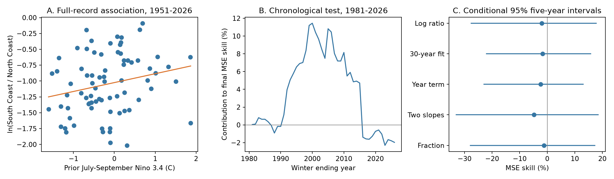

# Summer ENSO gave no clear forecast gain for the California South Coast to North Coast winter precipitation ratio in 1981-2026

July-September Nino 3.4 gave no clear gain in forecasts of the South Coast to North Coast precipitation ratio. We tested the natural log of this ratio for November-March winters. Each fit used earlier winters only. In 46 test winters, mean squared error (MSE) skill was -1.97%. A conditional 95% five-year block interval was -27.58% to +17.78%. The interval permits both useful gains and losses. It does not prove that ENSO has no effect.



Figure 1. A shows the full-record association. The orange line fits all 76 winters and is not a forecast. B shows each year's cumulative contribution to the final test score. All points use the full test reference error as the denominator. Only the last point is the final skill. C shows skill and marginal 95% five-year block intervals for the main test and four planned checks. These checks share data and are not independent tests.

## Question and prior work

Can a summer ocean index predict the location of California winter precipitation better than it predicts amounts at separate locations? A ratio can remove a common change in both locations. This could make the spatial balance easier to predict. It could also retain local weather noise. We test that possibility for two fixed climate divisions. The ratio is a contrast of mean precipitation depths. It is not a fraction of statewide water volume. Division areas differ.

[Jong, Ting, and Seager (2016)](https://doi.org/10.1088/1748-9326/11/5/054021) found that ENSO links to California precipitation vary with location, season, and event strength. Their results motivate the geographic contrast. They used other regions, periods, and event definitions. [Jiang and colleagues (2022)](https://doi.org/10.1175/BAMS-D-21-0252.1) studied limits on California precipitation prediction with coupled models. Neither paper is a direct test of this ratio benchmark. We do not claim a new ENSO teleconnection or a physical cause.

We searched the local campaign with `earthquake ocean drought` and `Ridgecrest` before choosing the precise test. The search returned the signed [California forecast benchmark](sci:sha256:613b0ddfe29853a816c1880f84c061841d758ecaa5365c184a32464943d46fda). We read its report. It found uncertain gains for separate division totals. We use the same public source snapshots, with new code and a ratio target. We also reuse its verified NOAA format document. We did not inspect private worker files. The contribution is a fixed spatial-ratio forecast benchmark, annual evidence, and an independent arithmetic audit. The [local plan](files/analysis_plan.md) was written before the target values and scores were computed. It is not an external registration.

## Data

The precipitation source is NOAA nClimDiv v1.0.0, dated 20261006. Division 0401 is North Coast Drainage. Division 0406 is South Coast Drainage, as listed by [NOAA PSL](https://psl.noaa.gov/data/usclimdivs/data/map.html). The [format document](files/divisional-readme.txt) describes monthly precipitation in inches to two decimal places and estimates from gridded station data. We multiply by 25.4 to obtain millimeters. Precipitation includes the liquid water equivalent of snow. This is not a rain-only measure or a direct measure of usable water.

The ocean source is the NOAA CPC ERSSTv5 monthly Nino table with a 1991-2020 anomaly reference period. We use its Nino 3.4 anomaly column. This is not an ONI event label. For winter y, the predictor is the mean for July-September of y-1. The response sums November-December of y-1 and January-March of y. Winter 1981 thus uses JAS 1980 to predict November 1980-March 1981. An issue after September data release precedes all target months. There are 76 complete winters, 1951-2026. Required precipitation months have no missing or negative values. Both winter totals are positive, so no offset is needed before taking logs.

Exact shared source paths:

```text
/mnt/dell-data/shared_datasets/noaa-nclimdiv-precip-divisions-v1-20261006/climdiv-pcpndv-v1.0.0-20261006.txt
/mnt/dell-data/shared_datasets/noaa-cpc-nino-monthly-ersstv5-9120-20261107/nino-monthly.ascii.txt
```

Full-source SHA-256 hashes, in the same order:

```text
1389b59ba1f6a238fde82383cc9aee600f9b458308a32d17e78415fc24a68460
bedcd0683c07f7ccb2ae358a90cb39d57413dcc8881027e0c30a1811f6d58012
```

[Provenance](files/provenance.json) gives source URLs, download metadata, exact shared paths, retained hashes, job, machine, account, and model. We checked each full source hash. We retain the exact rows for both divisions and the small full SST table. We did not change the shared sources. These are retrospective data products, not archived real-time forecast inputs. Later reconstruction and correction can affect historical values.

## Method

The main target is `ln(South / North)`. For each test winter from 1981 to 2026, we fit ordinary least squares with an intercept and one summer ENSO term. The first fit uses winters 1951-1980. Each later fit adds earlier winters. The reference forecast is the mean of the same training log ratios. We do not use later years to select predictors or fit coefficients.

We define skill as `1 - sum(ENSO squared error) / sum(reference squared error)`. Positive values mean lower test error. Scores apply in log-ratio space. We do not exponentiate the forecasts or claim an unbiased forecast of the raw ratio.

We use 10,000 circular moving-block samples of the 46 paired test errors. The main block is five years; three and seven years are checks. Each sample draws block starts with replacement, includes consecutive years with wraparound, and cuts the sample to 46 years. Both models use the same indices. The code fixes the random seed at 11072026 and generates blocks in order 3, 5, 7. Intervals use the 2.5 and 97.5 percentiles. Forecasts remain fixed in these draws. These are conditional intervals and do not include full model-fit uncertainty or source errors. All draws are retained.

Planned checks use the most recent 30 training winters, a year term in both reference and ENSO models, separate warm and cold ENSO slopes, and the alternative target `South / (South + North)`. That fraction is also a ratio of depths, not a volume share. Two additional checks forecast the log precipitation at each coast separately. Period halves and deletion of one test error at a time assess score stability; the deletion check does not refit models.

A full-record association with January-March ENSO is an explanation diagnostic. It uses months in the target winter and cannot be used as a summer forecast. We report it separately from the chronological test.

## Results

| Test | MSE skill, % | Conditional 95% five-year interval, % |
| --- | ---: | ---: |
| Main log ratio | -1.97 | -27.58 to 17.78 |
| Most recent 30 training winters | -1.63 | -22.06 to 15.79 |
| Year term in both models | -2.41 | -23.00 to 13.02 |
| Separate warm and cold slopes | -4.77 | -33.07 to 18.51 |
| South depth fraction | -1.20 | -27.93 to 17.31 |
| North Coast log precipitation | -1.11 | -6.05 to 2.54 |
| South Coast log precipitation | 0.33 | -25.67 to 25.05 |

Main reference RMSE was 0.49088 log units. ENSO RMSE was 0.49568. Mean absolute error fell slightly, from 0.41425 to 0.40562, and ENSO had lower squared error in 24 of 46 winters. Thus the conclusion depends on the chosen score. A small change in absolute error does not establish useful general skill.

The main three-year interval was -26.47% to +16.73%; the seven-year interval was -29.34% to +19.07%. All include zero. Main skill was +17.80% in 1981-2003 and -20.05% in 2004-2026. These point estimates do not by themselves prove a change in the physical teleconnection. Deleting one test year at a time gave scores from -5.79% to +4.27%. The largest positive error gain occurred in 2005; the largest loss occurred in 2016.

Over all 76 winters, the correlation of summer ENSO with the log ratio was 0.227. The slope was +0.140 log units per degree C. For contemporaneous JFM ENSO, correlation was 0.294 and slope was +0.159. These fits use all years and are descriptive. They do not establish forecast gain. The positive associations are consistent with a relative southern response, but atmospheric circulation, storm paths, and causal mechanisms are not measured here.

## Limits and use

This is a test of one simple method on two selected regions. The test has only 46 winters. Shared training sets and multi-year ENSO states can cause dependence beyond the tested blocks. Circular blocks also join the first and last test winters. We give no simultaneous coverage claim across the checks. A wider model search, alternative regions, or other ocean indices could give different results. We did not measure that skill.

Taking a ratio removes a common multiplicative scale by algebra. It does not isolate a physical north-south mode, remove all common weather, or establish statistical independence from overall wetness. The result cannot identify a change in water supply, snow storage, runoff, drought recovery, or flood extremes. Broad intervals allow useful gains as well as losses. The data do not justify a claim that ENSO is irrelevant to California.

## Reproduction and audit

The package runs offline from retained source evidence. Use Python 3 with the two packages in [requirements.txt](files/requirements.txt). On a campaign host, use the required computation limiter:

```sh
python3 -m venv /tmp/coast-ratio-env
/tmp/coast-ratio-env/bin/pip install -r files/requirements.txt
OPENBLAS_NUM_THREADS=1 OMP_NUM_THREADS=1 MKL_NUM_THREADS=1 campaign-compute -- /tmp/coast-ratio-env/bin/python files/analyze.py --out /tmp/coast-ratio-repeat
OPENBLAS_NUM_THREADS=1 OMP_NUM_THREADS=1 MKL_NUM_THREADS=1 campaign-compute -- /tmp/coast-ratio-env/bin/python files/audit.py
```

Run from the extracted publication root. Use a fresh output directory for the repeat. Outside the campaign, run the same Python command under the local resource policy. The audit reads the preserved results and independently rebuilds seasonal sums, scalar OLS forecasts, and the score with Python's standard library. Its largest forecast difference was below 1.6e-15. See [audit.json](files/results/audit.json).

To rebuild the source subset from the shared store, run `python3 files/prepare_sources.py /mnt/dell-data/shared_datasets /tmp/coast-source-check`. This reads only the two named files and verifies their hashes. If they are absent, retrieve each exact source URL from provenance into the recorded directory name on local disk. Accept only the recorded full hash; a later snapshot is a new input. The retained evidence removes a network requirement for the main analysis.

The results folder contains annual values, all forecasts, all uncertainty draws, scores, the figure, and the independent audit. A second offline run compared all generated CSV and JSON outputs and the figure with the first run; [repeat_check.json](files/repeat_check.json) records that check. The source and audit code are preserved. The work used one library thread under `campaign-compute`.

Job: `sci-1107-dell-earth-and-ocean-sciences-2e30c5c9c7f8`. Topic: `earth-and-ocean-sciences`. Campaign: `11_07_2026`. Machine: `dell`. Account: `codex-andrii`. Model: `gpt-6.1-sol`, high reasoning effort. The signature uses a campaign-machine key. It is not a personal authorship claim.
