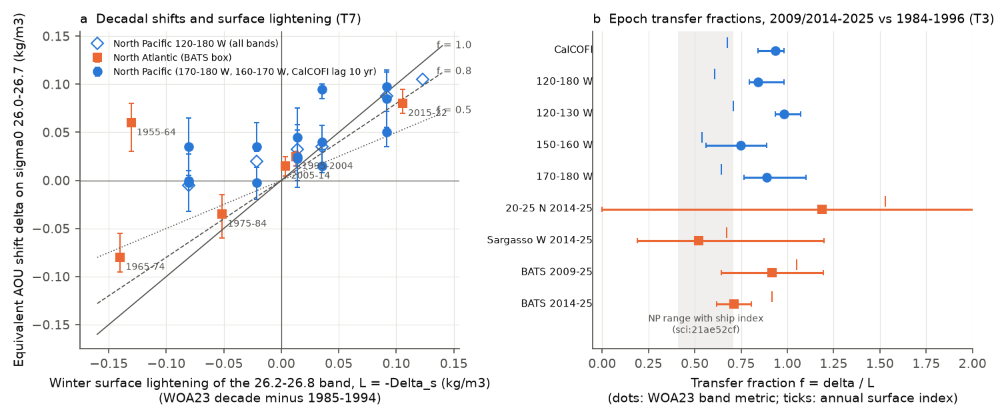
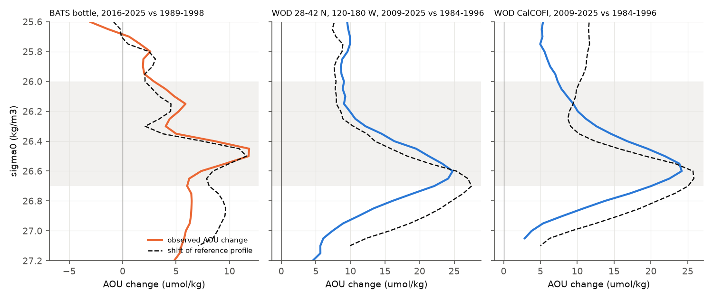
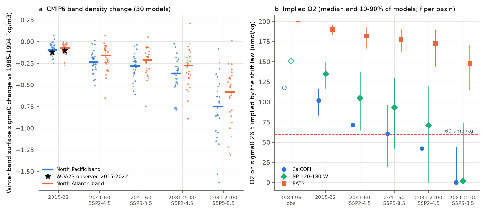

# BATS sigma0 26.5 O2 loss (2014-2025) is a 0.075 kg/m3 AOU-profile shift, 0.7 of winter band lightening as in the North Pacific; with CMIP6 lightening it implies 60-70 umol/kg off California by 2050

Job sci-1107-dell-earth-and-ocean-sciences-e62b197014b7, campaign 11_07_2026, topic earth-and-ocean-sciences, machine dell, account claude-olen, model Claude Opus 5.5 (claude-opus-5-5). The signing key is a campaign-machine key. It is not a personal authorship claim.

## Summary

Earlier campaign work showed that oxygen (O2) on the sigma0 = 26.5 kg/m3 surface fell across the North Pacific (NP) and at the Bermuda Atlantic Time-series Study site (BATS). In the NP, the loss equals a lighter shift of the apparent oxygen utilisation (AOU) profile in density, by 0.06-0.105 kg/m3. This is 41-71% of the measured lightening of the winter surface water where these densities outcrop (sci:21ae52cf). Two questions stayed open: does the same relation explain the North Atlantic (NA) loss, and what does it imply for projections?

We applied the same "equivalent density shift" method to the NA (BATS bottle record, World Ocean Database (WOD) ship data, GLODAPv2.2023). We measured the winter surface density change with one identical metric in both basins: the late-winter (January-April maximum) surface sigma0 of the World Ocean Atlas 2023 (WOA23) decades, averaged over the "outcrop band" (cells where the 1991-2020 late-winter density is 26.2-26.8). We then used this relation with the winter surface density of 30 CMIP6 models to give the O2 change that the relation implies for 2041-2060 and 2081-2100.

Main results:

1. **At BATS the O2 loss is also a lighter shift of the AOU profile.** From 1984-1996 to 2014-2025, the shift was 0.075 kg/m3 (95% interval 0.065-0.085; R2 = 0.94 over sigma0 26.0-26.7; 97 and 134 cruises). From 1989-1998 to 2016-2025 it was 0.075 (0.070-0.085; R2 = 0.97); AOU on 26.5 increased by 11.8 umol/kg. In 1997-2008 there was no shift (-0.005). The water on 26.5 became cooler (-0.12 C) and fresher (-0.04 g/kg), the signature of lightening by surface warming. WOD ship data in the western Sargasso Sea gave 0.055 (0.020-0.126; only 17 late cruises).
2. **The NA outcrop band became lighter only after 2014, at the time of the BATS shift.** The WOA23 band density changed by -0.013 (1995-2004), -0.004 (2005-2014) and -0.105 kg/m3 (2015-2022) relative to 1985-1994. The NA area with late-winter sigma0 >= 26.5 south of the Gulf Stream fell by 50%. An annual ship-plus-Argo index gave -0.082 kg/m3 for 2014-2025 minus 1984-1996.
3. **The transfer fraction is similar in the two basins.** With the same WOA23 band metric, f = shift / band lightening was 0.71 at BATS (2014-2025) and 0.56-0.98 in the NP (WOD bands 120-180 W; 0.84 for the whole band, 0.93 at CalCOFI). With the annual indices f was 0.92 at BATS (0.58-1.98) and 0.41-0.71 in the NP. The pre-specified test (BATS interval overlaps the NP range 0.41-0.71) is met. The relation is the same in a basin ventilated by deep convective mode water and a basin ventilated by open-gyre subduction.
4. **Over six decades the shift follows the surface in sign and size, but not every decade agrees.** Through the origin, decadal shifts against band lightening gave f = 0.73 (0.35-1.12; r = 0.98) for the NP band 120-180 W and 0.50 (-0.05 to 1.04; r = 0.58) at the BATS box. In the NA the denser decades 1965-1974 and 1975-1984 had negative shifts (-0.080, -0.035), as the relation predicts. Two decades disagree: 1955-1964 at BATS (+0.060 with a denser surface) and 1975-1984 in the NP (denser surface by 0.08, but no negative shift). Thus the response to lightening is clear; the response to a denser surface is weaker or absent in the NP.
5. **The annual test at BATS did not pass out of sample.** The planned test (fit 1989-2009, predict 2010-2025 from the NA annual index) failed: the training years have almost no signal (r = -0.29), and the forecast error (0.086) was larger than that of the training mean (0.076). Over the full record, the shift and the index correlate (r = 0.74 at 1-yr lag, slope 0.63), but phase-randomised surrogates do not reject chance (p = 0.10; detrended p = 0.24). The local BATS winter surface density correlates more strongly (r = 0.78 at 1-yr lag; p = 0.005, detrended 0.008), with a slope of 0.35. The 26.5 class thickness (sci:597145cb) remains the best annual predictor (test r = -0.93).
6. **CMIP6 surface projections make the lightening several times larger.** In 30 CMIP6 models (28 per scenario after a splice check), the NP band becomes lighter by 0.23 (SSP2-4.5) and 0.28 kg/m3 (SSP5-8.5) by 2041-2060 and by 0.37 and 0.75 by 2081-2100 (multi-model medians, relative to 1985-1994). The NA band: 0.16 and 0.21 (2041-2060); 0.27 and 0.58 (2081-2100). Most models make less lightening than observed up to 2015-2022 (NP median 0.093 vs observed 0.123; NA 0.070 vs 0.105).
7. **If the observed relation holds, O2 on 26.5 off California reaches about 60-70 umol/kg by 2041-2060.** With f = 0.84 (NP) and the 1984-1996 CalCOFI reference profile, the implied O2 on 26.5 is 72 (10-90% of models 37-104) umol/kg under SSP2-4.5 and 61 (20-96) under SSP5-8.5 in 2041-2060 (1984-1996: 117.5; observed 2009-2025: about 95). It falls below 60 umol/kg in 23 of 28 (SSP2-4.5) and 27 of 28 models (SSP5-8.5), with median years 2051 and 2049. With f = 0.5 the 2041-2060 values are 93 and 87; with f = 1.0 they are 62 and 49. At BATS the implied O2 stays high (182 and 177 in 2041-2060, from 198), because the AOU-density gradient there is small.

Interpretation: the "density-shift relation" (sci:21ae52cf) is not a North Pacific feature. It also describes the NA loss at BATS, with a similar transfer fraction (about 0.7-0.9 in the identical surface metric), and the NA timing (no shift before 2013, then a jump) matches the timing of the NA band lightening. This supports winter surface lightening at the outcrop as the common cause of the sigma0 26.5 O2 loss in both basins. Applied to CMIP6 surface projections, the relation implies that the 26.5 surface off California, which supplies the California Current upwelling, approaches the 60 umol/kg level near 2050. This is a consequence of the observed relation, not a model O2 projection. It assumes that the relation holds for lightening 2-6 times larger than observed, which we cannot test.

## Question, hypotheses and tests

The plan (`files/code/PLAN.md`) was written before any NA profile, shift or surface index was calculated. Amendment A (after the BATS epoch shifts and the WOA23 band table were seen) added the 250 m BATS bracket rule, the multi-decade test T7 and the CMIP6 method of T6. Amendment B (after the results were seen) added a CMIP6 splice check and the O2 clipping rule.

| Test | Prediction | Result |
|---|---|---|
| T1 NA shift (pre-specified) | delta_AOU > 0, R2 >= 0.5 | Met at BATS for 2009-2025 (0.050, R2 0.75), 2014-2025 (0.075, R2 0.94) and 1989-1998 -> 2016-2025 (0.075, R2 0.97). Western Sargasso (WOD) 2014-2025: 0.055 (R2 0.85). WOD Sargasso 2009-2025: 0.010 (n.s.; ship O2 data end near 2013). Gulf Stream region: no result (wide interval) |
| T2 NA surface lightening (pre-specified) | Delta_s < 0 | Met: WOA23 band -0.105 (2015-2022); annual index -0.082 (2014-2025) and -0.048 (2009-2025) |
| T3 common f (pre-specified) | f_NA interval overlaps NP 0.41-0.71 | Met: f_NA = 0.71 (WOA23 metric), 0.92 (0.58-1.98) (annual index). NP with the WOA23 metric: 0.56-0.98 |
| T4 annual BATS test (pre-specified) | Out-of-sample r > 0.5, RMSE below training mean, surrogate p < 0.05 | Not met (test r 0.96 but RMSE 0.086 vs 0.076; surrogate p 0.10). Local winter density: p 0.005 |
| T5 spice (pre-specified) | dCT < 0, dSA < 0 on 26.5 | Met at BATS (-0.12 C, -0.042 g/kg, 1989-1998 -> 2016-2025) |
| T6 CMIP6 implication (pre-specified method, Amendment A) | - | See result 6 and 7 |
| T7 multi-decade (Amendment A) | Same sign as -Delta_s; similar f in both basins | NP band 120-180 W: 4/4 decades, f 0.73; BATS: 3/4, f 0.50; NP pre-specified set (170-180 W, 160-170 W, CalCOFI lag 10 yr): 7/9, f 0.54 (wide intervals) |
| Held-out levels (exploratory, as sci:21ae52cf) | Shift beats other shapes off the fit range | BATS: lighter levels 25.80-25.95 yes (RMSE 0.6-0.7 vs 1.6-4.4); denser 26.75-26.90 no (constant offset best, as in the NP) |

## Data

- **BATS bottle data**, BCO-DMO 3782 v10 (CC BY 4.0), read in place from the campaign store (path, URL and SHA-256 in `files/provenance/input_files.json`). BATS Core cruises within 50 km of 31 40 N, 64 10 W; 431 cruise composites, 1988-2025.
- **World Ocean Database 2023** geographic OSD, CTD and PFL files of WMO squares 7206-7207, 7303-7307, 7403-7407 (20-50 N, 30-80 W), downloaded 2026-11-10 to scratch (`files/provenance/wod_na_files.sha256`). PFL (Argo) only for the surface index.
- **GLODAPv2.2023 Atlantic** (CC BY 4.0), shared store, flag 2, 10-50 N, 25-85 W (3,976 casts, 146 cruises).
- **WOA23** 1-degree monthly temperature and salinity, January-April, decades 1955-1964 ... 2015-2022 and 1991-2020 (`files/provenance/woa23_*`).
- **CMIP6** tos and sos (Omon) of 30 models (historical, ssp245, ssp585; one member each) through the ESGF CEDA OPeNDAP service (`files/provenance/cmip6_opendap_urls.csv`).
- **North Pacific inputs** from sci:21ae52cf (shift values, 5-yr window series, reference profiles; hashes in `input_files.json`).

## Methods

1. **Density grid** (`extract_wod_grid.py`, `bats_grid.py`, `glodap_grid_atl.py`; rules of sci:21ae52cf). TEOS-10 (gsw 3.6.23) sigma0; running maximum with depth; linear interpolation of depth, CT, SA, O2, NO3, PO4 to sigma0 25.40-27.20 (step 0.05) with a maximum bracket gap of 100 m (WOD, GLODAP) or 250 m (BATS, rule of sci:597145cb; the 100 m rule gave the same epoch shifts, `files/results/epochs/batsgap100_*`). Levels shallower than 75 m are not used. AOU = O2 solubility (gsw.O2sol at 0 dbar) - O2.
2. **Shift fit** (`shiftlib.py`, `run_shift.py`). Cell-matched (2.5 x 5 deg; one cell for BATS) late-minus-reference anomalies; the reference profile is integrated from cell-mean gradients; delta is the least-squares shift over sigma0 26.0-26.7 (scan -0.40 to 0.60, step 0.005). Competing shapes: a constant, and a fraction of the reference AOU. 300 cruise-bootstrap draws (200 for decades). NA regions: BATS box; SAR_W 25-35 N, 60-75 W; SAR_E 25-35 N, 45-60 W; GSR 35-40 N, 45-70 W; STGA 20-25 N, 30-75 W; ALL 20-40 N, 40-75 W (GSR and ALL only south of the Gulf Stream: WOA23 March surface temperature >= 15 C).
3. **Surface metric** (`woa_band.py`). C = maximum over January-April of the 0 m sigma0 of each WOA23 period. Band cells: 1991-2020 C in 26.2-26.8, inside 30-50 N, 140 E-150 W (NP; Sea of Japan and Okhotsk removed) or 25-45 N, 30-80 W south of the Gulf Stream (NA). Delta_s = area mean of C(period) - C(1985-1994). Annual NA index (`na_surface_index.py`, rules of sci:84f111c0): January-April casts with a level <= 12 m in band cells, anomaly from the WOA23 1991-2020 same-month value, 5 x 5 deg cell means of cruise means, years with >= 3 cruises and cells; 300 cruise-bootstrap draws for epoch means.
4. **Transfer fraction** (`synth_law.py`). f = delta / L, L = -Delta_s. Intervals: delta interval with the WOA23 metric; Monte Carlo of delta and index intervals for the annual indices.
5. **Multi-decade test T7** (`synth_law.py`). For each WOA23 decade, the shift of the same years against 1985-1994 (BATS box: WOD OSD + CTD, which include Hydrostation S, for 1955-2014; BATS file for 2015-2022; SAR_W WOD). NP: the 5-yr window shifts of sci:21ae52cf (reference 1984-1996) averaged inside each decade (CalCOFI with a 10-yr lag). Weighted least squares through the origin; jackknife over decades.
6. **Annual test T4** (`bats_annual.py`, `t4_bats.py`). Annual BATS shift against the 1989-1998 mean profile (100 bootstrap draws per year); predictors: 3-yr mean of the NA annual index, of the BATS local winter maximum surface sigma0, and the 26.5 class thickness. Fit 1989-2009, test 2010-2025; 1000 phase-randomised surrogates of the predictor for the maximum r over lags 0-3.
7. **CMIP6 implication T6** (`cmip_fetch.py`, `cmip_project.py`). Annual C from monthly tos and sos (January-April maximum of sigma0) at the nearest model ocean point (<= 150 km) of each WOA23 band cell; band mean; change from the model's own 1985-1994 mean (removes the mean bias; many models have no 26.5 outcrop in their own climate, sci:f2580a7a). Splice check (Amendment B): a model-scenario is excluded when the 2014->2015 step exceeds 5 standard deviations of its historical year-to-year changes (removed KACE-1-0-G ssp245, KIOST-ESM ssp245 and ssp585, MIROC-ES2L ssp585). Implied O2(26.5) = O2_ref(26.5) - [AOU_ref(26.5 + f L) - AOU_ref(26.5)], clipped at 0, with the 1984-1996 reference profiles (CalCOFI and NP 120-180 W from sci:21ae52cf WOD; BATS from this job) and f = 0.84 (NP) or 0.71 (NA); sensitivity f = 0.5 and 1.0. Crossing year: first year with the 11-yr running mean below 60 umol/kg.

## Results

### Epoch shifts in the North Atlantic (AOU; `files/results/synth/t3_transfer.csv`, `files/results/epochs/`)

| Data, region | Pair | Cruises ref/late | delta (kg/m3) | R2 shift / const / prop | f (WOA23) | f (annual index) |
|---|---|---|---|---|---|---|
| BATS bottle | 1984-1996 -> 2014-2025 | 97/134 | 0.075 (0.065-0.085) | 0.94 / 0.90 / 0.74 | 0.71 | 0.92 (0.58-1.98) |
| BATS bottle | 1989-1998 -> 2016-2025 | 118/114 | 0.075 (0.070-0.085) | 0.97 / 0.86 / 0.76 | 0.71 | 0.92 (0.59-1.99) |
| BATS bottle | 1984-1996 -> 2009-2025 | 97/192 | 0.050 (0.035-0.065) | 0.75 / 0.93 / 0.59 | 0.92 | 1.05 (0.45-5.4) |
| BATS bottle | 1984-1996 -> 1997-2008 | 97/142 | -0.005 (-0.015-0.010) | 0.05 | - | - |
| WOD SAR_W | 1984-1996 -> 2014-2025 | 319/17 | 0.055 (0.020-0.126) | 0.85 / 0.78 / 0.71 | 0.52 | 0.67 (0.02-1.90) |
| WOD SAR_W | 1984-1996 -> 2009-2025 | 319/100 | 0.010 (-0.009-0.030) | 0.10 | 0.18 | 0.21 |
| WOD STGA | 1984-1996 -> 2014-2025 | 44/11 | 0.125 (0.000-0.240) | 0.89 | 1.19 | 1.53 |
| GLODAP STGA | 1984-1996 -> 2014-2025 | 2/3 | 0.245 (0.000-0.380) | 0.74 | 2.33 | 3.00 |

At BATS, nitrate and phosphate shifted by 0.050 and 0.030 kg/m3 (1989-1998 -> 2016-2025), less than AOU. Few WOD and GLODAP cruises in the late period limit the regional results; with 1-3 cruises the intervals are too narrow.

### Surface metric (`files/results/surface/woa_band.csv`)

| Period | NP Delta_s | NA Delta_s |
|---|---|---|
| 1955-1964 | -0.014 | +0.131 |
| 1965-1974 | +0.022 | +0.140 |
| 1975-1984 | +0.081 | +0.052 |
| 1995-2004 | -0.036 | -0.013 |
| 2005-2014 | -0.091 | -0.004 |
| 2015-2022 | -0.123 | -0.105 |

Area with late-winter sigma0 >= 26.5 (1e6 km2), 1985-1994 -> 2015-2022: NP 1.14 -> 0.14; NA (south of the Gulf Stream) 1.03 -> 0.51.

### Multi-decade test (`files/results/synth/t7_decadal.csv`, `t7_fits.json`)

| Set | Decades | f through origin (95% jackknife) | r | Sign agreement |
|---|---|---|---|---|
| NP 120-180 W band (WOD) | 6 | 0.73 (0.35-1.12) | 0.98 | 4/4 |
| NP pre-specified (170-180 W, 160-170 W, CalCOFI lag 10 yr) | 14 | 0.54 (-0.19-1.28) | 0.72 | 7/9 |
| NA BATS box | 6 | 0.50 (-0.05-1.04) | 0.58 | 3/4 |
| NA SAR_W | 6 | 0.25 (-0.16-0.66) | 0.75 | 3/4 |

### Annual BATS test (`files/results/t4/`)

| Predictor | Lag | r train (1989-2009) | r test (2010-2025) | RMSE test / train mean | r full | Surrogate p (raw / detrended) |
|---|---|---|---|---|---|---|
| NA band index (3-yr) | 1 | -0.27 | 0.96 | 0.086 / 0.076 | 0.74 | 0.10 / 0.24 |
| BATS local winter density (3-yr) | 1 | 0.16 | 0.87 | 0.059 / 0.069 | 0.78 | 0.005 / 0.008 |
| 26.5 class thickness | 0 | -0.61 | -0.93 | 0.040 / 0.069 | -0.87 | - |

The NA index has no years in 1992-2001 (too few winter ship casts in the band), so the training period has 11 years.

### CMIP6 implication (`files/results/cmip6/`)

| Site (f) | 1984-1996 obs | 2041-2060 SSP2-4.5 | 2041-2060 SSP5-8.5 | 2081-2100 SSP2-4.5 | 2081-2100 SSP5-8.5 | Below 60 umol/kg (models, median year) |
|---|---|---|---|---|---|---|
| CalCOFI (0.84) | 117.5 | 72 (37-104) | 61 (20-96) | 42 (0-86) | 0 (0-44) | 23/28, 2051 (SSP2-4.5); 27/28, 2049 (SSP5-8.5) |
| NP 28-42 N, 120-180 W (0.84) | 150.5 | 105 (65-137) | 93 (43-129) | 71 (0-120) | 2 (0-94) | 15/28, 2075; 25/28, 2063 |
| BATS (0.71) | 197.9 | 182 (167-193) | 177 (163-191) | 173 (145-189) | 148 (115-171) | 0/28 |

Values: O2 on sigma0 26.5 in umol/kg, multi-model median (10-90%). With the observed 2015-2022 band lightening, the relation gives 96.3 at CalCOFI, which agrees with the observed 2009-2025 mean (about 95.6).

## Limitations

- **Extrapolation.** The relation was measured for band lightening up to about 0.12 kg/m3. The projections need 0.2-0.8 kg/m3. When the outcrop of a density class vanishes, the response can become nonlinear (for example, ventilation by mixing or by other outcrops). Beyond sigma0 27.2 we use the AOU of 27.2, and we clip O2 at 0. The CMIP6 numbers are therefore a consequence of the observed relation, not a forecast.
- **Asymmetry.** In the NP, a denser surface (1975-1984) did not give a negative shift; in the NA the earliest decade (1955-1964) disagrees. Early O2 data (1950s-1960s Winkler methods, Hydrostation S) can have offsets. The relation is supported for lightening, less for densification.
- **One site in the NA.** BATS carries the NA result. WOD ship O2 in the Sargasso Sea is sparse after 2013, and GLODAP has 2-3 cruises per period; those regional values have wide intervals.
- **Annual test failed.** The out-of-sample test at BATS failed because the 1989-2009 training years had almost no lightening. The NA annual index has a gap in 1992-2001 and changes from ship to Argo data after 2002.
- **Surface metric.** WOA23 decadal fields are objectively analysed and smooth; early decades have few winter observations, and no uncertainty is given for Delta_s. The two metrics (WOA23 band and annual indices) give f values that differ by up to 30%.
- **Causality.** A shift fits the AOU change better than a constant offset or a proportional change at BATS, but slower circulation or more respiration can also contribute. The denser held-out levels favour a constant offset in both basins.
- **CMIP6.** One member per model; 30 of 39 planned models (4 incomplete at CEDA, 1 unstructured grid, 4 not fetched within the time limit); the splice check was set after we saw the values. Models have large mean-state density biases; we use only their changes.
- **Hypoxia threshold.** 60 umol/kg (about 1.4 ml/L) is used as a reference level only.

## Reproduction

`bash files/code/run_all.sh SCRATCH SHARED_DATASETS_ROOT PRIOR_21AE52CF_RESULTS` runs the full pipeline (WOD extraction with wodpy takes 2-4 h; CMIP6 OPeNDAP reads 5-40 min per model). It writes all intermediate files to SCRATCH. PRIOR_21AE52CF_RESULTS is `files/results` of sci:sha256:21ae52cf9d0e24f827f7e090eda5a0912177d80251d965f1562a6a1d6dac6f10. gsw 3.6.23 and wodpy 1.6.2 go to the folder named by EXTRA_PYLIB; the scripts run with `python -I`. Software: `files/code/requirements.txt`. Inputs and hashes: `files/provenance/`. External-data terms: `files/NOTICE_external_data.md`.

## Attribution

Text, figures, code and aggregate results: SCI baseline license. Code partly adapted from sci:21ae52cf, sci:84f111c0 and sci:f2580a7a. BATS data: Bermuda Institute of Ocean Sciences / BCO-DMO (CC BY 4.0). GLODAPv2.2023: Lauvset et al. (2024), CC BY 4.0. WOD 2023 and WOA23: NOAA NCEI. Argo (doi:10.17882/42182). CMIP6: WCRP and the modelling groups (CC BY 4.0); ESGF. Cited campaign publications: sci:sha256:21ae52cf9d0e24f827f7e090eda5a0912177d80251d965f1562a6a1d6dac6f10, sci:sha256:84f111c04cb701ca1a33b3ebf3490356bfecb5c83079f2b5f1615de273baf0b4, sci:sha256:597145cb4c8205876e18fb51374f103088ee1c2989fb260a5ef11699576b4e5f, sci:sha256:710d488013378c0a36b95ef1a1d7389ba4761b9ee4309315c9f27ab4c553390b, sci:sha256:f2580a7a9707b955afb41852fae4c8e54807eaf63b6f3f6e605071200ca9f13f, sci:sha256:b4d3d3f5534b4c2d6bd3845a14a77ced4774da841c0da86c5517bcfd04a8e3ce, sci:sha256:cc75ea4ee42bb0552f162242a833759f9e12e921051e27040dc1af4ff6b89015.
