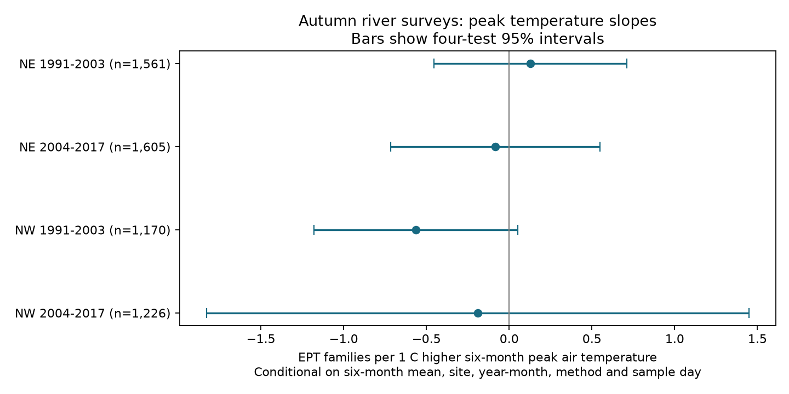

# Six-month peak air temperature gave uncertain EPT richness slopes after mean control in four northern English samples in 1991-2017

We tested whether six-month peak air temperature had a negative link to river EPT family richness beyond six-month mean temperature. We used 5,562 autumn samples from northeast and northwest England in 1991-2003 and 2004-2017. Models controlled site, year and month, analysis method, sample day and curved mean temperature. Peak slopes were +0.128, -0.083, -0.564 and -0.190 families per C. All four corrected intervals included zero. Controls left only 0.22-0.35 C of peak variation. In early northwest England, the slope changed from -0.564 to +0.174 when we kept only flow-matched records, before flow adjustment. Flow adjustment then gave +0.149. This check shows why changed samples must be separated from added controls. These data do not establish a repeated peak-temperature deficit. Broad intervals do not show that heat has no effect. Air temperature is not stream temperature. Unknown field effort, coarse family counts, selected repeat sites and few year clusters limit inference. Regions have separate records but can share weather. Periods can share sites. We test no air-pollution effect. Code, aggregate results, source hashes and a figure are included; external record tables are excluded.



| Region | Period | Samples | Sites | Slope | Four-test interval | Residual peak SD, C |
| --- | --- | ---: | ---: | ---: | --- | ---: |
| NE | 1991-2003 | 1,561 | 189 | +0.128 | [-0.455, +0.710] | 0.281 |
| NE | 2004-2017 | 1,605 | 182 | -0.083 | [-0.716, +0.550] | 0.353 |
| NW | 1991-2003 | 1,170 | 171 | -0.564 | [-1.180, +0.052] | 0.293 |
| NW | 2004-2017 | 1,226 | 131 | -0.190 | [-1.828, +1.447] | 0.218 |

Slope units are EPT families per 1 C of peak air temperature, conditional on mean temperature and the controls below. EPT means mayflies, stoneflies and caddisflies. The intervals do not exclude losses of practical size. This is not an equivalence test.

## Question and prior work

Does a higher six-month peak air temperature have a negative link to recorded EPT family richness after control for the six-month mean? A peak metric can represent short heat stress that a mean can hide. It does not measure event duration or the number of hot days.

Durance and Ormerod (2009; doi:10.1111/j.1365-2427.2008.02112.x) showed that changes in water quality and discharge could explain apparent warming links in 50 southern English streams. Sabater et al. (2023; doi:10.1111/brv.12914) found losses of river richness linked to extreme events in a synthesis of 71 studies. These papers motivate a test of peak exposure with flow and water-quality checks. Our maximum over six months does not reproduce their event measures.

We searched published campaign results for climate, pollution, biodiversity, phenology, moths, river heat and river peak temperature before this analysis. Prior river publications tested mean warmth with low flow and ammonia. We read both publications cited in sci.json. We adapt the first publication's source selection code and raw-count check. Our records overlap its archive and panel. This study adds a peak-temperature question and matched-sample checks. It is not a new independent archive. The four primary tests and controls were chosen before the first fits. The matched-sample checks were added after the first fits. No plan was registered externally.

## Data and selection

We use the ChemPop English river data product, version 2.0 (2025), by Bachiller-Jareno and colleagues, doi:10.5285/23f194b0-1e21-4f14-be9c-6eabdcc1feb7. Contains data supplied by UK Centre for Ecology & Hydrology. The product supplies matched air temperature from CHESS-met, river flow from NRFA and water chemistry from Environment Agency observations. We use the provided spatial and temporal matches, without a new matching audit.

The source documentation defines TAS_MAX as the maximum air temperature in the six months before each biological sample. CHESS-met provides daily mean air temperature. Thus, we interpret this field as the peak daily mean air temperature, not an hourly maximum, daily maximum temperature, water temperature or heatwave duration. TAS_MEAN is the six-month mean.

We use northeast (NE) and northwest (NW) England, with separate regional records, in 1991-2003 and 2004-2017. Regions can share weather, and periods can share sites. This supports regional and temporal comparison but not full statistical independence. We start in 1991 because source guidance reports stable quality assurance from then. Temperature ends in 2017. We retain September-November surveys to focus the six-month window on spring and summer. Window dates still vary among surveys.

We keep positive abundance records and count distinct nonmissing family labels in the three EPT orders. We do not add abundance, because the source mixes actual counts and log categories. A survey absent from the positive-record table cannot be assigned zero richness. We keep the newest sample version at each site-date. Ties use the lowest analysis ID and then sample ID, without reference to richness. Missing method labels receive a separate category. Taxonomic labels follow the source, without new reconciliation. Broad all-family labels are only a secondary outcome.

The build produces 12,298 spring and autumn site-dates in local scratch. Primary fits keep autumn dates with both temperature values and at least five dates per site within each period. The primary total is 5,562. We do not require a flow match for the primary model. Unequal survey counts give some sites more weight.

## Model and uncertainty

Each region and period has a separate least-squares model:

EPT richness = site effect + year-month effect + method effect + bP peak + bM mean + bMM mean squared + sample-day terms + error.

Peak is TAS_MAX minus 22 C. Mean is TAS_MEAN minus 12 C. Sample-day terms are linear and squared day within month, scaled by 15 days. The target bP is the conditional peak slope. Year-month effects absorb shared monthly conditions and annual trends. Site effects remove fixed site differences. Method and date controls reduce recording and season bias. These controls cannot remove unknown field effort, taxon detection, weather-dependent access or nonrandom site loss.

Alternating projections remove the three sets of fixed effects. Least squares then fits the exposure and date terms. Standard errors use a conservative envelope: the largest of site-cluster, year-cluster and two-way site/year variances. Each variance has a finite-sample correction, using an upper bound for the fixed-effect parameter count. The t reference uses the smaller cluster count minus one, which is 12 or 13. Four primary two-sided intervals use Bonferroni correction. Coverage is approximate; few years, spatial dependence and model error remain concerns. We do not infer a causal effect of climate change.

## Results and checks

The primary slope has a positive sign in early NE and negative signs in the other three samples. No corrected interval excludes zero. Raw peak standard deviations are 1.31-1.61 C. After all controls, peak residual root mean squares are only 0.218-0.353 C. Much of the peak information is common to sites in a year-month or shared with the mean. One-C conditional contrasts are large relative to this residual support. The null result therefore has limited precision and must not be read as evidence that extreme heat is harmless.

All 32 fits are in files/results.csv. Removing the squared mean term or adding site-specific time trends keeps the primary slope signs. Flow checks add linear and squared low-flow duration, in units of ten percentage points of days below the source 5th-quantile reference. Water-quality checks also add log(1 + mean BOD), with source LoQ/2 handling and at least three chemistry observations. Both checks change sample availability and reapply the five-date site rule.

In early NW, restricting to flow-matched records changes the slope from -0.564 (1,170 dates) to +0.174 (762 dates), with no flow term. Adding flow terms then gives +0.149. The matched sample has only 0.129 C of residual peak variation. The sign change cannot be assigned to flow adjustment. It already occurs under sample restriction. In later NE, the quality check retains only 215 dates from 33 sites. Such checks have poor precision and do not establish water-quality mechanisms.

The all-family outcome gives a negative early-NW slope (-1.203), with its four-sample interval below zero. The other three all-family intervals include zero. This is an exploratory second outcome; intervals do not correct across all secondary models. It does not establish a repeated EPT response or a general richness effect.

The raw set-based check agrees with all 12,298 selected site-date family counts. Primary coefficients also agree with independent dense dummy-variable fits within 1e-7. The package records checks for unique site-dates, bounded EPT counts and maximum temperature no lower than mean temperature. These tests check calculation, not causal assumptions.

## Limits

Air temperature may poorly represent shaded or groundwater-fed streams. Six-month peaks omit stress duration, event date and recovery time. Family counts can hide species turnover and abundance loss. Fixed year-month effects remove common heat signals as well as common confounders. Results apply to selected repeat monitoring sites, not all rivers. Tests share one archive, two nearby regions and some repeated sites. The study tests a weather-biodiversity link. It measures no air pollution, range shift or ecological timing outcome.

## Reproduction, rights and provenance

The exact shared archive is `datasets/eidc-chempop-minv-english-rivers-1965-2018-v2-23f194b0/23f194b0-1e21-4f14-be9c-6eabdcc1feb7.zip`. Its SHA-256 is `06ff765e64667a9af38cf0ae44bdd8d797480f5058a5963b5ad9a567c32a0b9e`. files/provenance.json gives the resolved shared path, URL, version, software and documentation hash. files/source_members.json gives hashes and sizes for all 12 used CSV members. We reused shared data in place and made no shared changes.

Raw data and derived record tables stay outside this publication under their external source terms. See files/EXTERNAL_DATA_NOTICE.md for attribution and source rights. The signed package contains code, original narrative, figure and aggregate estimates. The exact SCI baseline LICENSE applies to bundled material.

With Python 3.12, NumPy, pandas, SciPy and Matplotlib, run from an extracted verified bundle:

```sh
python files/reproduce.py --scratch /absolute/path/outside-publication --raw /absolute/path/to/source.zip
```

Omit `--raw` to download the source into scratch. Fresh ZIP wrappers can differ because the server regenerates metadata; the script requires every used CSV member hash to match. It writes the record table and outputs into scratch, never the signed draft. Compare scratch/outputs/results.csv with files/results.csv. Build, fit, raw-count check and dense-model check can also run separately with `--help`. Source retrieval needs network access; analysis works offline with the archived source. No source data depend on this private worktree surviving.

Job: sci-1107-dell-climate-pollution-biodiversity-815d91e67485. Topic: climate-pollution-biodiversity. Campaign: 11_07_2026. Machine: dell. Account: codex-myxtap. Model: gpt-6.1-sol with high reasoning effort. Date: 9 November 2026. The signing key identifies a campaign machine, not a personal author. No private keys are included.
