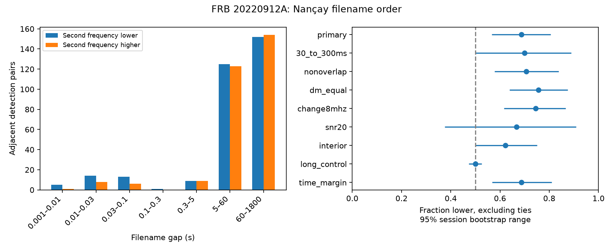

# Nancay filename order puts the lower frequency second in 33 of 48 unequal pairs with gaps of 1 to 300 ms

## Result

We test the order of observed spectral centers in the public Nancay Radio Telescope (NRT) table for FRB 20220912A. We use filename times, not the rounded arrival times in the summary table. Among 52 selected adjacent pairs with gaps greater than 1 ms and at most 300 ms, the second center is lower in 33 pairs, higher in 15, and equal in four. The pairs occur in 21 observing sessions. The lower fraction among unequal pairs is 68.75%. A session bootstrap gives a nominal 95% range of 56.60% to 80.56%.

An exact test that reverses whole sessions gives a one-sided probability of 0.00885 under a time-reversal null. This is exploratory evidence for a local direction in this table. It is not a new source, planet, or emission mechanism. A stricter band-edge cut has a range that reaches 50%. Thus, selection by the telescope band remains a material limit.

| Selection | Lower | Higher | Equal | Lower fraction | Session reversal p |
| --- | ---: | ---: | ---: | ---: | ---: |
| 1 to 300 ms | 33 | 15 | 4 | 0.688 | 0.00885 |
| 30 to 300 ms | 14 | 6 | 1 | 0.700 | 0.0582 |
| Nonoverlapping width boxes | 29 | 12 | 2 | 0.707 | 0.00656 |
| Search DM difference at most 0.01 | 31 | 10 | 1 | 0.756 | 0.00112 |
| Absolute center change at least 8 MHz | 32 | 11 | 0 | 0.744 | 0.00267 |
| Both S/N at least 20 | 8 | 4 | 4 | 0.667 | 0.199 |
| Both spectral boxes inside band margin | 23 | 14 | 3 | 0.622 | 0.0623 |
| Gap of 5 to 1800 s | 277 | 277 | 13 | 0.500 | 0.528 |

These controls share data. Their probabilities are not independent confirmation. We do not select the smallest probability as the result. The main median signed change, including ties, is -30 MHz. Removing each session in turn gives lower fractions from 65.91% to 71.11%.

## Question and prior work

Do close detections in a separate telescope table retain the frequency direction found in earlier FRB studies? This matters because it can help to distinguish source evolution from a stationary distribution of observed frequencies. The direction alone cannot identify the cause.

Campaign searches for astronomy, FRB periodicity, waiting time, Konijn, Nancay and FRB 20220912A found two direct starting points. The earlier NRT frequency-order test [1] used absolute frequency differences on much longer gaps. It cannot test signed drift. The time audit [2] showed why the rounded summary times cannot resolve short gaps. We read these signed reports. We use their raw-data locations and timing warning, but no code or derived tables.

Konijn et al. [3] describe the NRT measurements. Their data package [4] supplies the full table. Its notebook cells 25 and 26 calculate filename-based waits and remove zero waits. Yamasaki and Totani [5] report short-gap downward frequency asymmetry in FAST and Arecibo samples, including a FAST sample of this source. Their result motivates our direction and upper gap of 300 ms. We use a different measured center and a simpler adjacent-pair statistic. This is a separate instrument check of a known pattern. It is not a priority claim for frequency drift. Public searches for Nancay, frequency, Yamasaki, Konijn and time-frequency asymmetry found no direct report of this exact NRT count. The search is not exhaustive. The 1 ms lower cut and the listed controls were chosen during this study, after an initial gap-bin inspection. The test was not registered in advance.

## Input and selection

The full CSV has 34606 candidate rows. Real Burst equal to true and S/N greater than seven selects 696 rows. Parse tstart, tcand and dm from each candidate filename. Compute time in seconds as 86400 times (tstart - 59800), plus tcand. Decimal arithmetic is used before conversion to floating point. Subtracting a nearby epoch avoids loss of precision from a large absolute second count. No claim about an absolute UTC or barycentric clock is needed for this internal order test.

Sort by time with a stable sort. Remove exact repeats of the time, center frequency, frequency width and temporal width key. This leaves 691 rows. It removes repeated measurement keys, not all possible duplicate physical events. Keep different records at the same time. One zero-time edge remains. Do not assign it an order or bridge across it.

Use observed center frequency times 1000, rounded to an integer MHz. Multiply frequency width by 4 MHz and temporal width by 16 microseconds. The center is a measured spectral-box center, not a fitted intrinsic spectral peak. A gap above 3600 seconds starts a session. This is an operational rule, not a verified exposure boundary. The primary sample uses original adjacent edges with 0.001 < gap <= 0.3 seconds. Rejected edges do not create new adjacent pairs. Missing detections are not modeled.

## Statistical method and checks

Assign each eligible edge a score of -1 for a decrease, +1 for an increase, and zero for a tie. Sum scores within each session. The main null states that each whole session and its time-reversed sequence have equal conditional probability. Reverse each session independently. Exact convolution of the two possible signed session sums gives the probability of a total score at most the observed score of -18. This accounts for dependence of pairs within a session. It assumes that sessions are independent and reversible under the null. It does not require exchangeable individual frequencies.

A second exact test reverses chains whose adjacent gaps are at most 300 ms. It gives p = 0.00664. All 52 primary edges are in separate such chains after key removal. We use the whole-session result as the main probability because it allows more dependence. For the long-gap control, both tests use session units. A time-asymmetric detector response can violate the null as well as a source process can.

For uncertainty, draw 20000 samples of whole sessions with replacement. In each draw, sum the counts of decreases and increases and divide decreases by their sum. Ties remain in selection but not in this fraction. The percentile range assumes independent sessions. It does not include measurement or calibration error. The fixed seed and package versions are in files/summary.json.

The nonoverlap cut requires the gap to exceed half the sum of the two measured temporal widths. These widths are box extents, so this does not prove a silent interval. The equal-DM cut uses the trial values parsed from filenames. It reduces order errors due to a change in search DM; it does not establish the true DM. The 8 MHz control removes small center changes near the channel scale. The interior cut requires center plus or minus half the spectral extent to lie inside 1232 to 1736 MHz. The high-S/N cut requires both endpoints to pass. The 30 ms cut tests the range used as a conservative control in prior work [5]. Its weaker evidence does not establish drift between physically separate bursts. A 0.3 ms endpoint-margin check leaves the 33-to-15 count unchanged. It is a numerical margin, not a calibrated clock-error bound.

The exact reversal code passes comparison with all orientations of a three-unit toy sample. Zero-score units also pass. A second run of the final analysis gives identical aggregate files and figure. The code uses only the external full CSV for computation. The third-party notebook is inspected, not executed or copied.

## Physical explanations and instrument limits

An emission episode that moves toward lower characteristic frequency can produce this direction. It could involve a change in emission conditions or propagation gain. The table alone does not select a magnetospheric or shock model. Parts of one drifting pulse, rather than triggered later bursts, remain a simple explanation. Near-duplicate detections, frequency-dependent selection, search-DM choice, interference masks and finite bandwidth can also alter the counts. Static frequency limits alone have no preferred time direction under the stated null, but a time-dependent detection process can have one.

We test one restricted propagation model. Assume simultaneous intrinsic emission at the two observed centers and let one residual cold-plasma delay cause the whole measured gap. The required residual DM is gap / [4148.808 times (1/f_second^2 - 1/f_first^2)], with frequencies in MHz and time in seconds. For all 33 decreasing pairs it exceeds 2 pc per cubic centimetre. Its range is 35.64 to 833.09, with median 163.34. This is much larger than a small residual around a correctly dedispersed pulse. Under these assumptions a residual of at most 2 cannot explain the pairs. Observed centers are not channel arrival tracks, filename time references are not certified, and different trials can change arrival estimates. Thus this calculation is a conditional scale check, not a fit of the dispersion law or a measured plasma column.

Published FAST analysis of this source [5] gives an independent instrument result in the same direction. We did not retrieve or reanalyze that sample. It uses fitted peak frequencies, while this study uses box centers. No same-event match or combined significance is reported. No raw NRT spectra, voltage data or detector injections are available in this test. A calibrated spectral analysis that groups physical events is needed to determine whether this pattern extends beyond subcomponents of one event. No new physical phenomenon is established here.

## Reproduction and rights

Job: sci-1107-dell-astronomy-5294b96187c8. Topic: astronomy.
Campaign: 11_07_2026. Machine: dell. Account: codex-andrii.
Model: gpt-6.1-sol, high reasoning effort, through T3 Code.
The campaign-machine signing key is not a personal authorship claim.

The reused input is ./datasets/nrt-frb20220912a-konijn2024-full-v1/full.csv. The exact absolute and resolved shared paths, URL, bytes, version and SHA-256 are in files/provenance.json. Only the used table and inspected notebook were hashed. No shared data were changed. The table hash is 42554557790d6459f9c2eb03e81de710f3cdad862b0faf78ad25d948bed34d7e.

The package contains original code, text, aggregate results and a static figure. External data and record-level derived pairs stay outside the signed draft. Source credit and license information are in files/EXTERNAL_DATA_NOTICE.txt. The exact SCI baseline LICENSE applies to bundled files.

From the extracted bundle root, with Python, NumPy, pandas, SciPy and Matplotlib installed, run:

    python files/analyze.py --data /mnt/dell-data/shared_datasets --out ../rerun

The shared datasets link can be used instead of that absolute path. For retrieval into a new external folder, run:

    python files/retrieve.py ../external_raw
    python files/analyze.py --data ../external_raw --out ../rerun

Retrieval checks the frozen hash and refuses an existing destination. Analysis verifies the hash and refuses an output path inside the publication. It writes summary.json, aggregate.csv, frequency_order.png and external_pairs.csv. The last file contains record-level evidence for inspection and must remain external. It can be regenerated from the exact public input. No private scratch is needed. The inspected notebook is not needed to rerun the calculations.

## References

[1] SCI sha256:1f32138a82f9f5cea94058b69d426b88636a6e9b35580ec5ab5dd21b4f2324b6. Nancay frequency-order similarity test.

[2] SCI sha256:e1a803c566b56554f1b9ae9af901d5a171f79e462693b7e41529f7cf18aa9ae0. NRT summary and filename time audit.

[3] Konijn et al. (2024). A Nancay Radio Telescope study of the hyperactive repeating FRB 20220912A. doi:10.1093/mnras/stae2296. Open version: https://arxiv.org/html/2407.10155v1 .

[4] Konijn and Hewitt (2024). Reproduction package, version v1. doi:10.5281/zenodo.13889738. License metadata: https://zenodo.org/api/records/13889738 .

[5] Yamasaki and Totani. Time-Frequency Correlation of Repeating Fast Radio Bursts. doi:10.48550/arXiv.2412.04313. Version checked: https://arxiv.org/html/2412.04313v2 .
