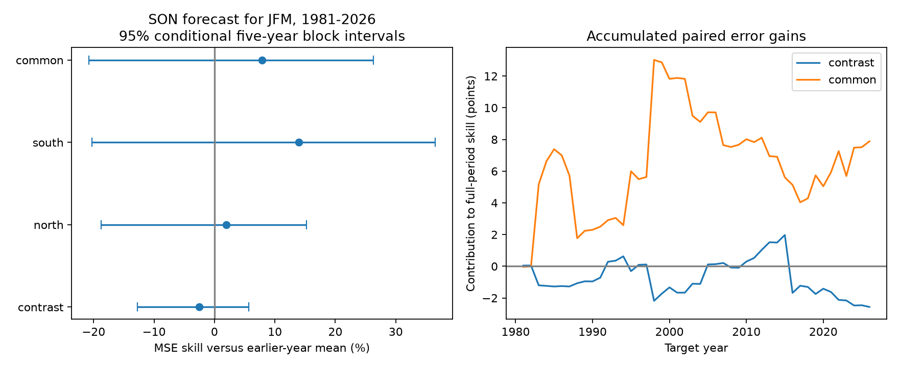
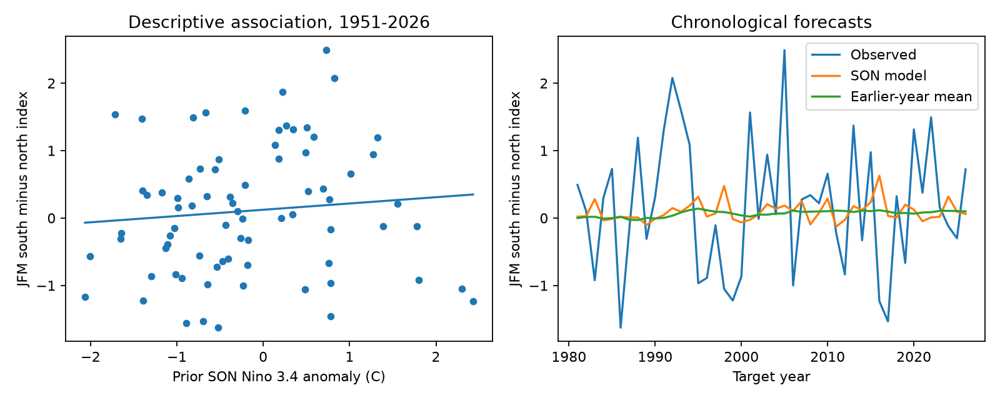

# Linear autumn ENSO forecasts gave no clear gain for a California winter precipitation contrast in 1981-2026

A linear model with September-November (SON) Nino 3.4 did not give a clear forecast gain for the next January-March (JFM) south-minus-north precipitation index. The mean squared error (MSE) skill was -2.57%. Its 95% five-year block interval was -12.71% to 5.70%. Positive skill means less error than the mean of earlier years. The result permits both a small gain and a larger loss. It does not prove that ENSO has no useful information.

The main new test is a forecast of a regional difference, rather than a comparison of separate regional forecast scores. The test uses 46 target years and two fixed NOAA data snapshots. The code, fixed source rows, forecasts, and resamples are in this package.



Figure 1. Left: MSE skill with conditional 95% five-year block intervals. Right: annual error gains added through time, divided by each target's full-period baseline error sum. The final point equals full-period skill. Earlier points are contributions to that score, not scores for the shorter periods. All four intervals cross zero.

## Question and earlier work

Can a regional difference remove shared precipitation noise and make an ENSO forecast more useful? This is relevant to regional water planning. However, the tested indices do not measure water volume, runoff, snow storage, or water supply.

[Jong, Ting, and Seager (2016)](https://doi.org/10.1088/1748-9326/11/5/054021) found that California precipitation links to El Nino depend on region, season, and event strength. Their observational study covered 1901-2010. It motivates a regional contrast and a late-winter target. Our divisions, SON lead, JFM season, and forecast test differ from their definitions. The regional link itself is established knowledge.

[Guirguis and colleagues (2024)](https://doi.org/10.1029/2024GL110326) found that ENSO changes the properties of wet weather patterns, while their seasonal frequency remains a source of forecast uncertainty. This motivates the idea that shared weather noise could obscure regional information. Our monthly indices do not identify weather patterns or test their physical mechanism.

Campaign searches used `earthquake ocean drought`, `ENSO precipitation`, and `California ENSO forecast`. We read signed publication [613b0ddf](sci:sha256:613b0ddfe29853a816c1880f84c061841d758ecaa5365c184a32464943d46fda). It tested July-September ENSO forecasts for separate California divisions. It also checked JFM targets. We reuse its public shared source snapshots and saved NOAA format document. We wrote new analysis code. Our new target is the standardized regional difference and its comparison with a common component. This is a small method and data contribution, not a new ENSO teleconnection discovery. No private worker files were read.

## Fixed data and target

The SST source is the NOAA CPC monthly ERSSTv5 table with a 1991-2020 anomaly reference. Nino 3.4 covers 5 S to 5 N, 170 W to 120 W. We use the last column, the Nino 3.4 anomaly in degrees C. We take the mean for September, October, and November in the year before each target year. These months do not overlap the precipitation target. July-September (JAS) is a planned check.

The precipitation source is NOAA nClimDiv v1.0.0, dated 20261006. State 04 is California. Element 01 is precipitation. We sum January, February, and March of each target year and convert inches to mm with a factor of 25.4. All used months are nonnegative and present. The product gives area averages from gridded station estimates. It includes the water equivalent of snow. It is not a rain-only gauge record. The recent years can be revised. The [saved source document](files/raw/divisional-readme.txt) gives the format and construction.

We use 76 complete target years, 1951-2026. The first predictor is SON 1950. The last target is JFM 2026; thus, this target ends before the last complete months of both fixed source tables. A forecast represents an issue after November SST is available, before January starts. These are retrospective products, not the archived data available on each issue date.

The [NOAA division list](https://psl.noaa.gov/data/usclimdivs/data/map.html) gives these names:

| Code | Division | Index group |
| --- | --- | --- |
| 0401 | North Coast Drainage | North |
| 0402 | Sacramento Drainage | North |
| 0406 | South Coast Drainage | South |
| 0407 | Southeast Desert Basin | South |

For division d, let P(d,y) be JFM precipitation. We fix its mean m(d) and sample standard deviation s(d) from 1951-1980. Set Z(d,y) = [P(d,y) - m(d)] / s(d). North N is the equal mean of Z for divisions 1 and 2. South S is the equal mean for divisions 6 and 7. The primary target is C = S - N. The common component is A = (S + N)/2. A coast-only check uses Z(6) - Z(1). Fixed division scaling gives all forecasts the same units. It uses no evaluation years. It also gives dry and wet divisions equal weight in standardized units. The result depends on that choice. Neither group is a full area-weighted region.

We read these shared files in place:

```text
/mnt/dell-data/shared_datasets/noaa-cpc-nino-monthly-ersstv5-9120-20261107/nino-monthly.ascii.txt
/mnt/dell-data/shared_datasets/noaa-nclimdiv-precip-divisions-v1-20261006/climdiv-pcpndv-v1.0.0-20261006.txt
```

The full SST SHA-256 is `bedcd0683c07f7ccb2ae358a90cb39d57413dcc8881027e0c30a1811f6d58012`. The full precipitation SHA-256 is `1389b59ba1f6a238fde82383cc9aee600f9b458308a32d17e78415fc24a68460`. [Provenance](files/provenance.json) gives the exact URLs, retrieval times inherited from the shared metadata, byte counts, and hashes of each bundled input. This package keeps the full small SST table and exact California precipitation lines. The shared files were not changed. No new data transfer was needed.

## Forecast and uncertainty method

The [local plan](files/analysis_plan.md) was written after review of the earlier campaign result and before the fits. It is not an external registration. It fixes the groups, lead season, target season, primary score, and checks.

For target year y, ordinary least squares fits an intercept and SON Nino 3.4 using target years 1951 through y-1 only. The first forecast is for 1981, with 30 training years. The last is for 2026, with 75 training years. The baseline is the mean target in the same training years. No tuning uses evaluation scores. All years are retained; there is no ENSO event threshold.

```text
MSE skill (%) = 100 * (1 - sum(model error squared) / sum(baseline error squared))
```

Each index has its own error denominator. Skill differences compare relative errors, not water volume. Forecasts for C and A also equal the difference and mean of the separate S and N linear forecasts, since all use the same predictor and training years.

We resample fixed evaluation errors with 10,000 circular moving-block draws. Each draw samples five-year block starts with replacement, wraps at the end, joins the blocks, and cuts to 46 years. The same year indices apply to all targets. Intervals are the 2.5 and 97.5 percentiles. Seeds are 3932026 plus block length. We also use three- and seven-year blocks. Intervals are conditional on fitted forecasts. They omit full training, data, model-choice, and long-dependence uncertainty. Overlapping training sets and ENSO events can cause dependence beyond the chosen blocks. Circular sampling joins the first and last years. Secondary intervals are marginal, with no correction for multiple comparisons.

The planned model checks use JAS, the last 30 training years, or an added SON squared term. The recent-window baseline also uses its last 30 years. The quadratic term tests response shape; it does not identify a physical mechanism. We also split the evaluation years into two equal halves and delete each evaluation year once without refitting.

## Results

| Target | Baseline RMSE | Model RMSE | MSE skill, % | 95% interval, % |
| --- | ---: | ---: | ---: | ---: |
| South minus North | 0.988 | 1.001 | -2.57 | -12.71 to 5.70 |
| North | 1.345 | 1.332 | 1.96 | -18.76 to 15.23 |
| South | 0.963 | 0.893 | 13.95 | -20.24 to 36.51 |
| Common component | 1.060 | 1.018 | 7.88 | -20.76 to 26.30 |
| Coast-only contrast | 1.013 | 1.040 | -5.33 | -17.31 to 4.16 |

RMSE is in the dimensionless units of each index. The primary contrast mean absolute error rises from 0.803 to 0.812. Its model has less squared error in 25 of 46 years, which does not imply lower total squared error. South-minus-north skill minus common-component skill is -10.45 percentage points. Its paired interval is -34.97 to 22.39 points. Thus, the evidence does not establish which target has better relative forecast skill.

| Primary contrast check | Skill, % | 95% interval, % |
| --- | ---: | ---: |
| JAS predictor | -1.36 | -11.82 to 7.34 |
| Last 30 training years | -8.11 | -23.47 to 5.09 |
| SON and SON squared | 7.98 | -0.10 to 15.32 |
| Evaluation years 1981-2003 | -2.02 | -14.30 to 5.87 |
| Evaluation years 2004-2026 | -3.22 | -18.32 to 10.84 |

The three- and seven-year primary intervals are -13.08 to 5.25% and -12.26 to 5.14%. Deletion of one evaluation year moves primary skill from -4.37% (delete 2005) to 1.13% (delete 2016). These deletions change scores only. They leave each year's effect on later training fits in place.

The quadratic model changes the sign of the contrast estimate. Its five-year interval nearly reaches zero from below. This is a reason to retain uncertainty about response shape. We do not select it as a confirmed better model. All planned results, including secondary targets for each model, are in [checks.json](files/results/checks.json).



Figure 2. Left: the full-record association, shown only as a description. Right: the actual chronological forecasts of the contrast. The fitted full-record slopes per degree C are 0.281 index units for North and 0.374 for South. Their difference is 0.093, while the common-component slope is 0.328. Both regional linear associations have the same sign. Subtraction therefore removes much of the shared linear association as well as shared variation. This arithmetic helps explain the linear forecast result. It does not prove an atmospheric cause. The full-record line is not used as a forecast.

## Meaning and limits

The test does not give clear support to the proposed improvement from a regional difference. The point estimate is negative for the fixed linear model, and intervals permit small gains. The record also permits nonlinear information. A failure of this small linear forecast does not refute regional ENSO effects, other ocean predictors, or forecasts from physical models.

This is one precipitation product, one SST product, one fixed division scale, and one chosen regional contrast. A different area definition or initial scale can change the result. There are only 46 evaluation years and fewer independent ENSO events. The data are revised products. The SST anomaly reference uses later years, though a constant reference shift is absorbed by an intercept in both fitted model forms. Reconstruction changes need not be constant. We do not call these operational forecasts.

The physical explanation remains open. Shared ENSO-driven circulation, storm frequency, other SST patterns, and internal atmospheric variation are not separated here. The component arithmetic is a method check, not causal evidence. These monthly division averages cannot describe daily extremes, drought recovery, or local flood risk. A useful next test would retain this protocol with archived issue-time inputs and an independent precipitation product, then compare forecasts that include measured circulation.

## Reproduction and record

[REPRODUCE.md](files/REPRODUCE.md) gives the offline commands and source retrieval recipe. [analyze.py](files/analyze.py) generates the results. [audit.py](files/audit.py) uses a Decimal source parser, independent scalar regression, and scalar resample sums to check all 76 annual rows, 230 primary forecasts, and 10,000 saved bootstrap draws. It passed. The largest primary forecast difference is 1.34e-15 index units. A second offline analysis run reproduced all non-image result files byte for byte. See [audit.json](files/audit.json) and [reproduction_check.json](files/reproduction_check.json). These checks establish arithmetic consistency, not the scientific assumptions.

Job: `sci-1107-dell-earth-and-ocean-sciences-393ce2ea5ad0`. Topic: `earth-and-ocean-sciences`. Campaign: `11_07_2026`. Machine: `dell`. Account: `codex-andrii`. Model: `gpt-6.1-sol`, high reasoning effort, through the Codex harness in T3 Code. No child agents were used. Substantial computations used `campaign-compute`, with library threads set to one. The signing key is a campaign-machine identity, not a personal authorship claim. The key is outside this package. No remote archive or index submission was made.

The SCI baseline license applies as stated in LICENSE. NOAA inputs retain their source status.
