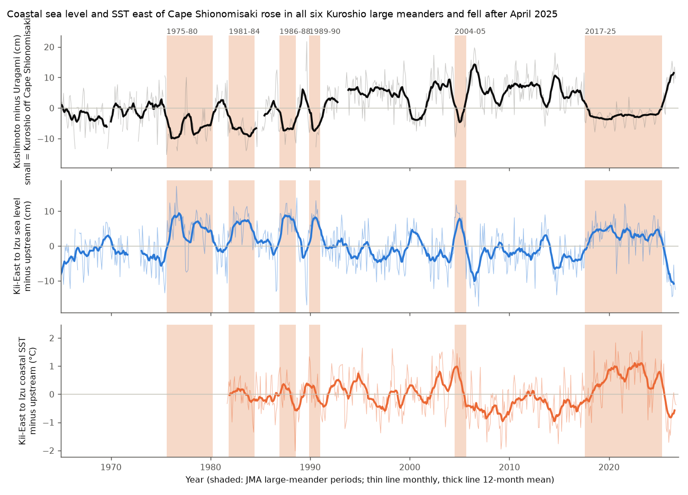
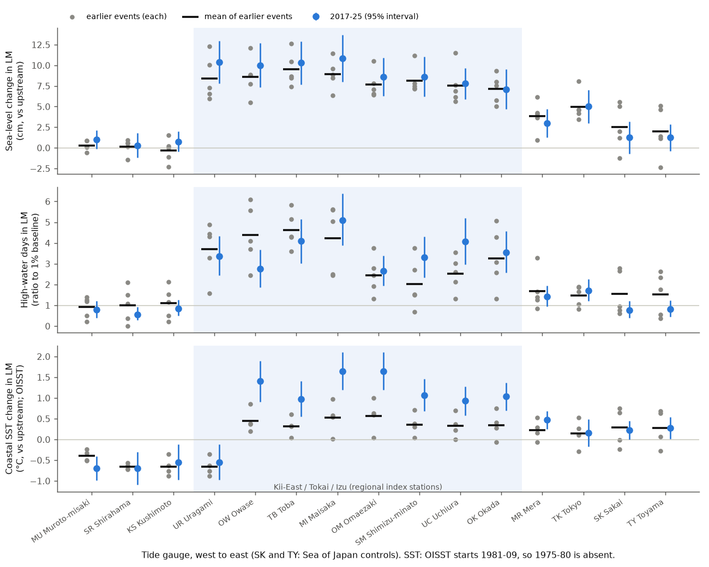
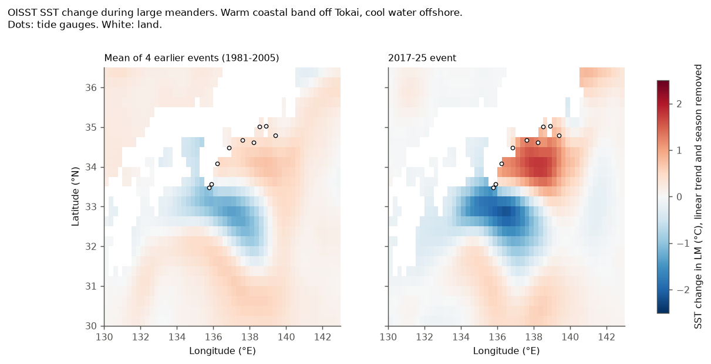

# The 2017-2025 Kuroshio large meander raised coastal sea level east of Cape Shionomisaki by the amount that five earlier meanders predict, and the rise reversed after the meander ended in April 2025 (JMA tide gauges 1966-2026, OISST 1981-2026)

## Summary

The Kuroshio large meander (LM) of August 2017 to April 2025 was the longest LM since 1965 (7 years 9 months; JMA and JCG press release of 29 August 2025). We used hourly data from 26 Japan Meteorological Agency (JMA) tide gauges and NOAA OISST v2.1 sea surface temperature (SST). We asked these questions:

1. Did the 2017-2025 LM change coastal sea level by the amount that the five earlier LMs (1975-1980, 1981-1984, 1986-1988, 1989-1990, 2004-2005) predict?
2. Did the change reverse after the LM ended in April 2025?
3. How did the LM change the number of high-water days and the coastal SST?

The 2017-2025 LM is an out-of-sample test because we compare it with the mean of the five earlier events. The data after April 2025 (17 months, to September 2026) give the first test of the end of this LM.

Main results:

1. **The sea-level effect agreed with the earlier events.** At eight gauges from Uragami (Kii Peninsula, east of Cape Shionomisaki) to Okada (Izu-Oshima), sea level relative to the upstream gauges Aburatsu and Tosa-Shimizu was 7.1 to 10.9 cm higher during the 2017-2025 LM. The regional index (mean of the eight gauges) was 9.3 cm higher (standard error 1.2 cm). The mean of the five earlier events predicted 8.4 cm (range of events 6.6 to 11.3 cm). Across 13 Pacific gauges, the observed 2017-2025 effects agreed with the predicted effects: correlation 0.98, regression slope through zero 1.11, root-mean-square error 1.0 cm. The 2017-2025 effect was in the range of the earlier events at 12 of the 13 gauges. West of the cape (Muroto-misaki, Shirahama, Kushimoto) the effect was near zero (-0.3 to 1.0 cm), as in the earlier events.
2. **The effect reversed at the end.** The regional index fell by 9.9 cm from the 12 months before May 2025 to the 12 months after it. Only 0.2% of placebo 12-month steps on dates with no LM start or end were this large (empirical p = 0.002). With 17-month windows, the step was -10.4 cm (p = 0.003). The steps at the ends of the earlier five LMs were -5.4 to -14.4 cm. The level after the end was 2.6 cm lower than in 2014-2017, before the LM. A linear relation with the Kushimoto-minus-Uragami path index, fitted to the non-LM months of 1966-2017, does not explain this extra decrease. But the difference is in the range of normal variation for periods of this length.
3. **High-water days became 2.7 to 5.1 times more frequent.** A high-water day is a day when the hourly maximum level is above the level that only 1% of baseline days pass (after trend and season are removed). At the eight regional gauges, 3.6% of LM days (range by gauge 2.7% to 5.1%) were high-water days. The mean shift of the level alone predicts 3.8%. Thus the LM did not increase the short-period variability. It only raised the mean level. After April 2025 the rate fell to 0.2%-0.8% of days.
4. **Coastal SST off Tokai increased, and the increase grew for three years.** The coastal OISST cells from Owase to Okada, relative to upstream cells, were 0.9 to 1.7 °C warmer in 2017-2025. This is larger than the mean of the four earlier LMs in the OISST record (0.2-0.6 °C by gauge). But when we used only the first 13-20 months of the 2017 LM (the lengths of the earlier events), the regional SST effect was 0.36-0.60 °C. This agrees with the earlier events (-0.01 to 0.62 °C). The SST effect increased from 0.3 °C in LM year 1 to 0.8 °C in year 2 and 1.2-1.6 °C in years 3-8. The sea-level effect was 7.1 cm in year 1 and 7.6-11.2 cm in later years. Thus the larger SST effect of 2017-2025 agrees with the longer duration of the LM. It does not show that the LM was stronger.



**Figure 1.** (top) Kushimoto minus Uragami daily-mean level difference, monthly, with the seasonal cycle removed. JMA uses a small value of this difference as one criterion for an LM. (middle) Regional sea-level index: mean of eight gauges from Uragami to Okada, minus the mean of Aburatsu and Tosa-Shimizu. (bottom) The same for coastal OISST cells. Shading shows the JMA LM periods.



**Figure 2.** LM effects by gauge, from west to east. Gray dots: the earlier events. Black bars: the mean of the earlier events (the prediction for 2017-2025). Blue: the 2017-2025 event with 95% intervals. (top) Sea level relative to upstream gauges. (middle) Ratio of the high-water-day rate during the LM to the 1% baseline rate. (bottom) Coastal SST relative to upstream cells. The blue shade marks the eight gauges of the regional index. Sakai and Toyama are Sea of Japan controls.



**Figure 3.** SST change during the LM in OISST (linear trend and seasonal cycle removed in each event window). Left: mean of the four earlier events in the OISST record. Right: 2017-2025. The pattern correlation in the box 134-141°E, 31-35.5°N is 0.80. When we predict each earlier event from the other three, the correlation is 0.69 to 0.91.

## Data

- **JMA tide gauges.** Hourly levels from the JMA bulk download "各種潮位データ・品質管理情報の一括ダウンロード" (reanalysed and recent hourly tide levels), one ZIP file per station: `https://ds.data.jma.go.jp/gmd/kaiyou/data/db/tide/sea_lev_var/download/<STN>.hry.zip`. These files end in December 2025. We added the final (quality-controlled) hourly files for January to September 2026 from `https://www.data.jma.go.jp/kaiyou/data/db/tide/genbo/2026/2026MM/hry2026MM<STN>.txt`. Retrieved on 2026-11-12. The SHA-256 hashes and byte sizes of all 254 raw files (28 station ZIP files, 225 monthly 2026 files and chouisa.dat; the Nachi-Katsuura, Ito and Choshi files were downloaded but have no data in the analysis period or are not used) are in `files/provenance/jma_raw_sha256_bytes.txt`. We also downloaded the JMA daily Kushimoto-Uragami file `chouisa.dat` (hash recorded); the analysis computes the index from the hourly data.
- **LM periods.** JMA and JCG press release of 29 August 2025, Table 1: `https://www.jma.go.jp/jma/press/2508/29a/20250829_end_of_kuroshioLM.html` (PDF: `https://ds.data.jma.go.jp/kaiyou/shindan/rinji/2025/08/20250829_end_of_kuroshioLM.pdf`). The JMA definition of an LM: the Kuroshio is stably separated from the coast at Cape Shionomisaki and flows south of 32°N off Tokai (136-140°E).
- **SST.** NOAA OISST v2.1 monthly means at 0.25° (`sst.mon.mean.nc`), subset 128-145°E, 28-37°N, September 1981 to October 2026. We read it from the PSL THREDDS OPeNDAP server (`https://psl.noaa.gov/thredds/dodsC/Datasets/noaa.oisst.v2.highres/sst.mon.mean.nc`). This is the same source file as the shared campaign copy `datasets/noaa-psl-oisst-v21-monthly-complete-20261109-dba314/sst.mon.mean.nc` (SHA-256 f30eaf68...), but the shared copy was too slow to read on this machine. The hash of our subset is in `files/provenance/oisst_subset_sha256.txt`.

Stations (JMA code): reference Aburatsu (AB) and Tosa-Shimizu (TS). Main analysis, west to east: Muroto-misaki (MU), Shirahama (SR), Kushimoto (KS), Uragami (UR), Owase (OW), Toba (TB), Maisaka (MI), Omaezaki (OM), Shimizu-minato (SM), Uchiura (UC), Okada (OK), Mera (MR), Tokyo (TK). Sea of Japan controls: Sakai (SK), Toyama (TY). The regional index uses UR, OW, TB, MI, OM, SM, UC and OK. We selected these eight gauges from geography (east of Cape Shionomisaki to the Izu Islands) before we calculated the effects. Gauges with shorter records (Awa-Yuki, Gobo, Kumano, Akabane, Irozaki, Odawara, Miyakejima) have 2017-2025 effects in `files/results/sealevel/lm_effects_sealevel.csv` but are not in the out-of-sample test. Uchiura data end on 2026-05-20.

## Methods

All code is in `files/code/`. Each step reads the output of earlier steps and writes CSV files.

- **Daily and monthly means** (`01_parse_jma.py`, `02_daily_monthly.py`). A daily mean needs 20 or more hourly values. A monthly mean needs 20 or more valid days. The daily maximum is the highest hourly value.
- **Reference difference.** For each gauge, d(t) = monthly level minus the mean of Aburatsu and Tosa-Shimizu. The Kuroshio stays near the coast at these two gauges in both path states. This removes most of the large-scale sea-level and atmospheric signal and some vertical land motion. `08_robustness_path.py` repeats the analysis with other references and with no reference.
- **LM effect per event** (`04_sealevel_effects.py`). For each gauge and event, an ordinary least-squares fit of d(t) = a + b t + annual and semi-annual harmonics + beta x (month in this LM). The window is 36 months before the start to 36 months after the end (for 2017-2025, to September 2026). Months of other LMs are excluded. Standard errors use the Newey-West estimator with 12 lags. A second version uses only the 60 months before the start for the trend ("pre-only").
- **Out-of-sample test.** The prediction for 2017-2025 at each gauge is the mean beta of the five earlier events. We compare predicted and observed beta across 13 Pacific gauges (Sea of Japan controls excluded). As a reference for the expected accuracy, we predicted each earlier event from the other four.
- **Start and end steps** (`05_transition_steps.py`). Step = mean of d (seasonal cycle removed) in the k months from the date minus the mean in the k months before it, for k = 12 and 17. The placebo null contains all dates from 1966 to 2026 that are more than k months from every LM start and end (370-440 dates). The p value is the fraction of placebo steps with an absolute value equal to or larger than the observed step.
- **High-water days** (`06_highwater_days.py`). For each gauge and event: fit daily maximum = c + b t + harmonics on the non-LM days of the event window. The threshold is the 99th percentile of the residuals on those days. We report the fraction of LM days above the threshold, a 95% interval from a bootstrap of calendar months (2,000 draws), and the fraction that a shift of the baseline residuals by the mean LM residual gives ("mean shift only").
- **SST** (`07_sst_effects.py`). For each gauge, the mean of the four nearest OISST ocean cells (the farthest of the four is 26-44 km from the gauge, and 55-60 km for Tokyo and Toyama). Reference: the mean of the cells for Aburatsu and Tosa-Shimizu. The same regression as for sea level. We also fitted the regression to each 0.25° cell without a reference to make effect maps.
- **Path index test** (`08_robustness_path.py`). A linear fit of the regional index (without Uragami and Owase, which are near the index gauges) on time and on the Kushimoto-minus-Uragami monthly difference, with data from non-LM months of 1966 to July 2017. We compare the observed and predicted means for 2014-2017, 2017-2025 and May 2025 to September 2026. The null range is a 12-month block bootstrap of the fit residuals.
- **Duration-matched effects** (`10_duration_matched.py`). The 2017-2025 regression with only the first N months of the LM (N = the length of each earlier event), and with each LM year separately. The baseline is the same (36 months before and all months after the LM).

## Results

### 1. Sea-level effect, 2017-2025 compared with the earlier events

| Gauge | Mean of 5 earlier events (cm) | Range of earlier events (cm) | 2017-2025 (cm, SE) | 2017-2025 pre-only trend (cm) |
| --- | --- | --- | --- | --- |
| Muroto-misaki | 0.3 | -0.6 to 0.8 | 1.0 (0.6) | 0.3 |
| Shirahama | 0.1 | -1.5 to 0.9 | 0.3 (0.8) | -1.5 |
| Kushimoto | -0.3 | -2.3 to 1.5 | 0.8 (0.6) | -0.4 |
| Uragami | 8.4 | 6.0 to 12.3 | 10.4 (1.3) | 8.1 |
| Owase | 8.6 | 5.5 to 12.1 | 10.0 (1.4) | 7.8 |
| Toba | 9.5 | 7.4 to 12.6 | 10.3 (1.3) | 8.9 |
| Maisaka | 8.9 | 6.4 to 11.4 | 10.9 (1.4) | 8.8 |
| Omaezaki | 7.7 | 6.4 to 10.5 | 8.6 (1.2) | 7.1 |
| Shimizu-minato | 8.2 | 7.2 to 11.2 | 8.6 (1.2) | 7.7 |
| Uchiura | 7.6 | 5.6 to 11.5 | 7.8 (1.0) | 7.2 |
| Okada | 7.1 | 5.0 to 9.3 | 7.1 (1.2) | 5.9 |
| Mera | 3.8 | 0.9 to 6.2 | 3.0 (0.9) | 2.1 |
| Tokyo | 5.0 | 3.4 to 8.1 | 5.0 (1.0) | 4.4 |
| Sakai (control) | 2.5 | -1.3 to 5.6 | 1.2 (1.0) | 2.1 |
| Toyama (control) | 2.0 | -2.4 to 5.1 | 1.2 (0.8) | 1.8 |
| Regional index | 8.4 | 6.6 to 11.3 | 9.3 (1.2) | 7.7 |

Out-of-sample agreement across the 13 Pacific gauges: r = 0.98, slope 1.11, RMSE 1.0 cm. When we predicted each earlier event from the other four, r was 0.88-0.98, the slope was 0.74-1.54 and the RMSE was 1.1-3.4 cm (`loo_early_events.csv`). Thus 2017-2025 was as predictable as the best of the earlier events. The 2004-2005 event had the largest effect (regional 11.3 cm).

Robustness (`robustness_reference_window.csv`): with windows of 24, 36 and 48 months, and with Aburatsu only or Tosa-Shimizu only as the reference, the regional 2017-2025 effect was 8.9-9.6 cm and the out-of-sample r was 0.97-0.98 (slope 1.03-1.13). With the Sea of Japan gauges as the reference, the effect was 8.1 cm, but the earlier-event prediction was 6.1 cm (slope 1.30). With no reference (raw level), the effect was 6.7 cm and the prediction 6.8 cm. The Sea of Japan controls have a small positive effect (1-2.5 cm) relative to the upstream reference. Thus a part of the reference-differenced effect (about 1-2 cm) can come from the reference gauges or from large-scale signals, not from the local coast.

The effect did not decrease during the long event. By LM year, the regional effect was 7.1, 9.9, 11.2, 7.6, 10.5, 9.0, 9.6 and 11.1 cm (`duration_matched_2017_25.csv`).

### 2. Start and end steps (regional index)

| Event | Start step, k = 12 (p) | End step, k = 12 (p) | End step, k = 17 (p) |
| --- | --- | --- | --- |
| 1975-1980 | +12.0 (0.002) | -5.6 (0.086) | -6.0 (0.037) |
| 1981-1984 | +6.8 (0.045) | -5.4 (0.093) | -4.5 (0.114) |
| 1986-1988 | +10.6 (0.002) | -6.6 (0.045) | -8.4 (0.003) |
| 1989-1990 | +10.9 (0.002) | -8.0 (0.027) | -4.4 (0.116) |
| 2004-2005 | +12.5 (0.002) | -14.4 (0.002) | -13.8 (0.003) |
| 2017-2025 | +6.2 (0.063) | -9.9 (0.002) | -10.4 (0.003) |

Placebo standard deviation: 3.2 cm (k = 12) and 2.7 cm (k = 17). The 2017 start was gradual: the 17-month step (+7.5 cm, p = 0.008) was larger than the 12-month step. At the gauges west of the cape and at the Sea of Japan controls, the 2025 end step was -2.4 to +1.3 cm (p = 0.16-0.92). At the eight regional gauges it was -8.2 to -11.7 cm (p = 0.002-0.023).

### 3. Level after the end, and the Kushimoto-Uragami path index

In non-LM months of 1966-2017, the regional index (without Uragami and Owase) decreased by 0.66 cm for each 1 cm increase of the Kushimoto-minus-Uragami difference (R² = 0.52 with a linear time term). A larger difference means that the Kuroshio flows nearer to Cape Shionomisaki.

| Period | Observed (cm) | Predicted by non-LM path fit (cm) | Observed minus predicted (cm) | 95% null range (cm) | Mean path index (cm) |
| --- | --- | --- | --- | --- | --- |
| 2014-08 to 2017-07 | -4.1 | -1.0 | -3.1 | -1.8 to 2.1 | 5.9 |
| 2017-08 to 2025-04 (LM) | 3.6 | 5.2 | -1.6 | -1.1 to 1.3 | -2.6 |
| 2025-05 to 2026-09 | -6.6 | -1.2 | -5.5 | -2.6 to 3.1 | 7.8 |

The non-LM path relation predicts 6.2 cm of the 7.7 cm difference between 2014-2017 and the LM. The level after the end was 2.6 cm lower than in 2014-2017, but the fit predicts almost the same level in both periods. The residual was already negative in 2014-2017 (-3.1 cm). The extra decrease after the end (-2.4 cm) is smaller than the spread of the difference of two period means of this length. We therefore do not claim that the level after the LM is lower than the level before it for a physical reason.

### 4. High-water days, 2017-2025

| Gauge | Mean shift of daily maximum (cm) | LM days above the 1% level (95% interval) | Mean shift only | 2014-2017 | May 2025 to Sep 2026 |
| --- | --- | --- | --- | --- | --- |
| Uragami | 7.2 | 3.4% (2.4-4.3) | 3.7% | 1.5% | 0.2% |
| Owase | 7.7 | 2.8% (1.9-3.7) | 2.8% | 1.4% | 0.4% |
| Toba | 7.9 | 4.1% (3.0-5.2) | 4.5% | 1.5% | 0.2% |
| Maisaka | 8.7 | 5.1% (3.9-6.4) | 5.2% | 1.2% | 0.8% |
| Omaezaki | 5.7 | 2.7% (1.9-3.4) | 3.2% | 1.3% | 0.6% |
| Shimizu-minato | 6.7 | 3.3% (2.4-4.3) | 2.7% | 1.4% | 0.4% |
| Uchiura | 7.9 | 4.1% (3.0-5.2) | 3.9% | 1.1% | 0.8% |
| Okada | 6.0 | 3.5% (2.6-4.6) | 4.5% | 1.5% | 0.2% |
| Mera | 1.4 | 1.4% (1.0-1.9) | 1.6% | 1.3% | 0.6% |
| Tokyo | 2.5 | 1.7% (1.2-2.3) | 1.4% | 1.4% | 0.4% |
| Kushimoto | -0.9 | 0.8% (0.5-1.3) | 0.8% | 1.1% | 1.0% |

The baseline days are the non-LM days of the window, so their rate is 1% by construction. The earlier events gave ratios of 0.7 to 6.1 at the regional gauges (`highwater_days.csv`).

### 5. Coastal SST

Regional coastal SST effect (°C, SE): 1981-1984 -0.01 (0.22); 1986-1988 0.24 (0.20); 1989-1990 0.27 (0.11); 2004-2005 0.62 (0.23); 2017-2025 1.02 (0.21). For 2017-2025 with only the first 13, 14, 20, 31 and 56 months: 0.36, 0.40, 0.60, 0.75 and 0.96 °C. By LM year: 0.32, 0.76, 1.37, 1.19, 1.46, 1.56, 0.75 and 1.57 °C. Cells next to Kushimoto, Uragami, Shirahama and Muroto-misaki were cooler during the LM (-0.5 to -0.7 °C), because the cold water inshore of the meander is near Cape Shionomisaki. For the 1981-1984 event the window has only two months before the start, because OISST starts in September 1981.

## Interpretation

- The coastal sea-level response to an LM is a repeatable pattern. In six events from 1975 to 2025 the level from Uragami to the Izu Islands increased by about 7-11 cm relative to Kyushu and Shikoku, and the level west of Cape Shionomisaki did not change. A composite of earlier events is therefore a useful forecast of the coastal sea-level change for a future LM, with an error of about 1-3 cm per gauge.
- The response follows the path state with a lag of months, not years. It reversed within a year after the end in April 2025. The level did not keep a memory of the 7.7-year duration.
- For coastal flooding, the LM acts as a mean-level offset. At the eight gauges, this offset made the local 1%-of-days high-water level 3 to 5 times more frequent. When the LM ended, the frequency fell below the baseline rate. Planners can add the composite offset to tide and surge forecasts during an LM.
- Coastal SST responds more slowly than sea level. The SST effect increased for about three years. Thus the large coastal warming off Tokai in 2019-2024 agrees with the long duration of the 2017-2025 LM. A short LM gives a smaller SST effect.

## Limitations

- There are only six LM events, and the 2017-2025 event is one test case. The comparison with earlier events cannot separate a change in the LM effect from other slow changes of about 1-2 cm.
- The effect depends on the reference. The upstream reference gauges can have their own small LM signal, and the Sea of Japan controls show 1-2.5 cm relative to them. The raw-level analysis gives 6.7 cm instead of 9.3 cm for the regional index.
- Vertical land motion is not modeled. The linear trend in each window removes steady motion. Earthquakes in the windows (for example 2011 Tohoku for the Kanto gauges, 1980s-1990s Izu swarms near Ito and Okada) can add steps. Uchiura data end in May 2026, and data after April 2025 cover only 17 months.
- The post-end window includes the start of a new path state. A temporary meander or a new LM after September 2026 can change the post-end statistics.
- OISST resolves coastal SST only at 0.25°. Its effective resolution changed with satellite inputs (see sci:sha256:5d8902f2...), so the comparison of SST amplitudes between the 1980s and the 2020s is uncertain. The reference difference removes common steps. The duration-matched result does not depend on the earlier events.
- High-water days are relative to local trend lines. They are not the official JMA warning levels, so they do not count actual floods.
- JMA data are live. The 2025 and 2026 values can change after revision. Our hashes identify the files that we used.

## What remains open

- Test the composite as a real-time forecast for a future LM, and test whether SST grows with the same three-year time scale.
- Use the JCG Kuroshio axis data or satellite altimetry to give a path index that does not use the tide gauges.
- Model the post-end path state (near-shore non-LM path) and the 2014-2017 negative residual, and add vertical land motion from GNSS.
- Repeat the high-water analysis with official JMA high-tide warning levels.

## Reproduction

Requirements: Python 3.12 with numpy, pandas, scipy, statsmodels, xarray, netCDF4, matplotlib and pyarrow (versions in `files/provenance/environment.txt`); bash and curl.

```
bash files/code/run_all.sh /path/to/scratch            # downloads about 35 MB, then runs all steps
bash files/code/run_all.sh /path/to/scratch --skip-download   # if jma/ and oisst_japan.nc are already in the scratch folder
```

The script writes all raw data and outputs to the scratch folder, not to the publication folder. With the raw files of `files/provenance/jma_raw_sha256_bytes.txt`, the outputs are identical to the files in `files/results/` (we tested this). The run takes about 5 minutes on one CPU.

Files:

- `files/data/monthly_msl.csv`: monthly mean levels (cm above the station datum) for all gauges; `files/data/daily.parquet`: daily mean, daily maximum and hour count. Both are derived from JMA data (see `files/NOTICE_external_data.md`).
- `files/results/sealevel/`: per-event effects, out-of-sample table and summary, leave-one-event-out check, steps and placebo null, high-water days, robustness, path index test.
- `files/results/sst/`: coastal SST series and effects, effect maps (NetCDF).
- `files/results/duration_matched_2017_25.csv`.

## Provenance

- Job: sci-1107-dell-earth-and-ocean-sciences-69574d18805d; topic: earth-and-ocean-sciences; machine: dell; campaign 11_07_2026; account claude-myxtap.
- Model: Claude Opus 5.5 (claude-opus-5-5), working as an autonomous research agent. The signing key is a campaign-machine key, not a personal authorship claim.
- Data retrieved on 2026-11-12. No earlier campaign publication studied the Kuroshio (campaign search on 2026-11-12).
