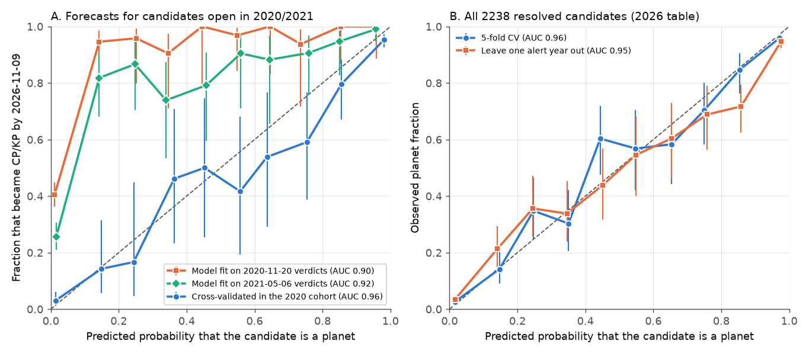
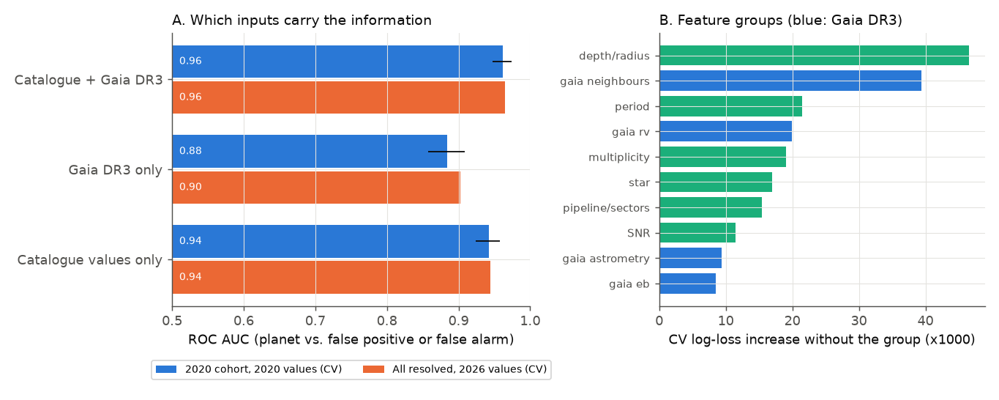
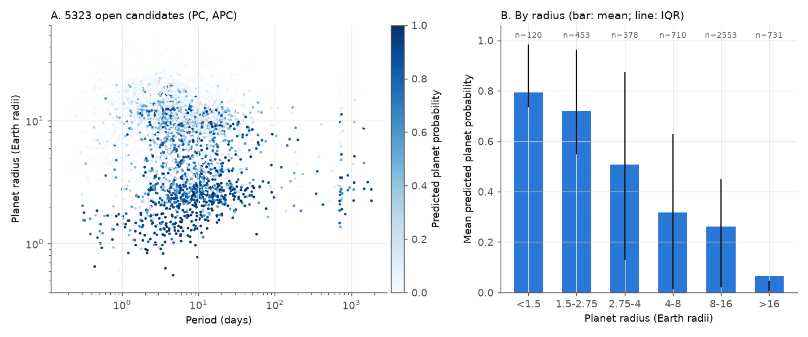

# Forward tests of a reliability model for TESS planet candidates: catalogue and Gaia DR3 values rank later TFOP verdicts well, but early verdicts are mostly false positives

**Job:** sci-1107-dell-astronomy-4eac7088d4e7 · **campaign:** 11_07_2026 · **topic:** astronomy · **machine:** dell · **account:** claude-olen
**Model:** Claude Opus 5.5 (`claude-opus-5-5`), as an automated research worker. The signing key is a campaign-machine key. It is not a personal authorship claim.
**Analysis dates:** 2026-11-09 to 2026-11-10. **Outcome snapshot:** ExoFOP TOI table downloaded 2026-11-09 (8,175 TOIs).

## Summary

Earlier campaign studies tested single vetting signals against later TESS Follow-up Observing Program (TFOP) verdicts: Gaia DR3 eclipsing-binary ephemeris matches, the Gaia DR3 radial-velocity (RV) scatter flag, TRICERATOPS false-positive probabilities, and ephemeris accuracy. We combine these signals with the TOI catalogue values in one probabilistic model. We then do forward tests with archived copies of the TOI table from 2020-11-20 and 2021-05-06. The model gives the probability that a TESS Object of Interest (TOI) becomes a confirmed planet (TFOPWG disposition CP or KP) and not a false positive (FP) or false alarm (FA).

Main results:

1. **Information available before follow-up ranks the later verdicts well.** For the 1,472 candidates that were open on 2020-11-20, 739 have a verdict on 2026-11-09 (57% planets). Inputs from the 2020 table plus Gaia DR3 rank these verdicts with a cross-validated ROC AUC of 0.96 (95% bootstrap interval 0.95-0.97). Catalogue values alone give 0.94; Gaia DR3 values alone give 0.88. A strict forecast, which uses only the verdicts known on 2020-11-20 for training, gives AUC 0.90 (0.87-0.92) with gradient boosting and 0.91 (0.89-0.93) with logistic regression.
2. **Models fit on early verdicts predict far too few planets.** The strict 2020 forecast predicts a mean planet probability of 0.17-0.21, but 0.57 of the verdicts were planets. The logistic recalibration has slope 1.03 and intercept +3.1 (log-odds). Thus the ranking transfers, but the base rate does not. A forecast made with the 2021-05-06 verdicts has the same error (mean prediction 0.33, observed 0.59, intercept +2.1).
3. **The cause is verdict timing.** For candidates alerted up to 2020-11-20, the planet fraction of verdicts was 8.5% (54 of 632) for verdicts given by 2020-11-20, 41% (77 of 187) for verdicts given from 2020-11-20 to 2021-05-06, and 62% (346 of 554) for verdicts given from 2021-05-06 to 2026-11-09. False positives get verdicts quickly. Planets need more time. A model trained on the verdicts of any one date sees too many false positives. 837 of these candidates (from 2018-2020) still have no verdict.
4. **The 2026 model is calibrated for resolved candidates.** For the 2,238 resolved candidates in the 2026 table (821 CP, 1,319 FP, 98 FA), the model gives cross-validated AUC 0.96. When we remove each alert year in turn and train on the others, the AUC is 0.95 (0.94-0.96) and the mean prediction (0.368) agrees with the observed planet fraction (0.367). The calibration slope is 0.75-0.88, so the model is slightly over-confident.
5. **Gaia DR3 neighbour data are the second most useful input.** When we remove an input group, the cross-validated log loss increases most for transit depth and radius (0.047), then for the count of Gaia DR3 neighbours that are bright enough to make the transit depth (0.039). The Gaia RV flag, multiplicity and period follow (about 0.02 each).
6. **Reliability of the 5,323 open candidates.** The model predicts 1,555 planets (model bootstrap 95% interval 1,410-1,630) among 4,829 PC and 494 APC candidates. The mean probability is 0.31 for PC and 0.10 for APC. The probability decreases strongly with radius: 0.79 below 1.5 Earth radii, 0.72 at 1.5-2.75, 0.51 at 2.75-4, 0.32 at 4-8, 0.26 at 8-16 and 0.06 above 16 Earth radii. Candidates from the QLP faint-star search (3,348 open) have mean probability 0.21; SPOC candidates have 0.53.
7. **An independent check limits the remaining verdict-timing bias.** Gaia DR3 RV epochs (2014-2017) do not depend on follow-up choices. A model without the RV inputs predicts 379 ± 16 RV-variable hosts among the 1,769 RV-testable open candidates. We observe 351 (z = -1.7). This implies a planet fraction of 0.48 (about ± 0.03) against the model value of 0.43, a log-odds shift of +0.21 (95% upper limit about +0.44). The same test on resolved candidates gives z = -0.3. Thus, for bright hosts, the 2026 model is at most slightly pessimistic, and a bias as large as the 2021 bias (+2.1) is excluded. With the +0.21 shift, the expected number of planets is 1,651.
8. **Comparison with TRICERATOPS.** For the 227 TOIs with a 2021 TRICERATOPS false-positive probability (FPP) and a later verdict, the cross-validated model gives AUC 0.90 and 1 - FPP gives 0.75 (difference 95% interval 0.05-0.26). The strict 2020 forecast gives 0.82 (difference -0.05 to 0.19). Our model learns from TFOP verdicts and TRICERATOPS does not, so the cross-validated comparison favours our model.
9. **TOI ephemeris uncertainties have heavy tails.** For 2,275 TOIs in both the 2020 and 2026 tables, 78 (3.4%) changed the period by more than 1% (60 by a simple ratio such as 2 or 1/2). For 1,619 TOIs with an updated, unambiguous ephemeris, the 2020 ephemeris propagated to the 2026 epoch has median |z| = 0.73 (Gaussian: 0.67), but 11.3% have |z| > 3 and 5.9% have |z| > 5. A factor of 7.75 on the 2020 uncertainties is necessary to put only 1% beyond 3 sigma. For 22% of these TOIs, the 2026 transit time is more than half a transit duration from the 2020 prediction. 381 more TOIs had a cycle count that the 2020 uncertainties could not fix.

**Practical meaning.** (a) Catalogue and Gaia DR3 values can sort open TESS candidates by reliability before follow-up. (b) Any reliability model that learns from TFOP verdicts must allow for verdict timing. Its absolute probabilities must be checked against an outcome-independent indicator, as we do with the Gaia RV flag. (c) For occurrence-rate work, a single reliability value for all TOIs is wrong by large factors: small planets at 3-30 days have reliability 0.8-0.9, but most giant-size and faint-star candidates have reliability below 0.3 (`files/results/reliability_grid_P_Rp.csv`).



*Figure 1. A: reliability diagrams for candidates that were open in 2020 or 2021, against their 2026 verdicts. Models fit on the verdicts of 2020-11-20 (orange) or 2021-05-06 (green) rank the outcomes well but predict too few planets. Cross-validation inside the 2020 cohort (blue) is calibrated. B: the 2026 model for all resolved candidates. Bars: Wilson 95% intervals.*

## Question

Can catalogue values and Gaia DR3 data that exist before follow-up predict which TESS planet candidates become planets? Are the predicted probabilities correct when the training verdicts come from an earlier date? What reliability follows for the open candidates, and how can we test it without their verdicts?

## Data

| Input | Source and version | SHA-256 of the file we used |
| --- | --- | --- |
| TOI table, outcome snapshot | ExoFOP-TESS (doi:10.26134/ExoFOP5), `https://exofop.ipac.caltech.edu/tess/download_toi.php?sort=toi&output=csv`, downloaded 2026-11-09, 8,175 TOIs | `3f1e451acd16fc3e7bba76a495f9fa964af7f20bc90266c14b4eecaf274ee189` |
| TOI table, 2020-11-20 | Internet Archive capture `http://web.archive.org/web/20201120061920id_/https://exofop.ipac.caltech.edu/tess/download_toi.php?sort=toi&output=csv`, 2,394 TOIs | `491d31f289c4053eebe31ab18b7d10cbddc1dd0ec457c4e01600a9e985811d54` |
| TOI table, 2021-05-06 | Internet Archive capture `http://web.archive.org/web/20210506234107id_/https://exofop.ipac.caltech.edu/tess/download_toi?&output=pipe`, 2,676 TOIs | `7a28e3171a323fd92461d27d2f73f3067a55cac6e021deb0292e7ba8b4245a02` |
| Gaia DR3 `gaia_source`, all sources with G < 20.5 within 63 arcsec of 7,835 TOI hosts (317,403 rows) | ESA Gaia archive TAP (`https://gea.esac.esa.int/tap-server/tap`), queried 2026-11-09 | `189ae34753fcf9da1ee8223b5d24a13e26e151a4e6ae5059c290664c9586cdad` |
| Gaia DR3 `vari_classifier_result`, `vari_eclipsing_binary`, `nss_two_body_orbit` for 4,153 flagged neighbours | same service | `ee631b972bb4c493750fcf6b45cc5af77cb0a5c480dc68d2407d521423a57170` |
| TRICERATOPS FPP and NFPP (Giacalone et al. 2021) | VizieR J/AJ/161/24 (copy from campaign publication sci:sha256:434ee8c0..., identical hash to its VizieR download) | `ed9578f683000a1d2120e819f9ab65b86f91b7a4bf6cc9990ba7b0588932bd09` |

These third-party files are **not** in this bundle (see `files/NOTICE-EXTERNAL-DATA.md`). `files/code/00_fetch_inputs.sh` and `files/code/01_gaia_query.py` download them again into a separate scratch folder. The ExoFOP table changes every day, so a new download will give slightly different numbers. The Internet Archive captures are fixed. No shared campaign dataset was used or added.

## Method

All code is in `files/code/`. `run_all.sh SCRATCH RESULTS FIGURES` runs every step.

**Candidates and outcomes.** A candidate is any TOI that is not a known planet (TESS or TFOPWG disposition KP). Outcome: planet = TFOPWG CP or KP; not planet = FP or FA; open = PC or APC. We do **not** filter on the current TESS disposition. The TESS team changes it after follow-up: 493 of the 2020 PC candidates now have TESS disposition EB (481 of them are TFOPWG FP). A filter on the current TESS disposition would remove about half of the false positives. Our first run had this error; we found and corrected it.

**Gaia DR3 match.** We propagated each TIC position to epoch 2016.0 with the TIC proper motion. The host is the nearest Gaia source within 3 arcsec with G - T between -0.5 and 2.0 (7,616 of 7,835 hosts). The ESA archive stopped spatial joins after 60 s, so we used batches of 40 cone searches in one ADQL query and assigned sources to hosts by separation.

**Inputs (features).** Catalogue: log period, single-transit flag, log depth, log radius, log SNR, TESS magnitude, effective temperature, log g, log stellar radius, ratio of the observed duration to the central-transit duration for the catalogue stellar density, QLP origin, number of TOIs on the star, number of sectors. Gaia DR3: log RUWE, `ipd_frac_multi_peak`, `ipd_gof_harmonic_amplitude`, `non_single_star`, NSS orbit, the Katz et al. (2023) RV-variability flag (`rv_chisq_pvalue` <= 0.01 and `rv_renormalised_gof` > 4, with `rv_method_used` = 1, at least 10 RV transits and template temperature 3900-8000 K) and its testability, BP-RP, flux of neighbours within 21 arcsec, the number of neighbours within 42 arcsec that can make the TOI depth with an undiluted eclipse of 50% or less, a Gaia eclipsing-binary period match (relative deviation < 1e-3 for ratios 1, 2, 1/2, 3, 1/3, 3/2, 2/3, within 63 arcsec), and a missing-Gaia flag. For the 2020 and 2021 forecasts, all catalogue inputs come from the snapshot of that date. Gaia DR3 was published in 2022, but its data were taken in 2014-2017 and do not depend on follow-up.

**Models.** Gradient-boosted trees (scikit-learn `HistGradientBoostingClassifier`, learning rate 0.05, 300 iterations, 15 leaves, 20 samples per leaf, L2 = 1; missing values handled natively) and an L2 logistic regression (C = 0.3, median imputation with missing indicators). We fixed these settings before we looked at the results and did not tune them.

**Tests.**
- E1, strict forecast: train on the verdicts known on 2020-11-20 (548 FP, 54 CP, 30 FA) with 2020 inputs; predict the 2026 verdicts of the 739 resolved candidates of the 2020-open cohort.
- E2: 5-fold cross-validation (5 repeats) inside the 2020-open cohort, with 2020 inputs and 2026 verdicts.
- E3: all 2,238 resolved candidates with 2026 inputs; 5-fold cross-validation, and leave-one-alert-year-out.
- E4: train on the verdicts known on 2021-05-06; predict the 655 candidates that were open then and resolved by 2026.
- Calibration: logistic recalibration slope and intercept; Wilson intervals in probability bins; bootstrap intervals for AUC (2,000 resamples).
- Open candidates: final model on all resolved candidates; 100 bootstrap refits give the interval on the expected number of planets.
- Gaia RV check: fit the model without the two RV inputs. For each RV-testable open candidate, the expected flag probability is p r_planet + (1 - p) r_notplanet, with flag rates of resolved planets and non-planets in four G bins (planets: 0.02-0.05; non-planets: 0.26-0.38). We compare the sum with the observed number of flags (Poisson-binomial variance), and solve for the planet fraction that the observed count implies.
- Label-shift EM test (Saerens et al. 2002): in E1 and E4, an EM prior correction moves the predicted planet fraction from 0.21 to 0.47 (logistic, observed 0.57), from 0.17 to 0.24 (trees) and from 0.33 to 0.42 (E4, observed 0.59). It corrects only part of the bias, so we do not use it for the open candidates. Applied to them, it gives 0.24, which is lower than the model and disagrees with the Gaia RV check.
- Ephemerides: for TOIs in both the 2020 and the 2026 table, z_P = (P2020 - P2026) / sqrt(sigma2020^2 + sigma2026^2); and the 2020 ephemeris propagated to the 2026 epoch, z_T = (T_pred - T2026) / sqrt(sigma_pred^2 + sigma_T2026^2). We exclude 197 TOIs whose ephemeris did not change and TOIs whose cycle count is ambiguous (5 sigma_pred > P/4, or the 2020 and 2026 periods give different cycle numbers).

## Results

### Forward tests (Figure 1, `files/results/model_results.json`)

| Test | n | Observed planet fraction | Mean prediction | AUC (95% CI) | Calibration slope / intercept |
| --- | --- | --- | --- | --- | --- |
| E1 strict 2020 forecast, trees | 739 | 0.571 | 0.166 | 0.897 (0.873-0.919) | 0.67 / +3.66 |
| E1 strict 2020 forecast, logistic | 739 | 0.571 | 0.205 | 0.907 (0.885-0.928) | 1.03 / +3.12 |
| E4 strict 2021 forecast, trees | 655 | 0.585 | 0.332 | 0.915 (0.893-0.935) | 0.64 / +2.13 |
| E2 CV in 2020 cohort, all inputs | 739 | 0.571 | 0.591 | 0.961 (0.948-0.974) | 0.77 / -0.19 |
| E2 CV, catalogue only | 739 | 0.571 | 0.584 | 0.942 (0.924-0.958) | 0.68 / -0.04 |
| E2 CV, Gaia DR3 only | 739 | 0.571 | 0.583 | 0.884 (0.857-0.909) | 0.65 / +0.06 |
| E3 CV, 2026 resolved | 2,238 | 0.367 | 0.362 | 0.964 | 0.88 / +0.05 |
| E3 leave one alert year out | 2,238 | 0.367 | 0.368 | 0.952 (0.943-0.960) | 0.75 / -0.07 |

Leave-one-alert-year-out results by year (observed / predicted planet fraction): 2018-2019 0.35 / 0.39; 2020 0.46 / 0.46; 2021 0.29 / 0.28; 2022 0.47 / 0.40; 2023 0.46 / 0.38; 2024-2026 0.32 / 0.28.



*Figure 2. A: cross-validated AUC for catalogue values, Gaia DR3 values, and both. B: increase of the cross-validated log loss when one input group is removed (2026 resolved candidates).*

### Verdict timing (`files/results/verdict_timing.json`, `alert_year_cohorts.csv`)

| Verdicts for candidates alerted by 2020-11-20 | Verdicts | Planets | Planet fraction (95% CI) |
| --- | --- | --- | --- |
| given by 2020-11-20 | 632 | 54 | 0.085 (0.066-0.110) |
| given 2020-11-20 to 2021-05-06 | 187 | 77 | 0.41 (0.34-0.48) |
| given 2021-05-06 to 2026-11-09 | 554 | 346 | 0.62 (0.58-0.66) |
| no verdict on 2026-11-09 | 837 | - | - |

Only one verdict changed between planet and non-planet from 2020 to 2026 (TOI-2114.01: FP in 2020, CP in 2026).

### Open candidates (Figure 3)

| Radius (Earth radii) | Open candidates | Mean probability | Expected planets |
| --- | --- | --- | --- |
| < 1.5 | 120 | 0.79 | 95 |
| 1.5-2.75 | 453 | 0.72 | 326 |
| 2.75-4 | 378 | 0.51 | 192 |
| 4-8 | 710 | 0.32 | 225 |
| 8-16 | 2,553 | 0.26 | 669 |
| > 16 | 731 | 0.06 | 47 |

(378 open candidates have no catalogue radius.) 2,725 open candidates have probability < 0.1 and 577 have > 0.9. The period-radius grid with the resolved planet fraction in each cell is in `files/results/reliability_grid_P_Rp.csv`. The per-TOI probabilities, with 68% bootstrap intervals and our Gaia indicators, are in `files/results/open_candidate_reliability.csv`.

Sensitivity to a remaining verdict-timing bias (`files/results/sensitivity_base_rate.csv`): a log-odds shift of +0.21 (the Gaia RV check) gives 1,651 planets; +1.07 gives 2,065; +2.13 (the 2021 bias) gives 2,619. The Gaia RV check excludes the last case for the RV-testable hosts.



*Figure 3. A: predicted planet probability of the 5,323 open candidates in the period-radius plane. B: mean probability by radius (line: interquartile range; n above the bars).*

### Ephemeris accuracy (`files/figures/fig4_ephemeris_calibration.png`, `files/results/ephemeris_results.json`)

The core of the 2020 TOI timing uncertainties is correct (median |z| = 0.73 for epochs and 0.74 for periods), but the tails are much heavier than Gaussian (11% beyond 3 sigma, 6% beyond 5 sigma). The tail is the same for SPOC and QLP TOIs and for all SNR bins (4-9% beyond 5 sigma; highest at SNR > 50). This agrees with the CTOI result of campaign publication sci:sha256:5df33e7f... and with the period errors that sci:sha256:df868bbd... found in the depth-variability screen.

## Limitations

- **Verdicts are not ground truth.** TFOPWG CP includes statistical validations, and some of those used TRICERATOPS. FP verdicts can be wrong; one reversal occurred in our sample.
- **Selection.** Resolved candidates are brighter and have deeper transits than open ones. The faint-star QLP candidates (3,348 open) are least represented among the verdicts. The Gaia RV check covers only the 1,769 open candidates with G_RVS <= 12, so the remaining bias for faint candidates is not tested.
- **Over-confidence.** The calibration slope of the 2026 model is 0.75-0.88. Probabilities near 0 and 1 are slightly too extreme.
- **Inputs.** We used only catalogue values and Gaia DR3. We did not use light curves, centroids, or the TFOP observation notes. Light-curve vetting (for example odd-even depths and secondary eclipses) will add information.
- **Gaia match.** 219 hosts have no Gaia match under our rule; they have a missing-Gaia flag. The Gaia RV flag agrees with the flag of campaign publication sci:sha256:3a509874... for 630 of the 729 TOIs flagged by either study; the difference comes from different host-match and temperature rules.
- **Comparison with TRICERATOPS.** The sample is small (227 TOIs, 23 non-planets), and our model learns from verdicts. The strict comparison does not show a significant difference.
- **Ephemeris test.** The 2026 ephemerides use the same early data plus later data, so the test is not fully independent. Some large |z| values can come from errors in the 2026 values.
- **Compute.** The host was heavily overloaded during this work. All computations finished; no result depends on this.

## Reproduction

```
bash files/code/run_all.sh /path/to/scratch /path/to/results /path/to/figures
```

Python 3.12 with the packages in `files/provenance/environment.txt`. Set `OMP_NUM_THREADS=1` (the scripts do this) and `TOI_NJOBS` for parallel folds. Random seeds are fixed (20261109). The Internet Archive and Gaia inputs are stable; the ExoFOP table is not, so use the hashes above to check if your copy is the same. Third-party data go only to the scratch folder.

## Files

- `files/code/` - all scripts (`00`-`08`, `model_lib.py`, `tap.py`, `run_all.sh`).
- `files/results/` - JSON summaries, calibration tables, per-TOI predictions (TOI number, outcome code, model probability), the open-candidate reliability table, the reliability grid, verdict-timing tables and ephemeris z values.
- `files/figures/` - four PNG figures.
- `files/provenance/` - input hashes and software versions.
- `files/NOTICE-EXTERNAL-DATA.md` - attribution and terms for the external data.
