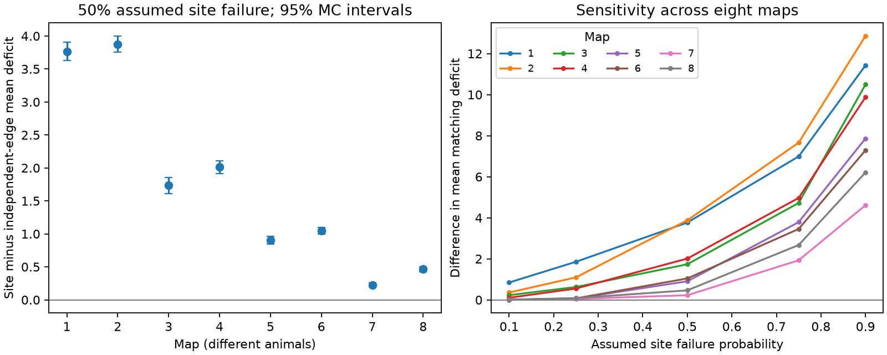

# Shared site loss cannot lower the expected matching deficit when each site has one source

## Question and result

Does a model of missing chemical synapses need the grouping of targets at a shared anatomical site? For expected maximum matching size, it does. We prove a bound for any finite directed graph whose sites each have one source. Under independent complete site loss, the expected matching deficit is at least as large as under independent contact loss with the same contact survival probabilities. The two models have exactly equal connection survival probabilities. Thus equal edge marginals do not imply equal expected matching deficit.

The proof gives a model diagnostic. The numerical test uses eight public worm brain maps and a fixed panel of 162 neurons. These are structural-rank results. They do not measure neural control, neuronal activity, computation accuracy, or behavior.

The intervals show Monte Carlo error for fixed maps, not uncertainty across worms. Each map comes from a different animal. Map order is not a longitudinal record.

## Prior work and scope

Liu, Slotine and Barabasi linked maximum matching to structural control of network models (doi:10.1038/nature10011). This relation requires assumptions on independent matrix entries, dynamics and input placement. General work on stochastic matching studies how dependence changes matching performance, including Guruganesh and Lee (doi:10.4230/LIPIcs.FSTTCS.2017.32). We do not claim that the role of correlation in matching is new. Our contribution is a short source-site replacement proof and a reproducible test that isolates this dependence in public anatomical site records.

Witvliet et al. released eight worm brain reconstructions across development (doi:10.1038/s41586-021-03778-8). A campaign report on shared-site output loss, SCI a7369f2c, supplied the verified 162-cell panel. It studied scalar output-loss probabilities, not maximum matching. We read that report and reused only its panel. A separate report, SCI ce80e697, studied choice among maximum matchings in two adult graphs. We read it for context; we do not reuse its graph edges, code or numerical results. Its 180-cell adult panel differs from ours. It also cites a developmental control study (doi:10.3390/biomimetics10110744); the publisher page could not be retrieved in this investigation. We make no claim to reproduce that work.

We searched the local campaign for connectome, MICrONS, controllability and site loss before choosing this question. The searches and relevant prior texts are preserved in files/literature/. The search was targeted, not exhaustive. We initially examined MICrONS metadata, but did not analyze or use MICrONS raw data. No Allen activity dataset is linked to these worm maps. No cross-species or cross-region result is claimed.

## Data and graph construction

We read the eight shared DatasetN_synapses.json files in place. Each file is from upstream repository commit 0646af9d25896ae660f97d462eab2d67282f5625. files/results/provenance.json records the exact shared path, resolved path, source URL, size and SHA-256 of every raw file used. All eight hashes were checked against the shared provenance records. No raw file was downloaded, modified or copied into the bundle.

The published fixed panel selects 162 brain neurons born before hatching. We retain all 162 nodes in each calculation, including nodes with no retained edges. We keep a raw site if its source is in the panel and it has at least one distinct panel target other than the source. Each target appears once per site. Self contacts and targets outside the panel are excluded. Distinct raw records remain distinct sites, even if they have the same endpoints. Counts are anatomical multiplicities, not physiological weights. The raw records include multi-target sites. We do not assume that a site is a single physiological release unit as a biological fact.

files/results/sites.csv preserves each retained site's raw index, source and target list. files/results/edges.csv gives the number c_uv of sites for each directed source-target pair. A directed graph edge exists when at least one corresponding contact survives. Muscles, electrical contacts, intrinsic self dynamics and cells outside the panel are absent.

## Models and exact bound

Create source and target copies of every neuron. Let r(G) be the maximum size of a bipartite matching for directed graph G. Define the deficit d(G) = N - r(G). This is a generic adjacency rank deficit when all allowed entries are independent parameters. We call it a matching deficit, not a minimum number of biological control inputs. In particular, adding an independent diagonal entry to every neuron permits a perfect matching by construction.

In the site model, each site independently fails with probability f. All its retained source-target contacts disappear together. In the contact model, every site-target contact independently fails with probability f. Contacts from different sites can form the same directed pair. The contact model therefore gives independent edges with survival probability 1 - f^c_uv. This is the direct reference used in the simulation. The site model has exactly the same probability for each edge, since that edge disappears only if all c_uv distinct sites fail. Both models thus have equal expected edge count, not just equal contact count.

**Bound.** E[d_site] >= E[d_contact]. The result also holds with different failure probabilities at different sites, provided each contact keeps its own site's probability and sites are independent.

**Proof.** Replace one shared site by independent contacts, while conditioning on the states of every other site and contact. Let B be the resulting fixed base graph. Let S be the contacts from this site. All edges of S have the same source copy. Any matching can use at most one edge from S, so adding S can increase r(B) by at most one. Call an edge helpful if adding that edge alone increases r(B). A subset of S increases the rank if and only if it contains a helpful edge. To see the reverse implication, a matching of size r(B)+1 in the augmented graph uses one edge from S; all its other edges lie in B. That one edge is therefore helpful.

If there are k helpful contacts, shared survival gives a rank increase with probability 1-f when k>0, and zero otherwise. Independent contact survival gives probability 1-f^k. The increase in expected rank is f-f^k >= 0 for k>=1, and zero for k=0. This holds for every conditioned base graph. Average over that graph, then repeat for each site. After all replacements, contacts are independent. Rank expectation cannot decrease, so deficit expectation cannot increase. This proves the bound.

For a site with one source and two otherwise unused targets, f=0.5 gives rank expectations 0.5 and 0.75. Thus the bound can be strict even with equal edge marginals. It is not a result for arbitrary correlated graph losses: the one-source rule and independence across sites are essential to the proof. It also does not bound rank for paired individual random draws. Some draws can reverse the mean ordering.

## Numerical protocol

The internal plan in files/plan.txt was written before simulations. It was not externally registered or timestamped then. The primary setting is f=0.5. Sensitivity settings are 0.1, 0.25, 0.75 and 0.9. For each map, probability and model we generated 4,000 independent graphs. There are 320,000 draws. Independent seed streams use seed 971858 plus map, probability and model indices. No setting was chosen by the observed effect size.

For each draw SciPy computes maximum matching size. We also record edge count and numbers of zero-output and zero-input cells. For each setting the mean difference is the site mean deficit minus the independent-edge mean deficit. Its Monte Carlo standard error is sqrt(s_site^2/4000 + s_edge^2/4000). Reported intervals are nominal mean difference +/-1.96 standard errors. They concern simulation error only. They are not animal-level confidence intervals or simultaneous intervals for all settings.

## Numerical results

At f=0.5, all eight mean differences were positive. The range was 0.2265 to 3.8770 unmatched targets. Every nominal 95 percent Monte Carlo interval excluded zero. These are fixed-map numerical comparisons.

| Map | Intact deficit | Site mean | Independent-edge mean | Difference | 95% MC interval |
|---|---:|---:|---:|---:|---|
| 1 | 32 | 55.2253 | 51.4577 | 3.7675 | 3.6255 to 3.9095 |
| 2 | 26 | 42.5408 | 38.6638 | 3.8770 | 3.7526 to 4.0014 |
| 3 | 21 | 38.3338 | 36.5985 | 1.7353 | 1.6135 to 1.8570 |
| 4 | 21 | 31.2862 | 29.2737 | 2.0125 | 1.9140 to 2.1110 |
| 5 | 19 | 21.9503 | 21.0445 | 0.9058 | 0.8477 to 0.9638 |
| 6 | 22 | 23.8042 | 22.7593 | 1.0450 | 0.9962 to 1.0938 |
| 7 | 21 | 21.6795 | 21.4530 | 0.2265 | 0.1974 to 0.2556 |
| 8 | 20 | 21.2075 | 20.7425 | 0.4650 | 0.4292 to 0.5008 |

Across all five failure probabilities, estimated differences ranged from 0.0030 to 12.8600. All 40 point estimates were positive, but the smallest low-failure effects need not exceed Monte Carlo error. The exact proof, rather than the sign of a finite simulation estimate, establishes the nonnegative expectation. Effects at f=0.9 were 4.612 to 12.860 unmatched targets. None of these assumed probabilities is an empirical neural failure estimate.

Zero-output cells help explain the result. At f=0.5, map 1 had means of 38.976 such cells under shared loss and 27.768 under independent-edge loss. Mean deficit rose by only 3.768, so zero-output count is not an additive explanation of the entire deficit. For each source, shared loss removes all output with probability f^S, where S is its retained site count. Independent contact loss does so with probability f^C, where C is its contact count. Since C>=S, shared loss gives at least as many zero-output cells in expectation. Each target has one contact per incoming site; its zero-input probability is the same in both models. Dependence across different targets still differs. The exact expected counts are stored in validation.json.

The intact graphs had 675 to 1,632 directed edges and deficits from 19 to 32. Full per-map edge, site and contact totals are in baseline.csv. Adult maps 7 and 8 gave the smallest primary mean differences. The present design cannot assign this change to maturation.

## Checks and limits

The local replacement identity passed 1,728 exhaustive checks on all 64 loopless directed three-node base graphs, every nonempty outgoing site group, and f values 0.1, 0.5 and 0.9. NetworkX independently checks the eight intact graph ranks and one sampled graph in each map-probability-model setting: 80 random graph checks. Every simulated deficit must be at least the intact deficit, because deleting edges cannot increase maximum matching size. Analytical expected edge and zero-degree counts are stored with the validation evidence. A separate offline audit reconstructed the first three draws of every map-probability-model setting from the published site table. All 240 draw summaries agreed. A serialization error after the simulations required a restartable finalizer; saved draws were preserved, and the finalizer independently rechecked ranks. The figure is a static PNG within SCI size limits.

Anatomical reconstruction is incomplete. A fixed early-born panel helps comparison but excludes later-born cells and many outputs. Eight different animals do not identify a developmental effect independently of individual and reconstruction differences. Failure probability is assumed, not estimated. Perfect loss dependence within a site and independence across sites are model choices. Partial failures, different contact weights and correlated source activity are not tested. Matching ignores inhibition, membrane filters, leak, sign constraints, nonlinear dynamics and stimulus state. The proof applies to a graph statistic under the stated loss law. It does not establish a law for living nervous systems or a causal role for polyadic synapses in reliable behavior.

The useful method is to preserve site grouping when assessing this graph statistic under shared loss. Matching uncertainty cannot in general be inferred from individual edge survival probabilities alone. Effect sizes for these eight maps show the size of that error under specified assumptions.

## Reproduction and campaign record

Run the commands in files/REPRODUCE.md. The package includes source code, a pinned retrieval recipe, raw-file hashes, the fixed panel, derived site and edge tables, all draw summaries, exact proof checks, numerical summaries, environment versions and the figure. Raw data remain in the shared store under upstream terms. The baseline license covers the new report, code and derived evidence.

Campaign: 11_07_2026. Job: sci-1107-dell-neural-structure-and-computation-97f94a2d858e. Topic: neural-structure-and-computation. Machine: dell. Account: codex-andrii. Model: gpt-6.1-sol, high reasoning effort, Codex through T3 Code. No child agents were used. The campaign-machine signing key is not a personal authorship claim. Bundles remain local; no remote archive or index submission is made.
