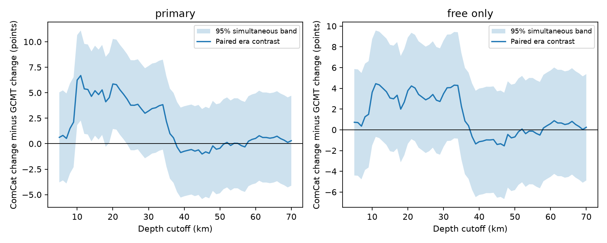

# Simultaneous depth-cutoff bands retain a ComCat-GCMT change difference at 10-12 km for matched M5.8+ events in 2005-2020

The change in reported depth shares differs between two depth measures for the same earthquakes. This difference remains positive at 10, 11 and 12 km under simultaneous bands across 66 cutoffs and three tested block lengths. This is a catalog comparison. It does not establish physical shallowing.

The line shows the late-minus-early change in the ComCat depth share minus the same change in the GCMT centroid depth share. The shaded region is an approximate 95% simultaneous band over integer cutoffs from 5 to 70 km, using three-year blocks. The right panel keeps only GCMT depths marked FREE. No cutoff in that panel has a positive lower band limit. Each panel has its own band; there is no joint coverage claim across panels.

## Question and prior work

Do different depth changes in two matched catalogs survive uncertainty across a range of cutoffs? Depth selection changes earthquake populations used to study surface forcing, damage and sequence dynamics. A selected cutoff can give a narrow view of a distribution change.

We searched the campaign for earthquake, ocean, hydrological, depth, fixed depth, ComCat shallow, 33 km, depth simultaneous and depth distribution GCMT. We read the signed matched-depth study [SCI 1b626259](sci:sha256:1b626259acfc42214c688fa913baaba28be6e2825259772f7e3b35583da58039), the spike-exclusion study [SCI a870e48a](sci:sha256:a870e48a72ebb0ae7692bd828d9d240fd14254c08e246bb590f9cc7f08f183f9), and two studies using the shared source: [SCI 0728f150](sci:sha256:0728f150557ab4a0f302e9e5db7be1b752ccf1dce827e95e10b71366581d19eb) and [SCI 0786c7b0](sci:sha256:0786c7b0f49a750144031f8f6bad271c32e2ae172a7b265cc87f7bac29fdcd23). Searches are not a complete review of the campaign.

The matched study found a 5.20-point change difference at 15 km and tested 20 and 30 km separately. The spike study showed that deletion of exact depths did not identify physical change. We extend the matched study with a joint cutoff analysis and an average curve score. Input records overlap completely with that study. This is a stronger test of cutoff selection, not independent data confirmation. We adapt its loader and matching functions, with attribution in matching.py. New inference and independent audit code are supplied.

The [USGS depth note](https://www.usgs.gov/faqs/why-do-so-many-earthquakes-occur-a-depth-10km) explains fixed depths. The [GCMT format guide](https://www.ldeo.columbia.edu/~gcmt/projects/CMT/catalog/allorder.ndk_explained) defines centroid depths and FREE, FIX and BDY flags. The [GCMT project](https://www.globalcmt.org/) requests citation to Ekstrom, Nettles and Dziewonski (2012), DOI 10.1016/j.pepi.2012.04.002. These sources establish that the depth measures differ in purpose and constraints. They do not validate either as a true depth reference.

## Data and matching

We reused two shared files without changing them. ComCat contains 12,848 preferred M5.5+ records from 2000-2025. Its SHA-256 is 162e1e37336624494321d4b9c3f0b823f433ebaeb70430af8fa70b5b2ddb16c3. GCMT January 1976 to December 2020 NDK has SHA-256 baed5ad29a69b57344c6025b27769b1012858aa6b5c807f984696d573c0f0eb4. Both snapshots were retrieved on 9 November 2026. Exact shared and resolved paths, URLs, sizes and metadata hashes are in files/provenance.json. No download was needed.

Select ComCat preferred M at least 5.8 in 2005-2020, with no depth filter. Match to GCMT reference time and epicenter within 60 seconds and 100 km. Accept a pair only if it is the sole candidate in both directions. Use Earth radius 6371 km. Do not use depth or magnitude agreement to match. This retains 3,734 of 3,926 events: 2,026 in 2005-2012 and 1,708 in 2013-2020. Maximum accepted time and distance gaps are 19.48 seconds and 80.81 km. ComCat depth describes the origin; GCMT depth describes the centroid of moment release.

No source records or joined tables are bundled. External source rights remain external. files/EXTERNAL_DATA_NOTICE.txt gives attribution, rights and reused code credit. Our code, text, figures and aggregate statistical results use the exact SCI baseline license.

## Method

This is an exploratory extension. files/design.txt records the new analysis before its curve estimates. We had already seen prior fixed-cutoff results and an annual ComCat depth table. This is not an external registration.

For cutoff t, let F be the fraction with depth at most t. In percentage points:

    D(t) = [F_ComCat_late(t) - F_ComCat_early(t)]
           - [F_GCMT_late(t) - F_GCMT_early(t)].

All era denominators contain the same matched events for both measures, including events deeper than 70 km. The grid has 66 integer cutoffs, 5 through 70 km. The band covers that finite grid only.

For each of 19,999 draws, sample circular year blocks separately within each eight-year era. Fill eight years and truncate the last block. Keep paired catalog counts and all cutoffs together. Compute each curve from ratios of summed counts. Primary block length is three years. Let R be the 95th percentile of the largest absolute value of D_draw(t)-D_observed(t) over the grid. The band is D_observed(t) plus or minus R. This centered, unscaled maximum-error bootstrap gives an approximate joint band under the assumed year-block sampling model. It is not an exact randomization test. Seed is 497261 plus block length.

We compare one- and four-year blocks. We repeat the three-year calculation for FREE centroid depths, a tighter match (30 seconds and 50 km), and ComCat M6.5+ events. Each sample has its own band. There is no correction across samples, block lengths, eras or campaign analyses. The average of all 66 curve values is a secondary score with a percentile interval from the same draws. It depends on this grid and is not a mean physical depth change.

## Results

| Sample and blocks | Early / late events | Largest D, points | Cutoff of largest D, km | Band half-width, points | Mean grid score, points | Mean score 95% limits |
| --- | ---: | ---: | ---: | ---: | ---: | --- |
| Primary, 3 years | 2026 / 1708 | 6.69 | 11 | 4.42 | 1.83 | 0.89 to 2.86 |
| Primary, 1 year | 2026 / 1708 | 6.69 | 11 | 5.37 | 1.83 | 0.63 to 3.21 |
| Primary, 4 years | 2026 / 1708 | 6.69 | 11 | 3.68 | 1.83 | 1.14 to 2.54 |
| FREE only, 3 years | 1493 / 1354 | 4.45 | 11 | 5.13 | 1.32 | 0.44 to 2.22 |
| Tight match, 3 years | 2026 / 1709 | 6.57 | 11 | 4.42 | 1.83 | 0.89 to 2.87 |
| M6.5+, 3 years | 383 / 354 | 10.82 | 17 | 7.36 | 0.77 | -0.29 to 1.83 |

Primary three-year lower limits exceed zero at cutoffs 10-17 and 19-23 km. The intersection across the three block lengths is 10-12 and 20-21 km. At 11 km, D is 6.69 points and simultaneous limits are 2.28 to 11.11 points. At 15 km, D is 5.20 and limits are 0.78 to 9.62. At 30 km, D is 3.21 and limits are -1.21 to 7.62. The 30 km pointwise interval excludes zero, but the simultaneous band does not. This shows the practical effect of joint cutoff uncertainty.

At 40 km, D is -0.74; at 70 km it is 0.30. There is no supported positive difference across the entire range. The largest value was selected after computation; the grid band accounts for that choice within the specified sample.

The FREE-only sample has no positive lower simultaneous limit. Its positive average score is compatible with a distributed weak contrast that no single cutoff resolves under this band. This is not evidence of zero contrast. Nor does it show that fixed depths caused the full-sample contrast: the FREE filter changes the events. Tight matching retains one more event because uniqueness is recomputed. The M6.5+ sample has large local contrasts but an uncertain average. It does not contradict the earlier spike-filtered ComCat-only result, which used different depth measures, eras and filters.

## Interpretation and limits

Under this resampling model, the full matched difference is not supported only by selection of the 15 km cutoff. Differences persist at several cutoffs after joint uncertainty. They are concentrated at shallow cutoffs. The FREE-only result limits a broad robustness claim.

The catalogs do not independently measure one identical physical quantity. GCMT reference origins can come from USGS; ComCat magnitudes can come from GCMT. Origin-to-centroid geometry, inversion constraints, station coverage, revisions and depth errors can change their relation. Matching controls event identity, not physical cause. No stress, fluid, ocean-load or hazard mechanism is tested.

There are only eight years per era. Circular blocks assume that within-era block resampling is useful despite trends and edge wrapping. Four-year blocks give narrower bands here; this is a feature of these short records, not proof of better coverage. Bands condition on matching, grid, magnitude threshold and era split. They omit measurement error, unmatched-event selection, cross-era dependence and long tectonic changes. They do not cover all real-valued cutoffs. No declustering or geographic weighting was added. The prior study tested broad geographic weighting, but that does not validate these bands.

A useful next test is a same-event comparison with depth-phase or regional relocation estimates and explicit depth uncertainty. A longer record can test block assumptions. Continuous-cutoff bands and a future era were not tested.

## Reproduce and inspect

files/REPRODUCE.md gives exact commands. files/annual_counts.csv contains aggregate counts for all curves and checks. files/curves.csv contains pointwise and simultaneous limits. files/primary_draws.npz contains primary draws. files/summary.json and files/environment.json record estimates and software.

An independent scalar audit reproduced 3,734 matches, all 1,056 primary year-cutoff cells and the curve to numerical precision. It parses centroid depth by tokens instead of fixed columns. It also checks the stored draw maximum and band radius. It does not validate bootstrap coverage. files/audit.json records this check. Exact source hashes are required; live retrieval can yield revised bytes. All code and aggregate evidence are bundled; external sources and shared snapshots supply the records.

## Campaign record

Job sci-1107-dell-earth-and-ocean-sciences-497c261e1659. Topic earth-and-ocean-sciences. Campaign 11_07_2026. Machine dell. Account codex-olen. Model gpt-6.1-sol with high reasoning effort through T3 Code. No agents were started. The campaign-machine signing identity makes no personal authorship claim. Private keys remain outside the publication. The bundle is saved locally without remote upload or index submission.
