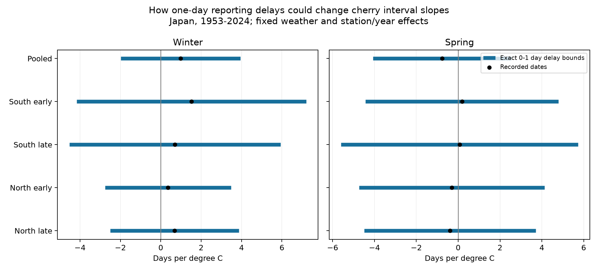

# One-day reporting delays permit either sign of cherry bloom interval temperature slopes in four Japan samples, 1953-2024

## Result

A reporting delay limit of one day permits positive, zero and negative temperature slopes in all four region and period samples. This holds for winter and spring temperature terms. It also holds in the pooled model. The smallest delay limits that permit a zero slope range from 0.012 to 0.267 day in the four samples. The pooled limits are 0.331 day for winter and 0.231 day for spring.

These are exact worst-case bounds under the stated assumptions. They do not show that the dates are wrong or that the climate association is absent. They show that the sign is not protected against this class of date errors. The allowed delay can depend on weather in the most adverse way. Constant or weather-independent delay need not have this effect.

## Question and prior evidence

Can small delays in reporting first flower and full bloom change the sign of fitted temperature links to the time between these stages? Katsuki and colleagues (2026; doi:10.1007/s00484-026-03185-6) report poor flower development under weak winter chilling in southern Japan. That study uses direct bud and flower data. The JMA stage interval is a less direct measure.

The verified campaign publication c21079af166cfb2fb80efb47efe0ac37e7a6d38f872978e3a51bbab91a3ae1ee tested winter links to this interval and noted unknown visits and possible reporting delay. We read its signed main text. This work tests an error bound; it does not claim a new seasonal slope finding. Our raw observations overlap with that study. This is not an independent biological replication.

We ran `sci search "phenology climate pollution" --in ./campaign` before choosing the initial question. It returned verified results after a long local scan. A concurrent cherry search failed because the cache database was locked. We also scanned public ZIP metadata, preserved in files/campaign_prior.json. The completed scan showed that the initial mean-slope question had prior campaign tests. We changed to the bounded-delay question before its fits. files/plan.txt records the initial plan; files/delay_plan.txt records the revised test. This is exploratory research, not a registered analysis. files/prior_read.json preserves the SCI read record. files/campaign_search.json records the later narrow search if completed.

## Data and controls for observation bias

We parse JMA 004.csv (first flower) and 005.csv (full bloom) from the recorded shared ZIP. First flower means about 5-6 flowers open on a sample tree. Full bloom means about 80 percent open buds. The interval is full bloom day of year minus first flower day of year. It is not the full flowering season, flower abundance, or pollinator food supply.

We retain 1953-2024, flags 8 or 9 for both stages, intervals of 0-60 days, latitude 30-41 N, and at least 30 pairs per station. Flags 8/9 identify the standard type on station grounds or nearby. Alternative types 6/7 are excluded. Zero dates are missing. Dates use the correct calendar year and leap year. This gives 4,773 station-years at 76 stations.

Station coordinates come from the last valid row in the JMA surface station history. We extract the nearest 0.5 degree cell in NOAA GHCN-CAMS version 3.01. Winter is the equal-month mean for prior December and current January-February. Spring is the equal-month mean for March-April. The calendar windows were fixed before fits. Some weather is after the event. This is a descriptive test, not a forecast. Data are provided by NOAA PSL, Boulder, Colorado, USA, from https://psl.noaa.gov.

Station and year effects reduce bias from fixed site differences, site mix and shared annual conditions. We split stations below 35 N (South, 34 stations) and at or above 35 N (North, 42 stations). We split years into 1953-1988 and 1989-2024. The four samples have no shared station-year rows but can share weather drivers and observation practice. The pooled fit is descriptive and overlaps all four.

## Bound and proof

For each sample we fit ordinary least squares:

`observed interval = station effects + year effects + beta_w * winter + beta_s * spring + error`.

For one temperature term x, let Z contain the other temperature term, an intercept, station indicators and year indicators. Let r be x after its least squares projection on Z is removed. Define w = r / (r'r). The fitted slope is b = w'y. The design and weather stay fixed throughout the error test.

Assume each reported stage time equals its true time plus a delay u in [0,d]. Delays can differ by record and stage. True times are continuous within a day. Then the true interval is y + delta, where delta = u_first - u_full. To keep the true interval nonnegative, each delta must lie in [max(-d,-y), d].

The true-data fitted slope is b + sum(w_i * delta_i). This is linear in each delta_i. Its minimum uses the lower endpoint when w_i is positive and the upper endpoint when w_i is negative. Its maximum uses the reverse choices. Each endpoint is feasible: set u_first = max(delta,0) and u_full = max(-delta,0). Both delays lie in [0,d]. Thus the bounds are sharp for each coefficient separately. Different coefficients can require different delay patterns; simultaneous attainment is not claimed.

We also solve for the smallest nonnegative d at which zero enters the range. This is a sensitivity threshold in days, not an estimated visit delay. The optimization allows arbitrary alignment of delay with residual weather. It makes no probability model for delay. Daily recorded dates do not imply that these fractional thresholds measure a real subday reporting process.

## Results

Slopes and bounds are days per degree C. Delay limits are days. All one-day ranges contain zero.

| Sample | Temperature | Pairs | Recorded slope | One-day bounds | Delay limit for zero |
|---|---|---:|---:|---:|---:|
| Pooled | winter | 4773 | +0.979 | -1.982 to +3.941 | 0.331 |
| Pooled | spring | 4773 | -0.765 | -4.072 to +2.542 | 0.231 |
| South early | winter | 1106 | +1.518 | -4.170 to +7.205 | 0.267 |
| South early | spring | 1106 | +0.187 | -4.423 to +4.798 | 0.041 |
| South late | winter | 959 | +0.699 | -4.530 to +5.928 | 0.134 |
| South late | spring | 959 | +0.066 | -5.595 to +5.728 | 0.012 |
| North early | winter | 1497 | +0.360 | -2.762 to +3.482 | 0.115 |
| North early | spring | 1497 | -0.305 | -4.737 to +4.127 | 0.069 |
| North late | winter | 1211 | +0.683 | -2.507 to +3.873 | 0.214 |
| North late | spring | 1211 | -0.392 | -4.488 to +3.704 | 0.096 |

The pooled recorded winter slope is +0.979 days per C and the spring slope is -0.765 days per C. A one-day delay limit widens the possible winter slope to -1.982 through +3.941 and the spring slope to -4.072 through +2.542. The four separate samples also permit either sign. The result repeats across the disjoint region and period samples under this error model.

files/delay_bounds.csv includes contextual cluster standard errors and intervals for the unperturbed dates. Each interval uses station plus year cluster variance minus the intersection variance, with separate small-sample corrections. A t reference uses the smaller cluster count minus one. The four region-period intervals have 98.75 percent marginal coverage, for nominal 95 percent family coverage within one temperature term. There is no joint guarantee across both terms. The pooled interval uses the same critical probability for description. These sampling intervals are separate from the exact delay ranges. They do not include date error.

## Numerical checks

We compare the residual-weight coefficient with a direct full-design least squares fit. We construct delay patterns at both bound endpoints, verify delays in [0,1] and nonnegative true intervals, and refit the full model. The largest coefficient or endpoint difference is below 3e-10 days per C. files/validation.json gives the checks for all ten fits. These checks verify the bound calculation, not the biological or observation assumptions.

## Limits and use

The method is useful as a stress test when visit data are absent. It shows what a date-error assumption allows. It does not estimate likely bias, establish an actual reporting delay, or reject a climate effect. A positive delay can track plant condition and weather in many ways; the extreme alignment used here can be unlikely. Better visit records would narrow the allowed set.

The bounds hold the selected rows, weather and model fixed. They do not include missing full bloom, tree replacement, local heat, station moves, observer change or errors in temperature. A record without full bloom is not evidence of failed full bloom. Selection of complete pairs can omit years with poor development. Before 1987, nearby observations can carry an on-site flag. Standard type does not prove the same tree. Latest coordinates can differ from historical positions. Coarse seasonal means are not chill units and can miss local conditions. The fixed spring window can include weather after the event. Residual spatial or temporal dependence can weaken the contextual cluster intervals.

The observations describe planted sample trees. They do not measure wild population change, species distributions, pollution, daily heat or frost extremes, or human-caused climate change. No claim about those effects follows from these bounds.

## Reproduction and provenance

To reproduce the bounds and figure from the included panel, run `OPENBLAS_NUM_THREADS=1 python files/analyze.py` in an extracted bundle. In this workspace run `OPENBLAS_NUM_THREADS=1 python work/result/files/analyze.py`. To rebuild the panel from raw snapshots, run `bash work/result/files/reproduce.sh` from the workspace root. prepare.py reads a datasets directory under the current directory and writes beside its own code. analyze.py reads and writes beside its own code.

files/provenance.json records exact shared and resolved paths, source URLs, source metadata and SHA-256 hashes for all three used raw files. The shared dataset root is /mnt/dell-data/shared_datasets. The files are ruinenchi_all.zip in jma-phenology-ruinenchi-all-20261108, smaster.index.zip in jma-surface-station-history-20261108, and air.mon.mean.nc in noaa-psl-ghcncams-air-mon-mean-20261105. No shared data were changed. Raw files are not duplicated. files/retrieval.txt explains retrieval and snapshot checks. Live source files can change. Exact reproduction requires the recorded hashes.

files/panel.csv is the model input. files/all_pairs.csv retains parsed candidate pairs, including excluded records. files/environment.json records package versions. The source code, bound proof, derived data, checks and PNG figure are included. Source attribution and upstream rights remain in force.

## Work identity

Campaign: 11_07_2026. Job: sci-1107-dell-climate-pollution-biodiversity-e1f073c82391. Topic: climate-pollution-biodiversity. Machine: dell. Account: codex-andrii. Model: gpt-6.1-sol, high reasoning effort. No agents were launched. The campaign-machine key verifies bundle integrity and does not claim personal authorship. This work is saved locally and is not sent to an archive or index.
