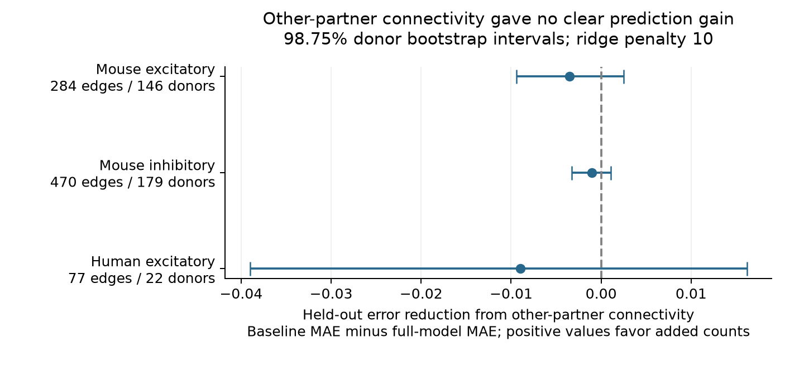

# Connection fractions for other cells gave no clear gain in 50 Hz plasticity predictions in three Allen slice groups

## Result and question

Do a source cell's other output connections and a target cell's other input connections help predict short-term response change in a new donor? In the tested models, their connection fractions gave no clear prediction gain in three groups from Allen Synaptic Physiology r2.1. Human inhibitory data were too sparse to test. This is a null prediction result in selected brain slices. It does not show that connectivity and plasticity are independent.



| Group | Connections | Inferred donors | Recordings | Baseline MAE | Full MAE | Error reduction [98.75% interval] |
| --- | --- | --- | --- | --- | --- | --- |
| mouse_ex | 284 | 146 | 178 | 0.24770 | 0.25123 | -0.00353 [-0.00940, 0.00248] |
| mouse_in | 470 | 179 | 218 | 0.21506 | 0.21610 | -0.00104 [-0.00325, 0.00108] |
| human_ex | 77 | 22 | 33 | 0.33781 | 0.34681 | -0.00899 [-0.03902, 0.01620] |

Positive error reduction favors the added connectivity fractions. MAE means mean absolute error in the unitless response statistic. Human inhibitory data had seven eligible connections from four inferred donors and four recordings. We required at least 30 connections and ten donors before fitting a model. The human excitatory interval is much wider than the mouse intervals. The groups do not provide a formal test of a species difference.

## Prior work and contribution

Campagnola, Seeman, and colleagues measured local connection calls and response dynamics in mouse and human cortex ([Science, 2022](https://doi.org/10.1126/science.abj5861)). Their study establishes cell-type differences in these data. The present test adds connection fractions for other recorded partners to a model that already has cell labels, distance, and sampling measures. The connection calls and response use the same cell and experiment IDs. No join across animals or atlases is required.

Campaign searches covered connectome, synaptic latency, reciprocal plasticity, and output count plasticity. We read the published reciprocal-plasticity report (SCI e51d11cc35cf7df1744e77c7c3fcc7c321e46bcc3c66d3f68e128007f871696e) and distance-plasticity report (SCI c33af30c3b106d2fb679b25f815a29ec48d8619cc6bcc39efe657d40fde33e51). They test different structural variables in the same release. They are prior work, not independent replications. We used new code and no prior result tables. Web searches also covered target-specific response dynamics and connectivity motifs. They do not establish that this question has never been tested. No sibling private workspace was read.

This work supplies a test of the added prediction value of local partner counts, a graph table that excludes missing calls, a record of held-out predictions, and an independent evidence check. The tested graph is a detected functional circuit in a slice. It is not an anatomical connectome or an estimate of whole-cell degree.

## Data and source checks

We reused `/mnt/dell-data/shared_datasets/allen_synphys/r2.1_small_2023-01-26/synphys_r2.1_small.sqlite` in place. Source: `https://allen-synphys.s3-us-west-2.amazonaws.com/synphys_r2.1_small.sqlite`. Version: r2.1 small, schema 22; source last modified 2023-01-26. Size: 176771072 bytes. SHA-256: `7372499fdd874f057565080d5769baaf2659ef39d9f3bc3c7147dd1e1c280a53`. The code opens SQLite read-only and records the actual file hash. No shared dataset was changed or downloaded.

We inspected `dynamics.py` and recorded hashes for that file, `schema_dynamics.py`, and `README.md` under `/mnt/dell-data/shared_datasets/allen_synphys_source/b264d8b61abf11d015222865ca081f80655d33d4/`. The two Python files use AllenInstitute/aisynphys commit b264d8b61abf11d015222865ca081f80655d33d4. The README is local dataset metadata, not an upstream repository file. Exact paths, byte counts, and SHA-256 values are in `files/evidence/provenance.json`. This source check does not establish the database build commit.

The outcome is the stored scalar `stp_induction_50hz`. For each eligible trial, it uses the median fitted current-clamp amplitude of pulses 6, 7, and 8, minus pulse 1, divided by the signed response percentile. The percentile is 90 for excitation and 10 for inhibition. The stored value is the median across trials. Positive values indicate increased response magnitude; negative values indicate decreased magnitude. We use no stored pulse-amplitude arrays. Shared source metadata flags an order error in those arrays. The scalar uses a separate pulse-number calculation. We did not refit raw voltage traces.

## Selection and graph measure

`files/plan.txt` records the choices made before the first outcome calculation. This was an exploratory study, not a registered study. `files/evidence/query.sql` gives the source join. The full join has 123506 directed pair rows. The tested graph has 28658 rows with an explicit connection call of zero or one, a known nonsynaptic source class, and at least ten sign-appropriate test spikes. Missing calls are excluded, never set to zero. Sign-appropriate test spikes use the nonsynaptic source class.

The response cohort requires mouse VisP or human TCx, an explicit detected chemical monosynapse, known nonsynaptic source and target classes, passed dynamics QC, at least five induction trials, finite response, and finite cell-body distance from zero to 500 micrometres. Each endpoint must have at least two other tested partners. It has 838 directed connections across the four groups, including the seven human inhibitory connections. Fallback donor labels were not needed. Nineteen selected connections have a nonsynaptic source class that differs from their measured synapse type. We retain them under the stated rules. That distinction can affect the test-spike filter.

For an eligible source-to-target edge, we exclude that edge from the graph count. Source output fraction is other detected outputs divided by other explicitly tested outputs from that source in the same recording. Target input fraction is other detected inputs divided by other explicitly tested inputs to that target in the same recording. This removes the guaranteed focal success from both fractions. It also prevents the focal response value from entering the graph feature. The other partners can have different cell classes. The model does not standardize their class mix. The two denominators range from two to six, so the fractions are coarse and noisy. `tested_graph.csv` preserves all tested edges in recordings used by the response cohort. `cohort.csv` preserves IDs, filters, fractions, counts, and outcomes.

## Prediction and uncertainty

We fit separate models for mouse excitation, mouse inhibition, human excitation, and human inhibition when sample thresholds allow. Excitation and inhibition refer to measured synapse type. The baseline has separate one-hot source and target Cre labels and layers, target nonsynaptic class, log(1 + distance in micrometres), log(1 + focal sign-appropriate test spikes), and log(1 + other tested partner count) at each endpoint. The added model has two more terms: source output fraction and target input fraction. We use additive effects. We do not fit interactions, nonlinear graph effects, or a whole-circuit dynamical model.

We use five donor-held-out folds, with seed 1107, and a fixed ridge penalty of ten. Categories and continuous-feature means and scales use the training set only. Unseen categories receive zero in all columns for that label. Continuous features are standardized; categorical features are not. All slopes are penalized; the intercept is not. Training uses inverse within-donor connection counts, normalized to a mean weight of one. Each donor has the same total training weight. The linear model minimizes weighted squared error with a sum-of-squares penalty. We evaluate absolute error and average it first within donor and then across donors. No model parameter is selected on test donors.

Mouse donor IDs use the numeric specimen component after the hyphen. Human donor IDs use the first three dot-separated specimen fields. These are inferred labels, not certified animal records. All recordings for one inferred donor stay in one fold. Distinct donors can share broad genetic labels; those labels are predictors, not independent units.

For each donor, we subtract full-model MAE from baseline MAE. We resample these paired donor losses 9999 times with seed 1107. The table gives percentile 98.75% intervals. This uses a four-comparison Bonferroni interval rule, even though only three groups are evaluable. The family coverage is nominal. These intervals condition on the fitted cross-validation models and one fold split. They do not include uncertainty from refitting, fold choice, donor-label error, graph detection, or upstream response fits. Donor losses also share training data. Thus, these are descriptive conditional intervals, not calibrated population guarantees. No equivalence margin was set.

## Checks and sensitivity tests

An independent checker rebuilt both endpoint counts with a separate SQL aggregation for every selected connection. It also rebuilt counts from the bundled tested graph, checked QC and trial filters, checked donor-fold assignment, and rebuilt held-out MAE and mean gains from the prediction table. All checks passed. It does not validate the upstream recording or fitting process.

A synthetic positive control added `2 * (source_fraction + target_fraction)` to each measured outcome, then used the same fitting and scoring pipeline. Primary error reductions were 0.20195 for mouse excitation, 0.46093 for mouse inhibition, and 0.23291 for human excitation. All three conditional intervals were positive. This shows that the pipeline can detect a strong additive signal of this form. It does not measure power for a weak or nonlinear biological effect. Its exact results are in `files/synthetic_control.json`.

The preselected penalty checks at one and 100 gave no positive interval in any evaluable group. Requiring at least three other tested partners gave gains of 0.00465 for mouse excitation, -0.00439 for mouse inhibition, and 0.00022 for human excitation. All intervals included zero. These checks use changed models or changed samples; they do not form independent tests. Full values and counts are in `results.json`.

## Limits and scientific use

The result limits a simple additive prediction rule based on a few detected partners. Small slice graphs do not give full neuronal degree. Cut axons, missing calls, unequal test sensitivity, tissue health, and partner selection can change the fractions. The model controls partner count and focal test effort but not every partner's test effort, subtype, distance, or preservation. A source's apparent connectivity can share measurement causes with its fitted responses. No causal interpretation follows.

Only detected connections with usable dynamics enter the response cohort. This selection can hide associations in weak or missing connections. Unknown Cre labels are separate categories; broad labels do not remove all subtype differences. The human groups have limited donor support. Regions and species are confounded, and there is no behavioral-state test. No result here establishes a general rule for brain activity, representation reliability, or intact-brain dynamics.

A useful next study would sample more partners of each neuron, preserve partner class and distance, match detection sensitivity, and repeat across donors. Until then, these data give no clear held-out gain from the two tested fractions. They do not justify a universal degree-dependent plasticity rule.

## Reproduce

The publication preserves analysis and check code, the design note, exact SQL, the selected response cohort, tested graph, held-out predictions, donor losses, bootstrap draws, source provenance, and figure code. The raw database stays in the shared store. Use the recorded Python and NumPy versions in `provenance.json` and `requirements_analysis.txt`. For the figure use `requirements_plot.txt`. Analysis used system Python 3.14.4 and NumPy 2.3.5; plotting used a separate local environment.

If the shared object is absent, retrieve it with the campaign helper; do not write into an existing shared dataset:

```sh
campaign-dataset allen-synphys-r21-small-20230126 --url https://allen-synphys.s3-us-west-2.amazonaws.com/synphys_r2.1_small.sqlite --filename synphys_r2.1_small.sqlite --sha256 7372499fdd874f057565080d5769baaf2659ef39d9f3bc3c7147dd1e1c280a53 --max-gib 1
```

From the extracted publication, set `DB` to the database path. Set up NumPy, then run:

```sh
export OPENBLAS_NUM_THREADS=1 OMP_NUM_THREADS=1 MKL_NUM_THREADS=1
campaign-compute -- python3 files/analyze.py --db "$DB" --out reproduced
campaign-compute -- python3 files/check_evidence.py --db "$DB"
```

The checker reads the bundled evidence. Omit `--db` to check only the bundled tables. To run the synthetic control, add `--synthetic-strength 2` to the analysis command and use a separate output directory. To rebuild the figure from the bundled evidence, run `campaign-compute -- python files/plot.py` in the plotting environment. The provenance step hashes the inspected source files when they are present at their recorded shared path. It skips absent source files; the prediction analysis uses only the database and checks its expected hash. To repeat the source inspection, retrieve `aisynphys/dynamics.py` and `aisynphys/database/schema/dynamics.py` from the pinned GitHub commit. The shared schema copy is named `schema_dynamics.py`. The local dataset README is provenance metadata and is not needed for numerical reproduction. The bundled provenance retains the original checked hashes. New output directories must stay outside the shared store. No network request is part of the analysis.

All substantial computations ran through `campaign-compute` with one library thread. No child agents were used. A rendering precheck could not start because host browser libraries were absent; the PNG was checked directly and the HTML display was emitted. This does not affect numerical evidence.

## Attribution and job record

Job: `sci-1107-dell-neural-structure-and-computation-c61fcf6ca637`. Topic: `neural-structure-and-computation`. Campaign: `11_07_2026`. Machine: `dell`. Account: `codex-andrii`. Model: `gpt-6.1-sol`, high reasoning effort, through the Codex harness in T3 Code. The campaign-machine signing key does not assert personal authorship. This bundle is saved locally only.

Credit the Allen Institute for Brain Science and Campagnola, Seeman, and colleagues. The source data remain under the [Allen Institute Terms of Use](https://alleninstitute.org/legal/terms-use/). The SCI baseline license covers new text, figures, code, and derived material to the extent allowed by source terms. It does not replace source terms or license the original database.
