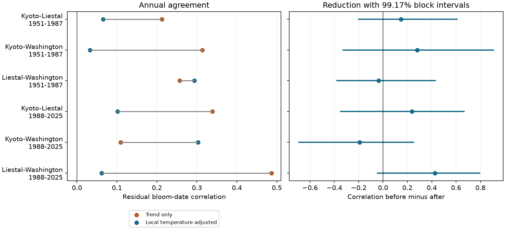

# Local temperature adjustment gave no clear reduction in annual cherry bloom agreement across three site pairs in 1951-2025

We tested whether local seasonal temperature reduced shared annual changes in cherry peak bloom dates at Kyoto, Liestal and Washington. We used 225 site-years and separate tests in 1951-1987 and 1988-2025. Site models removed linear year trends, then added January-February and March temperature. The six correlation reductions ranged from -0.194 to +0.425. All six intervals included zero after correction for six tests. For Liestal and Washington in 1988-2025, correlation fell from 0.486 to 0.061. Its reduction was 0.425, with a corrected interval of -0.045 to +0.793. This supports local temperature as a candidate explanation for the prior pattern, but does not establish it. Fixed sites and complete years reduce changes in coverage. Different species, bloom rules, unknown visit histories, coarse weather and short periods limit inference. These descriptive fits do not show a causal climate effect or measure pollution, extreme weather or species loss. Code, source hashes, derived evidence and offline checks are included.



## Question and prior work

Do local winter and spring temperatures account for shared annual bloom changes across distant regions? This question can inform tests of shared timing risk. It does not measure resource supply or actual risk.

SCI 7aab81648fca9dfbd115c4f58803f4fdefc1d1a233c2c9c5963525f92b8f6d00 found positive later annual agreement for Liestal and Washington after local trends and winter ENSO adjustment. It left local weather untested. We use the same biological archive and period split, then add local weather. This is a follow-up on the same records. It is not a new biological replication.

Campaign searches preceded question selection. We also read SCI 4b7781819be8475e4a2021ddf4bc53f7f3b2c46d8655e1f2012db879b393cf8d on Japanese bloom intervals and SCI b86f17457f0022d34a7e3434d71c31f5829a4886fca29cc36ee78d76a3cea349 on nearby lilac pairs. These studies test related measures. Our contribution is the direct local-weather test of the intercontinental peak-bloom pattern. The plan was saved before this study's correlations were calculated. It is exploratory and was informed by published results.

Aono and Kazui (doi:10.1002/joc.1594) used Kyoto bloom dates to reconstruct spring temperature. Fan and van den Dool (doi:10.1029/2007JD008470) describe the gridded weather product. Terasaki Hart and colleagues (doi:10.1038/s41586-025-09410-3) map spatial differences in seasonal plant cycles. Our annual correlation measure differs from their spatial seasonal-cycle measure.

## Data and observation bias

The bloom archive is the GMU competition repository at commit a95298263523607c8489a7be091c8c8d8ce61979. We use kyoto.csv, liestal.csv and washingtondc.csv. Each has exactly one valid date for every year from 1951 to 2025. We check years, duplicate coverage, dates and supplied day of year. We remove leap day from dates after February. There are 225 site-years. All weather months are present.

Kyoto records Prunus jamasakura peak bloom at Arashiyama, from a local newspaper through Yasuyuki AONO. Liestal records Prunus avium with a 25 percent bloom rule. Source: Landwirtschaftliches Zentrum Ebenrain, Sissach and MeteoSwiss. Washington records Yoshino cherry with a 70 percent full-bloom rule from EPA and the National Park Service. The species and bloom rules differ. Correlations describe annual deviations, not equal dates or flower overlap.

Fixed sites, complete annual records and the same years in both models reduce changes in geographic coverage and sample size. Local trends remove simple slow changes. These controls cannot remove observer changes, tree replacement, changing visit frequency, urban heat or shared reporting changes. We have no visit logs or tree histories. The three sites are selected managed records, not a random sample of wild plants.

NOAA PSL, Boulder, Colorado, USA provided GHCN-CAMS monthly temperature version 3.01 through https://psl.noaa.gov. We use the nearest 0.5-degree cell at each source coordinate. Cell coordinates are in files/provenance.json. The saved snapshot extends through October 2026; our inputs use January-March 1951-2025. Temperature is in Kelvin in files/weather.csv. An additive conversion to Celsius does not change slopes per degree or residuals. Seasonal means give equal weight to months. Monthly means do not measure daily chilling, forcing or extreme events. March can include weather after bloom. This is a retrospective description, not a forecast.

## Method

For each site and period, fit bloom day by least squares on an intercept and linear year. The weather model adds that site's January-February mean and March mean temperature. Separate site coefficients permit different responses. Compute Pearson correlation between site residuals for each of three pairs. Reduction is trend-only correlation minus weather-adjusted correlation. It is not a causal mediation fraction. Separate fits to local weather do not remove every possible shared climate cause.

Periods are 1951-1987 (37 years) and 1988-2025 (38 years). They use disjoint years and the same sites. The three pair tests share sites. Regions and periods are useful comparisons, but they are not six independent experiments. We fit and score on the same years; adjustment can change correlation through fitting and is not prediction skill.

Uncertainty uses 9,999 paired circular block bootstrap samples of length five per period, seed 110709. Draws retain all sites and weather for each sampled year. We refit both models against the original sampled calendar years. Marginal intervals use 2.5 and 97.5 percentiles. Primary intervals use 0.41667 and 99.58333 percentiles, a six-test Bonferroni rule. Nominal family coverage is at least 95 percent only if the bootstrap coverage is valid. Dependence across pairs does not invalidate the Bonferroni bound. Short series, long memory, nonstationary residuals and the small number of extreme-tail draws can affect coverage. Intervals condition on these sites and data product. They omit source measurement error.

Planned sensitivity checks use block lengths three and seven with 4,999 draws, quadratic trends, one February-March mean instead of two weather terms, February alone, and one-year omissions. Sensitivity estimates are descriptive; their marginal intervals do not replace the corrected primary rule. No model was selected for significance.

## Results

| Pair | Period | Before | After | Reduction | Corrected interval |
| --- | --- | ---: | ---: | ---: | --- |
| kyoto-liestal | 1951-1987 | 0.212 | 0.065 | +0.147 | -0.200 to +0.608 |
| kyoto-washingtondc | 1951-1987 | 0.314 | 0.033 | +0.281 | -0.327 to +0.906 |
| liestal-washingtondc | 1951-1987 | 0.257 | 0.293 | -0.036 | -0.379 to +0.429 |
| kyoto-liestal | 1988-2025 | 0.339 | 0.101 | +0.237 | -0.347 to +0.664 |
| kyoto-washingtondc | 1988-2025 | 0.109 | 0.303 | -0.194 | -0.691 to +0.250 |
| liestal-washingtondc | 1988-2025 | 0.486 | 0.061 | +0.425 | -0.045 to +0.793 |


All six corrected reduction intervals include zero. Thus the study gives no clear reduction after the planned multiple-test correction. This is not proof of no weather role.

The later Liestal-Washington point estimate falls from 0.486 to 0.061. The reduction is +0.425. Its marginal 95 percent interval is +0.083 to +0.708, but its corrected interval is -0.045 to +0.793. The earlier reduction is -0.036. We do not establish a repeated reduction across both periods. A low adjusted point correlation does not prove that temperature fully explains agreement or that the remaining agreement is zero.

For the later Liestal-Washington sample, reductions remain positive with quadratic trends (+0.322), one February-March term (+0.689), February alone (+0.438), and every one-year omission (+0.361 to +0.505). Length-three and length-seven marginal intervals also exclude zero. These checks support the point pattern, but do not establish corrected significance or independent confirmation. Other pairs give weaker or mixed patterns. Later Kyoto-Washington changes sign when the weather window changes.

Temperature reduces within-site residual sums of squares by 44 to 76 percent across the six fits. All March coefficients are negative, from -1.96 to -4.34 days per degree. These are descriptive fit diagnostics, not separately tested causal effects. Good within-site fits do not by themselves establish a reduction in cross-site correlation. Full diagnostics and all sensitivity values are preserved.

## Limits and next test

This test makes local temperature a plausible explanation for the prior later Liestal-Washington pattern. The primary uncertainty does not establish that explanation. The data also permit substantial reduction. Reporting changes, unmeasured weather and model error remain possible. There is no independent validation in new biological records here.

A useful next test would use more sites with fixed bloom rules, daily local weather, visit histories, and held-out periods. We did not measure air pollution, extreme heat, frost damage, ecological mismatch, range shifts or biodiversity loss. These results cannot attribute change to global warming or pollution.

## Provenance and reproduction

Job: sci-1107-dell-climate-pollution-biodiversity-b595342ffa78. Topic: climate-pollution-biodiversity. Campaign: 11_07_2026. Machine: dell. Account: codex-andrii. Model: gpt-6.1-sol, high reasoning effort. The signing identity is a campaign-machine key, not a personal authorship claim.

Exact reused shared inputs:
- /mnt/dell-data/shared_datasets/.campaign-dataset-objects/gmu-cherry-a9529826-retrieved-20261108-c93d292d-cijl8my2/source.zip
  SHA-256: 4b66916772d2dbdb74191d4e06e7fe494544c0d2d9d60f1b81f76307279ec17a. Bytes: 652125.
- /mnt/dell-data/shared_datasets/.campaign-dataset-objects/psl-ghcncams-air-mon-mean-20261105-vwptwwgo/air.mon.mean.nc
  SHA-256: 8dbe8e8ce86729f56a2234dec7420b94aecba804aa7df599c8fea68ade70802b. Bytes: 187237500.

files/provenance.json gives source URLs, download metadata, archive-member hashes, exact cell coordinates and package versions. No shared dataset was changed. The ZIP bytes differ from the older prior study's source ZIP hash, but the commit is the same. We rebuild the panel from our listed snapshot. Our six trend-only correlations match the prior reported values to rounding.

Raw bloom dates are not bundled. The source Liestal terms permit non-commercial use with attribution. Source rights remain in force. The baseline license applies to our original text, code, figure and derived analysis; it does not replace source rights. The saved residuals omit raw dates and trend intercepts.

From the bundle root, use the prepared research environment or install files/requirements.txt in a private environment:

```sh
python3 files/analyze.py --datasets /path/to/shared_datasets --output /private/reproduction
python3 files/validate.py
python3 files/diagnostics.py
python3 files/plot.py
```

The first command rebuilds all primary and sensitivity estimates, residuals, weather and figure from the exact raw inputs. It checks input SHA-256 hashes. The offline validation command checks the included six correlations, reductions, complete panel and weather projections. Diagnostics and plot commands rebuild those artifacts from bundled evidence. To validate newly rebuilt outputs, copy validate.py into the output folder and run it there. The retrieval recipe is `python3 files/retrieve.py /private/input_folder`; never target the shared store. Live NOAA bytes can change, so the stored hash can require the preserved snapshot. No changed hash is accepted automatically.

All analysis processes ended before signing. The bundle was checked, signed locally and verified. No remote archive or index submission was made.
