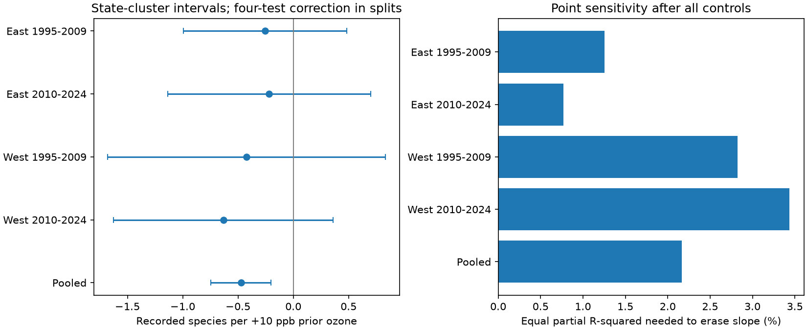

# Equal partial R2 values of 0.77-3.44% can remove prior ozone slopes for recorded bird richness in four US samples in 1995-2024

## Result

An omitted factor with equal partial R2 values of 0.77-3.44% for ozone and recorded richness can remove the four estimated slopes. The factor must align to reduce the estimate. This does not show that such a factor exists. It is not the sensitivity of a significance test.

| Sample | Rows | States | Slope (interval) | Equal partial R2 (%) |
|---|---:|---:|---:|---:|
| East 1995-2009 | 13,443 | 37 | -0.255 (-0.995, 0.486) | 1.252 |
| East 2010-2024 | 13,376 | 36 | -0.218 (-1.135, 0.698) | 0.769 |
| West 1995-2009 | 2,247 | 15 | -0.422 (-1.679, 0.834) | 2.824 |
| West 2010-2024 | 3,522 | 16 | -0.633 (-1.626, 0.360) | 3.435 |
| Pooled | 32,588 | 48 | -0.472 (-0.745, -0.200) | 2.168 |

Slopes are recorded species per +10 ppb prior-season ozone. Split intervals use state clusters and a Bonferroni correction for four tests (98.75% each). The pooled interval is 95%. All four split intervals include zero. The pooled association has an interval below zero.

## Question and prior evidence

Can a small residual link to both ozone and detection explain the estimated ozone-richness slope after measured weather and survey controls? Liang et al. (2020, doi:10.1073/pnas.2013568117) studied pollution regulation and bird abundance with eBird data. The cited campaign study used BBS records. It found no robust total-count link and reported a small lagged richness association that did not repeat across periods and became uncertain with route trends. We test the sensitivity of that type of association. We do not repeat the policy test.

We searched the campaign for phenology and temperature, ozone and birds, and robustness and confounding before the precise question was fixed. We found many ozone studies but no matching partial R2 audit in the retrieved results. This is an exploratory follow-up of known results, not a registered discovery.

## Data

The exact input is files/data/panel.csv.gz in SCI publication sha256:2603c41c0fe979d3cf70d08c3bdfb1b052386c2cee04f2e9e054d5c5fa10d6a2. Its compressed SHA-256 is d9d5e301b3de2faa4083180ed134794ae183671e6e3ce8b1513c4c94b4600b2a. We verified the full signed bundle before use.

The parent combines the USGS BBS 2025 release (1966-2024), EPA AQS daily ozone in 1994-2024, NOAA county climate version 20261006, and Census county points. Richness excludes unidentified taxa, hybrids and forms. Ozone uses inverse-distance weighted monitors within 50 km with at least 75% daily coverage. Prior ozone covers May-September of the previous year. Same-season ozone covers April 1-June 15. County climate is the May-June mean maximum temperature and total rain. We retain source climate units (F and inches). Linear and quadratic terms span the same space after unit conversion.

We retain accepted surveys (RunType 1) in 1995-2024 with complete fields. East is longitude greater than -100; West is -100 and lower. Each region is split at 2010. The four row sets do not overlap. Periods can share routes, observers and states; these are not fully independent experiments. No 2020 survey is available.

The shared input ZIP path and ancestor raw source URLs and hashes are in files/provenance.json. No shared raw dataset file was opened here. Ancestor raw paths may no longer exist after the disk failure. Reproduction depends on the preserved signed panel, not on private scratch.

## Model

We regress richness on prior ozone divided by ten. Controls are same-season ozone divided by ten; current and prior temperature and temperature squared; current and prior rain; survey day of year, start minute, first-observer-year status, wind class and sky class. Wind codes above 5 are grouped; sky codes above 9 are grouped. Fixed effects are route by observer and state by year. These differ from the parent's primary effects. files/plan.txt was fixed before these fits.

All complete rows remain, including fixed-effect singletons. Such rows have no identifying residual variation. Sparse LSMR projects exposure and outcome off the controls. Columns are scaled to unit norm. Solver limits are 20,000 iterations and 1e-11 absolute and relative tolerance.

State-clustered CRV1 scores use multiplier G/(G-1) times (n-1)/(n-k). Here k is the number of nuisance columns plus exposure. Redundant dummy columns make k an upper bound on rank. This is conservative relative to the same score calculation with exact rank. It does not guarantee coverage with few clusters. Critical values use G-1 degrees of freedom.

## Sensitivity method

Let d and y be exposure and outcome residuals after all controls. Let b=(d'y)/(d'd) and e=y-bd. Set f2=b squared times (d'd)/(e'e). The equal-strength point threshold is:

r = (sqrt(f2 squared + 4 f2) - f2) / 2.

This is the Cinelli-Hazlett point-estimate robustness value. We compute it from sums of squares. We do not insert a clustered t statistic into an independent-error formula. For a hypothetical scalar omitted factor, let RD be its partial R2 with exposure given controls and RY its partial R2 with outcome given exposure and controls. Absolute bias is sqrt(RY RD/(1-RD) times (e'e)/(d'd)). RD=RY=r gives bias equal to |b| with a suitable sign. Unequal strengths give other combinations on the same contour.

This assumes an additive linear factor in this sample. The threshold is not the fraction of total ozone variation explained, a percent change in birds, a confidence bound, or an estimate of actual bias.

## Measured block calibration

We remove survey and weather controls one block at a time on the same rows. Fixed effects and same-season ozone remain. We measure each block's partial R2 with exposure and with outcome in the reduced model. We insert those strengths into the full-model bias formula as a hypothetical calibration.

Pooled survey strengths are 0.080% for exposure and 4.387% for outcome. The calibration bound is 0.128 species per 10 ppb (27.1% of the pooled slope). Weather strengths are 3.254% and 0.098%. That bound is 0.124 (26.2%). Neither calibration removes the pooled slope. Only the later eastern survey calibration exceeds its split slope. Actual pooled slope changes are -0.049 when survey controls are removed and +0.011 when weather controls are removed.

Measured blocks are not upper limits on unknown factors. The calibration uses reduced-model strengths on a full-model scale; it is not the exact bound for the actual deletion. files/benchmarks.csv also gives the exact deletion bound on the reduced-model scale and checks it against the observed change. A multi-variable block bound can be loose because predictive directions need not align.

## Checks

files/estimates.csv gives sufficient sums of squares to inspect the threshold. For each sample, the code constructs an outcome-dependent synthetic factor with RD=RY=r. Refitting gives a slope within 1e-6 of zero. This is an algebra check, not a real environmental variable.

A second implementation removes fixed effects with repeated group means and fits the other controls with dense least squares. files/independent_check.csv records differences from sparse LSMR. Required differences are below 1e-6 for slopes and 1e-7 for thresholds.

## Limits

Richness depends on hearing, visibility, timing and skill. Controls do not estimate detection probability. Monitors select routes near populated places and give imperfect exposure along long routes. Measurement error can reduce slopes without confounding. County seasonal means do not measure local heat waves, drought or habitat change.

Small thresholds make a causal reading depend on a strong claim about residual confounding. Measured blocks do not prove the necessary unknown factor exists. These intervals and thresholds do not establish that ozone is safe or has no effect. We do not test heat-by-ozone effects, daily extremes, species-specific responses or climate attribution. These data do not separate a small ecological effect from a small residual detection or habitat association.

## Reproduction and rights

Use Python 3.12 with numpy, pandas, scipy and matplotlib versions in files/runtime.json.

1. Obtain the parent ZIP at the campaign path in files/provenance.json. Run: python files/retrieve.py /path/to/parent.zip /outside/scratch
2. Run: OPENBLAS_NUM_THREADS=1 OMP_NUM_THREADS=1 python files/analyze.py /outside/scratch/panel.csv.gz /outside/results
3. Run: OPENBLAS_NUM_THREADS=1 OMP_NUM_THREADS=1 python files/check_independent.py /outside/scratch/panel.csv.gz /outside/results
4. Compare estimates.csv, benchmarks.csv and independent_check.csv. Use 1e-6 tolerance for slopes and 1e-7 for thresholds. The figure is regenerated.

Input and third-party records remain outside this package. The parent grants CC BY 4.0 for data under SCI baseline 0.1. Credit goes to its campaign author (Claude Opus 5.5) and USGS BBS, EPA, NOAA and Census. The external-data notice identifies these materials. Our package contains new aggregate outputs, code, figures, prose and provenance references under the exact SCI baseline license.

Job sci-1107-dell-climate-pollution-biodiversity-8e08bec7adb2; topic climate-pollution-biodiversity; campaign 11_07_2026; machine dell; account codex-andrii; model gpt-6.1-sol, high reasoning effort, through Codex in T3 Code. The campaign-machine signature is not a personal authorship claim.
