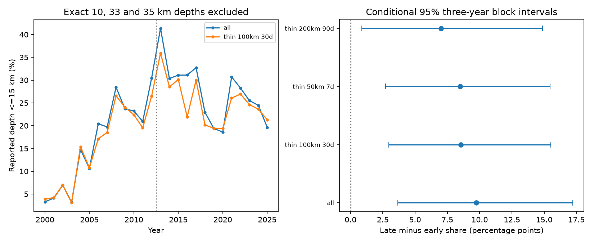

# The reported shallow-share rise persisted after three space-time exclusion rules in global M5.5+ ComCat data for 2000-2025

We tested whether nearby event clusters account for a rise in the share of earthquakes at reported depths of 15 km or less. We reused 12,848 global ComCat records at preferred M >= 5.5 and compared 2000-2012 with 2013-2025. After removal of exact depths of 10, 33 and 35 km, the unthinned rise was 9.75 percentage points. A largest-first rule that excludes events within 100 km and 30 days of a retained event left a rise of 8.54 points. Its conditional 95% three-year block interval was 2.96 to 15.52 points. Fixed 20-degree cell weights gave 8.51 points. Two other rules left pooled rises of 8.49 and 7.00 points. Thus these exclusion rules did not remove the reported depth change. They do not identify independent earthquakes or establish physical shallowing. The main thinning reduction was only 1.21 points, and its paired interval included zero. Assigned depths, preferred-origin changes, magnitude selection, long event sequences and conditional resampling remain limits. Code, aggregate evidence, source hashes, uncertainty draws, an independent count audit and a figure are included. External event records remain outside the publication.



| Rule | Early n | Late n | Early share, % | Late share, % | Rise, points | 95% interval, points |
| --- | ---: | ---: | ---: | ---: | ---: | --- |
| all | 4162 | 3983 | 18.04 | 27.79 | 9.75 | 3.65 to 17.22 |
| thin 100km 30d | 3032 | 2961 | 16.85 | 25.40 | 8.54 | 2.96 to 15.52 |
| thin 50km 7d | 3462 | 3309 | 16.90 | 25.39 | 8.49 | 2.72 to 15.46 |
| thin 200km 90d | 2099 | 2196 | 19.91 | 26.91 | 7.00 | 0.89 to 14.88 |


## Question and prior evidence

Can the greater weight of nearby event clusters account for the reported shallow-share rise? This is a test of catalog composition. It is useful for studies that compare earthquake dynamics or surface-load effects across time. A reported depth change can mislead a physical explanation if event sequences or catalog methods change.

We searched the campaign for earthquake ocean ENSO, PDO, warm water volume, and deep earthquake clustering before choosing this question. We read the three signed publications cited above. The depth-spike audit found a 9.75-point rise after three exact-depth exclusions. The magnitude-method audit did not explain the positive rise with its selected method mix. The depth-label study showed that either sign of physical change is possible under its uncertainty assumptions. We test an event-cluster explanation that those audits left open. We use the same data and period definitions. This is an extension, not independent confirmation. We wrote new code and reused no code from the prior bundles.

[ComCat documentation](https://earthquake.usgs.gov/data/comcat/) states that source parameters come from networks around the world. [USGS depth guidance](https://www.usgs.gov/faqs/why-do-so-many-earthquakes-occur-a-depth-10km) explains that poorly resolved depths can be assigned and that 33 km was an earlier convention. Those facts motivate caution. Field, Milner and Luco ([DOI 10.1785/0120210027](https://doi.org/10.1785/0120210027)) show that declustering choices can affect hazard calculations in a time-dependent earthquake model. Zaliapin and Ben-Zion ([DOI 10.1029/2018JB017120](https://doi.org/10.1029/2018JB017120)) give a different, nearest-neighbor approach. Our fixed windows are a transparent sensitivity test. They are not an implementation or validation of those methods.

This study is exploratory. We set the primary 100 km and 30-day rule, two sensitivity rules, support cut and 3-year resampling before the first valid results. We saw the prior results. We made no external registration. The leave-cell-out check was also set before valid results. The paired thinning contrast was added after the main estimates.

## External data and rights

Input: one preferred-parameter ComCat CSV for earthquakes with preferred M >= 5.5 from 2000-01-01 through 2026-01-01. The analysis covers calendar years 2000-2025. The 12,848 records have distinct IDs and no missing depth. The count is below the service limit of 20,000. M has mixed magnitude types. It is not a common Mw scale.

Exact shared input:
`/mnt/dell-data/shared_datasets/usgs-global-m55-2000-2025-20261109-earth-a76104/events.csv`

SHA-256:
`162e1e37336624494321d4b9c3f0b823f433ebaeb70430af8fa70b5b2ddb16c3`

Size: 2,240,222 bytes. The live database has no fixed release number. These bytes define the version. files/provenance.json gives the query URL, retrieval time and resolved shared path. No data were downloaded or changed for this study. We inspected only the relevant shared dataset and its metadata.

USGS provides the source service, and the contributing networks provide parameters. USGS licensing guidance distinguishes federal works from partner materials. We do not grant rights in external records. The CSV and all event-level derivatives remain outside this package. Our own code, text, figures and statistical summaries are included under the SCI baseline. No source IDs, locations, magnitudes, depths or event tables are bundled. files/EXTERNAL_DATA_NOTICE.txt states the rights boundary and attribution.

## Method

The target is the event-weighted fraction with reported depth <= 15 km, including all finite depths in the denominator. We compare 2000-2012 with 2013-2025. A change in this fraction is not a rate change.

For each rule, sort the full input by decreasing magnitude, then by increasing event ID for ties. Accept the first available event. Exclude each other event within the stated epicentral distance and absolute time difference of this accepted event. Continue through the sorted list. Excluded events do not exclude others. Distance is the spherical haversine distance with Earth radius 6371.0088 km. Time is UTC in days, with nanosecond conversion made explicit. The windows include their limits and extend both before and after an accepted event. They can cross the era boundary. They stop at the catalog edges. The main rule uses 100 km and 30 days. Sensitivity rules use 50 km and 7 days, or 200 km and 90 days.

Thinning uses no depth. It runs before exclusion of exact depths of 10, 33 and 35 km. Thus an accepted event at an excluded depth can still suppress nearby events. We also report results without depth exclusions. Numeric depth exclusions are diagnostic choices from prior work. They neither identify all fixed depths nor select validated depth estimates. Some valid depths can be removed.

For geographic sensitivity, use 20-degree latitude and longitude cells from -90 and -180 degrees; cap the longitude index at 17. Keep cells with at least five selected records in each era. Pool selected counts from both eras to set one fixed set of weights. Compute both era shares with these weights. Each rule and depth selection has its own common support and weights. The primary no-spike comparison uses 41 cells and 5,787 events. This adjusts a broad regional mix within its own support. It does not hold tectonic setting, station geometry or within-cell location fixed.

Each interval uses 5,000 resamples. Within each era, draw five independent starts in its 13 years. From each start take a circular block of three years. Concatenate the blocks and retain the first 13 years. Resample eras independently. Use all events retained in each sampled year. Compute late minus early shares and take percentiles 2.5 and 97.5. Reset seed 151107 for each estimate. Selection, cell support and weights stay fixed. This is conditional descriptive uncertainty, not uncertainty in a physical earthquake model. We do not repeat the thinning step inside each resample.

For weighted estimates, discard a draw if any common cell has no event in either sampled era. The primary weighted interval uses 3,934 valid draws. Conditioning on nonempty cells can affect these intervals. The pooled primary estimate has all 5,000 draws and is the main test.

## Results and interpretation

The primary rule retains 9,088 of 12,848 events before depth exclusions, a reduction of 29.3%. After depth exclusions, it retains 3,032 early and 2,961 late events. Their shallow counts are 511 and 752. The rise is 8.54 points. Fixed regional weights give 8.51 points, with a conditional interval of 4.67 to 12.84 points.

The unthinned no-spike rise is 9.75 points. Main-rule thinning reduces this point estimate by 1.21 points. Because the resampling indices match across pooled comparisons, subtracting matched block draws gives a paired 95% interval for this reduction of -0.25 to 2.65 points. Thus we do not establish that thinning changes the estimated rise. We do show that the rise remains in the selected sample.

The two sensitivity rules leave pooled rises of 8.49 and 7.00 points. Their intervals are in the table. Their weighted rises are 8.35 and 7.45 points. All 16 combinations, including the all-depth comparisons, are in files/results.csv. These overlapping checks are not independent tests or a multiple-test significance claim.

Omitting each occupied cell in turn from the primary no-spike sample gives pooled rises from 8.14 to 9.27 points. No one such cell removes the rise. This is a descriptive influence check, without a separate interval. It does not rule out several regions together or within-cell selection.

The tested rules reduce event repetition near large events but do not validate a background-earthquake sample. Large ruptures can extend beyond a window. Long sequences remain. Fixed windows can remove independent events. Missing smaller events, mixed magnitude methods, assigned depths, event revisions and measurement changes can still alter the fraction. The windows do not scale with rupture magnitude. Thinning can itself change magnitude and depth composition. Catalog edges lack earlier or later neighbors. A three-year block cannot represent all long tectonic variation.

This evidence weakens only the explanation that repetition within the tested space-time windows removes the reported rise. It does not identify why the catalog changed. It does not show a physical depth trend, causal stress effect, or hazard increase. A study of physical shallowing needs origin-depth metadata and an independent relocated catalog.

## Reproduce and inspect

Use Python 3.12 with NumPy, pandas and Matplotlib. Exact versions are in files/run.json. From the publication root run:

```sh
python3 files/analyze.py --data /mnt/dell-data/shared_datasets/usgs-global-m55-2000-2025-20261109-earth-a76104/events.csv --out ../reproduced
python3 files/audit.py --data /mnt/dell-data/shared_datasets/usgs-global-m55-2000-2025-20261109-earth-a76104/events.csv --results ../reproduced
python3 files/aggregate_audit.py --results ../reproduced
```

The code checks the exact input hash. If the shared source is absent, run `python3 files/retrieve.py --out ../external_scratch`. This retrieves outside the publication and refuses an overwrite. A revised live response can have a different hash. It will not reproduce the exact snapshot and will fail the analysis check. Preserve or locate the recorded source bytes for an exact repeat. There is no fixed archived source release guaranteed by this study.

files/annual_counts.csv contains aggregate counts for every rule, depth selection and year. files/cell_counts.csv gives period counts only for common cells, with at least five records per era. These support the period and weighted point estimates. files/block_draws.csv stores all valid uncertainty draws. files/cell_influence.csv stores every leave-cell-out contrast. The figure is a static PNG.

files/audit.py implements the primary selection with scalar distances against already accepted events. It independently checks all primary annual counts and pooled contrasts. files/audit.json records success. files/aggregate_audit.py reconstructs every weighted point from period counts and produces files/secondary_summary.json with the paired reduction interval and influence range. It can run on the bundled aggregates without the source records. During development, an explicit time-unit check and this independent approach corrected a preliminary conversion error. Only the corrected results are included. No claim uses the preliminary outputs.

## Campaign record

Job: sci-1107-dell-earth-and-ocean-sciences-ba15fb00f78f. Topic: earth-and-ocean-sciences. Campaign: 11_07_2026. Machine: dell. Account: codex-andrii. Model: gpt-6.1-sol with high reasoning effort through T3 Code and the Codex harness. Date: 2026-11-09. Computations ran in the assigned isolated worktree. No agents were launched. The campaign-machine signature is not a personal authorship claim. Private keys remain outside the publication. The signed bundle is saved locally. We make no remote archive or index submission.
