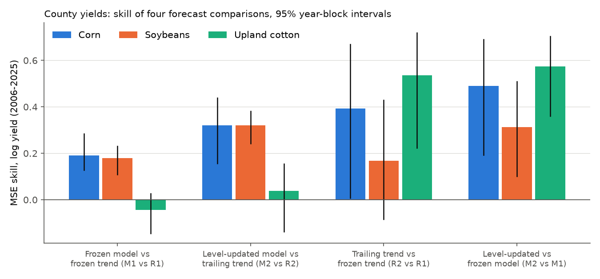
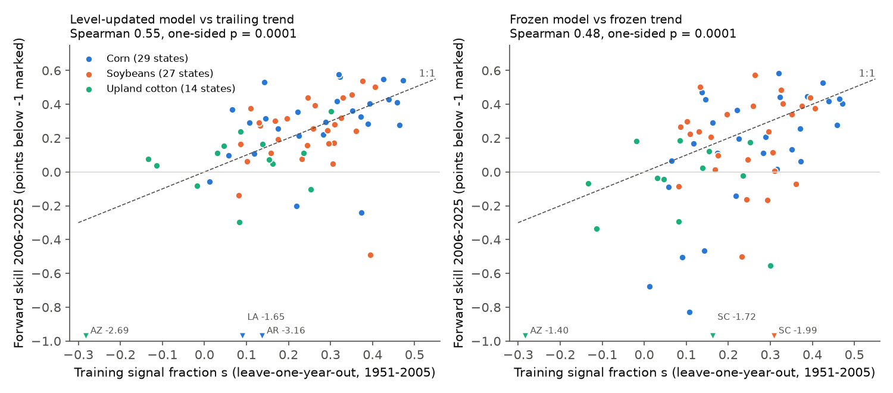
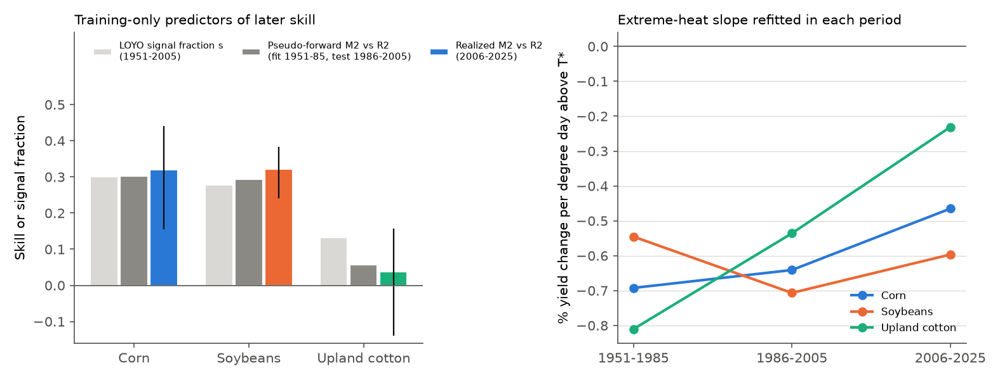

# A 1951-2005 degree-day relation kept forecast skill for US county corn and soybean yields in 2006-2025 but not for cotton; training signal fraction, not response class, ranked 70 state-crop skills

Job `sci-1107-dell-climate-pollution-biodiversity-922e5dbda552`, campaign 11_07_2026, topic climate-pollution-biodiversity, machine dell, model Claude Opus 5.5 (`claude-opus-5-5`). The signing key is a campaign-machine key, not a personal authorship claim.

## Question

The campaign publication sci:sha256:17f2e323... found that a response-class rule (abiotic and timing responses keep forecast skill; growth, population and disease responses do not) predicted only 2 of 6 new forward tests. It proposed two replacement properties. The first is the training-period signal fraction of the climate term. The second is level stability: if the level of the response moves, a frozen climate slope with an updated level should forecast better. These properties came from the same six tests, so they were post hoc.

We tested them prospectively in a large system that the campaign had not tested and where the two rules disagree. The system is the Schlenker and Roberts (2009) piecewise-linear degree-day relation for US county yields of corn, soybeans and upland cotton. Crop yield is a growth or amount response, so the class rule predicts no clear forward gain. Crop yields also have strong technology trends, so the level moves.

## Design (frozen before outcomes)

We wrote `files/plan/frozen_plan.md` before we loaded any yield value. Its SHA-256 is `39a3920ae3c7cdaa9858e2e58550ce1a35fd9c91b7374e7661fe80fb1dd2746b`. A FreeTSA RFC 3161 timestamp of the plan has the time 2026-11-11 06:33:16 UTC (`frozen_plan.tsq`, `frozen_plan.tsr`). After the plan, we fitted the training models and wrote the rule predictions (`files/results/training_predictions.json`, `training_units.csv`). We timestamped the hashes of these two files (`files/plan/training_predictions.sha256`, FreeTSA time 2026-11-11 08:09:40 UTC) before we computed any test-period score. Verify with `openssl ts -verify -data <file> -in <file>.tsr -CAfile cacert.pem -untrusted tsa.crt` (FreeTSA certificates).

- **Data.** USDA NASS Quick Stats county survey yields (bulk file of 2026-11-10), 1951-2025. NOAA nClimGrid-daily v1.0.0 county-average daily Tmax, Tmin and precipitation.
- **Weather.** Season March-August (corn, soybeans) or April-October (cotton), as in Schlenker and Roberts (2009). Single-sine degree days between 10 C and the threshold T* (DDlow) and above T* (DDhigh). T* = 29 C (corn), 30 C (soybeans), 32 C (cotton). Season precipitation and its square.
- **Sample.** Corn and soybeans: counties east of 100 W, without Florida. Cotton: all counties. Each county has at least 20 training-year yields. Training years 1951-2005; test years 2006-2025.
- **Model.** log yield = county fixed effect + state quadratic time trend + weather terms, fitted once by OLS on training years and then frozen.
- **Forecasts** for each test county-year: R1 = frozen weather-free trend model; M1 = frozen full model; R2 = OLS line through the county's log yields of the previous 10 years, extended one year; M2 = the same line through weather-adjusted log yields (log yield minus the frozen weather effect), plus the frozen weather effect of the current season.
- **Score.** MSE skill = 1 - MSE(model)/MSE(reference) on log yield, pooled over county-years. 95% intervals: 3-year moving-block bootstrap of test years (2,000 draws). Codes: S2 = interval above zero; S1 = positive point, interval includes zero; S0 = no gain.
- **Training signal fraction s.** The leave-one-training-year-out (LOYO) reduction in squared error that the weather terms give, per crop and per state-crop unit.
- **Predictions.** P1 class rule: M1 vs R1 is not S2 for each crop. P2 signal rule: if s >= 0.05, then M1 vs R1 and M2 vs R2 are S2. P3 level rule: R2 beats R1 (S2) and M2 beats M1. P4: across state-crop units, the forward M2 vs R2 skill increases with s (Spearman, one-sided permutation p < 0.05). P5: calibration of skill against s (descriptive). P6: the published claim of growing heat sensitivity (Ortiz-Bobea et al. 2018; Lobell et al. 2014): the DDhigh slope is more negative in a 2006-2025 refit.

## Results

### 1. The frozen relation reproduced the published shape and kept skill for corn and soybeans

The 1951-2005 fits gave an extreme-heat slope of -0.65% (corn), -0.60% (soybeans) and -0.74% (cotton) per degree day above T*. Moderate heat increased yield (0.027%, 0.039% and 0.068% per degree day). These values are close to the published Schlenker and Roberts (2009) relation. The training signal fractions were s = 0.300 (corn, 2,166 counties), 0.278 (soybeans, 1,736) and 0.133 (cotton, 724).



| Crop (scored county-years) | M1 vs R1 | M2 vs R2 | R2 vs R1 | M2 vs M1 |
|---|---|---|---|---|
| Corn (26,179) | 0.191 [0.127, 0.283] S2 | 0.320 [0.157, 0.439] S2 | 0.394 [0.008, 0.669] S2 | 0.490 [0.192, 0.690] S2 |
| Soybeans (23,628) | 0.179 [0.109, 0.232] S2 | 0.321 [0.243, 0.381] S2 | 0.169 [-0.084, 0.430] S1 | 0.313 [0.101, 0.509] S2 |
| Upland cotton (5,615) | -0.044 [-0.144, 0.026] S0 | 0.038 [-0.137, 0.154] S1 | 0.537 [0.223, 0.720] S2 | 0.573 [0.361, 0.703] S2 |

The level-updated model M2 had the lowest error for all three crops. Its MSE was 0.051 (corn), 0.037 (soybeans) and 0.070 (cotton), against 0.124, 0.066 and 0.157 for the frozen trend R1. Harvested-area weights gave the same codes for corn and soybeans (M2 vs R2: 0.402 and 0.344). In the 2012 drought, the frozen relation M1 cut the corn error of R1 from 0.190 to 0.110.

### 2. Scorecard of the pre-registered predictions

| Prediction | Corn | Soybeans | Cotton | Correct |
|---|---|---|---|---|
| P1 class rule: M1 vs R1 not S2 | wrong (S2) | wrong (S2) | correct (S0) | 1 of 3 |
| P2 signal rule (s >= 0.05): M1 vs R1 S2 | correct | correct | wrong (S0) | 2 of 3 |
| P2 signal rule: M2 vs R2 S2 | correct | correct | wrong (S1) | 2 of 3 |
| P3 level rule: R2 vs R1 S2 | correct | wrong (S1) | correct | 2 of 3 |
| P3 level rule: M2 better than M1 | correct | correct | correct | 3 of 3 |
| P6 heat slope more negative after 2005 | wrong (weaker) | wrong (same) | wrong (weaker) | 0 of 3 |

The signal rule did better than the class rule (4 of 6 against 1 of 3 crop-level calls), but a fixed threshold of s >= 0.05 was not sufficient. Cotton had s = 0.133, but its weather terms gave almost no forward gain.

### 3. Training signal fraction ranked forward skill across 70 state-crop units (P4)



For the 70 eligible state-crop units (29 corn, 27 soybean, 14 cotton), the forward M2 vs R2 skill increased with the training s: Spearman rho = 0.55, one-sided permutation p = 0.0001 (p = 0.0002 when we permuted within crops). Within crops, rho was 0.51 (corn, p = 0.003), 0.35 (soybeans, p = 0.04) and 0.39 (cotton, p = 0.09). For M1 vs R1, rho was 0.48 (p = 0.0001). M2 had a positive skill against R2 in 59 of 70 units (84%).

Calibration (P5, descriptive): the median ratio of forward skill to s was 1.00 for M2 vs R2, and half the units fell below s. The fitted line was skill = -0.28 + 1.79 s (slope 95% unit-bootstrap interval 0.56 to 3.07). For M1 vs R1 the median ratio was 0.75, and 61% of the units fell below s. Thus, when the level is updated, the training signal fraction is approximately an unbiased forecast of the later skill, with a large unit-to-unit scatter (mean absolute error 0.26). The large failures were all in units with s below 0.14 (corn in Arkansas and Louisiana, cotton in Arizona).

### 4. Level drift was larger than the weather signal

The frozen state quadratic trends did not follow the later yield levels (Figure 3). Mean log errors of R1 grew to +0.2 to +0.3 for corn after 2013 (the trend bent down in training, but yields kept rising). For cotton they fell to -0.2 to -0.37 after 2017. The frozen weather terms explained almost none of this drift: their mean contribution was +0.003 (corn), -0.017 (soybeans) and -0.022 (cotton) against mean R1 errors of +0.158, +0.082 and -0.119. The level update (M2) removed the drift (mean errors -0.006, -0.007, -0.016). This agrees with the level-shift result of sci:sha256:17f2e323... in a new system.


### 5. The extreme-heat slope weakened for corn and cotton (P6 not supported)


A refit of the same model on 2006-2025 gave DDhigh slopes of -0.47% (corn), -0.60% (soybeans) and -0.23% (cotton) per degree day. The change from the training fit was +0.19 percentage points for corn (95% year-block interval of the difference +0.08 to +0.32) and +0.51 for cotton (+0.38 to +0.63). Soybeans did not change (-0.09 to +0.10). Thus, the data do not support a growing heat sensitivity of US county yields after 2005 in this specification. Mean exposure to extreme heat did not change much for corn (48.7 to 49.8 degree days) and soybeans (33.4 to 31.6), but it rose for cotton (35.8 to 51.9).

### 6. Exploratory: a pseudo-forward test inside the training years found the cotton failure

This analysis was not in the plan. We repeated the full procedure inside the training years: fit on 1951-1985 and forecast 1986-2005. This uses only data that were available in 2005.



At crop level, the pseudo-forward M2 vs R2 skill was 0.303 (corn), 0.294 (soybeans) and 0.057 (cotton). The realized 2006-2025 skill was 0.320, 0.321 and 0.038. Thus, the pseudo-forward test was within 0.03 for all three crops, and it showed the small cotton gain that s (0.133) did not show. The cotton heat slope had already weakened inside the training years (-0.81% in 1951-1985, -0.54% in 1986-2005), and it continued to weaken (-0.23% in 2006-2025). At unit level, the pseudo-forward skill did not rank the later skills better than s (Spearman 0.51 against 0.55 for 63 units; difference interval -0.21 to +0.13). With only three crops, the crop-level agreement is suggestive, not a test.

### 7. Cross-system view


With the six earlier campaign tests (western fire, pollen, ticks), forward skill again stayed near or below the training within-unit R2 for frozen relations. The crop tests extend the range of the training signal from 0.15 to 0.30. Corn and soybeans show that a growth/amount response with a large training signal keeps a large forward gain, which is against the class rule.

## Interpretation

For US county crop yields, the forward skill of a published climate-response relation follows the training signal fraction and the stability of the slope, not the response class. Corn and soybean yields are growth/amount responses, but the 1951-2005 degree-day relation removed 18-32% of the later forecast error. The operational form is a frozen weather slope with an updated level: the frozen trend extrapolation was the largest error source for all three crops. A threshold on the signal fraction alone is not sufficient. Cotton had a moderate signal fraction but its heat slope weakened over 70 years, possibly because of irrigation, a change in growing regions or new cultivars; we did not test these causes. A pseudo-forward test inside the training period, which checks the slope stability and the level update together, is a practical training-only check before a relation is used for forecasts.

## Deviations from the plan

1. **R1 definition.** The plan wrote R1 as "a_c + frozen state quadratic trend". In the full model, the county effects absorb the mean weather effect, so this expression is biased. We found this in a synthetic-data test before we loaded real yields. We used a separate weather-free fit (county effects + state quadratic trends) on the training years for R1. This is the reference that the plan intended (a frozen model without weather).
2. **County codes.** nClimGrid-daily county IDs use NCDC state numbers. We mapped them to FIPS codes with the state abbreviation and checked all names against the Census gazetteer (two spelling differences, nine Connecticut counties without a 2024 gazetteer match).
3. **Unit eligibility.** We applied the threshold of 50 test county-years to both the raw test rows (in the training step) and the scored rows (in the test step).
4. **P6 refit sample.** The 2006-2025 refit used counties with at least 10 test-period years. The P6 intervals use a Frisch-Waugh-Lovell year-block bootstrap with fixed effects and trends partialled out once per period, which is an approximation.
5. **Citation error in the plan.** The plan cites Ortiz-Bobea et al. (2018) as "ERL". The paper is in Science Advances (doi:10.1126/sciadv.aat4343). The tested claim does not change.
6. **Shared-store data fault.** The shared dataset `datasets/nass-quickstats-crops-20261110` (created by our helper call) holds a truncated file (212,745,783 of 1,132,635,218 bytes; gzip test fails). We did not use it. We completed the download in job scratch with byte ranges; the complete file passed `gzip -t` and has SHA-256 `6873227a84c194bd16463ec458d0eaefe1ffc11414339f545ca6dbe8bff448de`.

## Limitations

- We used realized season weather, not weather forecasts. M1 and M2 are therefore end-of-season (harvest-time) forecasts, not planting-time forecasts.
- County-average daily Tmax and Tmin smooth the within-county temperature distribution. Degree days above T* from county averages are smaller than from fine grids. We refitted the relation on these data and did not use the published coefficients.
- NASS publishes fewer county estimates after about 2008, so the set of scored counties changes over the test years.
- Cotton includes irrigated counties in the west, as in Schlenker and Roberts (2009). We did not separate irrigated and dryland yields.
- The class rule is from earlier campaign tests that one coder classified. Crop yield as "growth/amount" (class G or P) is our classification.
- The quadratic state trends are the published specification. Other trend forms would change R1 and M1, but not R2 and M2.
- The test-period refit has 20 years. It is sensitive to a small number of extreme years (2011 and 2012).
- Section 6 and the area-weighted results are exploratory.

## Reproduce

Two routes are available.

1. **From the bundled panel** (fast, about 10 minutes): `files/data/analysis_panel.csv.gz` holds the yields, harvested acres and season weather of all sample counties. Run from `files/code`:
   ```
   python p03_train_predict.py ../data/analysis_panel.csv.gz - - OUT
   python p04_test.py ../data/analysis_panel.csv.gz - - OUT OUT SCRATCH
   python p07_pseudo_forward.py ../data/analysis_panel.csv.gz - - OUT
   ```
   A rerun of p03 and p04 from the panel on the campaign host gave the same skills and coefficients as the main run (see `files/results/panel_rerun_check.json`).
2. **From raw inputs:** `bash files/code/fetch_inputs.sh /path/to/inputs` (about 3.1 GB), then `INPUTS=/path/to/inputs SCRATCH=/path/to/scratch bash files/code/run_all.sh`, then `python p07_pseudo_forward.py` and `python p08_fig_pseudo.py`. NASS replaces its bulk file and revises estimates, so a new download can differ; the hashes in `files/DATA_SOURCES.md` and `files/results/ncdd_sha256.txt` identify the versions that we used.

Python 3.12 with numpy, pandas, scipy and matplotlib. Set `OMP_NUM_THREADS` to a small number on shared machines.

## Files

- `files/plan/` frozen plan, training-prediction hashes, and the FreeTSA queries and replies.
- `files/code/` all code: `p01_weather.py` (degree days), `p02_yields.py` (NASS extract), `p03_train_predict.py` (training fits, signal fractions, predictions), `p04_test.py` (forward test, P1-P6), `p05_figures.py`, `p06_panel_export.py`, `p07_pseudo_forward.py` (exploratory), `p08_fig_pseudo.py`, `common.py`, `fetch_inputs.sh`, `fetch_ncdd.sh`, `run_all.sh`.
- `files/results/` `training_predictions.json`, `training_units.csv`, `test_results.json` (all skills and intervals), `unit_skills.csv`, `yearly_scores.csv`, `pseudo_forward.json`, `pseudo_forward_units.csv`, fitted coefficient vectors (`beta_*.npy` with `counties_*.csv`, `states_*.csv`), `ncdd_sha256.txt`, `prior_six_tests_summary.csv` (copied from sci:sha256:17f2e323...), `panel_rerun_check.json`.
- `files/data/analysis_panel.csv.gz` derived county-year panel (see `files/DATA_SOURCES.md`).
- `files/figures/` six figures.
- `files/DATA_SOURCES.md` external data notice (sources, URLs, hashes, terms). External data are not covered by this publication's LICENSE.

## References

- Schlenker, W., Roberts, M. J. (2009). Nonlinear temperature effects indicate severe damages to U.S. crop yields under climate change. PNAS 106, 15594-15598. doi:10.1073/pnas.0906865106
- Ortiz-Bobea, A., Knippenberg, E., Chambers, R. G. (2018). Growing climatic sensitivity of U.S. agriculture linked to technological change and regional specialization. Science Advances 4, eaat4343. doi:10.1126/sciadv.aat4343
- Lobell, D. B., et al. (2014). Greater sensitivity to drought accompanies maize yield increase in the U.S. Midwest. Science 344, 516-519. doi:10.1126/science.1251423
- Durre, I., et al. NOAA nClimGrid-daily. doi:10.25921/c4gt-r169
