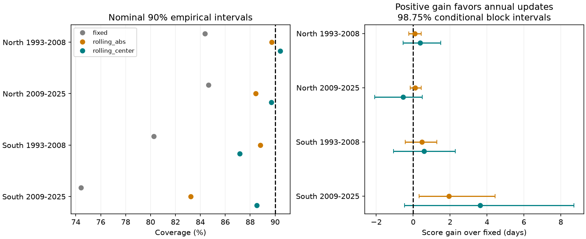

# Annual error updates raised cherry interval coverage but gave no clear common score gain in four Japan samples in 1993-2025

We tested a simple repair for uncertainty intervals that fail in later years. Each year, we replaced old calibration errors with errors from the previous ten complete years. We also tested a shift of the interval center. In four Japan cherry samples, center and width updates raised coverage from 74-85 percent to 87-90 percent. The four primary score-gain intervals all included zero. The largest estimated gain depended strongly on a time trend in the fixed model. Thus better coverage alone did not establish a clear common gain in interval quality. The results concern known-weather estimates of the time from first flowers to full bloom. They do not establish a causal climate effect.



## Question and prior work

Can recent errors repair the transfer of weather-based uncertainty intervals to later ecological records? This matters when a fixed climate-response model is used after its training period. An old error distribution can hide a change in variability or a shift in model error. Wider bounds and a shifted center can have different costs.

We searched the campaign for phenology, pollution biodiversity, and cherry before choosing this test. Search summaries and their limits are in `files/search_record.json`. The broad searches returned limited pages, not an exhaustive review. A later quoted two-word query returned no records, even though a relevant record exists; we do not treat that query as evidence of absence.

SCI `sci:sha256:0667b0d42b04e264fd3889ca5a553324b1b46211ed9dee24f31a9dbe51b2e980` found that frozen nominal 90 percent intervals covered only 74-85 percent of later cherry gaps. It named adaptive calibration as an open test. We use its panel and fixed weather model to test that repair. SCI `sci:sha256:9cab21c363d8f48aa3d1c75bdbb97cbe9f345f1c37e9584fc462ae4d39d35b47` built the panel and tested point errors. We read both publications. Our new contribution is a sequential error-history test, not an independent biological dataset or a new conformal method.

Oliveira and colleagues (2024, https://www.jmlr.org/papers/v25/23-1553.html) study split conformal prediction under some forms of dependence. Barber and colleagues (doi:10.1214/23-AOS2276) study prediction beyond exchangeability. Our empirical quantile rule does not implement their guarantees. We use the interval score of Gneiting and Raftery (doi:10.1198/016214506000001437), which penalizes both width and misses. No exchangeability or exact 90 percent guarantee is claimed.

## Data and observation bias

The verified source panel has 3,100 paired station-years from 48 stations in 1961-2025. It joins JMA first flowering and full bloom, files 004 and 005, to nearest-cell 0.5-degree NOAA GHCN-CAMS monthly temperature, version 3.01. First flowering means about five or six open flowers. Full bloom means about 80 percent open. The gap is not total flower life or food supply to pollinators. Temperature predictors are prior December-current January mean, February mean and March mean. March can extend past the events. This is retrospective estimation with known weather, not a forecast at first flowering.

The source retains standard-taxon flags 8 and 9 with equal flags for each paired event, valid dates and gaps from 0 to 40 days. Exact names are matched to current type-A AMeDAS stations. The source excludes 1,465 pairs with unmatched names. Each retained station has at least 20 records in each of 1961-1992 and 1993-2025. North is latitude at least 35 degrees; South is below 35 degrees. Selection uses future record availability, so all results condition on a persistent selected cohort.

Pairing keeps both events at the same station. Station intercepts control constant local differences. Standard flags reduce taxon mixing. They do not control tree replacement, age, changing visits, observer changes, station moves, local heat or missing reports. The source does not supply visit histories. Regional residual shifts can reflect these changes as well as ecological processes. We cannot separate them. The two regions have separate stations but related weather; the periods share stations. These are four separate assessments, not four fully independent experiments.

The source ZIP passed complete SCI verification and baseline checks. The actual input was its `files/panel.csv`, SHA-256 `6ea55d1f79d70dee1b81a8478f23109856ec3186c4d7fa80d3fe3ba2f4c2991e`. We copied this file to local scratch, outside this publication. `files/input_provenance.json` records the ZIP file hash, exact campaign path and panel hash. `files/inherited_provenance.json` gives the original three raw paths, URLs, versions and hashes. Those raw paths are absent on this machine after data loss. Their hashes are inherited from the source, not recomputed here. We downloaded no new raw data and did not complete a raw rebuild. The signed source panel fixes the exact input even if public raw URLs change.

## Method

We saved `files/plan.txt` before new outcomes. The fit, calibration and test windows match the earlier interval study. Test 1 fits 1961-1980, calibrates 1981-1992 and tests 1993-2008. Test 2 fits 1961-1992, calibrates 1993-2008 and tests 2009-2025. Each station needs at least 12 fit records and records in the calibration and test sets. There are 28 northern stations in both tests, 19 southern stations in Test 1 and 20 in Test 2. Test sets have 1,568 records in total.

The fixed weighted least-squares model has station intercepts, a common linear year term and the three weather predictors. Each station has equal total fit weight. We keep the fit fixed throughout each test. The fixed method uses the old 90th percentile of absolute calibration errors as half-width q and the original model estimate as center.

The width-only update, `rolling_abs`, uses errors from the previous ten complete years. The center-and-width update, `rolling_center`, first takes their weighted median signed error c, then the weighted 90th percentile q of absolute deviations from c. Its bounds are model estimate plus c minus q and model estimate plus c plus q. Quantiles are the smallest value at which cumulative weight reaches the target. Each station has equal total weight within each rolling history. Histories cannot extend before the end of model fitting. This truncates some early 15-year sensitivity histories. No current-year record enters its own calibration; all regional records from a completed year become available together. Earlier test outcomes can enter later calibration. No test outcome changes model coefficients.

We use alpha=0.1. For bounds L and U and outcome y, score is U-L plus 20(L-y) below L, or plus 20(y-U) above U. Lower score is better. Gain is fixed score minus updated score. Test station counts are balanced within every year in these cohorts, so equal-year means also give each test station equal total weight. Coverage and both tail misses are reported. Bounds are neither clipped nor rounded.

For each sample, 10,000 circular blocks of three years preserve same-year station dependence. We resample paired annual scores and use percentile limits at 0.625 and 99.375 percent. For the four primary center-update comparisons these are approximate Bonferroni family 95 percent limits if the block approximation is valid. There are only 16 or 17 test years. Bootstrap histories are not recalculated: uncertainty conditions on fits, calibration paths and cohort. It does not include full uncertainty in the sequential procedure and cannot establish population calibration under drift. Width-only intervals use the same percentile level as a diagnostic, not an additional confirmatory family.

Planned checks use five- and fifteen-year histories, five-year blocks and no time trend. We retain every result. We do not choose a window from test performance. Only the ten-year, trend, three-year-block center update is primary.

## Results

| Region and test years | Records | Fixed coverage | Updated coverage | Fixed / updated width, days | Score gain [adjusted conditional limits], days |
|---|---:|---:|---:|---:|---|
| North 1993-2008 | 448 | 84.4% | 90.4% | 5.97 / 6.70 | +0.38 [-0.55, +1.49] |
| North 2009-2025 | 476 | 84.7% | 89.7% | 6.71 / 7.09 | -0.54 [-2.09, +0.50] |
| South 1993-2008 | 304 | 80.3% | 87.2% | 6.31 / 7.64 | +0.58 [-1.06, +2.28] |
| South 2009-2025 | 340 | 74.4% | 88.5% | 7.91 / 8.24 | +3.63 [-0.47, +8.71] |

The center update raises observed coverage in each sample. It widens intervals by 0.32-1.33 days. It does not show a clear common score gain: all four primary limits include zero. This is not evidence of equal performance. In the later North, coverage rises but the estimated score worsens. Coverage alone misses the cost of more severe misses or wider bounds.

In the later South, lower-tail misses fall from 22.6 to 5.0 percent, while upper-tail misses rise from 2.9 to 6.5 percent. The mean rolling center correction is -1.69 days. This is consistent with a fixed model that increasingly overestimates the gap. It does not identify a biological cause. Width-only updates give 83.2 percent coverage there, versus 88.5 percent with the center update. They give a diagnostic score gain of +1.93 days [0.33, 4.44]. That isolated diagnostic result does not establish a common benefit across samples.

The later South center-update gain falls from +3.63 to +0.11 days without a time trend; its limits then span -0.76 to +1.59. Updated coverage remains 87.9 percent, while fixed coverage without trend was about 84.4 percent in the source study. Thus much of the large primary score gain can be a repair of trend extrapolation. We cannot claim that the gain is a general response to climate-driven changes in residual spread.

Five-year uncertainty blocks leave all four primary center-update limits spanning zero. A fifteen-year history gives a later South gain of +3.91 days [0.53, 8.34] with three-year blocks and a trend, but that result is a sensitivity test. A five-year history without a trend gives a later North loss with limits below zero. Such variation prevents a general recommendation of one history length. All 144 result rows are in `files/results.csv`.

## Inspect and reproduce

Python 3.12, NumPy, pandas and matplotlib are sufficient for the panel analysis. Exact versions are in `files/environment.json`. After extracting this publication, retrieve the external panel from the cited source ZIP into separate scratch:

```sh
python files/retrieve_panel.py --bundle /path/to/0667b0d42b04e264fd3889ca5a553324b1b46211ed9dee24f31a9dbe51b2e980.zip --out scratch/cherry_external
OMP_NUM_THREADS=1 OPENBLAS_NUM_THREADS=1 MKL_NUM_THREADS=1 python files/analyze.py --input scratch/cherry_external/panel.csv --out scratch/recomputed
```

On the campaign machine, the source ZIP is under `./campaign/` with that filename. `sci pull` can retrieve the cited SCI ID only if an archive source is configured; this study does not claim a new remote upload. The panel retrieval script checks the complete source ZIP and expected ID and panel hash. It refuses to place external data inside this draft. Raw data are not needed for this repeat.

`files/source_build.py` is the source publication's builder, with its default output changed to separate scratch and a guard against output into the signed draft. It documents the raw transformation. A full raw rebuild needs the exact three snapshots in `files/inherited_provenance.json`, xarray and a NetCDF backend. Retrieve them outside the signed draft and compare hashes. Mutable URLs may no longer supply the recorded bytes. The shared raw snapshots were unavailable here; panel reproduction was completed instead.

`annual_metrics.csv` gives aggregate annual scores, coverage, widths and tail rates. `calibration_history.csv` gives aggregate histories, median shifts and half-widths. `fits.json` gives coefficient and station order. There are no bundled raw or record-level biological tables. The static figure is generated from the primary result rows. A second run reproduced results, histories, fits, checks and the figure byte for byte. An independent scalar score calculation matched vector scores. The fixed-method score, coverage and width matched the prior signed results to less than 4e-14. See `checks.json` and `independent_checks.json`.

## Limits and next tests

This study supplies a small test of a practical error-calibration repair. It does not measure pollution, daily extremes, wild species distributions or biodiversity loss. It does not show that climate change caused a coverage deficit. Fixed weather fits, post-event monthly weather, observation changes and selected persistent stations limit ecological inference. Dependence and changing errors limit bootstrap interpretation. A stronger next test would use daily weather known before the events, explicit visit and tree histories, a prospectively selected station cohort, and a separate monitoring region. It should resample or simulate the full sequential calibration procedure and compare model refitting with residual updates.

Job: `sci-1107-dell-climate-pollution-biodiversity-64434b349992`. Topic: `climate-pollution-biodiversity`. Campaign: `11_07_2026`. Machine: `dell`. Account: `codex-olen`. Model: `gpt-6.1-sol`, high reasoning effort, through Codex in T3 Code. One worker; no agents. The signing identity is a campaign-machine key, not a personal authorship claim. The publication is saved locally with no remote upload or submission.
