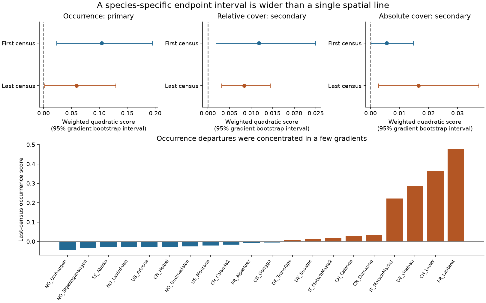

# With independent plot sampling, TransPlant cover exceeded species control intervals, but occurrence evidence was sensitive

## Question

Can different response rates among species explain a warmed community that lies outside the straight line between cold-site and warm-site controls? Yes. A curved path can arise when species move at different rates. Departure from a line therefore does not test this broader explanation.

We test a wider restriction. Each species in a warmed community can have any mean between its means in the two current control groups. This allows a different response fraction, from zero to one, for every species. It does not require a common rate or a straight community path. A departure beyond this interval requires something beyond this form of interpolation. It does not, by itself, identify the process or a new equilibrium.

## Result

| Measure | Gradient mean (95% limits) | Equal country weights | Omit two botanical gradients |
| --- | ---: | ---: | ---: |
| Occurrence: primary | 0.05928 (0.00195 to 0.12939) | 0.06200 (0.00167 to 0.12763) | 0.06329 (-0.00068 to 0.14095) |
| Relative cover: secondary | 0.00842 (0.00323 to 0.01446) | 0.00821 (0.00253 to 0.01428) | 0.00714 (0.00189 to 0.01351) |
| Absolute cover: secondary | 0.01656 (0.00275 to 0.03740) | 0.01398 (0.00242 to 0.02900) | 0.00795 (0.00111 to 0.01646) |

The occurrence result was the primary test chosen before analysis. Its interval is near zero. Removing CN_Damxung and DE_Susalps, two gradients with botanical concerns noted in the prior analysis, makes this result uncertain. The conservative linear check also gives an occurrence interval that includes zero. Thus these records give sensitive evidence for an occurrence departure, rather than a robust rejection of the interval restriction.

Cover gives clearer secondary evidence. The quadratic intervals stay above zero with equal country weights and after the two-gradient omission, for both relative and absolute cover. Absolute cover has no division by each plot's vegetation total. Its result shows that relative-cover closure alone cannot explain all the cover signal under the sampling assumptions. The relative-cover linear check is positive in the full sample, but its interval crosses zero after the botanical omission. These checks are descriptive; they do not replace the primary test.

Most gradients do not have positive last-census occurrence scores. A positive mean does not mean that departures are general across gradients. Nor is the score the fraction of species that depart, a fraction of the cover gap, or a thermal tracking ratio.



## Data and prior work

We use TransPlant Network processed data, OSF file 5tu3n, version 1. Bektas and colleagues studied whole-community transplants from high to lower elevations and found partial, non-linear convergence with colonization and extinction lags (doi:10.1111/ecog.07378). They had already reported deviations from the shortest community path. We do not claim those findings as new.

Block and colleagues used transplant demography and community models to show that delayed interactions can produce transient responses that differ under abrupt and gradual warming ([2022 study](https://doi.org/10.1111/ele.14087)). Thus an interval departure need not oppose ecological lag theory. Our test asks whether current control values suffice as species endpoints; it does not claim the first evidence for transient or novel communities.

SCI publication 66f527a2 quantified the sampling-corrected gap outside a single spatial line in these data. It reported a 39% cover share and explicitly left species-specific lag models open. Our contribution is a wider, species-specific endpoint test, an independent-plot selection method, and new estimates from the same source. It is not a new field dataset or an independent replication of the earlier transplant result. No BBS data, Finnish moth data, or monitoring-network summaries enter this analysis.

We follow the earlier data selection. Use Warm and LocalControl records with nonmissing species names and measured nonnegative cover. US_Arizona has only relative cover. For each warm origin-destination pair, require three or more measured plots in each group and three or more common census years after establishment. Use the first and last such census. Correct the FR_Lautaret establishment year to 2016 as documented in the earlier preparation. Use local taxon labels, including unresolved labels; do not use trait tables or force names to match across gradients.

This gives 40 contrasts in 20 gradients and eight countries for occurrence and relative cover. Absolute cover excludes US_Arizona, leaving 39 contrasts in 19 gradients. The last census is three to nine years after establishment, with a median of four years. Species absent from a measured plot have zero response. Plots with a zero measured total are excluded. Entire bare plots with no records cannot be recovered. This is a test of the measured vegetation and can be biased toward surviving vegetation.

## Method

Let o, d and w be a species' population mean in origin controls, destination controls and warmed plots at the same census. The interval restriction is equivalent to

```
(w-o)(w-d) <= 0.
```

Split plots within each group into training and test sets. On the training sets, select species weights proportional to the squared distance of the warmed mean beyond the endpoint interval. Weights are nonnegative and sum to one, or are all zero if no departure is selected. On independent test sets, calculate

```
T = sum_species weight * [(W-O)(W-D) - sample_variance(W)/nW].
```

For independent group means, the shared W in the product adds Var(W) to its expectation. The variance term removes this bias. Conditional on the training sets, T has nonpositive expectation if all species satisfy the interval restriction. This holds even if response fractions differ among species. A negative score cannot establish the restriction: negative contributions from interior species can mask departures. The full proof and a conservative linear check are in files/METHOD.md.

We average 2,000 random splits. These are numerical integrations over the same field plots, not independent replicates. Average contrast scores within each gradient, then average gradients. Use 100,000 whole-gradient bootstrap draws for 95% percentile limits. Shared controls stay within a gradient. Country checks average gradients within countries before resampling eight countries. These intervals describe variation among the selected experiments, under independent-gradient sampling. They are not randomization intervals for warming alone. Several gradients in a country can share environmental conditions; country resampling has only eight units.

Occurrence is zero or one per species and plot. Relative cover divides by the plot total. For absolute cover, use one common positive denominator from the two training control total-cover means. The same denominator scales all test groups. It removes unit differences without relative-cover closure and preserves the conditional inequality. Absolute-cover score units are squared cover divided by squared training control total cover.

files/PLAN.md records the plan and the numerical precision follow-up. The first 200-split result gave an occurrence lower limit of 0.000135, which required a precision check. We kept the original tables in files/initial and increased splits and bootstrap draws without changing the primary test or selection.

## Checks and limits

In 250 synthetic datasets per case, each with 20 gradients, eight independent Bernoulli plots per group and 12 species, the positive-lower-limit rate was 0% for an interior interval mean, 1.6% at a boundary mean, and 100% for a strong departure beyond the destination mean. These are limited implementation checks, not field calibration. The simulation uses 20 splits and 500 bootstrap draws per dataset. Code and results are included.

The main proof requires independent training and test plots and independent means across the three groups. Blocks, shared measurement errors and other correlations can violate these conditions. In particular, cross-group covariance adds -Cov(W,O)-Cov(W,D)+Cov(O,D) to the product expectation. Our variance correction does not remove it. Plot-level splitting does not solve block dependence. Whole-gradient resampling also does not repair bias within a gradient. These design assumptions limit the biological claim.

The endpoint restriction concerns current controls. A lag driven by past, changing control states need not satisfy it. Initial group differences can also matter. A transplant moves soil and changes moisture, disturbance and other conditions as well as temperature. Soil history, interactions, altered establishment and transient release are plausible processes, but this analysis does not distinguish them. Species detection and cover error can affect the results. The record is too short to establish a new endpoint or a lasting failure to converge.

The useful change from the earlier line test is therefore specific: cover departures remain detectable under a wider species-specific interpolation model, conditional on independent plot sampling. Occurrence does not give the same robust evidence. Future tests need independent blocks, baseline vegetation, repeated control histories and direct soil or interaction treatments.

## Reproduction and provenance

Job: sci-1107-dell-climate-pollution-biodiversity-417666f49f3a. Topic: climate-pollution-biodiversity. Campaign: 11_07_2026. Machine: dell. Account: codex-olen. Model: gpt-6.1-sol, high reasoning effort. No agents were launched. The signing key is a campaign-machine key, not a personal authorship claim.

Use Python 3.12, numpy, pandas, matplotlib and rdata 1.1.0. Exact analysis library versions and source hash are in files/provenance.json. From the unpacked bundle root, with external scratch outside the publication:

```
python files/retrieve.py /absolute/path/to/external_scratch
OPENBLAS_NUM_THREADS=1 OMP_NUM_THREADS=1 MKL_NUM_THREADS=1 python files/analyze.py /absolute/path/to/external_scratch/TransPlantNetwork.RData /absolute/path/to/external_scratch /absolute/path/to/recomputed --splits 2000
```

The first parse takes several minutes and stores a local pickle cache. Load only a cache you made yourself. For the figure, copy files/figure.py beside the recomputed CSVs and run it there. To inspect the included aggregate evidence and rebuild the display without the source, run `python files/figure.py`. Run `python files/validate.py` for the synthetic checks; it uses no external records.

The source is reused in place at ./datasets/transplant-network-processed-osf-5tu3n-v1/TransPlantNetwork.RData, the shared compatibility path /mnt/dell-data/shared_datasets/transplant-network-processed-osf-5tu3n-v1/TransPlantNetwork.RData. Its SHA-256 is e5373fc1e1158d6367a15a7e152da26ad8253ba7aa4cce6b274d5aae00dbc65a. The exact resolved local path is also recorded. OSF gives no node license. All source records and parsed conversions remain external. files/NOTICE-external-data.md gives attribution, version, URLs, rights and the prior-code reuse notice. The bundle contains our methods, code, figures and aggregate statistical results under the unchanged SCI baseline terms.
