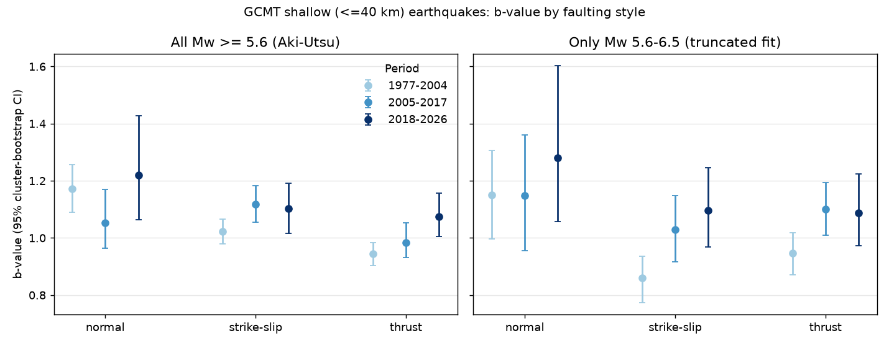
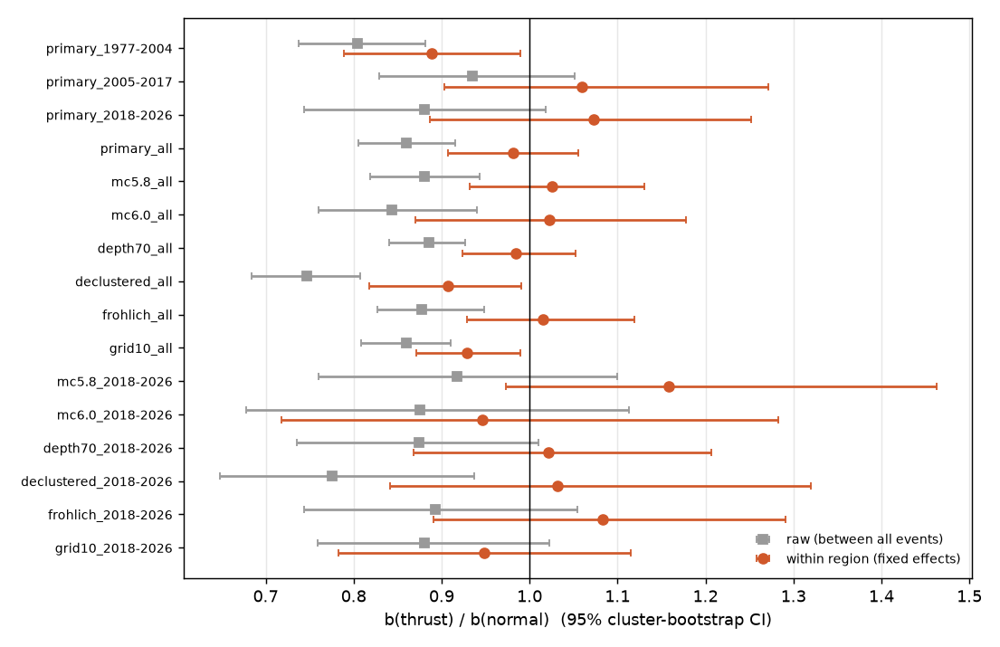
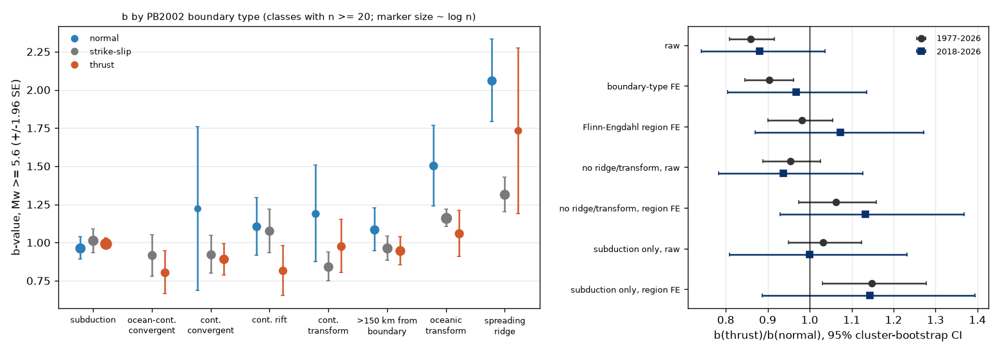

# In shallow Global CMT earthquakes of Mw 5.6 and larger (1977-2026), the faulting-style b-value difference came from differences between regions, not from faulting style within regions

## Summary

Many studies report that the Gutenberg-Richter b-value changes with faulting style:
normal faults have the highest b, thrust faults the lowest, and strike-slip faults are
between them (Schorlemmer, Wiemer and Wyss 2005; Petruccelli et al. 2018, 2019). The usual
explanation is that b decreases when differential stress increases, so b can be a "stress
meter". We tested this relation in the Global CMT (GCMT) catalog: 10,194 shallow earthquakes
(centroid depth 40 km or less, Mw 5.6 or more, 1977-01 to 2026-06). We wrote the plan
(`files/ANALYSIS_PLAN.md`) before we calculated any b-value. The main results are:

1. **Raw global difference: present, but weaker after 2004.** For all years, b was 1.14
   (95% CI 1.08-1.20) for normal, 1.06 for strike-slip and 0.98 (0.95-1.01) for thrust
   events. The thrust/normal b ratio was 0.86 (0.80-0.92). The full order was present in
   1977-2004 (ratio 0.81, 0.74-0.88). In 2005-2017 strike-slip b was higher than normal b
   (ratio 0.93, 0.83-1.05). In the new period 2018-2026, which is after the data of the
   earlier studies, the order was present but the ratio, 0.88 (0.74-1.02), did not exclude 1.
   The planned replication rule for 2018-2026 was thus not met.
2. **Within regions, the difference mostly disappeared.** When we compared each event only
   with events in the same Flinn-Engdahl region (region fixed effects in an exact
   exponential likelihood), the thrust/normal b ratio was 0.98 (0.91-1.06). Only 13% of the
   raw log contrast remained. This met the planned rule for "mostly composition". The
   within-region ratio included 1 with Mc 5.8 or 6.0, depth to 70 km and the
   Frohlich (plunge) classification. With 10-degree grid cells and with a declustered
   catalog, a part remained (0.93, 0.87-0.99; 0.91, 0.82-0.99). In 2018-2026 alone the
   within-region ratio was 1.07 (0.89-1.25).
3. **It is not a corner-magnitude effect.** With magnitudes only in Mw 5.6-6.5, far below
   the corner magnitude, the raw thrust/normal ratio stayed 0.87 (0.78-0.96). In tapered
   Gutenberg-Richter fits with a separate corner magnitude for each class, class-specific
   slopes still fit better for 1977-2026 (likelihood ratio 27.7). Thus the raw difference is
   a slope difference between event populations. But this population difference is
   mostly between regions, not between faulting styles in the same region.
4. **Exploratory (added after step 2): tectonic setting explains the raw difference.** We
   gave each event the nearest PB2002 plate-boundary type (Bird 2003). Normal events at
   oceanic spreading ridges had b = 2.06 (n = 224) and at oceanic transforms b = 1.50
   (n = 125). At subduction boundaries, normal events had b = 0.96 (n = 652) and thrust
   events b = 0.995 (n = 3,283). When we removed ridge and transform events, the raw
   thrust/normal ratio was 0.95 (0.89-1.03). Inside subduction-zone regions, thrust b was
   higher than normal b (ratio 1.15, 1.03-1.28). This is the opposite of the stress-meter
   order. In continental rifts and continental transforms, thrust b was lower than normal b, but
   with few events (for example, 97 thrust events in rifts).

Interpretation: at Mw 5.6 and above, the global relation between rake and b in GCMT is
mostly a comparison of different tectonic settings. Mid-ocean ridge and transform
earthquakes (mostly normal and strike-slip, high b) are compared with subduction
earthquakes (mostly thrust, b near 1). In the same region, the faulting style of an event
did not predict its magnitude distribution. Thus a forecast model should not apply a
global rake-b relation to events inside one region. This result does not test the
relation for small earthquakes in dense regional catalogs, where most earlier evidence
comes from.



## Question and earlier work

- Schorlemmer, Wiemer and Wyss (2005, Nature 437:539, doi:10.1038/nature04094) found
  b(normal) > b(strike-slip) > b(thrust) in regional and global catalogs and interpreted b
  as inversely related to differential stress.
- Petruccelli et al. (2018, Geophys. J. Int.) described a harmonic dependence of b on
  rake in the global CMT catalog. Petruccelli et al. (2019, GRL 46:11044,
  doi:10.1029/2019GL083997) found faulting style and depth effects in Southern California.
- Kagan (1999, 2002) and Bird and Kagan (2004) found a nearly universal moment-distribution
  slope in subduction and continental zones, and higher slopes at oceanic spreading ridges.
  They put most tectonic differences in the corner magnitude.

The open question that we tested: in a global catalog, is the faulting-style difference a
property of faulting style itself (it stays when we compare events in the same region),
or a property of where the different styles occur (composition)? Also: does it hold out of
sample, and is it a slope or a corner effect?

In this campaign, sci:sha256:e52c68b2e1361162f3ebd5cc9a8f17d4109ed89f22dc6ecd14b5e92805a822d0 found that one b-value explains the
faulting-style difference in Bath's law for aftershocks. Other campaign studies tested
b-value changes over time (Tohoku, foreshock alarms, tides). None tested the rake-b
relation with region controls.

## Data

| Input | Source and version | SHA-256 |
|---|---|---|
| GCMT NDK 1976-2020 | https://www.ldeo.columbia.edu/~gcmt/projects/CMT/catalog/jan76_dec20.ndk; shared copy `/mnt/dell-data/shared_datasets/gcmt-ndk-jan76-dec20-20261109/jan76_dec20.ndk` (downloaded 2026-11-09) | baed5ad29a69b57344c6025b27769b1012858aa6b5c807f984696d573c0f0eb4 |
| GCMT monthly NDK 2021-01 to 2026-06 (66 files) | `NEW_MONTHLY` files from the same site; read from sci:sha256:7184e3ca8e705c7f1821efa1d5a15e4c4783218097677a59a269fcc8859179c1, file `files/raw/gcmt_monthly_2021_2026.tar.gz`. URLs and per-file hashes: `files/provenance/` | tar.gz: f706b68a15917423925340fed8ecedec70f2f998a91914fbc15018449163e593 |
| PB2002 plate-boundary steps (Bird 2003, G3, doi:10.1029/2001GC000252), GeoJSON version | https://github.com/fraxen/tectonicplates commit 339b0c56563c118307b1f4542703047f5f698fae, `GeoJSON/PB2002_steps.json` (ODC-BY 1.0) | 528fdeb1d57eb3d4c6e730951eabc6fd7da9dbc5fc7038b9f19100c52b986c9a |

Parsed event table (local only, not bundled): 71,279 events, sha256
f3d563cf622c5efa6d2dda2ecac16f659ec277229927b3c4b552c242c5dc5d10. We do not bundle the raw
catalogs or the record-level event table. See `files/NOTICE.md`. `files/code/run_all.sh`
downloads the inputs again into a separate scratch folder and checks the hashes.

## Method

- **Magnitude.** Mw = (2/3)(log10 M0 - 16.1), with M0 in dyn cm from the NDK scalar moment.
- **Class.** Rake of nodal plane 1: normal if -150 < rake < -30, thrust if 30 < rake < 150,
  strike-slip otherwise (Schorlemmer et al. 2005). Robustness: Frohlich (1992) plunge
  classes (T plunge > 50 deg thrust, P plunge > 60 deg normal, B plunge > 60 deg strike-slip).
- **Sample.** Centroid depth 40 km or less, Mw 5.6 or more, 1977-01-01 to 2026-06-30.
  Magnitude histograms by period show that counts decrease above Mw 5.4 in all periods;
  we also used Mc 5.8 and 6.0.
- **b-value.** Aki-Utsu maximum likelihood for a continuous magnitude,
  b = log10(e) / (mean(Mw) - Mc). Truncated version on [5.6, 6.5) for H3.
- **Within-region contrast.** The magnitude excess Mw - Mc is exponential with mean
  log10(e)/b. We fit log mean = region effect + class terms by exact maximum likelihood,
  with the region effects profiled out. A class term gives log(b_normal / b_class). Region
  = the 24-character Flinn-Engdahl region name in the NDK (898 names; some regions have
  two name variants, which only makes the groups finer). Alternative: 10-degree cells.
  A simulation with the same region and class structure showed that the estimator has no
  bias (mean estimate 0.153 for a true value of 0.151; 300 simulations).
- **Tapered Gutenberg-Richter.** Kagan's tapered Pareto law for moment, with a free
  slope beta (b = 1.5 beta) and corner moment per class, against a model with one shared
  slope and class-specific corners (likelihood ratio, 2 degrees of freedom).
- **Uncertainty.** Cluster bootstrap that resamples region-year clusters, so that most
  aftershock sequences stay together (1,000 resamples for the primary rows, 200 for
  robustness rows, 500 for the setting analysis). Intervals are 95% percentile intervals.
- **Declustering (robustness).** Gardner-Knopoff (1974) windows on the full GCMT catalog
  (Mw 5.0 and more, all depths).
- **Setting (exploratory).** Each event gets the class of the nearest PB2002 step midpoint
  within 150 km (OSR spreading ridge, OTF oceanic transform, SUB subduction, OCB, CCB, CRB,
  CTF); events farther away are "INTRA".

## Results

### Planned tests

| Sample (Mw >= 5.6, depth <= 40 km) | n normal / strike-slip / thrust | b normal | b strike-slip | b thrust | raw b(thrust)/b(normal) | within-region b(thrust)/b(normal) |
|---|---|---|---|---|---|---|
| 1977-2004 | 728 / 2,154 / 2,346 | 1.17 (1.09-1.26) | 1.02 | 0.94 (0.90-0.98) | 0.81 (0.74-0.88) | 0.89 (0.79-0.99) |
| 2005-2017 | 478 / 1,255 / 1,359 | 1.05 (0.96-1.17) | 1.12 | 0.98 (0.93-1.05) | 0.93 (0.83-1.05) | 1.06 (0.90-1.27) |
| 2018-2026 (new data) | 244 / 783 / 847 | 1.22 (1.06-1.43) | 1.10 | 1.07 (1.00-1.16) | 0.88 (0.74-1.02) | 1.07 (0.89-1.25) |
| 1977-2026 | 1,450 / 4,192 / 4,552 | 1.14 (1.08-1.20) | 1.06 | 0.98 (0.95-1.01) | 0.86 (0.80-0.92) | 0.98 (0.91-1.06) |

Robustness for 1977-2026 (within-region thrust/normal ratio): Mc 5.8: 1.03 (0.93-1.13);
Mc 6.0: 1.02 (0.87-1.18); depth to 70 km: 0.985 (0.92-1.05); Frohlich classes: 1.02
(0.93-1.12); declustered: 0.91 (0.82-0.99, raw 0.75); 10-degree cells: 0.93 (0.87-0.99).
The continuous form b ~ sin(rake) gave the same picture (raw coefficient 0.086 in log mean
excess; within-region -0.005, CI -0.043 to 0.036). All rows are in
`files/results/class_bvalues.csv`.

Power: in simulations without cluster correlation, the within-region estimator detects a
within-region effect as large as the raw effect in 99.7% of 1977-2026 catalogs but only in
34% of 2018-2026 catalogs. The cluster-bootstrap intervals are about twice as wide as the
simulation spread. Thus the 2018-2026 within-region result alone is weak; the 1977-2026
result is strong evidence against a within-region effect as large as the raw effect, but
it does not exclude an effect of about 5-10%.



### Slope or corner

| Period | b(Mw 5.6-6.5) normal / strike-slip / thrust | ratio thrust/normal | tapered-fit b per class | corner Mw per class | LR (2 df), p |
|---|---|---|---|---|---|
| 1977-2004 | 1.15 / 0.86 / 0.95 | 0.82 (0.71-0.96) | 1.17 / 1.01 / 0.94 | 8.4 / 7.9 / 8.9 | 25.6, 3e-6 |
| 2005-2017 | 1.15 / 1.03 / 1.10 | 0.96 (0.78-1.17) | 1.05 / 1.10 / 0.98 | 8.1 / 7.7 / 9.1 | 8.3, 0.016 |
| 2018-2026 | 1.28 / 1.10 / 1.09 | 0.85 (0.68-1.07) | 1.21 / 1.09 / 1.07 | 7.8 / 7.9 / 8.8 | 2.6, 0.28 |
| 1977-2026 | 1.17 / 0.95 / 1.02 | 0.87 (0.78-0.96) | 1.13 / 1.05 / 0.98 | 8.3 / 7.9 / 9.0 | 27.7, 1e-6 |

The LR p-values assume independent events, so they are too small. Corner magnitudes above
about 8.5 are poorly constrained.

### Exploratory: tectonic setting

| Control (1977-2026; 500 separate bootstrap resamples) | b(thrust)/b(normal) |
|---|---|
| None (raw) | 0.86 (0.81-0.92) |
| PB2002 boundary type fixed effects | 0.90 (0.85-0.96) |
| Flinn-Engdahl region fixed effects | 0.98 (0.90-1.06) |
| No ridge or oceanic-transform events, raw | 0.95 (0.89-1.03) |
| No ridge or oceanic-transform events, region fixed effects | 1.06 (0.98-1.16) |
| Subduction only, raw | 1.03 (0.95-1.12) |
| Subduction only, region fixed effects | 1.15 (1.03-1.28) |

The setting split was not in the plan. We added it after we saw that normal events in
regions with ridge-type names (for example "RIDGE" or "RISE") had very high b. Treat it as a hypothesis
for later tests. Full tables: `files/results/b_by_setting_class.csv` and
`files/results/setting_contrasts.csv`.



`files/figures/fig2_b_vs_rake.png` shows b in moving rake windows for each period.

## Limitations

- Only GCMT events of Mw 5.6 and more. Earlier positive results come mostly from small
  earthquakes in regional catalogs (California, Japan, Italy). Our result does not test them.
- Flinn-Engdahl regions are large. One region can contain different stress environments
  (for example, outer-rise normal events and interface thrusts). A stress-meter model can
  still predict a difference there, so the within-region null is evidence against a
  simple mechanism-based correction, but it does not exclude stress effects at smaller
  scales.
- Completeness can differ between regions and periods (for example, remote ridges before
  1990). A higher Mc (5.8, 6.0) did not change the within-region result.
- GCMT changed its method in 2004 (Ekstrom et al. 2012). The pre-2004 period shows the
  strongest class difference; we cannot separate a method effect from chance.
- Many shallow GCMT depths are fixed (69% of normal, 56% of strike-slip and 43% of thrust
  events in the sample). The depth cut can thus act differently by class.
- Rake of nodal plane 1 decides the class; oblique events near the class borders can move.
- The cluster bootstrap keeps region-year groups together but does not remove all
  dependence (for example, sequences that cross a year boundary).
- The plate-boundary analysis uses step midpoints and a 150 km cut, and it is post hoc.

## Reproduction

```
bash files/code/run_all.sh /path/to/scratch 1000
```

This downloads GCMT (1976-2020 file and 66 monthly files) and PB2002 into the scratch
folder, checks the SHA-256 values, parses the NDK files (`parse_ndk.py`), runs the planned
analysis (`analysis.py`, about 10 minutes), the exploratory setting split and power
simulation (`setting_and_power.py`) and the figures (`figures.py`). Software: Python
3.12.16, numpy 2.5.4, scipy 1.18.1, pandas 3.1.1, matplotlib 3.11.2. Random seeds are
fixed in the code. GCMT can revise monthly solutions; the script warns if hashes change.

## Provenance

- Job: sci-1107-dell-earth-and-ocean-sciences-6ff33cca78ee, campaign 11_07_2026, topic
  earth-and-ocean-sciences, machine dell, account claude-andrii.
- Model: Claude Opus 5.5 (claude-opus-5-5), acting as an automated research agent. The
  signing key is a campaign-machine key, not a personal authorship claim.
- Date of analysis: 2026-11-09.

## References

- Bird, P. (2003) An updated digital model of plate boundaries. G3 4, 1027.
  doi:10.1029/2001GC000252
- Bird, P. and Kagan, Y. Y. (2004) Plate-tectonic analysis of shallow seismicity. BSSA 94, 2380-2399.
- Dziewonski, A. M., Chou, T.-A. and Woodhouse, J. H. (1981) JGR 86, 2825-2852. doi:10.1029/JB086iB04p02825
- Ekstrom, G., Nettles, M. and Dziewonski, A. M. (2012) The global CMT project 2004-2010.
  PEPI 200-201, 1-9. doi:10.1016/j.pepi.2012.04.002
- Frohlich, C. (1992) Triangle diagrams. PEPI 75, 193-198.
- Gardner, J. K. and Knopoff, L. (1974) BSSA 64, 1363-1367.
- Kagan, Y. Y. (1999) Universality of the seismic moment-frequency relation. PAGEOPH 155, 537-573.
- Petruccelli, A. et al. (2018) Harmonic fluctuation of the slope of the frequency-magnitude
  distribution (b-value) as a function of the angle of rake. GJI.
- Petruccelli, A. et al. (2019) GRL 46, 11044-11053. doi:10.1029/2019GL083997
- Schorlemmer, D., Wiemer, S. and Wyss, M. (2005) Nature 437, 539-542. doi:10.1038/nature04094
