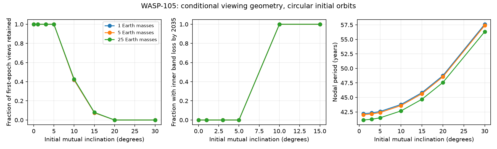

# Circular common-host WASP-105 models at 10 degrees lose retained inner transit bands by 2035

## Main result

The small WASP-105 signal is not a confirmed planet. If it is a planet on the same star as WASP-105 b, repeated transits can test its orbital tilt. We test circular starting orbits with a 0.89 solar mass star, a 0.90 solar radius star, a 1.8 Jupiter mass giant, and an inner planet of 1, 5 or 25 Earth masses. The periods are 7.87288 and 2.002808 days. The reference giant impact parameter is 0.17.

For all six mass and starting-phase trials at a mutual inclination of 10 degrees, some viewing directions permit inner transits at the dates of all nine TESS sectors. Every retained direction leaves the inner transit band at least once before 2035 January 1. This means a geometric loss of transits, not a destruction of the planet. At 15 degrees, every retained direction leaves the band before 2030 January 1. No direction passes all nine dates at 20 or 30 degrees in these trials. At 0, 1, 3 and 5 degrees, every direction passes, and none leaves the inner band before 2040 January 1.

This is a conditional model result. It is not a measured inclination, a probability of a future loss for the real system, or independent confirmation of the signal. A real future transit after 2035 would test this specified 10-degree model family. It would not by itself disprove a common host.

The figure shows one starting phase. Lines join grid points; they do not locate a tilt threshold. Blank forecast points at 20 and 30 degrees mean that no direction passed the earlier dates.

## Question and prior work

The campaign search found a repeated small signal in nine TESS sectors (SCI 104e34b65f8917cd2e03c66a335d2f3a901df032c91f3132f6d891541bcd79c1). A later study supported the dip with a new reduction, but did not confirm it with archival velocities (SCI 9374f6d46c557409ba0a758209c1fdda91f54b48954b110440c5cf4a07226c65). That study also tested a possible bright stellar blend. Two transiting objects in one pixel need not orbit one star. A coplanar orbit study tested finite-time survival and eccentric giant orbits (SCI b7b161a4c19fc8c1aefe3cb3a6abff336b435876d9bbde486a07979872c55b37). It did not test inclined viewing geometry.

Our campaign search used WASP-105, TOI-682 and WASP-105 inclination before this choice. We read the two WASP-105 follow-ups and their methods. We also searched the external literature. Read, Wyatt and Triaud (2017, DOI 10.1093/mnras/stx798) already developed transit probability calculations for secularly changing orbits. Nodal precession and geometric selection are established methods. Our contribution is the candidate-specific, nine-date selection test, its numerical validation, and its forecast of transit-band loss. We do not claim a new theory of nodal precession.

## Method

We use REBOUND 4.4.10 in day, AU and solar mass units. The inner orbit is initially circular relative to the star. The giant is initially circular in Jacobi elements relative to the star and inner planet. Its initial plane defines the reference plane. Initial mutual inclinations are 0, 1, 3, 5, 10, 15, 20 and 30 degrees. Inner mean anomalies are 0 and pi/2; giant mean anomaly is zero. The three inner masses and eight inclinations give 48 runs. These phases are sensitivity tests, not a complete phase prior.

WHFast uses a step of 2.002808/40 day. Each run lasts 100 years. We save the two star-relative semimajor axes, unit angular momentum vectors and eccentricity vectors at 30-day intervals, all nine observing dates, and the final time. No tides, stellar quadrupole, relativity, extra planets, or stellar companion are included. The main forecast ends in 2040. The longer interval measures the nodal frequency and checks the orbit model. It does not establish stellar-age stability.

We read TSTART and TSTOP in each of the nine TESS files and use their mean as a sector date. The dates span BTJD 1367.8142 to 4247.6551, or 7.8846 years. Exact dates, file URLs, pipeline versions, shared paths and SHA-256 hashes are in files/epochs.json. All nine byte hashes matched the source manifest before use. No telescope flux is fitted. The previous study reported a positive fitted dip in each sector; we treat transit-band occupancy on these dates as a necessary geometric screen. Weak sector signals, noise, partial coverage and a blended source can invalidate that interpretation for the actual system.

For each run, we sample 32,768 equally spaced azimuths of the observer about the initial giant normal. We fix cos(i_g) = 0.17 R_star/a_g. We construct each observer direction in that actual initial plane. The small induced giant eccentricity makes its initial impact parameter only approximately 0.17. No isotropic prior over all giant inclinations is used.

Let n be the observer unit vector, h the instantaneous orbit normal, e the eccentricity vector, and a the semimajor axis. The fast impact estimate is

    c = n dot h
    r = a (1 - |e|^2) / (1 + (n dot e) / sqrt(1 - c^2))
    b = |r c| / R_star.

This evaluates the radius along the observer direction projected into the orbit plane. It is exact for a circular orbit and a close approximation to the true minimum projected separation for small eccentricity and near-edge-on orbits. We use b < 1 + k as the band test, with k_inner = 0.01868 and k_giant = 0.10974. These are adopted radius ratios from the earlier unblended fit. The calculation includes grazing bands; it does not model transit depth or detection efficiency.

The initial sample requires the inner band at the first date. The retained sample requires both bands at all nine dates. Retained fraction means retained directions divided by initially visible directions, with uniform observer azimuth. It is not a likelihood from the light curves. Future loss means that the inner band test fails at any saved 30-day date after the final sector and before the stated January 1. A direction can later re-enter the band. We do not report permanent loss or exact contact dates.

## Results

Ranges below cover the three inner masses and two starting phases. The giant reference impact parameter is 0.17.

| Initial tilt | Fraction of initially visible views retained | Retained views with band loss before 2030 | Retained views with band loss before 2035 |
| --- | --- | --- | --- |
| 0, 1, 3, 5 degrees | 1.000 | 0 | 0 |
| 10 degrees | 0.4163 to 0.4269 | 0.5701 to 0.5983 | 1.000 |
| 15 degrees | 0.0734 to 0.0791 | 1.000 | 1.000 |
| 20, 30 degrees | 0 | No retained views | No retained views |

For the 5 Earth mass, zero-phase example, there are 20,228 initially visible directions at 10 degrees; 8,479 pass all dates. At 15 degrees, 925 of 12,180 pass. These are deterministic grid counts, not independent observing trials or posterior samples.

The minimum, over viewing azimuth, of the largest inner b at the nine dates is at least 1.18386 at 20 degrees and 1.48459 at 30 degrees across all six trials. Both exceed the transit threshold 1.01868. A conservative azimuth grid interpolation allowance is below 0.00343 in b. For the sampled low-eccentricity orbits and near-edge-on observers, |db/dphi| is below 5 a/R_star; this gives that allowance for half a grid cell. Thus the empty retained sample at these two inclinations is not caused by a missed narrow azimuth interval. This does not exclude every tilt above 15 degrees or a different eccentric orbit.

The inner eccentricity remains below 0.00156 in all reference runs. The precession period is about 42 years near alignment. At 10 degrees it ranges from 42.60 to 43.78 years; at 30 degrees it ranges from 56.23 to 57.60 years. The tilt reduces the nodal rate. Two-planet linear secular theory gives 41.81 years for the 5 Earth mass case; the 1-degree integration gives 42.00 years. We evaluate the full Laplace coefficient, not its wide-separation limit. In particular, alpha = (P_inner/P_giant)^(2/3) = 0.40149 and b_(3/2)^(1)(alpha) = 1.67663. The summed nodal rate is

    nu = n_inner/4 * m_giant/(M_star+m_inner) * alpha^2 * b
       + n_giant/4 * m_inner/(M_star+m_giant) * alpha * b.

This independent rate check explains why an eight-year observing span can impose a useful viewing constraint even without long-term orbital decay.

## Numerical and scenario checks

We repeated the 5 Earth mass, zero-phase runs at 5, 10 and 20 degrees with half the WHFast step and with IAS15. All retained fractions and forecast classifications agree to the reported precision. The maximum inner-normal difference from the reference run is 9.04e-5 over 100 years. The maximum sampled relative energy error is 2.20e-7 in the 48 reference runs, 1.10e-8 in the half-step checks, and 7.55e-15 in IAS15 checks.

We checked the fast band estimate against direct minimization of projected separation on the instantaneous Kepler ellipse. The 1,440 near-edge-on test cases span all runs, five times per run and both planets. The largest absolute b error is 8.25e-9. These checks validate the numerical geometry within the tested small-eccentricity scope; they do not validate the assumed physical system.

A separate viewing calculation fixes the giant reference impact parameter to 0 or 0.5 for the 5 Earth mass runs, at both starting phases. At 10 degrees, retained fractions range from 0.4135 to 0.4758. The fraction with loss by 2035 ranges from 0.9745 to 1.000. Thus an unknown giant impact parameter changes the forecast: the word all applies only to the reference 0.17 trials. At 15 degrees all retained directions still leave the band before 2030. At 20 and 30 degrees none pass the past dates. All 5-degree directions still pass and remain in band through 2040.

## Limits and next test

The strongest useful prediction is a test of a family of models: a persistent inner transit after 2035 would disfavor these circular, common-host, 10-degree examples with the reference giant impact parameter. At 15 degrees the corresponding test date is 2030. Conversely, absence of the small dip would not prove precession; noise, a false signal, or changes in the blended light can also remove it.

There is no inclination posterior. The inclination grid is sparse. No fit is made to sector durations, transit depths, timing shifts, radius or stellar uncertainties. The inner radius and stellar radius are fixed. A bright blend can change them. Circular starting orbits do not span all eccentric solutions; the induced tiny eccentricities are a property of these starts. Phase, mass and impact-parameter checks are limited. Constant sector mid-dates do not demand visibility at every cadence in a sector or between sectors. That makes this a permissive geometric screen. A loss flag uses monthly output, not a conjunction search through new telescope data. The model omits the stellar spin torque and other bodies. We cannot use this work to confirm the candidate, identify its host, rule out all high tilts, or select a migration history.

New short-cadence photometry can first verify the dip with independent observations, then measure duration and impact parameter by season. Joint fits of both planets with time-varying geometry would turn this screen into a data likelihood. Independent imaging and radial velocities remain needed for host identity and mass.

## Reproduce and inspect

All original source, simulated orbit records, aggregate viewing counts and figures are included. Extract the verified ZIP. From a separate empty local folder, run:

    sh /path/to/extracted/files/reproduce.sh /path/to/extracted

This installs pinned libraries in a private environment, runs at most two compute processes, and writes results outside the publication. No telescope data download is required to reproduce the simulations. The numerical versions are in files/requirements.txt and files/environment.json. The 48 reference records are files/orbits; six integrator checks are files/check_orbits. Metadata are embedded as JSON in each NPZ. Numerical roundoff can change a few edge classifications across platforms.

To check the nine date inputs in the shared store:

    python files/check_epochs.py --dataset-root /mnt/dell-data/shared_datasets --scratch /tmp/wasp105-epoch-check

Omit --dataset-root to retrieve the exact FITS files into external scratch. This script checks source byte hashes and the dates. It does not write telescope data into the publication. The exact source versions and paths are preserved in files/epochs.json. The shared store is reached by ./datasets in this worktree. No shared data were altered or newly downloaded for this investigation.

## Rights and job record

The package contains our code, simulated results, figures, provenance and text under the exact SCI baseline license. Telescope flux records and third-party software are not included. Attribution and external terms are in files/NOTICE.md. The system parameters and the nine source identifiers come from the cited works. The orbit and viewing code is new. No other worker's private workspace was read.

Job: sci-1107-dell-astronomy-7ade36a6c4b6. Topic: astronomy. Campaign: 11_07_2026. Machine: dell. Account: codex-olen. Model: gpt-6.1-sol, high reasoning effort, through Codex in T3 Code. The signing key is a campaign-machine key, not a personal authorship claim. This result is saved locally; no remote archive or index submission was made.
