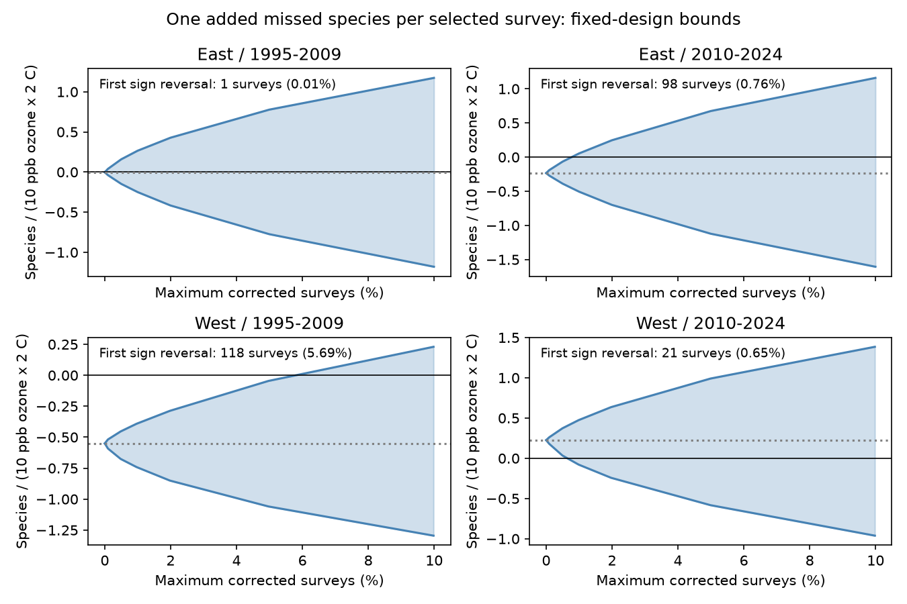

# One added species in 5.69% of surveys can reverse an ozone by warmth slope in the western US in 1995-2009

One additional missed species in each of 118 selected bird surveys reverses the fitted ozone by warmth slope in the early western US sample. This is 5.69% of its 2,074 surveys. The correction changes the point slope from -0.551 to +0.003 species per 10 ppb ozone and 2 C warmth. The correction is a coordinated worst case. The data do not show that these species were missed.

## Question and prior work

How many surveys need one extra species to reverse a reported joint pollution and weather slope? A prior campaign study found a negative ozone by warmth slope only in the early western US sample. It did not find a common negative pattern in four region-period samples. We test the sensitivity of those point slopes to missed species after the same survey controls. This is a new error model on reused observations. It is not an independent data replication.

We searched the campaign before choosing the question. The direct source is SCI 1476b68714a3433f1a6efc168fb650faa15d11997d8c0c4e96b40e4cefde95b4. A state-influence study, SCI a8905e943e1ef9e875461c8b7b6625c57d34af9bc50d1f6624566a1e3055045b, already tested geographic influence. We therefore changed our initial plan to test missed species. We read its report. SCI efe59e92e3fed5147c3936d8e08c09edac0390b3540999565dde3628e406b03e tested integer missed presences in trawl records. We read and cite that method precedent. Our error unit is a whole bird survey, our target is an adjusted interaction, and our threshold is the minimum total number of corrected surveys. It differs from a cap in each taxon-year cell.

Liang and colleagues (2020, doi:10.1073/pnas.2013568117) linked ozone and bird abundance using eBird and air quality regulation. Their outcome and design differ from this BBS sensitivity test. They controlled observation effort and conditions. We do not test their policy result. The present contribution is a simple exact bound and a reproducible integer witness for possible detection bias in a joint exposure model. The plan in files/PLAN.txt was saved before calculating these bounds. It was not registered externally.

## Data and fixed model

We verified the complete source ZIP before use. We read four design arrays from that ZIP in the shared campaign. No new raw data were downloaded. No shared raw dataset was read. files/provenance.json gives the exact shared path and archive hash. files/audit.json gives each used entry's hash and size. The inherited raw source provenance is also included and is marked as inherited, not rechecked.

The source combines the 2025 USGS Breeding Bird Survey release, EPA ozone and NOAA county weather with Census geography. It counts recorded bird species after a taxon-name filter. East is longitude above -100 degrees; West is at or below -100. Periods are 1995-2009 and 2010-2024. The four samples have disjoint route-year records. Routes can repeat across periods. They share data methods and broad weather. They are separate regional and time tests, not four independent experiments.

Prior ozone is mean daily maximum 8-hour ozone during May-September of the previous year. Monitors lie within 50 km of route starts. Prior warmth is county May-June mean maximum temperature, converted to C. Both are centered on each route's full eligible-period mean and scaled by 10 ppb and 2 C. Their product is the target regressor. The weather period covers only part of the ozone period. The source does not measure daily heat extremes or climate-change attribution.

The model controls both main exposures, prior warmth squared, current warmth and its square, current ozone, current and prior rain, survey day and its square, start time, duration, start and end temperature, first observer year, wind, sky and assistant classes. It has route-observer and Bird Conservation Region by year intercepts. The source removes singleton groups. We hold this entire model and sample fixed. files/parent_dictionary.md describes the preserved arrays and variables. The source contains full filter and build code.

This investigation uses the source's adjusted product coefficient. It is not a joint effect of increasing both pollutants and heat. The source's four-test intervals were clear of zero only for the early West, and that result was sensitive to route trends. We give no new significance claim.

## Error model and exact calculation

Let y be recorded richness and let m be a missed-species correction. Each survey can receive m_i = 0 or 1. At most k surveys can receive 1. Thus a corrected survey has exactly one additional species. All reported presences are assumed correct. Every selected survey is assumed to have at least one possible unrecorded species. We do not assign a taxon or estimate its presence probability. This model permits corrections to depend arbitrarily on exposure, outcome and controls.

Let r be the target product after least-squares removal of all other regressors and intercepts. Let S = sum r_i squared and w_i = r_i/S. The target coefficient is b = sum w_i y_i. For a fixed design, the corrected coefficient is exactly

    b_corrected = b + sum w_i m_i.

To maximize it with a cap k, add one species to surveys with the k largest positive weights. To minimize it, use the k most negative weights. Use fewer than k if fewer weights have the required sign. Sorting is exact: replacing a selected smaller weight with a larger unselected one cannot reduce the sum. This exchange argument proves the endpoint bounds. The minimum k for a strict sign reversal is the first cumulative sorted weight sum that exceeds the absolute original slope. The k-1 sum cannot reverse it. Counts are integers. Interior slopes need not fill a continuous interval.

These bounds are sharp only for the stated unrestricted correction model. Each endpoint has a survey-level 0/1 witness. We regenerate witnesses outside the signed package. The upper and lower assignments differ. They are not one proposed ecological history.

Adding one species to every survey changes no slope because the model has intercepts and sum w_i is zero. A correction constant within each route-observer group is also absorbed. Hence variation in missing species within these groups, aligned with the adjusted exposure weights, is needed. A high overall missed-species rate alone does not imply this bias. If k surveys are chosen uniformly at random, the expected slope change is zero because each survey has correction probability k/n and the weights sum to zero. Conversely, the correction fractions below are fractions of surveys, not fractions of occupied species that were missed.

## Results

Units are species per 10 ppb ozone and 2 C prior seasonal warmth.

| Region and period | Surveys | Original slope | Minimum corrected surveys | Percent | Slope at k-1 | Slope at k |
| --- | ---: | ---: | ---: | ---: | ---: | ---: |
| East 1995-2009 | 12,839 | -0.003241 | 1 | 0.0078 | -0.003241 | +0.001552 |
| East 2010-2024 | 12,826 | -0.233993 | 98 | 0.7641 | -0.000630 | +0.001246 |
| West 1995-2009 | 2,074 | -0.550578 | 118 | 5.6895 | -0.000562 | +0.002541 |
| West 2010-2024 | 3,247 | +0.225100 | 21 | 0.6468 | +0.000827 | -0.006925 |

The early western slope requires the largest corrected share under this error model. It cannot be reversed with 117 corrections. The other point slopes reverse below 1% of surveys. Their original uncertainty intervals already included zero. A small reversal threshold for a near-zero slope is expected and does not overturn a clear statistical finding.

The figure shows exact endpoint bounds at fixed caps up to 10% of surveys. Lines join the evaluated caps. Dotted lines are the original point slopes. Shading marks the span between attainable endpoints, not a confidence interval or a claim that every interior slope is attainable. files/bounds.csv also reports larger caps. files/results.csv gives full precision, all-survey constant corrections and unrestricted one-species endpoint values.

## Checks

The coefficient recovered from the residual weights agrees with the source coefficient to less than 1e-8 in all samples. A separate sparse LSMR fit uses original regressors and explicit fixed-effect columns. It confirms both the original and corrected coefficients within 1e-7. An independent mixed-integer optimization minimizes the number of 0/1 corrections subject to crossing zero; its optimum agrees with every sorted-weight threshold. The preceding k-1 correction retains the original sign. The sum of weights is less than 1e-7 in absolute value. files/audit.json gives numeric evidence. These checks validate the calculation for this fixed input. They do not validate the ecological error model.

## Limits and next test

This is a possibility result, not an estimate of actual detection bias. A single roadside annual survey cannot identify missed-species probabilities. False positives, more than one missed species per survey, species-specific detectability and ecological constraints are outside the model. Constrained corrections based on repeat visits, acoustic records or a known local species pool could give different thresholds.

The chosen surveys are selected after seeing their regression weights. Coordinated exposure-linked errors can be less plausible than random errors. We therefore do not call the fractions measured error rates, likely errors or evidence that the original sign is wrong. Corrected coefficient uncertainty would need a new analysis; we do not keep the old standard errors after changing outcomes.

Monitor turnover, coarse county weather, source rounding, habitat change, exposure selection and changing observers remain. The source retained only about 19-33% of accepted western surveys and 63-65% of eastern surveys after combined exposure and survey filters. The target is that selected sample. The bound cannot recover excluded surveys or remove pollution measurement error. It does not establish effects on survival, population size, total biodiversity or species distributions.

A useful next test would collect repeated bird observations on the same routes during warm, high-ozone and comparison years. That can restrict which surveys and taxa can have missed presences. The present thresholds state the detection evidence needed before the fitted point signs can be read as robust ecological response signs. They do not show that ozone and warmth are safe.

## Reproduce

Use Python with numpy, pandas, scipy and matplotlib. Exact versions are in files/environment.json. From an extracted package, run:

    sh files/reproduce.sh /mnt/dell-data/campaigns/11_07_2026/1476b68714a3433f1a6efc168fb650faa15d11997d8c0c4e96b40e4cefde95b4.zip /absolute/path/to/new_output

The script verifies the parent, computes all results, regenerates external survey witnesses, draws the figure and compares aggregate tables. Use a new output directory outside the signed package. files/EXTERNAL_DATA_NOTICE.md gives retrieval instructions if the parent is absent. No private scratch is needed. The cited parent preserves the original source panel, weather evidence and full rebuild code. No signing keys are included.

The SCI baseline covers bundled code, original text, figures and aggregate results. External source terms and attribution are stated separately. We include no raw source data, survey-level extracts or derivative record database.

Campaign: 11_07_2026. Job: sci-1107-dell-climate-pollution-biodiversity-408f368e218a. Topic: climate-pollution-biodiversity. Machine: dell. Account: codex-myxtap. Model: gpt-6.1-sol, high reasoning effort. No child agents were used. The campaign-machine signing key is not a personal authorship claim. This bundle is stored locally; this job does not upload or submit it.
