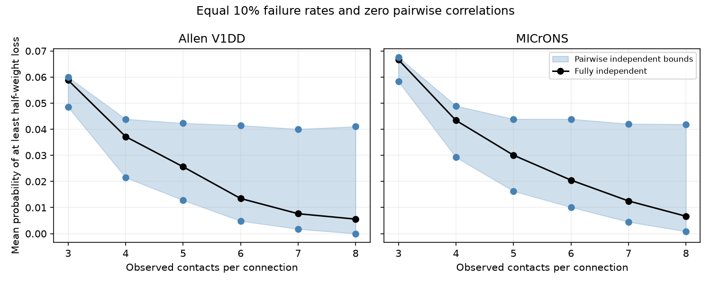

# Zero pairwise failure correlations leave half-weight loss uncertain in two selected mouse contact models

Equal failure rates and zero pairwise correlations do not fix the risk of losing half of a connection's cleft-weighted input. In the tested model, this risk had a nonzero range for 1,013 of 1,512 Allen V1 Deep Dive connections and 904 of 1,438 MICrONS connections. All contacts had an assumed failure probability of 0.1. We used observed cleft sizes as linear weights. These are sharp conditional probability bounds, not measured release rates.

The blue band gives mean lower and upper bounds within each contact-count group. The black line gives full independence. The band is a model identification range, not a confidence interval across animals. Each bound allows a different higher-order law in each connection.

## Question and prior work

Can contact sizes, equal failure rates, and all pairwise failure probabilities determine a large loss event? This matters when circuit models use contact counts or measured covariances to infer reliable transfer.

The campaign concentration report (sci:sha256:002ee9e80347aa25617ae61940dca8f996330f58445ab6c2d2cb51b24097dbd9) measured size concentration and independent dropout variance in V1DD. The spatial-failure report (sci:sha256:2fd74d3137fe637449210c92532d1a0a470a28bc94fb7e1bf10742eec038bc1b) added a specified spatial failure law in two maps. We reuse its verified contact tables. The contact-count report (sci:sha256:57033adde2db3ebff02ad55605c04163e555d7d529d1f30622c68aa64b23560f) already showed that equal first and second moments can leave full-silence reliability orders uncertain. Thus the general warning about higher-order dependence is not new.

Our extension tests a weighted half-loss event using actual size vectors in two mouse maps. Unlike full silence, this event depends on which contacts fail, so count moments alone cannot represent it. We impose each labelled pair constraint in a finite-state linear program. We quantify the gap while holding the weighted mean and variance exactly fixed. We do not claim a new probability method or a measured structure-function link.

Ramachandra and Natarajan studied established sharp bounds under pairwise independence (doi:10.1137/21M1408294; arXiv:2006.00516v6). Holler and colleagues linked size and strength in a different mouse sample and found multiple release sites per synapse (doi:10.1038/s41586-020-03134-2). This supports a size sensitivity test, but does not calibrate cleft size to strength here.

We searched the campaign before choosing this test. Terms included contact dropout, synaptic reliability, contact size concentration, and pairwise independence. We read the three reports above. This is an exploratory test, not an externally registered study. The failure rate, threshold, and count range were fixed before computing the new bounds.

## Data

We verified the complete source ZIP for sci:sha256:2fd74d3137fe637449210c92532d1a0a470a28bc94fb7e1bf10742eec038bc1b. We extracted two entries to separate scratch. No shared raw data were read, changed, or downloaded. No neural activity values were used.

Allen V1DD is mouse 409828, materialization 1196, release v1dd-analysis-1196-1_2025-08-14_16-38-00. The published input has 107,663 excitatory contacts with proofread axons and dendrites and known cell labels. Upstream selection is sci:sha256:27b63e3cdb4c8212ea43a2858f9fe8a62dd36bf2d65b74782d16a5d2ebcd77f5.

MICrONS is minnie65_phase3_v1/v1507. Its published input has 5,761 selected excitatory contacts in connections with at least three contacts. The source report selected proofread typed endpoints, positive sizes, finite positions, and nonself connections.

We group by ordered source and target identifiers. We retain 3 through 8 contacts, verify stored counts, and check unique contact identifiers. This gives 5,231 contacts in 1,512 V1DD connections and 5,413 contacts in 1,438 MICrONS connections. We exclude 7 V1DD and 34 MICrONS connections above eight contacts to keep state enumeration small. The cutoff is computational, not biological.

Exact input SHA-256 hashes:
~~~
v1dd_contacts.csv.gz
fae0ff744e30b79b5b7ac9d317e80e69f6b5a052bc5939db82904322564853b8
microns_contacts.csv.gz
a204f4b46ae12a8017a126adba5a8eac5058c593a389bf66fa8ba7a654787d21
~~~
files/provenance.json records exact input scratch paths, inherited shared raw paths, source URLs, versions, and raw hashes. Raw hashes are inherited and were not rechecked. The verified published tables are the actual inputs.

## Model and proof

Let F_i be one if contact i fails. Assume Pr(F_i=1)=q=0.1 and Pr(F_i=1,F_j=1)=q squared for each distinct pair. Thus every pair is independent. We place no restriction on dependence among three or more contacts.

For positive cleft sizes w_i with sum W, define lost fraction L=sum(w_i F_i)/W. The outcome is Pr(L >= 0.5). Integer size sums handle exact ties. Each contact fails as one unit; vesicles and spikes are not modeled.

For each binary state s in {0,1}^n, assign mass z_s >= 0. Constrain:
~~~
sum_s z_s = 1
sum_s s_i z_s = q               for each i
sum_s s_i s_j z_s = q^2         for each i < j
~~~
Minimize and maximize sum_s 1[2 sum_i w_i s_i >= W] z_s. Every allowed law is a feasible z and each feasible z is an allowed law. Both endpoints are therefore sharp within numerical tolerance. We enumerate at most 256 states per connection. Sorting weights allows reuse of identical event vectors: 112 distinct objectives require 224 solves. Full independence supplies a feasible reference with state mass q^k(1-q)^(n-k) for k failures.

For every allowed law, E[L]=q and Var(L)=q(1-q) sum_i w_i^2/W^2. All covariance terms vanish. Thus the half-loss range exists with exactly the same mean, variance, and all contact-pair distributions.

If one contact holds more than half of W, half loss occurs exactly when that contact fails. Its probability is fixed at q. This accounts for all zero-width cases here: 499 in V1DD and 534 in MICrONS. One exact half-size tie exists; it needs separate treatment because losing the other contacts also reaches the threshold.

For three contacts with every size below half, half loss means at least two failures. Let t be the triple-failure probability. Each specified two-failure state has mass q squared minus t. Each specified single-failure state has mass q minus 2q squared plus t. The no-failure state has mass 1 minus 3q plus 3q squared minus t. At q=0.1 these are nonnegative exactly when 0 <= t <= 0.01. The half-loss probability is 0.03 minus 2t. Its exact range is 0.01 to 0.03, versus 0.028 under full independence. The audit checks both endpoint laws with exact fractions.

## Results

| Map | Connections | Nonzero range | Mean lower | Mean independent | Mean upper |
|---|---:|---:|---:|---:|---:|
| Allen V1DD | 1,512 | 1,013 (67.0%) | 0.03935 | 0.05069 | 0.05507 |
| MICrONS | 1,438 | 904 (62.9%) | 0.04294 | 0.05312 | 0.05888 |

Means weight each connection equally. Endpoints can be attained together if laws across connections are unrestricted. No shared neuron, branch, or spatial failure law is imposed.

For eight contacts, mean ranges are 0 to 0.04104 in V1DD (8 connections) and 0.00083 to 0.04192 in MICrONS (24 connections). Full-independence means are 0.00557 and 0.00667. The largest individual upper-to-independent ratios are 14.66 and 15.33. These maxima are descriptive extremes. Larger groups are small and differ in cell composition. The trends do not isolate a causal count effect.

The useful result is a labelled-contact bound tool and a two-map sensitivity benchmark. In these selected samples, sizes and exact pairwise independence often leave large-loss risk unknown. This does not show that an extremal failure law occurs in the brain.

## Checks

All 224 endpoints passed checks of primal mass, marginal and pair constraints, dual feasibility, and primal-dual agreement. Maximum certificate error was 1.29e-13, below 1e-8. Every independent reference lay within its bounds. A second full run matched aggregate CSV and summary JSON byte for byte.

An independent scalar audit enumerated the independent law for all 2,950 connections, with maximum difference 1.12e-16. It checked analytic bounds for 1,922 three-contact cases without an exact half-size tie, all aggregate rows from scratch evidence, and the synthetic three-contact laws with exact fractions. files/results/audit.json records these checks. Code was written for this test.

## Limits and next tests

There is one animal per map. This is a result in two selected mouse visual cortex maps, not a population estimate across animals, regions, or behavior. Selections differ. Arbors are incomplete. Sizes, labels, and synapse detection can have errors. Connections share cells and tissue. No animal sampling interval or biological p value is warranted.

Cleft size is a structural proxy. The rate 0.1 and threshold 0.5 were chosen, not fitted. Other rates and thresholds were not tested. Zero pair correlations are imposed exactly, not estimated from finite trials. Extremal laws may require patterns that a specific biological mechanism cannot produce. A spatial or latent failure law can narrow the ranges. Multiple release sites, unequal rates, filtering, receptor saturation, inhibition, and recurrence are absent.

No paired release or activity data identify these laws. The result cannot establish reliable representations or behavior. A next test needs simultaneous multi-contact release measurements, estimated pairwise constraints with uncertainty, and observed weighted tail loss. A shared spatial law across connections and other feasible moments remain open. These extensions were not tested.

## Reproduce

Use Python 3.12 and files/requirements.txt. External contact tables and record-level results stay outside this draft. Obtain the exact cited source ZIP from the campaign archive:
~~~
./campaign/2fd74d3137fe637449210c92532d1a0a470a28bc94fb7e1bf10742eec038bc1b.zip
~~~
Outside the campaign, obtain this SCI bundle from its archive holder. If unavailable, use original raw data and selection code preserved in that publication. Raw URLs and hashes are in provenance.json. No unverified substitution is supported.

From the extracted publication root:
~~~
python files/extract.py --bundle /path/to/source.zip --out /path/to/external-inputs
python files/analyze.py --inputs /path/to/external-inputs --scratch /path/to/external-derived --out /path/to/reproduced
python files/audit.py --inputs /path/to/external-inputs --scratch /path/to/external-derived --results /path/to/reproduced
~~~
Use fresh paths outside the signed draft. Extraction verifies the full SCI ZIP, ID, and input hashes. Analysis writes per-connection evidence to scratch and only aggregate results and a PNG to the output folder. It sets numerical threads to one. The source ZIP preserves the exact inputs; reproduction does not depend on this worker's scratch surviving.

## Attribution and job

Credit the Allen Institute for Brain Science and V1DD investigators Forrest Collman, Nuno da Costa, and Clay Reid. Credit the MICrONS Consortium (doi:10.1038/s41586-025-08790-w), Leila Elabbady and colleagues for cell types, and MICrONS proofreading teams. Credit cited SCI workers for selection and tables. See files/EXTERNAL_NOTICE.md. No external raw data, contact extracts, source figures, or record-level derivative database is bundled. The baseline license covers original code, text, figures, and aggregate calculations.

Campaign 11_07_2026. Job sci-1107-dell-neural-structure-and-computation-c7f4e7343cf5. Topic neural-structure-and-computation. Machine dell. Account codex-olen. Model gpt-6.1-sol, high reasoning effort, in T3 Code through the Codex harness. No agents were launched. At most one compute process ran at once. The campaign-machine signature is not a personal authorship claim. This publication is saved locally only.
