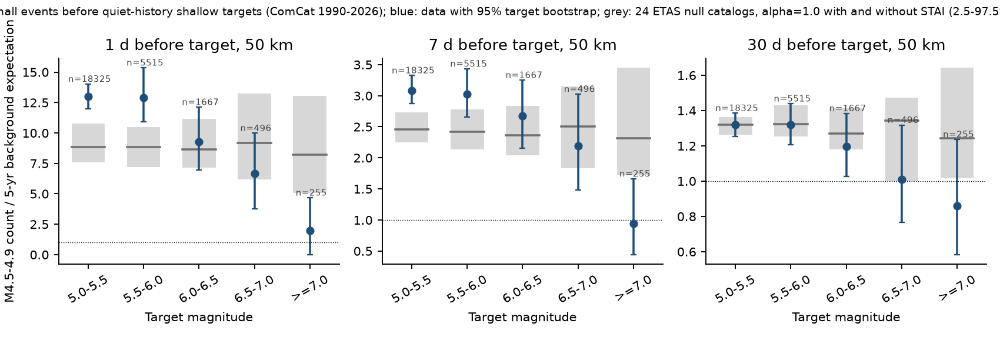
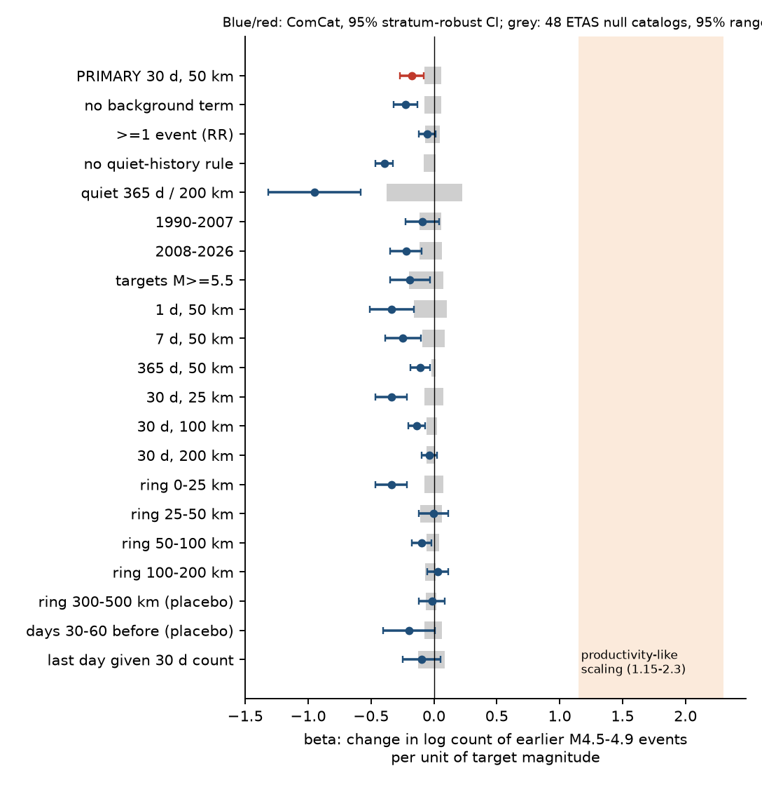
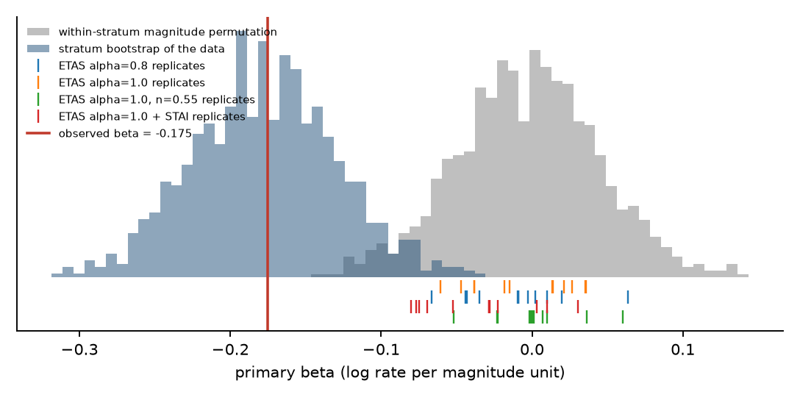

# Larger shallow earthquakes had fewer, not more, earlier small events nearby in global ComCat data for 1990-2026; an ETAS null gives no such decrease

Job `sci-1107-dell-earth-and-ocean-sciences-afe36a9c1352` · campaign 11_07_2026 · topic earth-and-ocean-sciences · machine dell · model Claude Opus 5.5 (`claude-opus-5-5`) through Claude Code · analysis date 2026-11-08. The signature is from a campaign-machine key. It is not a personal authorship claim.

## 1. Question

Does the number of small earthquakes before an earthquake increase with the magnitude of that earthquake?

This question is important for short-term earthquake forecasts:

- In the standard ETAS (epidemic-type aftershock sequence) model, each magnitude comes from the Gutenberg-Richter law and is independent of the past. Thus the expected number of small events before a target does not depend on the target magnitude.
- A "preparation" model of large earthquakes predicts more earlier small events (foreshocks) before larger earthquakes. Lippiello et al. (2012, 2017) reported magnitude-dependent foreshock numbers and spatial organization in regional catalogs. Felzer et al. (2004) found no magnitude dependence in global data to about 2002.

We tested this question with a large global sample, a fixed plan, selection rules that use only the history before each target, and a synthetic ETAS null.

## 2. Data

- USGS ANSS ComCat, global, magnitude 4.5 or more, 1973 to 2026-11-08. We reused the exact bytes that campaign bundle `sci:sha256:2182948c...` archived (archive SHA-256 `19e97634...`; per-file hashes in `files/data/comcat_csv_sha256.txt`). After we kept type "earthquake" and removed duplicate ids, 294,099 events remained.
- Smithsonian GVP Holocene volcanoes (shared dataset `gvp-votw-holocene-volcanoes-20261108`, SHA-256 `ff7ff1e4...`). We used it for one post-hoc check only.

Full provenance: `files/data/provenance.json`.

## 3. Method (plan written before outcomes: `files/PLAN_written_before_outcomes.md`)

**Targets.** Events with depth 70 km or less, magnitude 5.0 or more, 1990-01-01 to 2026-10-31 (51,414 events).

**Quiet-history rule (primary).** We removed a target if an earlier event of magnitude 5.0 or more occurred within 100 km and 30 days before it. This rule is the same for all target magnitudes and uses only the past. Thus it does not cause magnitude-dependent selection under ETAS. 26,258 targets remained: 18,325 (M 5.0-5.4), 5,515 (5.5-5.9), 1,667 (6.0-6.4), 496 (6.5-6.9), 255 (7.0 or more).

**Outcome.** N_pre = number of events with 4.5 <= M < 5.0 and depth 70 km or less, within 50 km of the target epicentre, in the 30 days before the target. This band is below every target magnitude. We did not count events in the last 60 s before the target (possible duplicates).

**Background.** B = count in the same band and radius from 5 years to 60 days before the target, scaled to 30 days.

**Primary model.** Conditional (stratum fixed-effect) Poisson regression:
log E[N_pre] = a(stratum) + beta x M_target + gamma x log(B + 0.1).
Stratum = 5 deg x 5 deg cell x era (1990-1999, 2000-2009, 2010-2019, 2020-2026). beta is the change in log count per magnitude unit. H0: beta = 0. If foreshock numbers followed an aftershock-like productivity law (10^(alpha M), alpha 0.5-1), beta would be 1.15-2.3.

**Inference.** Stratum-robust (sandwich) standard errors, a stratum cluster bootstrap (1,000 resamples), and a within-stratum magnitude permutation (1,000 permutations).

**ETAS null calibration.** We simulated 48 global space-time ETAS catalogs (12 seeds for each of 4 variants: alpha = 1.0 or 0.8 with branching ratio 0.40; alpha = 1.0 with branching ratio 0.55; alpha = 1.0 with short-term aftershock incompleteness (STAI)). Background epicentres come from the real shallow catalog with jitter. b = 1.05, c = 0.01 d, p = 1.1, power-law spatial kernel scaled by magnitude. We used the same counting, selection and model code on each synthetic catalog (`files/code/etas_sim.py`, `03_etas_null.py`).

**Secondary specifications** (stated in the plan): window/radius grid, distance rings, two placebos (days 30-60 before; ring 300-500 km), all targets without the quiet-history rule, a stricter quiet rule (365 d / 200 km), two periods, magnitude classes, at least one event.

**Post-hoc checks** (added after we saw the primary result; they are exploratory): finer strata (2 deg, 1 deg), local covariates from the history (local clustering share, local share of M 5.5 or more), distance to Holocene volcanoes, an STAI guard (remove targets within 60 days and max(300 km, 3 rupture lengths) after an earlier M 6.5 or more), free-depth targets only, magnitude type (mb or Mw), and target b-values by earlier activity.

## 4. Results

### 4.1 Primary result

| Quantity | Value |
| --- | --- |
| beta (log rate per magnitude unit) | **-0.175** |
| stratum-robust SE | 0.049 |
| bootstrap 95% interval | -0.267 to -0.080 |
| permutation p (two-sided, 1,000) | 0.001 (no permutation reached the observed value) |
| rate ratio M 7 vs M 5 | 0.70 (95% 0.59-0.85) |
| targets in informative strata | 21,506 in 1,087 strata |
| ETAS null beta, mean (SD) over 12 catalogs | alpha 1.0: -0.006 (0.034); alpha 0.8: -0.010 (0.034); n 0.55: +0.001 (0.028); STAI: -0.035 (0.037) |

The data reject H0. The sign is **negative**. Larger targets had fewer earlier small events near them than smaller targets in the same region and era. All 48 ETAS catalogs gave beta between -0.080 and +0.063. Thus the counting and model method does not produce the negative value. The STAI variant moves the null by about -0.03 only. The plan expected a positive or zero value. A productivity-like positive scaling (beta 1.15 or more) is excluded with a large margin.

**Figure 1.** Observed M 4.5-4.9 count before quiet-history targets, divided by the 5-year background expectation, by target magnitude class. Grey: ETAS null catalogs. In the last day, M 5.0-5.9 targets had about 13 times the background rate. M 7 or more targets had about 2 times (3 events against 1.5 expected). In the ETAS catalogs, the ratio is flat with magnitude, as the model requires.

### 4.2 Secondary and post-hoc results

| Specification | beta | SE | ETAS null 95% range |
| --- | --- | --- | --- |
| Primary (30 d, 50 km) | -0.175 | 0.049 | -0.076 to 0.056 |
| 1 d, 50 km | -0.334 | 0.089 | -0.156 to 0.105 |
| 7 d, 50 km | -0.246 | 0.073 | -0.090 to 0.085 |
| 365 d, 50 km | -0.110 | 0.039 | -0.020 to 0.015 |
| 30 d, 25 km | -0.338 | 0.064 | -0.078 to 0.076 |
| 30 d, 100 km | -0.137 | 0.033 | -0.056 to 0.024 |
| 30 d, 200 km | -0.036 | 0.032 | -0.061 to 0.011 |
| ring 25-50 km | -0.004 | 0.059 | -0.110 to 0.063 |
| ring 50-100 km | -0.098 | 0.040 | -0.061 to 0.043 |
| ring 100-200 km | +0.029 | 0.043 | -0.070 to 0.013 |
| placebo ring 300-500 km | -0.015 | 0.053 | -0.062 to 0.018 |
| placebo days 30-60 before | -0.198 | 0.105 | -0.075 to 0.066 |
| last day, given the 30-day count | -0.099 | 0.076 | -0.127 to 0.087 |
| at least one event (rate ratio model) | -0.053 | 0.035 | -0.071 to 0.045 |
| 1990-2007 | -0.093 | 0.068 | -0.115 to 0.060 |
| 2008-2026 (after Felzer et al. 2004 data) | -0.223 | 0.065 | -0.114 to 0.061 |
| targets M 5.5 or more | -0.191 | 0.081 | -0.198 to 0.076 |
| no quiet-history rule (all targets) | -0.395 | 0.037 | -0.081 to 0.016 |
| quiet 365 d / 200 km | -0.950 | 0.189 | -0.378 to 0.224 |
| post-hoc: STAI guard (no M 6.5+ within 60 d) | -0.148 | 0.051 | -0.064 to 0.073 |
| post-hoc: STAI guard, 1 d | -0.333 | 0.095 | -0.090 to 0.129 |
| post-hoc: strata 1 deg x era | -0.148 | 0.057 | not run |
| post-hoc: 1 deg + local clustering + local M 5.5 share | -0.149 | 0.056 | not run |
| post-hoc: volcano distance > 50 km | -0.166 | 0.048 | not run |
| post-hoc: free-depth targets (depth not 10/33/35 km) | -0.086 | 0.054 | not run |
| post-hoc: Mw-type targets | -0.122 | 0.049 | not run |
| post-hoc: mb-type targets | -0.965 | 0.314 | not run |

Magnitude classes against M 5.0-5.4 (rate ratios): 5.5-5.9: 0.96 (SE of log 0.05); 6.0-6.4: 0.90 (0.08); 6.5-6.9: 0.76 (0.12); 7.0 or more: 0.55 (0.19).

**Figure 2.** beta for all specifications (95% stratum-robust intervals) against the 95% range of the 48 ETAS null catalogs (grey). The shaded band on the right is the range that an aftershock-like productivity law predicts.

Main patterns:

1. **The decrease is local.** It is in the 0-25 km ring (-0.34). It is absent at 25-50 km and at 100-200 km. Thus we find no evidence for the claim that the spatial extent of earlier activity grows with the target magnitude.
2. **The decrease is largest close in time** (1 day: -0.33). It is also present in a 365-day window (-0.11) and, with low precision, in the placebo window 30-60 days before (-0.20, SE 0.10). Thus it is not only a final-days foreshock effect.
3. **The decrease is in the count, not mostly in occurrence.** The "at least one event" model gives only -0.05 (SE 0.035). Larger targets are less often preceded by bursts of several small events.
4. **Equivalent b-value view.** Quiet-history targets with no band event in the 30 days before had b = 1.01 (SE 0.007). Targets with one or more had b = 1.11 (0.017), and targets with three or more had b = 1.37 (0.064) (pooled, not stratified). Within strata, the mean magnitude was 0.019 (SE 0.007) lower after one or more 30-day band events, and 0.034 (SE 0.008) lower after a band event in the last day (`files/results/bvalue_by_prior.csv`).
5. **Robustness.** The result changes little with finer strata, local history covariates, volcano exclusion, or the STAI guard. It is weaker for free-depth targets (-0.086, SE 0.054) and for Mw-type targets (-0.122, SE 0.049). It is strong in mb-type targets (-0.97, SE 0.31). M 5.0-5.4 targets after band activity had a slightly larger share of mb magnitudes (43% against 40%).

**Figure 3.** Primary beta (red) with the stratum bootstrap of the data (blue), the within-stratum magnitude permutation null (grey), and the 48 ETAS null replicates (ticks).

## 5. Interpretation

The global ComCat data do not support a preparation model in which larger earthquakes have more small foreshocks at M 4.5-4.9. The data show the opposite. In the 30 days before a quiet-history shallow target, the count of nearby M 4.5-4.9 events decreases by about 16% per magnitude unit. At M 7 or more, the count is at or below the long-term background (30-day ratio 0.86; Figure 1).

The standard ETAS assumption of magnitude independence is also not correct for this catalog. The departure is in the opposite direction from the preparation hypothesis. One possible explanation is a b-value that increases during local bursts of activity (for example swarm-like or fluid-driven sequences), so events in active periods are smaller on average. Other possible explanations are residual sub-25 km heterogeneity between swarm-prone and large-earthquake source areas, and catalog effects (magnitude-type assignment, location quality). Our post-hoc checks reduce but do not remove these alternatives. The free-depth and Mw-only results show that part of the effect can come from poorly located or mb-sized events.

For forecasting, these results suggest that an increased local rate of M 4.5-4.9 events does not indicate a larger coming event. If anything, it indicates a slightly smaller one.

## 6. Limitations

- ComCat global completeness is near M 4.5 and changes with region and time. The strata and the background term control for slow changes only. Completeness changes inside a 5 deg cell and era, that also correlate with target magnitude, could remain.
- Magnitude types are mixed (mb for most M 5.0-5.4 targets, Mw for larger targets). Mw-only targets still give a negative beta (-0.12), but mb-only targets give a much larger value. We cannot fully separate a physical effect from magnitude-type effects.
- Epicentres, not rupture extents, define distance. For large targets, foreshocks along the future rupture but more than 50 km from the epicentre are not in the primary window. The 100 and 200 km windows and rings give the same conclusion.
- The ETAS null is simple: isotropic kernels, uniform parameters, a simple STAI rule. It shows that the method has no large bias, but it cannot show which non-ETAS process causes the result.
- The post-hoc analyses (Section 3) were added after we saw the primary result. Their p-values are not corrected.
- The quiet-history rule removes targets with a M 5 or more event in the previous 30 days within 100 km. Thus the study concerns foreshocks of M 4.5-4.9 only, not larger foreshocks such as the M 7.3 foreshock of the 2011 Tohoku earthquake.
- We did not test deep events, regional catalogs with lower completeness, or focal mechanisms.

## 7. Reproduce

Files:

- `files/code/run_all.sh`: full pipeline. Set `COMCAT_TGZ` to the ComCat archive from bundle `sci:sha256:2182948c...` (`files/data/raw/comcat_global_m4.5_1973_2026.tar.gz`) and `VOLC_CSV` to the GVP CSV. Then run `bash run_all.sh WORKDIR`.
- `01_build.py`: catalog loading and pre-target counts (BallTree, chunked queries). `03_etas_null.py` + `etas_sim.py`: ETAS catalogs. `04_real.py` + `specs.py` + `pipeline.py` + `cpois.py`: all models, bootstrap, permutation, null summaries. `06_heterogeneity.py`: post-hoc checks. `05_figures.py`: figures.
- `files/data/targets_with_counts.csv.gz`: all 51,414 targets with every count, background and post-hoc covariate. With this file, all real-data models can be refit without the raw catalog.
- `files/results/`: `primary.json`, `specs_real.csv`, `specs_sims.csv` (per synthetic catalog), `specs_sims_summary.csv`, `class_summary_*.csv`, `heterogeneity.csv`, `bvalue_by_prior.csv`, logs.

Software: Python 3.12.16, numpy 2.5.4, pandas 3.1.1, scipy 1.18.1, scikit-learn 1.9.1, matplotlib 3.11.2. Run time: about 2 CPU-minutes for the real counts and about 2 CPU-minutes for each synthetic catalog.

## 8. References

- Felzer, K. R., Abercrombie, R. E., Ekström, G. (2004). A common origin for aftershocks, foreshocks, and multiplets. BSSA 94, 88-98. doi:10.1785/0120030069
- Lippiello, E., Marzocchi, W., de Arcangelis, L., Godano, C. (2012). Spatial organization of foreshocks as a tool to forecast large earthquakes. Sci. Rep. 2, 846. doi:10.1038/srep00846
- Ogata, Y. (1988). Statistical models for earthquake occurrences and residual analysis for point processes. JASA 83, 9-27. doi:10.1080/01621459.1988.10478560
- Helmstetter, A., Kagan, Y. Y., Jackson, D. D. (2006). Comparison of short-term and time-independent earthquake forecast models for southern California. BSSA 96, 90-106. doi:10.1785/0120050067
- Campaign bundle sci:sha256:2182948ccf9d3297ee3ca28cdd0204ea9bf8162558495eb3b423983ebea9368c (source of the exact ComCat bytes).
