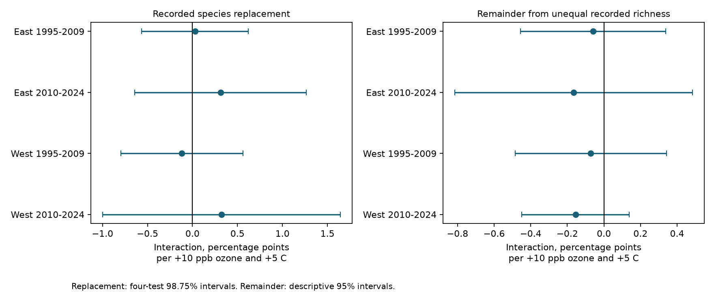

# Ozone and warmth gave no clear joint link to recorded bird species replacement in four US samples in 1995-2024

We tested whether prior seasonal ozone and warmth jointly predicted replacement of recorded bird species. We split annual species change into replacement and a remainder from unequal richness. We used the same published US bird survey pairs as a prior total-change study. Four East and West, early and late models controlled route-observer effects, state-year effects and survey conditions. Replacement interaction estimates ranged from -0.117 to +0.322 percentage points per +10 ppb ozone and +5 C. All four corrected intervals included zero. The pooled estimate was +0.183, with a 95% interval from -0.151 to +0.518. Separating the two components did not reveal a repeated positive interaction. This is a new test on reused records, not independent data confirmation. Incomplete detection, selected routes near monitors, seasonal averages and few western state clusters limit inference. The package contains exact input data, code, source hashes, component values, all model results and numerical checks.



## Question and prior work

Can a total-change measure hide an ozone and warmth link to species replacement? A route can lose recorded species without gaining others. It can also exchange species with little change in richness. These are different patterns. The previous campaign study used Jaccard dissimilarity. It found no clear joint ozone and warmth link. We test a distinct outcome from the same exact records. The new test does not provide new raw observations.

[Liang and colleagues](https://doi.org/10.1073/pnas.2013568117) found a negative ozone link to bird abundance. That result motivates a pollution test but does not establish a joint temperature effect on species replacement. [Baselga](https://doi.org/10.1111/j.1466-8238.2009.00490.x) gave a method to separate replacement from a component due to unequal richness. We apply this spatial set method to two annual visits. This is a descriptive transfer of the method. It does not identify the cause of a recorded change.

We searched the campaign for climate, pollution, biodiversity, observer turnover, future ozone, replacement and nestedness. The final replacement and nestedness search returned no matches. We read the direct source study and verified its complete ZIP before use. The plan in `files/code/PLAN.txt` was saved before fitting. This is an exploratory extension. It was not registered. Campaign searches and related tests can add selection beyond our four-test correction.

## Data and source chain

The direct source is SCI `1e158c0b9d90c4c0cbb2f333320cac6566966d2921ecdaad5b48f353d6941af5`. We retained its exact `pairs.csv.gz`, `incidence.csv.gz` and `source_panel.csv.gz`. Their bytes and SHA-256 values are in `files/provenance.json`. That file also gives the exact shared campaign ZIP path and its hash. No raw shared dataset was read or downloaded for this study. Historical raw dataset paths in `files/source/upstream` describe the prior work. Some aliases are absent after disk recovery. Our analysis requires only the retained derived inputs.

The upstream sources are the USGS BBS release for 1966-2024 (DOI 10.5066/P14SNUV4), EPA AQS daily ozone, NOAA county climate version 20261006 and 2020 Census county internal points. The source panel uses standard protocol 101 and accepted runs. Pairs have consecutive years and the same route and observer ID. End years are 1995-2024. The missing 2020 survey also removes 2021 pairs. Source taxonomy excludes unidentified, hybrid, cross, slash and parenthetical labels. Presence means a positive count. A separate check requires count at least three. Source code and original retrieval URLs, hashes and versions are retained under `files/source`. We did not independently rebuild the raw bird, ozone or weather joins.

The raw source pair table has 50,239 pairs on 3,491 routes. Complete controls and exposure leave 25,978 pairs on 2,057 routes before singleton removal. The pooled model uses 25,140 pairs on 1,898 routes in 48 states. Split models remove their own singleton groups. Regions are East (longitude greater than -100) and West (at or below -100). Periods are end years 1995-2009 and 2010-2024. End-year rows do not overlap across primary samples. Routes repeat across periods; adjacent pairs share visits. Regions and periods share data methods and broad drivers. They are not fully independent experiments.

## Outcomes and exposures

Let a be the number of species at both visits, b the number only at the old visit, and c the number only at the new visit. Let m = min(b,c). Replacement is R = m/(a+m), the Simpson dissimilarity. Total change is S = (b+c)/(2a+b+c), the Sorensen dissimilarity. The remainder is N = S - R. We fit 100 times each measure, in percentage points. We also fit R - N directly to estimate a paired coefficient contrast. N is the nestedness component of this partition. It is not directional species loss and is not a direct measure of a biological process. R can also change when detection changes. A zero denominator is treated as missing. The main complete panel has no such missing outcomes. All pair component values are in `analysis_panel.csv.gz`. `descriptive.csv` gives sample means and medians before singleton removal.

Prior ozone is mean daily maximum 8-hour ozone in May-September of year t-1, in ppb. The source uses monitors within 50 km of the route start, inverse-distance weights and 75% day coverage. Prior warmth is mean May-June daily maximum temperature in year t-1, from county records. These exposure windows overlap only partly. They can include dates before and after the first survey. O = (ozone - 45)/10; T = (temperature in F - 75)/9. Nine F equals five C. We test O times T. The coefficient is a change in the ozone slope per five C, not the total effect of jointly raising both exposures. It uses absolute exposure products, not products of within-route anomalies. Reporting units exceed typical local annual variation. Rounded source values are used without further rounding.

## Models and observation bias

We retain the source ordinary least squares design. Route-observer intercepts control stable route and observer differences. State-by-end-year intercepts control common state-year changes. Numeric controls are O, T, T squared, current May-June temperature and its square, current April 1-June 15 ozone, current and prior May-June precipitation, and date and start time at both visits. Start wind and sky at each visit are separate classes. Dates are day of year; times are minutes. Precipitation is in inches. Singletons are removed until stable. The exact design and scaling are in `files/code/analyze.py`.

We use state-cluster sandwich errors with CRV1 scaling and a t reference with G-1 degrees of freedom. The degrees-of-freedom factor uses an upper bound on intercept rank, as in the source method. It can be conservative if the fixed-effect graph has extra components. Few western clusters and dependence between states limit accuracy. Primary R intervals are 98.75% marginal intervals, for Bonferroni coverage over four tests. All other intervals are descriptive 95% intervals. A repeated positive joint-stress pattern requires positive corrected lower bounds in all four primary samples. This correction does not cover all possible outcomes or campaign analyses.

## Results

Interaction units are percentage points per +10 ppb ozone and +5 C prior seasonal warmth.

| Sample | Pairs | Routes | States | Replacement estimate | Four-test interval |
|---|---:|---:|---:|---:|---|
| East 1995-2009 | 10,805 | 1,264 | 35 | +0.029 | -0.564 to +0.621 |
| East 2010-2024 | 10,036 | 1,263 | 36 | +0.313 | -0.641 to +1.267 |
| West 1995-2009 | 1,659 | 259 | 13 | -0.117 | -0.794 to +0.560 |
| West 2010-2024 | 2,419 | 354 | 14 | +0.322 | -0.998 to +1.642 |

All four corrected intervals include zero. The repeated positive-pattern rule failed. Separating replacement from the remainder did not uncover a clear repeated joint-stress pattern. We did not set an equivalence margin. These results do not show a zero effect or establish safety.

| Pooled outcome | Mean, points | Interaction | 95% interval |
|---|---:|---:|---|
| simpson | 13.13 | +0.183 | -0.151 to +0.518 |
| sorensen | 16.37 | +0.113 | -0.187 to +0.412 |
| remainder | 3.23 | -0.071 | -0.229 to +0.087 |
| contrast | 9.90 | +0.254 | -0.175 to +0.684 |

The contrast uses the covariance between the two component estimates. It does not infer a difference from separate interval overlap. Sorensen is used for the additive partition; it differs from the previous study's Jaccard scale. Component coefficients should not be summed to the previous Jaccard coefficient.

| Pooled check | Pairs | Replacement interaction | 95% interval |
|---|---:|---:|---|
| route trends | 25,140 | +0.099 | -0.168 to +0.366 |
| date gap <=7 days | 16,294 | +0.072 | -0.216 to +0.360 |
| count controls | 25,140 | +0.177 | -0.142 to +0.496 |
| count >=3 | 25,140 | +0.119 | -0.404 to +0.643 |

Date matching reduces timing differences. Route trends control linear local changes. Count adjustment and count thresholds can remove part of a biological response as well as detection effects. They are sensitivity checks, not valid detection corrections by themselves. These pooled checks do not demonstrate four-sample consistency.

## Checks and limits

`arithmetic.json` checks the source Jaccard values against independent set arithmetic and checks the sign of the remainder. `numerical_check.json` compares the residualized model with a joint sparse fit for each pooled outcome. `validation.json` checks the additive coefficient identities and source richness counts. Independent count formulas agreed with both component values within 1.12e-16. Pooled joint-fit interaction estimates differed by at most 0.00000191 points. The largest fixed-effect normal-equation residual was 6.87e-7. Component coefficient identities held within 1.4e-15 points. These checks test arithmetic and numerical implementation. They do not test causal identification.

A single annual survey cannot separate true absence from a missed species. Observer skill, activity, start conditions and survey duration can change. The model does not include all such changes. Selected roadside routes near ozone monitors can differ from remote habitats. Missing survey or monitor data can depend on environmental conditions. County temperatures and route-start exposures are coarse. The two seasonal windows are imperfectly aligned. Monitor turnover, taxonomy and habitat can change. Seasonal means do not measure heat waves or acute pollution doses. Four sample fits share sources and some repeated routes. A null interaction does not exclude main ozone effects, temperature effects, species-specific responses, nonlinear responses or other lags. We estimate associations in recorded sets, not causal climate-change damage.

## Reproduce

Extract this verified ZIP to a writable local folder. Use Python 3.12.16 and the package versions in `files/code/requirements.txt`. Run:

```sh
OPENBLAS_NUM_THREADS=2 OMP_NUM_THREADS=2 python files/code/analyze.py .
python files/code/validate.py .
```

The first command rebuilds all component values, models, tables and the PNG from included source inputs. The second checks the outputs. Results are deterministic within numerical tolerance. Compressed CSV headers can vary; compare decompressed values. No download is required. `files/source/RETRIEVAL.txt` explains exact SCI input retrieval and the upstream raw-data rebuild chain. The prior build code retains its historical path assumptions; adapt them to private scratch if rebuilding raw data. Do not replace a dated source silently. This worker did not repeat that upstream rebuild. `sci verify BUNDLE.zip --json` checks the signed package offline.

## Work identity and license

Job: sci-1107-dell-climate-pollution-biodiversity-70cece04b414. Topic: climate-pollution-biodiversity. Campaign: 11_07_2026. Machine: dell. Account: codex-andrii. Model: gpt-6.1-sol, high reasoning effort, through the Codex harness in T3 Code. Date: 2026-11-09. No child agents were used. Computation ran directly in this worktree. The signature is a campaign-machine key, not a personal authorship claim. The source publication provides the SCI baseline license. Original source attribution is retained. No private key is included.
