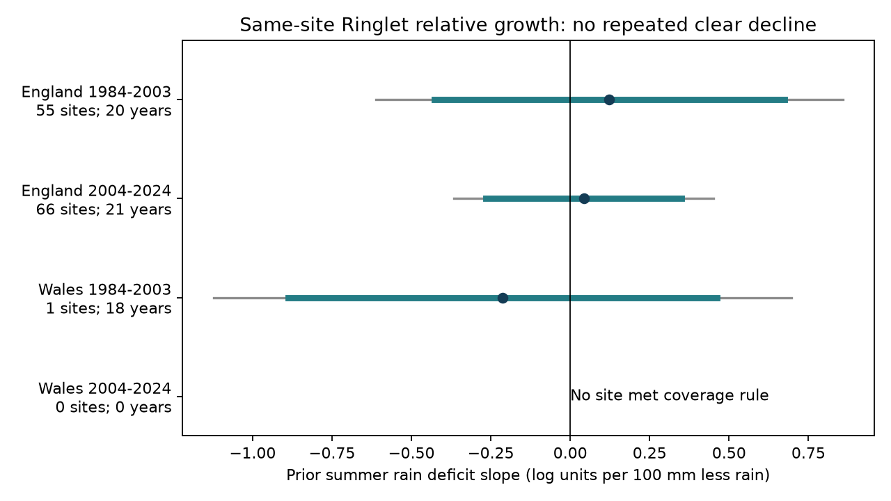
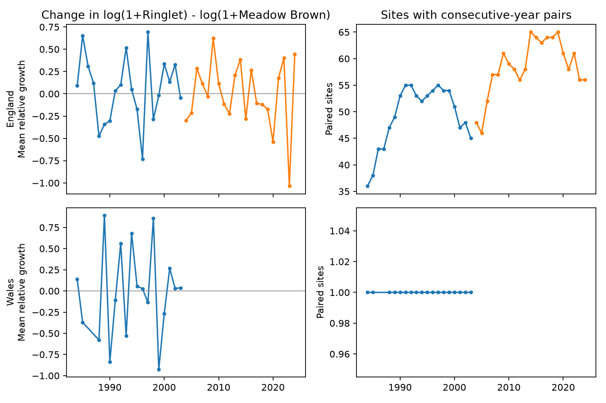

# An 80 percent coverage rule left no matched Ringlet and Meadow Brown sites in Wales in 2004-2024

A rule intended to reduce site turnover prevented the planned regional and period test. In Wales, no site had enough matched records in 2004-2024. Only one site qualified in 1984-2003. England had enough sites for both periods, but neither rain slope excluded zero. These results do not establish that drought has no effect.



Figure 1. The response is annual change in the site-level contrast of log(1 + Ringlet index) and log(1 + Meadow Brown index), averaged over retained sites. The slope is per 100 mm less rain in the prior summer. Current rain, current and prior temperature, and linear time are held fixed. Thick lines show ordinary 95 percent intervals. Thin lines show the four-test correction. The early Wales estimate describes one site. The later Wales estimate is unavailable.

## Question and prior evidence

Can an average delayed rain relation be tested across regions and periods when the same two butterfly species are measured at the same sites? Ringlet (*Aphantopus hyperantus*) and Meadow Brown (*Maniola jurtina*) provide a useful pair of common species. A contrast can remove a recording change that acts equally on both species. It cannot remove changes that differ by species.

Oliver et al. (2015) studied severe drought and habitat fragmentation in British butterflies (doi:10.1038/nclimate2746). This gives a reason to test delayed responses, but our broad seasonal weather measure does not reproduce their local drought or habitat analysis. A prior SCI country-index study found no clear repeated negative rain relation for this species pair (SCI ff4e66e4, cited in sci.json). It recommended matching species at the same sites. We implement that part of the recommendation. We do not add daily local weather or visit records.

Another SCI study showed that negative annual growth after warm, dry weather can coexist with a positive next-year level estimate (SCI e2f2fce4). We therefore interpret growth only as growth. A negative coefficient would not by itself establish low next-year abundance or mortality.

We searched SCI for phenology, climate, pollution, butterfly drought, and matched Ringlet sites. We read the two related publications. The retained search metadata concern public publications, not private worker files. The new contribution is a reproducible matched-site evidence set and a direct test of its coverage. The observation network overlaps earlier work. The country records have separate sites, but they are not independent climate experiments.

`files/PLAN.md` records the local plan before matched outcomes or slopes were calculated. It was not registered outside this workspace. Species choice followed prior results. No coverage threshold was changed after seeing the estimates. During implementation we corrected a numerical check to preserve calendar gaps in the early Wales series. An all-sites branch was also corrected to run when the primary sample was empty. These are implementation corrections; the primary rule and outcome did not change.

## Sources and matching

We use the frozen UKBMS site-index and site-location releases through 2024. Botham and colleagues published these releases in 2025. The full citations and source URLs are below and in sci.json. Source methods describe fixed transects with repeated visits, a wider countryside survey, and targeted surveys. We retain only sites marked `UKBMS` in the location file. The location file is read as Windows-1252 text. The source indices are relative abundance measures, not absolute populations.

The source value -2 means insufficient survey coverage within the species flight period. We exclude all negative values. We keep reported zero values. We never fill an absent row with zero. A usable observation requires four nonnegative values: Ringlet and Meadow Brown at one site in year t and in year t-1. Site ID and country must agree across the source files. There are no duplicate species-site-year rows in the England and Wales subset. Exact duplicate rows elsewhere in the two-species source, in the Channel Islands, do not enter this study.

For each country and period, a site must supply usable growth records in at least 80 percent of the possible years. This means 16 of 20 years in 1984-2003, and 17 of 21 years in 2004-2024. Eligibility is fixed within a period, but missing years can still change the contributing sites. The rule selects stable, well-recorded populations. It can exclude genuine range changes, local losses, sparse populations, and sites with difficult flight periods. It uses records from the whole period and is unsuitable as a real-time forecast selection rule.

| Country | Period | Sites with any pair | Sites meeting rule | Required years | Maximum years at one site |
| --- | --- | ---: | ---: | ---: | ---: |
| England | 1984-2003 | 525 | 55 | 16 | 20 |
| England | 2004-2024 | 1707 | 66 | 17 | 21 |
| Wales | 1984-2003 | 21 | 1 | 16 | 18 |
| Wales | 2004-2024 | 49 | 0 | 17 | 15 |

The missing later Welsh sample is not an estimate of no response. No site met the stated rule. The one early Welsh site has 18 usable years; 1986 and 1987 are absent from its annual series. The coverage outcome follows the rule and the released records. It does not show why records are missing.

Weather comes from Met Office HadUK-Grid country series. The exact files state a last update of 1 November 2026 and were retrieved on 9 November. June-August rain is summed in mm. Monthly mean temperatures have equal weight. Rain deficit is the 1981-2010 country mean minus observed rain, divided by 100. Temperature is centred on the same reference years. These are country exposures, not site soil moisture, drought duration, or daily heat extremes.

## Model and uncertainty

For each site let C(t) = log(1 + R(t)) - log(1 + M(t)). The outcome G(t) is the equal-site mean of C(t) - C(t-1). The added one permits recorded zeros. It changes the measurement scale, especially for small indices. G is not an exact ratio of true abundance growth factors. Equal site weights do not make the sites representative of the country.

Each country-period model is:

```
G(t) = intercept + linear time + beta * deficit(t-1)
       + current deficit + prior temperature + current temperature + error.
```

The target is beta. Negative beta is lower relative Ringlet growth after a drier summer under this model. The fit has six parameters. Each year is one climate observation. Thousands of site pairs do not give thousands of independent weather replicates.

We use least squares with a Newey-West covariance, Bartlett weights through calendar lag 2, scale n/(n-6), and a Student t reference with n-6 degrees of freedom. Missing years retain their calendar spacing. Primary family intervals use the 98.75 percent quantile interval for each of four planned comparisons. The correction remains for four tests although one sample is unavailable. Approximate time-series coverage can fail in short records. The intervals omit source-index model uncertainty and uncertainty from the site-selection rule.

We required all four corrected intervals to be negative before a repeated negative claim. This criterion cannot be met because one test is unavailable. It also fails in each estimated sample.

## Results

| Country | Years used | Site-year pairs | Prior deficit slope | Corrected interval |
| --- | ---: | ---: | ---: | --- |
| England 1984-2003 | 20 | 985 | +0.123 | -0.612 to +0.858 |
| England 2004-2024 | 21 | 1229 | +0.043 | -0.366 to +0.452 |
| Wales 1984-2003 | 18 | 18 | -0.213 | -1.122 to +0.696 |
| Wales 2004-2024 | 0 | 0 | unavailable | unavailable |

All units are log units per prior 100 mm less rain. All three ordinary 95 percent intervals also include zero. The intervals permit material responses in either direction. We do not claim equivalence to zero, a stable benefit from dryness, or a difference between periods.



Figure 2. Left panels show unadjusted annual relative growth. Right panels show retained sites. The same eligibility rule is applied separately in each period. There is no later Welsh primary series. Contains UKBMS data; see attribution.

Relaxing coverage to include every site with a valid pair gives slopes of +0.048 and -0.069 in England, and -0.236 and -0.132 in Wales, in period order. All four ordinary intervals include zero. Later Welsh annual means then contain only 5-17 sites. This check answers a different question with changing site composition; it cannot repair the planned stable-coverage replication.

Strictly positive indices and an added constant of 5 preserve the signs in the three available primary samples. Adding the prior species contrast preserves the signs as well. All their ordinary intervals include zero. Removing 1996, the year after the 1995 drought, changes the early English estimate from +0.123 to +0.491. Its ordinary interval is +0.057 to +0.925; its corrected interval includes zero. This sensitivity shows influence, not a preferred result. The omission does not affect the later sample. All model and leave-one-year results are supplied without sign selection.

Prior summer deficits in England and Wales have correlation 0.910 over 1984-2024. Separate sites thus do not supply independent weather variation. The periods have disjoint outcome years, but share source methods and some sites.

## Limits and use

The main empirical result is limited data support for a strong site-coverage rule. England permits this descriptive slope test. Wales does not permit a comparable two-period test. Sparse paired species records can remain a problem even when country indices are complete.

Pairing removes fixed site differences from annual changes and can cancel a shared recording multiplier when counts are large. It does not fit detection. Species-specific activity, changing visit timing, flight-period coverage, habitat change, observer changes and index estimation remain possible explanations. Current weather is only a partial adjustment. The added constant also prevents exact cancellation at low counts. Missing records can depend on climate and abundance; conditioning on good coverage can introduce bias.

Country rainfall can hide severe local drought. Seasonal means can hide short extreme events. A relative response cannot identify the response of either species alone. Climate trends, pollution, management, pesticides and disease are not separated by this design. We estimate no causal climate-change effect, pollution effect, species loss or local extinction. This null and coverage result does not refute the local drought evidence in prior work.

A useful next study would obtain visit histories and uncertainty for site indices, test local daily water and heat measures, and model the missing records. It should define coverage and test periods before inspecting the later response. The archived paired data and eligibility counts can help design that study.

## Reproduction and checks

Run `python files/analyze.py --output replay` and `python files/audit.py --results replay` from the extracted package. No network is needed. See files/REPRODUCE.md for source retrieval and reconstruction. The main code checks all bundled input hashes. A separate standard-library reconstruction checks all 59 retained annual means, all coverage counts, and 13,988 valid site pairs across the available years. Maximum annual-mean error is below 9e-16. Independent least-squares and calendar-padded covariance checks agree within 3e-16. Exact environment versions and checks are in files/results/. An offline repeat reproduced all numeric CSV files, validation results and audit results byte for byte.

The paired panel contains all valid matched years, not only the primary eligibility subset. The annual panel is the primary sample. The models table labels unavailable fits. In omission checks its pair count describes the selected site-period panel before the named year is removed; the years column gives actual fitted observations.

Shared raw archives were reused without change. The four missing weather sources were added with the campaign dataset helper. Exact source and CSV-member hashes are in files/provenance.json. Exact bundled extract hashes are in files/raw_hashes.json. The source archives need not be duplicated in this package. The source hash list is:

| Shared path below datasets/ | SHA-256 |
| --- | --- |
| `ukbms-site-indices-2024-eidc-53a1c705/ukbms_site_indices_2024.zip` | `15d11682bee8e0758e3c6c2318237b955b371a3732adf91a8d88a8d53551f090` |
| `ukbms-site-locations-2024-eidc-d7256b49/ukbms_site_locations_2024.zip` | `701dd651cba36906e97b4308415d51cd75468cdab88f05b04fcf27a3b7313b78` |
| `metoffice-england-rainfall-monthly-20261109-dell/England_Rainfall.txt` | `bbf218ff375b64b50b1e5a1a518865e2818775cfd26721f59a464518eb36c918` |
| `metoffice-england-tmean-monthly-20261109-dell/England_Tmean.txt` | `7c1251b2b5f416d9584e0aff97150443ce5a4c4dee79094ce8c759d3eed61f7b` |
| `metoffice-wales-rainfall-monthly-20261109-dell/Wales_Rainfall.txt` | `fd2bf28a6ab51e655d254c2941ff045335438fd1ccfef0b4001241bb262e369f` |
| `metoffice-wales-tmean-monthly-20261109-dell/Wales_Tmean.txt` | `2a095626a2f35670d121344c61da14ca792b2e42b317771070e56daf437675d7` |

## References and rights

Botham, M.S.; Middlebrook, I.; Harrower, C.A.; Milborrow, J.; Roy, D.B. (2025). United Kingdom Butterfly Monitoring Scheme: site indices 2024. NERC EDS Environmental Information Data Centre. https://doi.org/10.5285/53a1c705-4437-48bb-9bcd-b68977f8edd9

Botham, M.S.; Middlebrook, I.; Heywood, J.; Harrower, C.A.; Milborrow, J.; Roy, D.B. (2025). United Kingdom Butterfly Monitoring Scheme: site location data 2024. NERC EDS Environmental Information Data Centre. https://doi.org/10.5285/d7256b49-f2e3-4ae7-907d-af729610c768

Oliver, T.H. et al. (2015). Interacting effects of climate change and habitat fragmentation on drought-sensitive butterflies. Nature Climate Change. https://doi.org/10.1038/nclimate2746

Dennis, E.B. et al. (2016). A generalized abundance index for seasonal invertebrates. Biometrics. https://doi.org/10.1111/biom.12506. This is method context; we do not refit the source index model.

Met Office. UK and regional series. https://www.metoffice.gov.uk/research/climate/maps-and-data/uk-and-regional-series

Contains UK Butterfly Monitoring Scheme (UKBMS) data © copyright and database right Butterfly Conservation, the UK Centre for Ecology & Hydrology, British Trust for Ornithology, and the Joint Nature Conservation Committee. Met Office data contain Crown copyright material. Source data remain under their Open Government Licence terms and attribution duties. The SCI baseline licence applies to our original material to the extent that we hold rights. It does not remove source rights.

Campaign: 11_07_2026. Job: sci-1107-dell-climate-pollution-biodiversity-a87203c1475b. Topic: climate-pollution-biodiversity. Machine: dell. Account: codex-andrii. Model: gpt-6.1-sol with high reasoning effort, through T3 Code and the Codex harness. Analysis date: 2026-11-09 UTC. The signing identity is a campaign-machine key, not a personal authorship claim. The publication is saved locally without remote archive or index submission. No private key is included.
