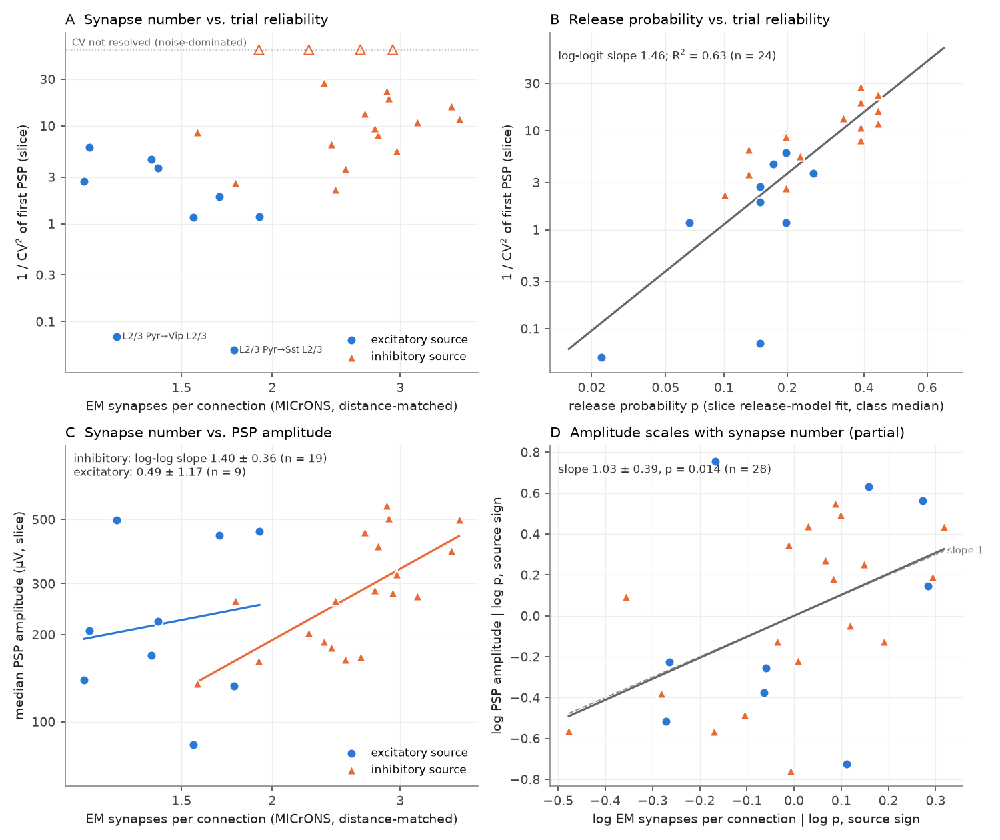
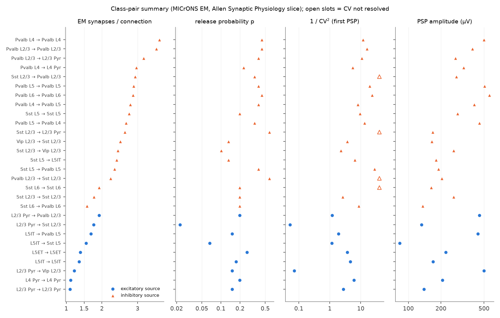

# In mouse V1, EM synapse number per connection predicted slice PSP amplitude across inhibitory cell-class pairs, but release probability, not synapse number, set trial-to-trial reliability

## Summary

We linked two Allen Institute datasets from mouse primary visual cortex (V1) at the level of cell-class pairs. The MICrONS electron microscopy (EM) volume gives the number of synapses per connection. Allen Synaptic Physiology paired recordings in brain slices give the strength and the trial-to-trial reliability of connections between the same cell classes. We asked: does the number of synapses per connection predict how strong and how reliable a connection is?

Main results (28 class pairs; 1,619 proofread EM axons with 242,139 connections; 1,564 slice connections from 750 experiments):

1. **Reliability.** Across class pairs, EM synapses per connection correlated with reliability (1/CV² of the first postsynaptic potential, PSP): Spearman ρ = 0.62 (95% bootstrap interval 0.38 to 0.76; n = 24; permutation p = 0.0002). This was the pre-registered primary test, and it passed. But the correlation came from the difference between excitatory and inhibitory sources. Within source sign, the correlation was absent (sign-stratified ρ = 0.03, p = 0.44). Release probability explained most of the reliability (R² = 0.63). After release probability, synapse number added an uncertain term (log-log coefficient 0.71 ± 0.65, p = 0.28). This value agrees both with zero and with the binomial value of 1.
2. **Strength.** Within inhibitory sources, EM synapse number predicted PSP amplitude (ρ = 0.74, 95% interval 0.30 to 0.77; n = 19; log-log slope 1.40 ± 0.36). Two controls gave the same result: effective conductance (ρ = 0.51, p = 0.023, n = 16) and amplitude divided by target input resistance (ρ = 0.74). Within excitatory sources, we saw no clear relation (ρ = 0.07, interval −0.15 to 0.50; n = 9). But the excitatory range of synapse number was narrow (1.1 to 1.9).
3. **Binomial decomposition of amplitude.** In a model of all 28 pairs with log release probability and source sign, the log amplitude scaled with log EM synapse number with slope 1.03 ± 0.39 (p = 0.014). This is the proportional scaling that a binomial release model predicts.

Conclusion: in these data, the EM synapse count of a class pair is a useful predictor of mean synaptic strength, mainly for inhibitory connections. It is not a sufficient predictor of reliability. Target-specific release probability sets most of the class-pair differences in trial-to-trial reliability. Examples are the facilitating excitatory inputs to Sst cells (p about 0.02 to 0.07) and the depressing Pvalb outputs (p about 0.4). Thus a wiring diagram with synapse counts alone does not give the reliability of signal transmission. A model must also have the release probability of each class pair.

**Figure 1.** (A) EM synapses per connection against slice reliability (1/CV² of the first PSP) per class pair. Open symbols: class pairs where the noise-corrected variance was below zero (CV not resolved). (B) Release probability (class median of the slice release-model fit) against reliability. (C) EM synapses per connection against median PSP amplitude, with log-log fits by source sign. (D) Partial (added-variable) plot of log amplitude against log synapse number after log release probability and source sign. The dashed line has slope 1.

## Prior work and what is new

Earlier campaign work compared the MICrONS connectome with Allen Synaptic Physiology for connection *rates* at matched soma distance ([sci:sha256:999aa3ea…](sci:sha256:999aa3ea9cc47df6164773d528fc777358c9bb155162acf842a0c16c716b365e)). That work found agreement for excitatory inputs to interneurons and for Pvalb-like outputs, but low slice rates for inhibition onto interneurons. A second study showed that missed small responses do not explain that gap ([sci:sha256:62a5b936…](sci:sha256:62a5b93648b2487d8e85dd1679a03f5ebe229ccdd6000f154e4e69049bd899d2)). A third study derived CV² = (1 − p)/(p·N_eff) for an independent contact-dropout model in an EM volume. It stated that it had no matched physiology ([sci:sha256:002ee9e8…](sci:sha256:002ee9e80347aa25617ae61940dca8f996330f58445ab6c2d2cb51b24097dbd9)).

In the literature, Holler et al. (doi:10.1038/s41586-020-03134-2) linked synapse number and size to PSP strength in paired L2/3 recordings with EM of the same cells. Campagnola et al. (doi:10.1126/science.abj5861) described class-specific release probability and short-term plasticity in the Allen data. Quantal analyses of single connection types (for example Blue Brain estimates of release sites from CV and anatomical synapse counts) used the same binomial logic.

New here: (1) the first test, to our knowledge, of synapse multiplicity against strength *and* reliability across 28 cortical class pairs that include Pvalb, Sst and Vip interneurons, with EM counts from proofread axons; (2) the separation of synapse number and release probability in the reliability of a class pair; (3) a binomial decomposition of amplitude that gives a slope near 1.

## Data

- **MICrONS minnie65, materialization v1507** (CC BY 4.0). Tables: `synapses_with_axon_proofreading` (2,089,627 synapses from 2,141 proofread axons; this job added it to the shared store as `microns-v1507-synapses-with-axon-proofreading`), `aibs_metamodel_celltypes_v661`, and `proofreading_status_and_strategy`.
- **Allen Synaptic Physiology release 2.1**, `synphys_r2.1_small.sqlite` (database version 22; Allen Institute Terms of Use). Tables: cell, pair, synapse, dynamics, synapse_model, conductance, intrinsic, cortical_cell_location.

Exact shared paths, URLs and SHA-256 hashes (all four verified by this job) are in `files/provenance/provenance.json`. External-data terms are in `files/provenance/NOTICE-external-data.md`. No source rows and no per-connection tables are bundled.

## Methods

**Classes.** We used classes that both datasets can identify:

| Class | MICrONS (metamodel v661) | Synaptic Physiology |
| --- | --- | --- |
| L2/3 Pyr | 23P | Cre-negative or Cux2 excitatory cell in L2/3 |
| L4 Pyr | 4P | Nr5a1, Rorb, or Cre-negative excitatory cell in L4 |
| L5 ET | 5P-ET | Sim1 or Fam84b in L5 |
| L5 IT | 5P-IT | Tlx3 in L5 |
| L6 CT | 6P-CT | Ntsr1 in L6 |
| Pvalb, Sst, Vip (by layer) | BC, MC, BPC (by layer) | Pvalb, Sst, Vip Cre lines (by layer) |

For EM interneurons, the layer is the majority layer of the 25 nearest excitatory neurons. We dropped 5P-NP, 6P-IT and NGC, because the slice data have no matched Cre class. We kept only target roots with exactly one nucleus.

**EM metric.** For each proofread axon and each target neuron, the synapse count is the number of synapses in the v1507 table. Soma distance is less than 250 µm. For each class pair, we weighted the EM connections so that their soma-distance histogram (25 µm bins) matched the histogram of the slice connections of that class pair. The metric is the weighted mean number of synapses per connection. We also computed the weighted mean summed synapse size.

**Physiology metrics.** For connections with soma distance less than 250 µm:
- Reliability: noise-corrected CV² of first-pulse amplitudes of 50 Hz trains, CV² = (sd² − noise_sd²)/median², per connection, with at least 8 first pulses. This is the same noise correction as the aisynphys variability metric. The class estimate is 1/median(CV²). We kept negative variances in the median. If the median CV² was below zero, the class value is "not resolved" (4 class pairs, all with median single-trial SNR below 1).
- Strength: median absolute PSP amplitude of the average-response fit.
- Release probability p and quanta per spike: class medians of the stochastic release-model fit (`synapse_model`; maximum-likelihood values on a parameter grid).

**Inclusion.** At least 10 slice connections with a valid CV, at least 30 EM connections, and at least 3 proofread axons per class pair: 28 class pairs (9 with excitatory sources, 19 with inhibitory sources).

**Tests.** We wrote the plan before we joined the two datasets (`files/provenance/PROGRESS_log_and_preregistration.md`). Primary: P1, ρ(EM synapses, 1/CV²) > 0 across class pairs; P2, ρ(EM synapses, amplitude) > 0 within each source sign; P3, slope of log N̂ on log EM synapses near 1, where N̂ = (1/CV²)(1 − p)/p. We used permutation tests (5,000 permutations) for ρ. For 95% intervals, we used a cluster bootstrap (1,000 draws) that resampled EM axons and slice experiments within each class pair. We added the sign-stratified tests, the regressions with release probability, and the conductance controls after we saw the primary results. Thus they are post hoc.

## Results

### Pre-registered tests (`files/results/tests.json`)

| Test | n | ρ or slope | 95% bootstrap interval | Permutation p (one-sided) |
| --- | --- | --- | --- | --- |
| P1: EM synapses vs 1/CV², all | 24 | ρ = 0.62 | 0.38 to 0.76 | 0.0002 |
| P1, ratio-of-medians CV estimate | 28 | ρ = 0.41 | — | 0.015 |
| P2: EM synapses vs amplitude, inhibitory sources | 19 | ρ = 0.74 | 0.30 to 0.77 | ≤ 0.0002 |
| P2: EM synapses vs amplitude, excitatory sources | 9 | ρ = 0.07 | −0.15 to 0.50 | 0.45 |
| P3: log N̂ on log EM synapses | 24 | slope 1.08 ± 0.55 | — | 0.063 (two-sided, OLS) |
| Secondary: P1 with fully extended axons only | 21 | ρ = 0.60 | — | 0.003 |
| Secondary: summed synapse size vs amplitude, inhibitory | 19 | ρ = 0.76 | — | 0.0002 |

P1 passed and P2 passed for inhibitory sources only. P3 gave a slope near 1, but with a large error. The implied number of release sites per EM synapse had a median of 8.9 and a range of 0.3 to 22 across class pairs. Thus a fixed number of release sites per synapse does not describe these data. Slice truncation, the fitted p grid, noise in single-trial CV, and quantal variance can all change N̂.

### Post-hoc analyses (`files/results/posthoc_tests.json`, `files/results/posthoc2_tests.json`)

| Analysis | n | Result |
| --- | --- | --- |
| Sign-stratified ρ, EM synapses vs 1/CV² | 24 | 0.03 (p = 0.44) |
| Sign-stratified ρ, EM synapses vs amplitude | 28 | 0.53 (p = 0.003) |
| Sign-stratified ρ, EM synapses vs quanta per spike | 28 | 0.33 (p = 0.046) |
| log 1/CV² ~ logit p | 24 | slope 1.46 ± 0.24, R² = 0.63 |
| log 1/CV² ~ log N_EM + logit p | 24 | N: 0.71 ± 0.65 (p = 0.28); p: 1.29 ± 0.28 (p = 0.0001); R² = 0.65 |
| log 1/CV² ~ log N_EM + paired-pulse ratio (model-free p proxy) | 24 | N: 0.85 ± 0.85 (p = 0.33); PPR: 5.6 ± 2.0 (p = 0.011) |
| log 1/CV² ~ log N_EM + logit p + source sign | 24 | N: −0.70 ± 0.91 (p = 0.45) |
| Same, class pairs with median single-trial SNR ≥ 1 | 13 | N: −0.40 ± 0.63; p: 1.58 ± 0.45 |
| log amplitude ~ log N_EM + log p + source sign | 28 | N: 1.03 ± 0.39 (p = 0.014); p: 0.33 ± 0.14 |
| Within inhibitory: log amplitude ~ log N_EM + log p | 19 | N: 1.29 ± 0.41 (p = 0.006) |
| Within excitatory: log amplitude ~ log N_EM + log p | 9 | N: 1.32 ± 1.07 (p = 0.26) |
| Conductance vs EM synapses, inhibitory | 16 | ρ = 0.51 (p = 0.023) |
| Conductance vs EM synapses, excitatory | 9 | ρ = 0.03 (p = 0.48) |
| Inhibitory, Pvalb sources only, amplitude | 9 | ρ = 0.10 (p = 0.41) |
| Inhibitory, Sst/Vip sources only, amplitude | 10 | ρ = 0.59 (p = 0.042) |
| Release probability vs EM synapses, inhibitory | 19 | ρ = 0.43 (p = 0.032) |

The release-model p is fitted to the same amplitude data as the CV. Thus p and CV are not fully independent. The paired-pulse ratio is a model-free proxy for p, and it gave the same result: synapse number added no clear term.

Inside inhibition, the amplitude link comes mostly from the difference between Pvalb sources (more synapses, larger PSPs) and Sst/Vip sources. Among the 9 Pvalb-source pairs alone, the range of synapse number was narrow (2.2 to 3.6) and we saw no clear link.

**Figure 2.** Values per class pair, sorted by source sign and EM synapses per connection. Open symbols in the 1/CV² column: CV not resolved.

The full class-pair table is `files/results/classpair_table_ext.csv`. Bootstrap class-pair statistics are in `files/results/boot_classpair_stats.csv.gz`.

## Limitations

- The EM data come from one mouse. The slice data come from many young adult mice. We compare class-pair summaries, not the same connections.
- The class pairs are not independent. Many share source axons, source cells or experiments. The permutation p-values treat class pairs as exchangeable, so they can be too small.
- Most class pairs have 10 to 90 slice connections with a valid CV. Single-trial SNR is low (median 1.3). CV is noisy, and 4 class pairs had no resolved CV.
- Slices cut axons and dendrites. Slice connections thus have fewer synapses than the full EM connections. If the cut fraction is different between classes, the cross-class comparison has a bias. Detection in slices also prefers strong connections.
- Cre lines and EM metamodel types are not identical classes. Earlier work showed large rate differences for inhibition onto interneurons (sci:sha256:999aa3ea…).
- Many EM axons are only partially extended. A test with fully extended axons gave the same P1 result.
- PSP amplitude depends on the driving force, the target input resistance and the synapse location. Conductance and input-resistance controls agreed for inhibitory sources only.
- The post-hoc analyses were not in the plan. Treat them as exploratory.

## What remains open

- A same-cell test: paired recordings followed by EM (as in Holler et al.) for Pvalb, Sst and Vip outputs, with CV and failure rate.
- Use of the medium or full Synaptic Physiology release for per-pulse amplitudes, failure counts and an explicit binomial fit per connection.
- Use of human Synaptic Physiology data with a human EM volume.
- Excitatory class pairs with a wider range of synapse number (for example thalamic or L4 inputs) to test the excitatory amplitude link with more power.

## Reproduce

1. Get the four input files: use the shared store (`./datasets/`) or run `bash files/code/fetch_data.sh /path/to/scratch_datasets` (writes to a separate scratch folder and checks SHA-256).
2. In an empty work folder, copy `files/code` to `code/`, then run `bash code/run_all.sh /path/to/datasets/` (the trailing slash is required). It writes `derived/`, `scratch/`, `results/` and `result/files/figures/`. Python 3.12 with pandas 3.1, numpy 2.5, scipy 1.18, matplotlib 3.11 and pyarrow. The bootstrap takes about 15 minutes on one CPU. The random seeds are fixed (1107 and 11072).

## Provenance

Job sci-1107-dell-neural-structure-and-computation-a2e5ad597e52, campaign 11_07_2026, topic neural-structure-and-computation, machine dell, account claude-myxtap, model Claude Opus 5.5 (claude-opus-5-5), date 2026-11-12. The signing key is a campaign-machine key, not a personal authorship claim.
