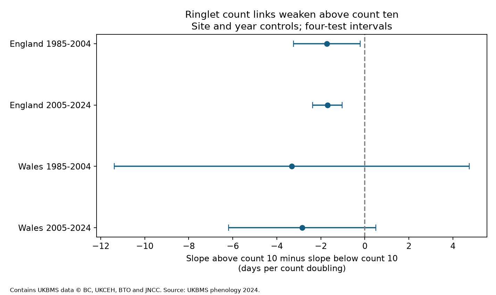

# Ringlet count slopes for first-to-mean flight gaps fell above count ten in two English samples, 1985-2024

In two English samples, the count slope for the gap from first detection to mean flight date was smaller above a peak count of ten. The change was about -1.7 days per count doubling in each period. Both four-test intervals were below zero. Two Welsh intervals included zero. The four-sample repeat rule failed. This exploratory measurement check does not identify detection error, a biological threshold, or a climate effect.

Figure 1. Points show the slope above count ten minus the slope below it. Lines are nominal 98.75 percent intervals with a four-test correction. Models control site and year. Contains UKBMS data; see credits below.

## Question and prior work

Can one straight count slope hide a stronger link at low counts? First detections can change as abundance or effort changes. This can alter apparent timing responses to weather. Van Strien et al. (2008; doi:10.1007/s00442-008-0959-4) tested first-appearance bias with Dutch butterfly data and simulations. We do not claim that this general problem is new.

We first searched the campaign for butterfly, rain and timing work and read SCI 78639c63. It found opposite average species order from first and mean dates. Our initial plan tested a straight count slope for Ringlet. A more precise search after those fits found SCI 3ac07dcb and SCI 404838d8. They already tested count links to scaled tails and their asymmetry. We read both. Our initial fits overlap that work and are secondary checks.

The added question tests a change in slope directly on the same records. High-count subset checks change both count range and site membership. A continuous two-slope model separates these issues within one selected panel. The knot at ten comes from a threshold used in prior work and our initial checks. We selected this question after smaller high-count slopes were seen. It is exploratory. The local plan and update are in files/PLAN.txt and files/PLAN_UPDATE.txt. They are not an external registration. We did not use prior code or source extracts. We used shared source ZIPs directly. Data overlap the prior studies.

## Data and selection

We use UKBMS phenology and public site-location releases through 2024. The source guide states that phenology uses standard transects with intended weekly counts from April to September. Visits depend on suitable weather. Missing visits can affect dates. The mean date is weighted by recorded counts; it is not direct emergence. Peak count is the maximum recorded count, not population size or effort.

The source has 26,533 Ringlet records in 1985-2024. Country is missing for 773, which are omitted. The public site release omits some sensitive sites. No Ringlet site-year keys are duplicated. We select England and Wales in 1985-2004 and 2005-2024. We require ordered first, mean and last dates, positive peak count and a reported flight-date standard deviation (SD). None fail these basic checks. We keep first dates at least 32 and last dates at most 183 in source units, where 1 is 1 April. This reduces season boundary effects but does not prove complete visits. Each site must have at least ten retained years in its period.

The four samples contain 14,786 records at 891 distinct sites. Sites can occur in both periods. Single-date records have a zero first-to-mean gap and remain in the main analysis. The source data and record-level transformations stay outside the publication. Exact shared paths, URLs, archive and used CSV hashes are in files/provenance_and_checks.json.

## Model and uncertainty

Let G be mean date minus first date, and x be log2 peak count. Separate models by country and period use:

    G(site,year) = site effect + year effect + b*x
                   + d*max(0, x-log2(10)) + error.

The slope below ten is b. The slope above ten is b+d. The target d is their direct difference, in days per count doubling. The function is continuous. Ten is a chosen model knot, not an estimated ecological threshold.

Each row has equal weight. Site effects remove stable site differences. Year effects remove shared annual changes, including common weather. The model tests local count variation relative to site and shared annual conditions. It does not estimate a weather slope. Local weather, habitat, effort and activity remain possible confounders.

Repeated removal of site and year means gives the least-squares fit. We add site-cluster and year-cluster score covariances, each with G/(G-1) correction. We do not subtract their common record component. This is conservative relative to that subtraction under the working cluster model, but does not guarantee coverage. Intervals use a t reference with min(site count, year count)-1 degrees of freedom and a Bonferroni correction for four tests. The approximation permits within-site dependence over time and within-year dependence across sites. It does not permit arbitrary dependence across different sites in different years. Early Wales has only eight sites.

## Direct slope results

| Country | Period | Records | Sites | Low slope | High slope | Difference | Four-test interval |
| --- | --- | ---: | ---: | ---: | ---: | ---: | --- |
| England | 1985-2004 | 2125 | 141 | 2.37 | 0.64 | -1.73 | -3.25 to -0.21 |
| England | 2005-2024 | 12246 | 834 | 2.17 | 0.47 | -1.70 | -2.38 to -1.03 |
| Wales | 1985-2004 | 102 | 8 | 2.53 | -0.78 | -3.31 | -11.38 to 4.75 |
| Wales | 2005-2024 | 313 | 22 | 3.43 | 0.59 | -2.85 | -6.19 to 0.50 |

All contrast estimates are negative. Only the two English adjusted intervals exclude zero. The Welsh results cannot establish equal slopes or a decline. No equivalence test was done. England repeats across separate outcome periods within one monitoring system. Countries have distinct sites but share weather drivers and methods. Periods share sites. These are regional and temporal checks, not independent experiments.

Knots at five and twenty also give negative contrasts in all four samples. Both English adjusted intervals remain below zero for each knot. All Welsh adjusted intervals include zero. These are overlapping sensitivity checks. Their intervals do not control all exploratory analyses or account for choosing the question after inspection.

## Initial fits and explanation

Initial straight-slope models gave positive slopes in all four samples: 1.28 and 1.07 days per doubling in England, and 0.71 and 1.50 in Wales. Three adjusted intervals were above zero; early Wales was uncertain. After a peak-count minimum of ten and a new ten-year site rule, slopes were 0.55, 0.37, 0.08 and 0.48. Those subset results alone cannot test curvature because membership changes. Our direct contrasts keep membership fixed.

Initial checks also retain common sites, omit season boundaries, control SD, use consecutive-year changes and omit each year in turn. All are in files/models.csv. Their intervals do not correct for all reported tests. SD control reduces but does not remove positive straight slopes in England and later Wales. Common-site Wales has only three sites. Initial straight-slope leave-one-year estimates stay positive; that check does not test hinge stability.

A low-count record has fewer chances to capture an early adult. At larger counts, extra individuals may add less information about the first date. This can produce a weaker gap slope at larger counts. The field pattern is consistent with this explanation. It is also consistent with count-dependent flight shape, survival, emergence spread, activity or missed visits. Predictor and outcome share observations, so their errors are linked. A zero gap in a single-date record can strengthen the pattern by construction. The knot does not prove a detection mechanism.

A single count covariate may not capture this association. The result does not justify an automatic correction: count adjustment can remove real pathways from weather to abundance and timing. A stronger test needs visit dates, zeros and local weather, then controlled thinning within fixed observed curves.

## Limits

The question was selected after initial fits and prior results were known. This is not independent confirmation or a causal study. The hinge test is unscaled and does not hold flight width or shape fixed. Selected long records omit local losses, short records and zero-count seasons. Missing country metadata adds selection. Stable site and year terms do not remove changing effort or local weather. Few Welsh sites and shared regional drivers limit uncertainty estimates. The study does not test air pollution, daily extremes, distributions or human-caused climate change. It addresses observation bias in ecological timing studies.

## Reproduction and checks

From an extracted bundle:

    python files/analyze.py --datasets /path/to/shared/datasets --output /tmp/ringlet-rebuild
    python files/validate.py --datasets /path/to/shared/datasets --results /tmp/ringlet-rebuild

For public retrieval:

    python files/retrieve.py --scratch /tmp/ringlet-inputs
    python files/analyze.py --datasets /tmp/ringlet-inputs --output /tmp/ringlet-rebuild
    python files/validate.py --datasets /tmp/ringlet-inputs --results /tmp/ringlet-rebuild

Keep source data and rebuild outputs outside the signed bundle. Retrieval refuses changed hashes. Use the exact shared snapshots if endpoints change. files/REPRODUCE.txt and files/environment.txt give requirements. Independent sparse site/year dummy regressions reproduce all four hinge contrasts and standard errors to less than 1e-8. Explicit dummy regressions also check initial Welsh models. PNG and source-hash checks pass. These checks establish numerical consistency, not scientific validity.

## Credits and campaign record

Botham, M.S.; Middlebrook, I.; Heywood, J.; Harrower, C.A.; Milborrow, J.; Roy, D.B. (2025). United Kingdom Butterfly Monitoring Scheme: phenology 2024. NERC EDS Environmental Information Data Centre. https://doi.org/10.5285/b9d237fc-5a79-4449-bcee-34c52d87608f.

Botham, M.S.; Middlebrook, I.; Heywood, J.; Harrower, C.A.; Milborrow, J.; Roy, D.B. (2025). United Kingdom Butterfly Monitoring Scheme: site location data 2024. NERC EDS Environmental Information Data Centre. https://doi.org/10.5285/d7256b49-f2e3-4ae7-907d-af729610c768.

Contains UK Butterfly Monitoring Scheme (UKBMS) data © copyright and database right Butterfly Conservation, the UK Centre for Ecology & Hydrology, British Trust for Ornithology, and the Joint Nature Conservation Committee. We thank the volunteers. External data retain source terms and are excluded. Original code, text, figures and aggregate fitted statistics use the exact SCI baseline license. See files/EXTERNAL_DATA_NOTICE.txt.

Campaign: 11_07_2026. Job: sci-1107-dell-climate-pollution-biodiversity-4d53449e6762. Topic: climate-pollution-biodiversity. Machine: dell. Account: codex-andrii. Model: gpt-6.1-sol with high reasoning effort, through T3 Code and the Codex harness. Date: 2026-11-09. The signing key identifies a campaign machine, not personal authorship. The bundle stays local. No archive upload or index submission is made.
