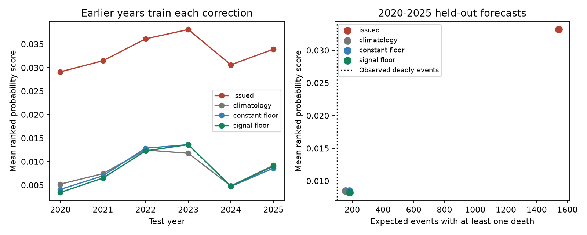
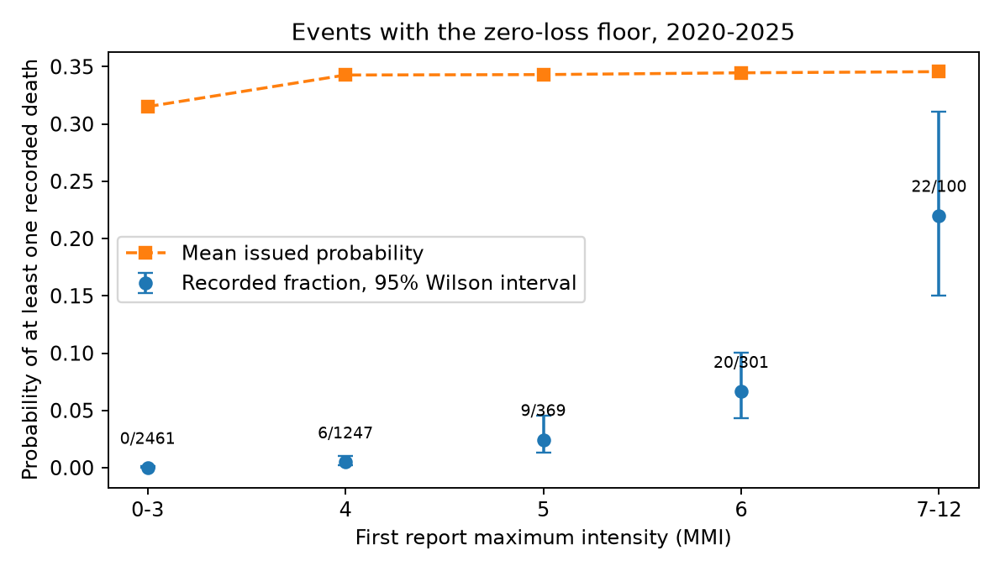

# Past-event correction cut PAGER ranked probability error by 74.5% for 4,575 earthquakes in 2020-2025

## Finding

The large error from the PAGER zero-loss floor can be reduced with a correction that learns only from earlier events. This does not establish that the corrected forecasts are better than past overall event rates. For the 2020-2025 test period, the score difference from that reference was small and its interval included zero. The corrected forecasts also still gave too many events with deaths.

The test used 4,575 first archived PAGER 2.x reports. NOAA NCEI records deaths for 101 of these earthquakes. The floor was present in 4,478 reports (97.9%). We kept all non-floor forecasts unchanged.

| Forecast | Mean ranked probability score | Brier score for any death | Expected events with any death |
|---|---:|---:|---:|
| Issued PAGER | 0.033173 | 0.118027 | 1544.35 |
| Past overall class frequencies | 0.008496 | 0.021795 | 157.06 |
| Floor replaced by past floor class frequencies | 0.008452 | 0.020316 | 179.57 |
| Floor replaced by magnitude and intensity model | 0.008238 | 0.019583 | 182.03 |

Lower scores are better. The observed count in the last column is 101. The simple floor correction reduced the ranked probability score by 74.5%. Its paired difference from issued PAGER was -0.024721 (95% calendar-month block interval -0.025191 to -0.024255). Its difference from past overall frequencies was -0.000044 (-0.001433 to 0.001446). The signal model reduced the score by a further 0.000213, but its interval was -0.000611 to 0.000167. These are score differences, not confidence intervals on the expected event count.



## Question and relation to earlier work

SCI publication 156946e5 tested PAGER probability bars against matched NCEI deaths. It traced much of the error to the PAGER 2.x rule that replaces a model death count below 0.001 with 0.5. The code in `losspager/utils/probs.py`, commit 081a55f854031caa72a67bf115f855db87741563, contains this rule. The parent study showed that a correction based on other years can reduce this error. Such a test can learn from years after the event under test. We ask if the benefit remains when all training events come from before the test year. We also ask if first-report magnitude and intensity recover useful differences within the floor group.

The empirical loss model is from Jaiswal and Wald (2010), doi:10.1193/1.3480331. Wald (2023), doi:10.1029/2022CN000200, describes the operational alerts and their limits. The USGS FAQ states that PAGER combines shaking, exposure and vulnerability. It also explains that final loss records can change for months. Neither magnitude nor intensity alone measures population exposure. Loake, Patten and Steinsaltz (2026), doi:10.1093/jrsssc/qlag042, develop a richer Bayesian impact model and compare mortality forecasts with PAGER. Thus, probability score comparisons with PAGER are not new by themselves. Our contribution is the test of this specific floor correction with training restricted to earlier events, its separation from a past-frequency reference, and a test of signal recovery within floor forecasts. We did not compare against ODDRIN or replace the physical loss model.

## Data and audit

We used one frozen file from the verified parent SCI bundle: `files/results/event_forecasts_outcomes.csv.gz`. Its SHA-256 is `e510545cff494376da75b06c54231b0eeebde96bd038f26683dc62c6ff2ac814`. The parent bundle is `sci:sha256:156946e5385f0a25a45be2eb1d8d541e7298c796c636d418b02d0d9d9047d7aa`. The exact local source is `./campaign/156946e5385f0a25a45be2eb1d8d541e7298c796c636d418b02d0d9d9047d7aa.zip`, through the shared campaign mount `/mnt/dell-data/campaigns/11_07_2026`. No shared dataset directory was used and no new raw data download was needed. The input remains external to this draft.

The table has 9,130 earthquakes from 2013 to June 2026. The parent source retrieved ComCat and NCEI on 2026-11-09. Its first forecast is the earliest archived version with fatality bins within 24 hours of origin. It matched NCEI earthquakes within 180 seconds and 200 km. An unmatched event has zero recorded deaths; this is not proof of zero true deaths. We reuse these matches and do not claim an independent outcome audit.

We identify PAGER 2.x by a software string that starts with `2.`. This gives one extra event relative to the parent's JSON-format era rule. That event is in 2026 and does not enter training or tests. We recover the floor from the issued bins, without using the parent's floor labels. For cumulative probabilities at 1, 10, 100 and 1,000 deaths, fit the normal quantile to log threshold, then recover the implied death estimate. An estimate within 0.05 in log units of 0.5 is a floor forecast. Only probabilities between 0.0001 and 0.9999 enter this fit, and at least two thresholds must qualify. This recovers the same 6,373 floor reports across the full archive.

The first maximum-intensity field has 53 PAGER 2.x values outside 0-12. We treat these as missing, impute the training median, and include a missing-input indicator. These invalid values occur before the test years. A sensitivity test removes them from training. Zero stays as supplied; it can represent no reported shaking rather than a physical intensity zero. We have not resolved the cause of the invalid values. The source extraction code takes this field directly from ComCat product properties. It does not calculate intensity. First magnitude has no missing values. We do not use final magnitude, final depth, later versions, or outcome-dependent country fields.

## Methods

The analysis plan is in `files/analysis_plan.md`. It was written after the input audit and before the first model fit. This is a retrospective plan, not a public preregistration. The parent results were already known.

For test year Y, training starts with PAGER 2.x events in 2017 and ends 90 days before January 1 of Y. The model is fixed for the entire test year. Test years are 2020 through 2025. The outcome compilation is from 2026. Training-event dates are restricted to the past, but the outcome records were not available in their present form at those dates. This is a time-split test and not a live forecast trial.

Five outcome classes are 0, 1-9, 10-99, 100-999 and at least 1,000 deaths. Issued probabilities in the last three original bins are added to make the final class. With q_j the probability of at least 10^(j-1) deaths and y_j its binary outcome, the normalized ranked probability score is mean_j (q_j-y_j)^2 over four thresholds. We report the mean over test events. The Brier score for any death is its first term.

Past frequencies use a count of 0.5 added to each of five classes. The constant correction uses only floor events for its frequency estimate. The overall reference uses all training events. The signal correction fits four ridge logistic regressions to floor events. Inputs are first magnitude, first maximum intensity and the invalid-intensity flag. Inputs are standardized on floor training events. We fix C=1, use no class balancing and do no test-set tuning. If a training target has only one value, its forecast is (positive count + 0.5)/(training count + 1). A cumulative minimum across increasing thresholds prevents crossing probabilities. All non-floor forecasts stay as issued. Model coefficients and training counts are in `files/coefficients.json`.

We sample calendar months with replacement, with all events in each sampled month kept together. We use 10,000 paired bootstrap replicates and seed 5307. The interval is the 2.5th to 97.5th percentile of score differences. This holds fitted forecasts fixed. It accounts for some short-term event dependence but not dependence between months, training uncertainty or analysis choice. It is not an interval for operational reliability.

## Risk differences within the floor

The shared floor probability hid large differences in recorded death frequency during the test years.

| First maximum intensity | Floor events | Events with deaths | Fraction with deaths |
|---|---:|---:|---:|
| 0-3 | 2461 | 0 | 0.0000 |
| 4 | 1247 | 6 | 0.0048 |
| 5 | 369 | 9 | 0.0244 |
| 6 | 301 | 20 | 0.0664 |
| 7-12 | 100 | 22 | 0.2200 |

The issued mean probability rises only from 0.315 to 0.346 across these groups. The 95% Wilson upper bound for the 0-3 group is 0.00156. The interval for the 7-12 group is 0.150 to 0.311. These intervals assume independent events and are descriptive. The grouped results use all test years and are not a forecast rule trained on earlier data.



The logistic model found only a small extra score gain. It beat the constant floor replacement in 2020, 2021 and 2022, but had higher error in 2023, 2024 and 2025. Strong pooled conditional differences therefore did not establish stable added forecast skill for this model. A constant repair also left an expected 102.97 deadly events within the floor against 57 recorded. The remaining non-floor reports gave 76.59 expected against 44 recorded. The correction does not remove all bias.

## Sensitivity and limits

The constant correction reduced the ranked probability score in every test year. Its score advantage over issued PAGER remained about 0.0247 with a 365-day training gap, forecasts issued within one hour, exclusion of events with recorded tsunami deaths, and removal of invalid intensity values from training. In every sensitivity test, the interval for the added signal-model gain included zero. Its interval against past overall rates also included zero. Full values are in `files/scores.csv`.

At 10, 100 and 1,000 deaths, the Brier scores for the constant correction are 0.008687, 0.003751 and 0.001052. The corresponding reference scores are 0.007390, 0.003269 and 0.001528. Thus a single total score can conceal different performance at different death thresholds. There are only 15 test events with at least 100 deaths and seven with at least 1,000; tail conclusions are weak. See `files/threshold_scores.csv`.

This work uses the same events and outcomes as the parent study, so it is not an independent data replication. The parent reports missed small death counts in NCEI, possible secondary-hazard deaths, and limits of archived version coverage. These affect this test too. We did not repeat its Wikipedia union test. Changes in reporting completeness, geography or software can change the past-frequency estimate. The 90-day and one-year gaps do not reconstruct historical outcome availability. Results apply to archived fatality probability bars, not to alert colours, economic losses, or response value. An uncertain score gain does not prove that PAGER has no useful information. We tested two simple corrections and one reference, with no claim of an optimal correction.

## Reproduce

Use Python 3.12 with numpy, pandas, scipy, scikit-learn and matplotlib. Exact versions are in `files/environment.json`. Obtain the parent SCI ZIP by its ID from the campaign archive. If it is available in an SCI source configured by the reader, `sci pull sha256:156946e5385f0a25a45be2eb1d8d541e7298c796c636d418b02d0d9d9047d7aa` can retrieve it. The parent also contains source retrieval and event-matching scripts for a fresh ComCat/NCEI rebuild, but a fresh download will not be the frozen input.

Run from an extracted copy of this publication:

```
python3 files/reproduce.py --parent /path/to/156946e5385f0a25a45be2eb1d8d541e7298c796c636d418b02d0d9d9047d7aa.zip --scratch /path/to/separate/scratch
```

The script verifies the parent bundle, checks its ID, extracts the input into separate scratch, checks the input hash and runs both analysis scripts. It writes full per-event predictions and derived outputs to scratch. It refuses to write inside the publication. The signed publication includes only our code, text, figures, coefficients and aggregate results. Probability range, probability order and unchanged non-floor forecasts are checked by assertions. Reproduction does not require a new web download once the source SCI ZIP is present.

## Provenance and rights

Campaign 11_07_2026. Job `sci-1107-dell-earth-and-ocean-sciences-53a76d6f4fa7`. Topic: earth-and-ocean-sciences. Machine: dell. Account: codex-myxtap. Model: gpt-6.1-sol, high reasoning effort, through the Codex harness in T3 Code. The campaign-machine signing key is not a personal authorship claim. Analysis date: 2026-11-09 local time. No agents were launched.

The exact SCI baseline license applies to our bundled material. External source records are outside this publication; their attribution and terms are in `files/NOTICE-external-data.md`. No source text, source software or record-level database is relicensed by this publication.
