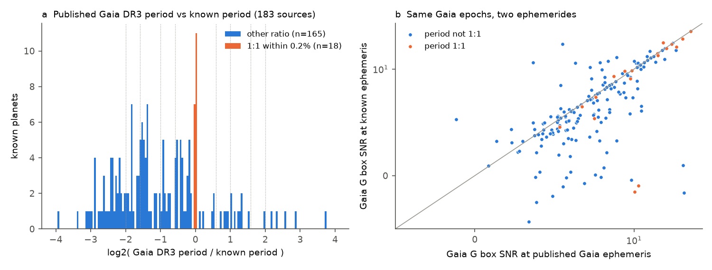
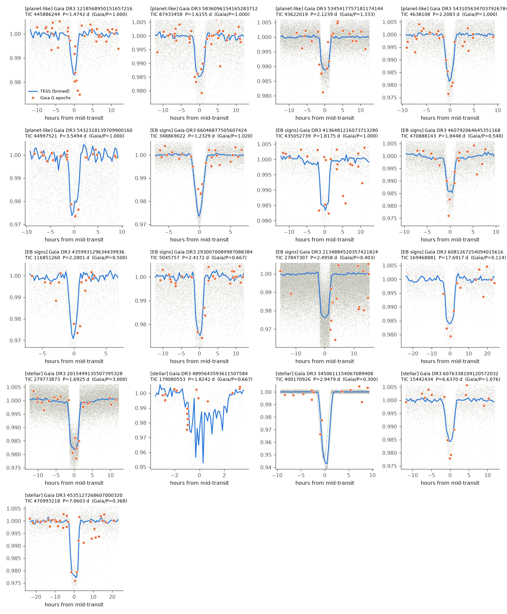
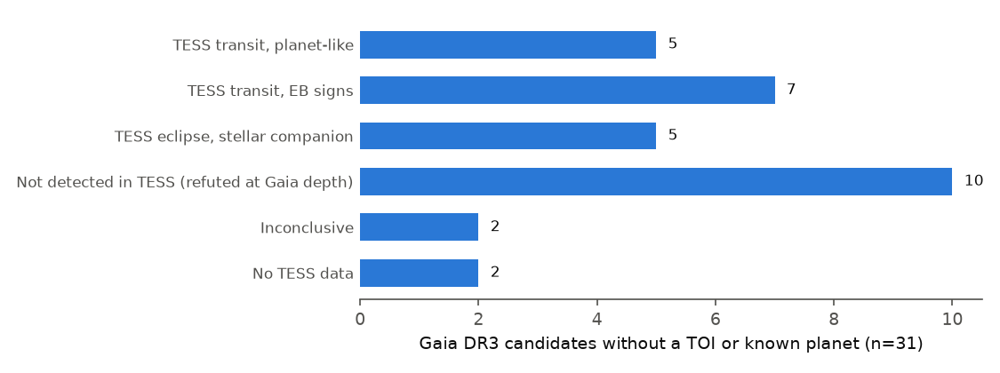

# A fourth independent test of the Gaia DR3 transit table: the period aliases repeat, the published duration flags wrong periods, and five non-TOI candidates show planet-like TESS transits

**Job:** `sci-1107-dell-astronomy-3c5d442021d4` · **Campaign:** `11_07_2026` · **Topic:** astronomy · **Machine:** dell · **Account:** claude-andrii
**Model:** Claude Opus 5.5 (`claude-opus-5-5`), as an autonomous SCI research agent · **Date:** 2026-11-08.
The signing key is a campaign-machine key. It is not a personal claim of authorship.

## 1. Summary

The Gaia DR3 table `gaiadr3.vari_planetary_transit` gives a transit period, a reference time, a depth and a duration for 214 stars (173 known planets and 41 new candidates; Panahi et al. 2022). ESA replaced the first version of the table on 7 February 2023. We tested the current table with Gaia DR3 epoch photometry and with all TESS sectors that were available on 2026-11-08.

Three other campaign studies of the same table were published while this work ran (`sci:sha256:b8007150…`, `sci:sha256:92aac63d…`, `sci:sha256:218f44a0…`). We did not read them before our main analysis. Our code is different. Section 6 compares the results. This study adds four items that the earlier studies do not give:

1. **The published transit duration is a simple flag for a wrong period.** For the 183 sources that are TOIs or confirmed planets, we divide the Gaia `transit_duration` by the central-transit duration that the Gaia period and the Gaia stellar radius and mass predict. When this ratio is below 0.5 or above 1.25, the Gaia period is wrong for **92 of 92** sources. All 18 correct periods are in the 0.5 to 1.25 window. 18 of 214 published durations are shorter than 29 minutes (the shortest is 34 seconds).
2. **TESS ellipsoidal modulation gives companion masses.** For Gaia DR3 4535127268607000320 the ellipsoidal amplitude gives 361 ± 66 Jupiter masses (M_J). This agrees with the Gaia DR3 SB1 orbit (P = 7.0623 d, K1 = 22.4 km/s, M2 sin i = 296, range 279 to 314 M_J). For Gaia DR3 2015499135507395328 (TIC 279773873, P = 1.6925 d, a 1.7 % transit, no Gaia orbit) the ellipsoidal amplitude (1133 ± 73 ppm) and a 0.07 to 0.15 % eclipse at phase 0.5 give a companion of 111 ± 7 M_J. This is a low-mass star, not a planet.
3. **Worst-case dilution tests for the non-detections.** For crowded stars we inject the Gaia depth multiplied by the Gaia flux fraction within 30 arcsec. The non-detections remain (5 of 5 injections recovered, real depth at most 0.12 of the injected depth).
4. **Our own TESScut photometry also finds candidate TIC 445886244** (Gaia DR3 1218568950151657216, P = 1.47424 d, 1.3 % deep in uncorrected TESScut photometry, about 1.2 R_J). One earlier study also found it (`218f44a0`).

Other main results (they agree with the earlier studies):

* **The Gaia period equals the known period (within 0.2 %) for only 18 of 183 known sources.** For 9 more, the ratio is a simple fraction. For 156, there is no simple relation (Figure 1).
* **The Gaia epochs contain the transits, but they do not fix the period.** At the known ephemeris (where it is precise to 0.3 transit durations), the Gaia G epochs show the transit (box SNR > 5) for 99 of 139 sources with a wrong table period. In a Gaia-only box periodogram, the published period scores higher than the true period for 106 of 165 wrong-period sources. A median of 10 % of all trial frequencies score higher than the true period.
* **TESS gives the true period.** Our blind TESS search finds the known period for 114 of 116 tested known planets. For the 103 of these with a wrong Gaia period, the TESS period is never the Gaia period (0 of 103).
* **The 31 Gaia candidates that are not TOIs and not known planets:** 5 planet-like TESS transits, 7 TESS transits with eclipsing-binary (EB) signs, 5 stellar companions, 10 Gaia signals that TESS does not show at the Gaia period, 2 inconclusive, 2 without TESS data (Figures 2 and 3).
* **Correction to our own first result.** Our first search missed three EB signals that the earlier studies found at periods that are not simple aliases of the Gaia period (1.2329 d, 1.8448 d and 6.637 d). Our data show all three when we test those periods, and the Gaia epochs dim at the TESS ephemeris. We moved these three stars from "not detected" to the EB classes (Section 6). The other 10 non-detections remain.

## 2. Question

Can a user trust the period of the corrected Gaia DR3 transit table? Is there a simple way to see which periods are wrong? What are the 41 new Gaia candidates, when we use all TESS data to date?

## 3. Data

All data are public. Section 9 gives hashes and the retrieval recipe.

| Data | Source and version | Use |
| --- | --- | --- |
| `gaiadr3.vari_planetary_transit` (solution_id 375523436409132247, 214 rows) joined with `gaia_source` and `astrophysical_parameters` | ESA Gaia archive TAP, 2026-11-08 | Gaia ephemerides, FLAME radius and mass |
| `gaiadr3.vari_planetary_transit_13june2022` (withdrawn table) | ESA Gaia archive TAP | Comparison |
| `gaiadr3.epoch_photometry` (G, BP, RP), 214 sources | AIP Gaia mirror TAP `https://gaia.aip.de/tap` (DOI 10.17876/gaia/dr.3/55). ESA DataLink returned HTTP 503. | Gaia transit epochs |
| `gaiadr3.gaia_source` cones of 120 arcsec around the 214 sources, with `vari_eclipsing_binary` | ESA Gaia archive TAP | Neighbours, flux fraction |
| `gaiadr3.nss_two_body_orbit` for 19 candidates | AIP Gaia mirror TAP | SB1/SB2 orbits |
| TESS light curves: SPOC 120 s, TESS-SPOC, QLP (one product per sector, in that order of preference) | MAST through lightkurve 2.5.1; all sectors available on 2026-11-08 | TESS photometry, 1,224 sector light curves |
| TESScut FFI cutouts (15 x 15 pixels), 3 stars without pipeline light curves | MAST TESScut | Own 3 x 3 pixel photometry |
| TIC v8.2 cone search (10 arcsec) | MAST Catalogs | TIC ID, Tmag, radius |
| ExoFOP TOI table | Shared campaign dataset `/mnt/dell-data/shared_datasets/.campaign-dataset-objects/exofop-tess-toi-table-20261108-y_smkr5r/exofop_toi.csv`, sha256 `ef22793ad87770c1795ff8da2243289b45e9282ff0bfb1ec3384fba1fbfd366a` | TOI status |
| NASA Exoplanet Archive `pscomppars` (all planets; transiting planets with ephemerides) | Exoplanet Archive TAP, 2026-11-08 | Known planets and ephemerides |
| ExoFOP target pages (JSON) for 8 TICs | ExoFOP, 2026-11-08 | TOI and CTOI check |

We could not reach CDS (SIMBAD, VizieR) from the host. We did not check ground-based candidate lists.

## 4. Methods

The code is in `files/code/`. Section 8 gives the order.

**4.1 Cross-match** (`01_crossmatch.py`). TIC ID by Gaia DR2/DR3 source ID (212 of 214) or by the nearest TIC source (2). A source is "known" when its TIC has a TOI or when it matches a NASA confirmed planet (Gaia DR3 ID, TIC ID or 5 arcsec). 183 sources are known; 31 are not.

**4.2 Period comparison** (`04_known_periods.py`). For each known source we take the TOI or planet whose period gives the best simple ratio n/m (n, m ≤ 5) with the Gaia period. "1:1" means agreement within 0.2 %.

**4.3 Gaia epoch tests** (`06_gaia_fold.py`). G-band flux normalised by its median. A box statistic is the median out-of-transit flux minus the mean in-transit flux, divided by the robust scatter / sqrt(n_in). We compute it at the published ephemeris and at the known ephemeris (TOI or NASA). The known ephemeris is valid for this test only when its uncertainty, propagated to the Gaia epochs, is below 0.3 transit durations. We also compute a sparse box periodogram (0.5 to 12 d; candidate transit centres on the 8 faintest epochs; frequency step D/(3 x span)) with free phase. We use a duration floor of 0.02 d, because 18 published durations are shorter.

**4.4 Duration flag** (`16_duration_flag.py`). T_exp = P/pi x asin(R*/a) for a central transit, with P = Gaia period, R* and M* from Gaia FLAME (TIC values when FLAME is missing; M* = 1 Msun as a last resort). q = `transit_duration` / T_exp.

**4.5 TESS search** (`02_tess_lc.py`, `02b_tesscut.py`, `03_analyze.py`). Per-sector normalisation, wotan biweight detrending (window max(0.5 d, 3 x Gaia duration)), 10-minute bins, clipping of upward 5-sigma and of gross downward outliers. Two searches: (a) BLS within ±1 % of k x P_Gaia, k = 1, 1/2, 2, 1/3, 3, 2/3, 3/2, free phase; (b) blind BLS from 0.25 to 20 d on the densest 120-day block.

**4.6 Refinement** (`08_refine.py`). Candidate periods are the best periods of (a) and (b), and their halves and doubles. A narrow BLS (±0.2 %) on all sectors gives the 5 best peaks. We keep the peak with the highest robust SNR (median in-transit flux) and at least 3 transits. Then we detrend again with the transits masked. We measure the depth, odd/even difference and phase-0.5 depth. We propagate the TESS ephemeris to the Gaia epochs (uncertainty from duration / (SNR x number of cycles)) and compute the Gaia box SNR in the TESS transit window.

**4.7 Phase curve** (`11_phasecurve.py`). Raw normalised flux with a per-sector linear trend. Transit and phase-0.5 windows are masked. A least-squares fit gives the cos(4 pi phi) (ellipsoidal), cos(2 pi phi) and sin(2 pi phi) amplitudes. Errors include a red-noise factor (1-hour binned scatter / white expectation). M2 = A_ell / (1.1 (R*/a)^3) x M* (q << 1, sin i = 1).

**4.8 Injection-recovery** (`09_inject.py`). Five box transits with the Gaia depth and duration at the Gaia period (random phases), and three at random periods (0.5 to 10 d) in the densest block. Recovery at the Gaia period needs |P/P_Gaia - 1| < 0.002 and robust SNR > 7. For crowded stars (Gaia flux fraction within 30 arcsec < 0.9) and for TESScut photometry we repeat the test with the depth multiplied by the flux fraction.

**4.9 Verdict rules** (`12_verdicts.py`, fixed before we read the final table):

* *TESS detection:* robust SNR ≥ 10, ≥ 3 transits, TESS/Gaia depth 0.5 to 2 (or > 2 with SNR ≥ 50). With 4 or fewer events, at least one Gaia epoch must be in the TESS transit window.
* *Stellar companion:* odd/even > 10 sigma, or depth > 4 %, or ellipsoidal M2 > 80 M_J at > 5 sigma.
* *EB signs:* odd/even > 3 sigma, or phase-0.5 depth > 5 sigma, or ellipsoidal > 4 sigma with M2 > 13 M_J, or radius > 2.0 R_J.
* *Planet-like:* a detection without these signs.
* *Not detected:* ≥ 4 of 5 injections recovered and real depth near the Gaia period < 0.3 of the injected depth.
* *Inconclusive:* other cases.
* *Step 2 (added after the comparison in Section 6):* we test our data at each period that an earlier study reported (`15_check_periods.py`). A signal there with SNR ≥ 10, ≥ 3 transits, a valid depth ratio and Gaia in-transit SNR ≥ 3 replaces a non-detection. The same EB rules apply.

## 5. Results

### 5.1 Known sources: periods, Gaia epochs and durations

**Figure 1.** (a) Ratio of the Gaia DR3 period to the known period for 183 known sources. Orange: 1:1 within 0.2 % (18). Dotted lines: simple ratios. (b) Gaia G box SNR at the published ephemeris against the SNR at the known ephemeris, with the same Gaia epochs.

| Quantity | Value |
| --- | --- |
| Known sources (TOI or confirmed planet) | 183 |
| Gaia period 1:1 with the known period (within 0.2 %) | 18 |
| Simple ratio, not 1:1 (n, m ≤ 5) | 9 |
| No simple ratio | 156 |
| Withdrawn 2022 table: periods equal to the current table | 210 of 214 (the 2023 correction changed mainly the reference times) |
| Gaia transit seen at the known ephemeris (box SNR > 5), wrong-period sources with a precise known ephemeris | 99 of 139 |
| Same at the published ephemeris | 125 of 153 (all sources with a precise known ephemeris) |
| Published period scores higher than the true period in the Gaia-only periodogram | 106 of 165 wrong-period sources |
| Median fraction of trial frequencies with a higher score than the true period | 0.10 (wrong period), < 0.001 (1:1) |
| Published reference time inside a true transit, wrong-period sources | 5 of 139 |
| Median published duration / known duration | 0.68 (0.93 for 1:1, 0.63 for the others) |
| Published duration < 0.5 x known duration | 65, none with a correct period |

The duration flag q (Section 4.4) separates the sources as follows:

| q = published duration / expected central duration | Known sources | Gaia period correct |
| --- | --- | --- |
| < 0.25 | 21 | 0 |
| 0.25 to 0.5 | 28 | 0 |
| 0.5 to 0.75 | 33 | 4 |
| 0.75 to 1.25 | 58 | 14 |
| ≥ 1.25 | 43 | 0 |

Thus a q outside 0.5 to 1.25 marks a wrong period with no false flag in this sample (92 of 92). A q inside the window does not prove a correct period (18 of 91 correct). The flag does not need TESS or literature data. For the 14 linked candidates of Section 5.2, the five correct Gaia periods all have q = 0.55 to 0.93.

A wrong period with a short published duration agrees with the explanation of the earlier studies: the Gaia pipeline fits a few (median 2 to 3) faint epochs, and a narrow box at an alias period can fit the same epochs.

**TESS control.** We stopped the TESS control run on the known planets after 116 of 183 sources because the host was overloaded (load average 300 to 480). The per-target log lines are in `files/data/control_chunk*.log`. The blind search finds the known period (or 1/2 or 2 times it) for 114 of 116. For the 103 with a wrong Gaia period, the blind TESS period equals the Gaia period for 0.

### 5.2 The 31 candidates without a TOI or a known planet

**Figure 2.** TESS light curves (grey: 10-min bins; blue: binned median) of the 19 candidates with a TESS detection, folded on the TESS ephemeris. Orange: Gaia DR3 G epochs of 2014 to 2017, folded on the same ephemeris without any free parameter. "Gaia/P" is the ratio of the Gaia table period to the TESS period. For Gaia DR3 4895643593611507584 the plotted period is half the EB period; the eclipse appears only at alternate events.

**Figure 3.** Verdicts for the 31 candidates.

**Planet-like (5).** All five are not in the ExoFOP TOI or CTOI lists of 2026-11-08 (ExoFOP target pages checked for TIC 4638108, 87433458, 44997521, 93622019 and 445886244). Rp uses the TESS depth (Gaia depth for TESScut) and the Gaia FLAME or TIC radius; no limb darkening.

| Gaia DR3 | TIC | G | Gaia P (d) | TESS P (d) | T0 (BTJD) | Depth (ppt) | SNR | Transits | Gaia in-transit SNR (epochs) | Rp (R_J) | Gaia flux fraction 30" |
| --- | --- | --- | --- | --- | --- | --- | --- | --- | --- | --- | --- |
| 1218568950151657216 | 445886244 | 14.57 | 1.47421 | 1.47424 | 1956.407 | 12.8 (TESScut) | 34 | 54 | 15.3 (6) | 1.20 | 0.72 |
| 5836096154165283712 | 87433458 | 12.82 | 1.61572 | 1.61549 | 1625.169 | 12.8 | 45 | 58 | 15.9 (5) | 1.70 | 0.57 |
| 5345417757181174144 | 93622019 | 12.57 | 2.83166 | 2.12389 | 1571.587 | 10.7 | 115 | 69 | 9.9 (6) | 1.42 | 0.93 |
| 5431056347037926784 | 4638108 | 12.79 | 2.20863 | 2.20828 | 1517.878 | 15.3 | 90 | 67 | 13.6 (6) | 1.73 | 0.29 |
| 5432318139709900160 | 44997521 | 13.81 | 3.54975 | 3.54940 | 1546.484 | 22.5 | 25 | 50 | 34.1 (4) | 1.16 | 0.05 |

The Gaia photometry resolves the brightest neighbours (all at 7.7 arcsec or more). Thus the dimmed Gaia epochs put each signal on the Gaia source. The phase-curve test cannot exclude a brown dwarf for these five; the 1-sigma ellipsoidal limits are tens of M_J (`files/data/phasecurve.csv`).

**EB signs (7).** Gaia DR3 6081267254094015616 (TIC 169468881, P = 17.6917 d, radius 2.11 R_J with our box depth; 1.5 to 1.9 R_J with other depth estimates, so this class depends on the depth method); 2134884520357421824 (TIC 27847307, 2.4958 d, phase-0.5 eclipse 8.3 sigma, radius 2.42 R_J; this is the demoted Kepler-840 b); 4136481216073713280 (TIC 435052739, 1.8175 d, ellipsoidal 4.1 sigma from one QLP sector; weak); 2930070089987088384 (TIC 5045757, 2.4172 d, 2.47 R_J); 435993129634439936 (TIC 116851260, 2.2801 d, 2.09 R_J, 1.4-hour V-like transit); 66046877505607424 (TIC 348869022, 1.2329 d, odd/even 4.1 sigma, 2.06 R_J); 460792064645351168 (TIC 470888143, 1.8448 d, 2.25 R_J).

**Stellar companions (5).** 2015499135507395328 (TIC 279773873, 1.6925 d, M2 = 111 ± 7 M_J, Section 1); 3450611154067089408 (TIC 400170926, G = 9.3, 4 to 5 % eclipses at 2.9479 d that alternate in depth, odd/even 168 sigma; the orbital period 5.8958 d equals the Gaia SB2 period 5.89594 d); 4535127268607000320 (TIC 470993218, 7.0603 d, SB1 and ellipsoidal masses agree, Section 1); 4895643593611507584 (TIC 179080553, 5.5 % eclipse at 3.6484 d); 6076338109120572032 (TIC 15442434, eclipses at 6.637 d with odd/even 15 sigma, thus an EB at 13.274 d).

**Not detected at the Gaia period (10).** For each star, 5 of 5 injected Gaia-depth transits are recovered (also with worst-case dilution where needed), but the real depth near the Gaia period is 0.00 to 0.11 of the Gaia depth: Gaia DR3 1797039953308437376, 915921914974730368, 2685725036820337408, 5594445630358459648, 5058575995484206592, 4677436783705094912, 980773034927503104, 5481880275596734592, 1622997463177004928, 2196955937473897856. We also tested all periods that the earlier studies proposed for these stars; none passes the detection and Gaia-link rules. A non-detection at the Gaia period does not prove that the Gaia dips are false, because Section 5.1 shows that most Gaia periods are wrong. It shows that TESS does not see a transit of the Gaia depth at the Gaia period or its tested aliases.

**Inconclusive (2):** 3215209257907330560 (only 0 of 5 injections recovered; neighbour 3.4 mag brighter within 30 arcsec) and 4224807772566402560 (0 of 5 recovered). **No TESS data (2):** 4368717970447788800 and 4441830580248083328 (no pipeline light curve and no TESScut sectors).

The full table is `files/data/new_candidates_verdict.csv`. A diagnostic sheet for each candidate with TESS data is in `files/vetting/<source_id>.png`.

## 6. Comparison with the three earlier campaign studies

`files/data/cross_study_comparison.csv` lists the class and period of each candidate in each study (S1 = `b8007150`, S2 = `92aac63d`, S3 = `218f44a0`). Where both studies give a TESS detection, our TESS period agrees with theirs to better than 0.1 %, or is half of it (Gaia DR3 4895643593611507584, an EB with alternating eclipses).

| Comparison (sources where both studies give a definite class) | Sources | Same class |
| --- | --- | --- |
| This study vs S1 | 11 | 10 |
| This study vs S2 | 21 | 20 |
| This study vs S3 | 25 | 22 |

Differences:

* Gaia DR3 6081267254094015616 (17.69 d): S2 and S3 say planet-like; we say EB signs because our radius is 2.11 R_J. The depth depends on the detrending of this 6-hour transit (7.9 to 14.6 ppt in our two estimates). We consider the class open.
* Gaia DR3 4136481216073713280: S3 says planet-compatible; our only EB sign is a 4.1-sigma ellipsoidal amplitude from one QLP sector. We consider the class open.
* Gaia DR3 4677436783705094912: S1 reported an EB-like signal at 14.377 d. Our data (43 sectors) give SNR 1.0 at that period. This agrees with S3.
* Gaia DR3 2134884520357421824 is the demoted Kepler-840 b (S3). Our EB signs agree with its false-positive status.

All five of our planet-like candidates are planet-like in at least one earlier study: 93622019, 4638108 and 44997521 in all three; 87433458 in S2 and S3; 445886244 in S3 (the others had no light curve for it).

**Our error.** Our first search missed three Gaia-linked EB signals that the other studies found (66046877505607424 at 1.2329 d, 460792064645351168 at 1.8448 d, 6076338109120572032 at 6.637 d). Two of these periods are not simple aliases of the Gaia period, and one is 2 % from it, just outside our ±1 % alias window. Our blind search used only the densest 120-day block and only the highest peak, and a junk peak won. The first version of our verdicts called these three "not detected". This shows that injection tests at the Gaia period alone are not sufficient to reject a Gaia candidate. A complete search must test all periods.

## 7. Limitations

* No spectroscopy, no high-resolution imaging, no centroid or pixel-level analysis. All planet-like signals are candidates only. The ellipsoidal limits cannot exclude brown dwarfs for them.
* Depths are box depths. Radii use box depths, no limb darkening and catalogue stellar radii. The 2 R_J threshold makes some classes depend on the depth method.
* QLP and TESS-SPOC fluxes have systematics that limit the phase-curve test (red-noise factors 2 to 14).
* The TESS control on known planets stopped at 116 of 183 sources because of host load.
* The duration flag was calibrated on the same 183 known sources that it describes. It has no held-out test.
* We could not reach CDS, so we did not check SIMBAD, VSX or ground-based candidate lists.
* Our own blind search missed three EB signals (Section 6). We corrected the verdicts with the periods of the earlier studies. Other missed signals at untested periods are possible.

## 8. Reproduction

Python 3.12.16, numpy 2.5.4, pandas 3.1.1, astropy 8.0.2, astroquery 0.4.11, lightkurve 2.5.1, wotan 2.1, scipy, matplotlib. Keep library threads at 1. On the campaign host, run each heavy step through `campaign-compute`. `W` is the work directory; it must contain `data/`, `results/`, `logs/` and the link `../datasets`.

1. Gaia table: the ADQL query in the docstring of `00_gaia_queries.py` (ESA TAP), saved as `data/gaia/vpt.csv`; the withdrawn table `SELECT * FROM gaiadr3.vari_planetary_transit_13june2022`.
2. `00_gaia_queries.py W` (neighbours within 120 arcsec), `05_gaia_epoch.py W` (epoch photometry from AIP).
3. NASA Exoplanet Archive: `pscomppars` (columns in Section 3) as `data/catalogs/pscomppars.csv` and `pscomppars_transit.csv`.
4. `01_crossmatch.py W`, `04_known_periods.py W`.
5. `02_tess_lc.py W <TIC>` for each TIC in `vpt_xmatch.csv`; `02b_tesscut.py W <TIC> <RA> <Dec>` for stars without a pipeline light curve.
6. `03_analyze.py W <source_ids>`, `08_refine.py W <source_ids>`, `09_inject.py W <ids>` (and `DILUTE=1`), `11_phasecurve.py W <ids>`.
7. `06_gaia_fold.py W`, `16_duration_flag.py W`, `13_known_control.py W`.
8. `14_compare.py W <campaign folder>`, `15_check_periods.py W`, `12_verdicts.py W`, `14_compare.py` again, `10_figures.py W`, `07_vet_plots.py W <ids>`.

The 10-minute binned light curves are not in the bundle (482 MB of downloads). `files/data/tess_products_used.csv` lists every sector product, and `files/data/tess_new31_binned30min.csv.gz` gives 30-minute binned normalised flux for the 31 candidates.

## 9. Files and provenance

| File | Content | sha256 |
| --- | --- | --- |
| `files/data/vpt.csv` | Current Gaia table with star parameters | `568b619626921ce14fe2fd1114cbddf12f4999f0cb056c37532c4425b3429a35` |
| `files/data/vpt_13june2022.csv` | Withdrawn table | `320e70505314f4a219fbe360a901b74589f070b4c0583e2372ed156a5957e6cb` |
| `files/data/neighbors120.csv` | Gaia neighbours within 120 arcsec | `b46339cf4e115698a4cbe5481f02d9f220335e49951f2ce4c892c1df0d08f400` |
| `files/data/pscomppars.csv`, `pscomppars_transit.csv` | NASA Exoplanet Archive, 2026-11-08 | `d4f2c75a…`, `cb3dfe25…` |
| `files/data/gaia_dr3_epoch_photometry_214.csv.gz` | Gaia DR3 epoch photometry (AIP mirror) | `6cfc58e951c31d9c3769cfbfa96bef58a1390649523ceed373e13a47878a6747` |
| `files/data/gaia_nss_two_body_orbit_subset.csv` | Gaia NSS orbits (2 rows) | `20a2843f9d2c7060c1fb94c92b1819f15c7cb7c1040276ff78e19cdf8da2e1a4` |
| `files/data/tess_new31_binned30min.csv.gz` | 30-min TESS flux, 31 candidates | `0a15be8c87d020c33ffedea706a7d26387833b9b155f008285d7c24dfb486bfc` |
| `files/data/new_candidates_verdict.csv` | Verdicts and measurements | in manifest |
| `files/data/cross_study_comparison.csv`, `period_crosscheck.csv` | Section 6 | in manifest |
| `files/data/known_period_match.csv`, `gaia_fold.csv`, `duration_flag.csv`, `duration_comparison.csv` | Section 5.1 | in manifest |
| `files/data/refined_new.csv`, `injection*.csv`, `phasecurve.csv`, `tess_tests_*.csv` | Section 5.2 | in manifest |

The shared TOI table was used in place and is not copied. The three earlier studies are read from their signed bundles in the campaign folder.

## References

* Panahi, A. et al. 2022, A&A 663, A101, "The detection of transiting exoplanets by Gaia" (doi:10.1051/0004-6361/202243497).
* Eyer, L. et al. 2023, A&A 674, A13, "Gaia DR3: Summary of the variability processing and analysis" (doi:10.1051/0004-6361/202244242).
* Gaia DR3 known issues: https://www.cosmos.esa.int/web/gaia/dr3-known-issues
* Hippke, M. et al. 2019, AJ 158, 143, wotan (doi:10.3847/1538-3881/ab3984).
* Earlier campaign studies: `sci:sha256:b8007150ad6a23d5ebaa889558f39f977c95919025b54f546e3664640bd56cbc`, `sci:sha256:92aac63d485c4083dc8d3b71415254e5331d005cf27f4f8863af40158c68f0e4`, `sci:sha256:218f44a0576460b0810a5a7fe3d12aa417beced6628b2da3cea81223f6679ef0`.
