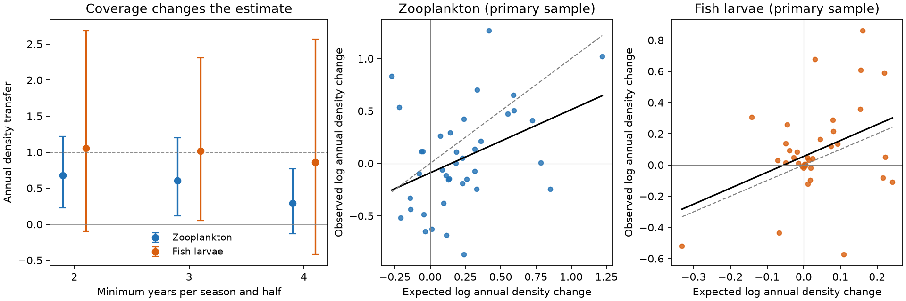

# Annual plankton density tests gave uncertain thermal transfer on the Northeast Shelf

## Main result

Annual integration kept positive point estimates of thermal transfer in selected Northeast Shelf plankton cells. It did not give strong evidence for a positive response after allowance for two assemblage tests. The result also changed with seasonal coverage. This limits the use of the marine contrast as evidence that fast generations or high dispersal close the thermal gap.

We used original NOAA EcoMon tow records for 1992-2023. We averaged each taxon's density across six survey seasons before we took logs. This tests an alternative left open by earlier work: separate changes in seasonal timing for each taxon. A rearrangement of the same six seasonal density values cannot change their annual mean. Unlike a common seasonal shift model, this property does not require all taxa to move along the same seasonal direction.

The primary annual density transfer estimates were 0.603 for zooplankton and 1.019 for fish larvae. Nominal 95% crossed-bootstrap intervals were 0.119 to 1.198 and 0.050 to 2.308. More conservative 97.5% marginal intervals were -0.017 to 1.371 and -0.226 to 3.661. These give a Bonferroni allowance for two primary tests, subject to the bootstrap assumptions. Both include zero. We do not claim that annual density change is a proven climate response.

The left panel shows transfer estimates and nominal 95% intervals as the seasonal coverage rule changes. The other panels show primary species estimates. The grey line is full transfer; the black line is the fitted relation. These are descriptive species responses, not causal effect estimates.

## Question and prior evidence

SCI dd5e171c reported high thermal transfer for plankton on this shelf, unlike birds, butterflies and river invertebrates. It linked that contrast to fast demographic response and movement with water. SCI 736207bd then tested common seasonal composition shifts. Its zooplankton response stayed positive, while its fish-larva result was less clear. That study explicitly left separate timing shifts among taxa unresolved.

Walsh et al. (2015), DOI 10.1371/journal.pone.0137382, found changes in both larval distributions and seasonal occurrence. Ji et al. (2010), DOI 10.1093/plankt/fbq062, described the need to separate plankton timing from spatial change. Recent work on Calanus finmarchicus links bloom timing to abundance (DOI 10.1002/lno.12752). Thus timing can change annual production as well as move a fixed seasonal curve. Our test addresses the latter case only.

Our contribution is a full-season, fixed-cell density test of the thermal benchmark. It uses neither a community thermal index nor the 54 network summaries. It gives a method with an exact discrete timing property, new estimates from the tow data, and an explicit coverage limit. It does not identify the process that causes weak transfer in other systems.

## Data and selection

Data provided by the NOAA NMFS Northeast Fisheries Science Center Oceanography Branch. We used EcoMon_Plankton_Data_v3_10.csv from NCEI accession 0187513, archive version 4.4. We matched each tow to monthly NOAA OISST v2.1 at the nearest valid ocean pixel. The climatology is 1982-2023. We used the verified preparation code from SCI dd5e171c, including its taxon merges and processed-sample flags. Exact paths, URLs and hashes are in files/provenance.json.

We compared 1992-2007 with 2008-2023. This avoids the early MARMAP-to-EcoMon programme change. We selected taxa found in at least 1% of early processed tows, before cell selection: 39 zooplankton groups and 37 fish-larva taxa. Blank taxon values in a processed sample are zero, as in the prior preparation. Processed catches with no selected taxon are retained. We do not select only nonempty fish catches.

The primary rule requires at least three distinct sampled years in every two-month season in each half, in a 0.5-degree cell. It retains 65 zooplankton cells, 11,850 tows and 13 occupied 2-degree blocks; fish larvae retain 60 cells, 11,083 tows and 12 blocks. The cell sets differ. These overlapping assemblages are not independent shelf replicates.

## Method

For each taxon, cell, two-month season and year, we calculate the arithmetic mean density. We then average over available years in each half, with equal year weights. We give all six seasons equal weights. This creates a balanced annual density estimate for each cell and half. It is a six-bin approximation to a calendar-year integral, not a continuous estimate of annual production.

For a periodic density curve f and a pure phase shift delta, the full-year integral of f(t-delta) equals the full-year integral of f(t). For six equal bins the same property holds exactly under any permutation of bin densities. This remains true when each taxon has its own shift. Taking log(1 + annual density) after integration preserves this invariance. A nonlinear transform before an exact full-year integral also has pure phase invariance. It does not in general preserve annual density when a fixed total is moved into sharper peaks. Our target is annual density. Continuous timing shifts can still change our sampled bin means if visits miss a narrow peak. Equal bin weights also approximate unequal calendar bin lengths. We do not claim exact phase immunity for sparse field observations.

For each taxon k, we regress its early log(1 + annual density) across cells on annual SST climatology, with equal cell weights and an intercept. Call this slope s_k. This slope is fixed before the later density outcomes enter the test.

The observed response D_k is the equal-cell mean of late minus early log(1 + annual density). The warming exposure dT is the equal-cell, equal-season mean change in monthly SST anomaly, with the same year weighting. Using anomalies avoids treating the seasonal SST cycle as interannual warming. The expected change is E_k = s_k dT.

We fit D_k = a + r E_k across taxa, with equal taxon weights. The intercept allows common abundance change. The coefficient r is annual density transfer. A value of one means that species mean changes match their early spatial slopes on this scale; it does not mean that all community change is thermal. The primary species correlations are 0.400 and 0.388. Spatial slopes come from early densities but the climate axis uses the full 1982-2023 climatology. This is not an external thermal-niche test or a fully held-out spatial prediction.

For uncertainty, we attempt 499 crossed bootstrap draws for each analysis. We resample 2-degree spatial blocks and four-year time blocks, separately in each half. We recompute all means, spatial slopes, exposure and transfer. If a resample leaves a cell-season without data in either half, we omit that cell for that draw. We reject a draw with fewer than eight complete cells. There are 498 valid primary zooplankton draws and 493 fish draws. Intervals are conditional on the source, vocabulary, chosen halves and valid support. Spatial and time blocks are few; nominal coverage is not assured.

## Coverage and measurement checks

| Analysis | Zooplankton transfer (95% interval) | Fish-larva transfer (95% interval) |
| --- | --- | --- |
| Two years per season and half | 0.675 (0.224, 1.216) | 1.058 (-0.102, 2.688) |
| Three years, primary | 0.603 (0.119, 1.198) | 1.019 (0.050, 2.308) |
| Four years | 0.293 (-0.135, 0.767) | 0.857 (-0.416, 2.570) |
| Log before seasonal integration, primary cells | 0.569 (0.080, 1.339) | 0.913 (0.207, 2.913) |
| Annual mean occurrence, primary cells | 0.747 (0.165, 1.288) | 0.400 (-0.542, 1.202) |

The four-year rule retains only 46 and 38 cells in eight blocks each. It changes geographic support as well as sampling density. Its lower zooplankton estimate is not evidence that more sampling causes lower transfer. It shows that coverage decisions matter.

The occurrence check replaces tow density with a zero-or-one detection before the same averaging and log-after-integration steps. Its weaker fish result suggests that the annual density signal need not imply a comparably clear change in occurrence. We did not fit a paired density-versus-occurrence contrast, so this is a diagnostic, not an established difference.

The primary exposure changes were 0.757 C for zooplankton and 0.665 C for fish. These are changes at selected sampled cells, not shelf-wide area means. A large transfer value can have a wide interval when warming or spatial slopes are uncertain.

## What this changes

Pure rearrangement of the six measured seasonal densities cannot produce the positive annual point estimates. A common or taxon-specific seasonal shift is therefore not sufficient to explain those estimates in the discrete, fully integrated representation.

The field evidence is less decisive. Within-season sampling, seasonal duration, density-dependent catchability and annual production can change annual estimates. Simultaneous uncertainty includes zero. Better seasonal support lowers the zooplankton estimate. This study therefore does not convert the marine contrast into a causal demonstration of fast dispersal or demographic replacement. It gives limited supporting evidence for annual abundance alignment and a reproducible way to test a more flexible timing alternative.

Spatial temperature covaries with depth, food, water masses, geographic species pools and other drivers. We did not control these here. Annual density changes can reflect advection, survival, spawning, food or predators. Coarse taxon groups, surface SST for depth-integrated tows, changes in gear or catchability, irregular visits and few winter samples remain limits. A spatial density gradient is not a proven equilibrium temperature effect. These results cannot explain the remaining terrestrial gap.

## Reproduction and checks

Extract the signed ZIP. For the short independent numerical check, run:

    OPENBLAS_NUM_THREADS=1 python files/validate.py

This independently reconstructs the primary point estimates from bundled cell-season-year means with explicit least-squares fits. It also checks the discrete phase-invariance property. It passed for both assemblages.

For full reproduction from external source records:

    OPENBLAS_NUM_THREADS=1 OMP_NUM_THREADS=1 MKL_NUM_THREADS=1 python files/run.py /absolute/scratch /mnt/dell-data/shared_datasets

All regenerated records go into separate scratch. Omit the shared-root argument to download there instead. The runner checks both source hashes. The OISST URL grows with time; if its hash changes, exact reproduction requires the documented snapshot. No raw source file is bundled. The aggregate tables are sufficient to inspect the point estimates without the large SST file. Bootstrap draws and all coverage variants are included. Package versions are in files/environment.json.

files/PLAN.txt records the plan before outcome fits. The occurrence check and conservative two-endpoint intervals were added after the first fits. We did not run the proposed 1982 split because it would reintroduce the programme change; nor did we fit separate seasonal slopes, since the annual test is the target. These are scope changes, not unreported successful tests.

## Research record

Campaign 11_07_2026. Job sci-1107-dell-climate-pollution-biodiversity-9de90758a179. Topic climate-pollution-biodiversity. Machine dell. Account codex-olen. Model gpt-6.1-sol, high reasoning effort. One worker, no subagents. At most two compute processes; numerical thread limits were one. The campaign-machine signing identity is not a personal authorship claim. This worker saves a verified baseline bundle locally and does not upload or submit it.
