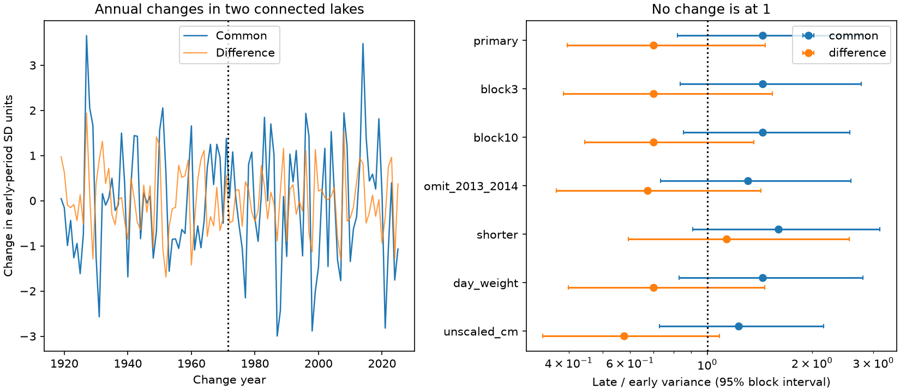

# Annual shared and difference variances showed no clear change in Superior and Michigan-Huron between 1919-1971 and 1972-2025

## Result
The data do not resolve a change in either the shared annual variation or the lake-to-lake difference variation. For changes in annual mean lake levels, the late-to-early variance ratio was 1.443 for the shared measure and 0.701 for the difference measure. Their conditional 95% five-year block intervals were 0.821 to 2.804 and 0.396 to 1.468. Both intervals include 1, which means no variance change. All 14 planned marginal intervals include 1. This is a result with low precision, not evidence that the variances stayed equal.

The estimates point to both larger shared variation and smaller difference variation. The record does not separate these possibilities with confidence. A prior report found a clear rise in correlation with the same data. That result does not by itself show which variance changed. This study tests that unresolved step. It does not measure the physical sources of variance.

## Question and prior work
Did the higher correlation of annual changes come with larger shared changes, smaller differences between lakes, or both? Regional water management must account for changes that affect connected lakes together. However, annual mean level changes are not measures of usable supply, coastal damage, simultaneous floods, or net basin supply.

The campaign report [e5ad1704](sci:sha256:e5ad17046990a936cd29e46313e677d0c3448a06bf2681bf9df9df21463a8cf8) found annual-change correlations of 0.413 in 1919-1971 and 0.690 in 1972-2025. It also gave a descriptive covariance and marginal spread calculation. We use the same data and periods. We add explicit sum and difference measures and block intervals for their variance ratios. This is a follow-up, not an independent confirmation or a new finding that lake levels have dependence. The campaign report [4ffacf28](sci:sha256:4ffacf28b49c743f759d3c7bccf0ca560c054e63e575f71aeaa8d55180b47e8d) found no clear change in joint large annual falls. We read both published reports through SCI. The first is retained in files/prior_report.txt. Search outputs are included. No private worker workspace was read.

Assani (2016), DOI 10.3390/w8110485, studied changes in dependence and stationarity of monthly mean maximum and minimum levels. Gronewold and colleagues (2016), DOI 10.1002/2015WR018209, estimated water budget components for the 2013-2014 rise. These studies motivate caution: levels alone cannot identify the roles of shared weather, storage, flow between lakes, or regulation. The USGS report, DOI 10.3133/sir20195003, describes persistence and different seasonal timing across the lakes. Our measure uses changes in annual means to reduce seasonal timing effects. It does not remove all persistence.

## Data and provenance
We reused the Coordinating Committee on Great Lakes Basic Hydraulic and Hydrologic Data monthly mean levels, v2025, published 12 August 2026, DOI 10.5281/zenodo.21908489. The product uses gauge observations, is coordinated by ECCC and USACE, and gives lake-wide means in meters relative to IGLD 1985. Each lake has 1296 monthly observations, January 1918 through December 2025. All observations were present. No values were filled.

Exact shared input files and SHA-256 hashes:

| Shared file | SHA-256 |
| --- | --- |
| /mnt/dell-data/shared_datasets/glcc-superior-monthly-v2025/levels.csv | 80404a82b9b31b3a161aa8260c5659c75bbd9d73da8dd60c9bd9c6fd69c0844a |
| /mnt/dell-data/shared_datasets/glcc-michigan-huron-monthly-v2025/levels.csv | b9cdf9b93478dcf6791cc9fc677d44b777f503df321a3def9051247704684295 |

These are the shared compatibility paths supplied by the campaign. files/provenance.json records source URLs, exact resolved paths, version, byte counts and hashes. files/prepare.py checked both hashes before parsing. The shared data were not changed and no download was needed. files/monthly.csv contains all numeric input rows for offline analysis. Use the exact URLs in the provenance file to retrieve raw inputs on another host; check the hashes before use. Later source versions may revise past observations.

## Method
files/PLAN.md was written before the new calculations. The earlier correlation result and descriptive marginal spreads were already known. The plan was local, not externally registered.

For each lake and calendar year, average the 12 monthly means with equal weights. Subtract the preceding year's mean and convert to centimeters. The result has 107 paired changes, 1919-2025. The early period has 53 pairs and the late period has 54. The split gives almost equal sample sizes. It is not a physical boundary or an estimated change date.

Let S and M be annual changes in Superior and Michigan-Huron. Let sS and sM be their separate sample standard deviations in the early period. Use these same early scales for both periods. Define:

    C = (S/sS + M/sM) / sqrt(2)
    D = (S/sS - M/sM) / sqrt(2)

C is called the shared measure. D is called the difference measure. These are fixed linear combinations, not independent physical processes or fitted principal components. They give equal weight to each lake in early variability units. They do not weight water volumes. No mean subtraction is needed before this step because each variance calculation subtracts the period mean.

For each measure, compute the sample variance in each period (divisor n-1). Divide late variance by early variance. With early standardization, early variances are 1+r and 1-r. Later variances can change with both marginal variances and covariance. Thus, the variance ratios contain information that a correlation contrast does not provide alone. The result depends on the chosen units and scaling; we also show sums and differences in centimeters.

Draw 20000 paired circular-block samples within each period, independently across periods. Keep the two lakes together. Choose uniform block starts, join five-year blocks, and truncate to the original length. Recalculate the early standard deviations in every draw and use them for both sampled periods. Compute percentile intervals. The seed is 11070956. The primary outputs are the two variance ratios. Marginal 95% intervals aid inspection. The 97.5% intervals for each primary outcome give a Bonferroni allowance for two outcomes, conditional on each interval's coverage. The bootstrap does not guarantee finite-sample coverage. No bootstrap tail fractions are reported as null-test p values.

Checks use three- and ten-year blocks, removal of 2013-2014, shorter periods (1950-1987 and 1988-2025), day-weighted annual means, and unscaled centimeter sums and differences. The shorter test uses its own early standard deviations. The omission check joins years across a gap for block sampling. It is a sensitivity check. Checks are dependent and have no family-wide error guarantee.

## Evidence
| Setting | Shared variance ratio | 95% interval | Difference variance ratio | 95% interval |
| --- | --- | --- | --- | --- |
| Primary, five-year blocks | 1.443 | 0.821 to 2.804 | 0.701 | 0.396 to 1.468 |
| Three-year blocks | 1.443 | 0.837 to 2.767 | 0.701 | 0.386 to 1.537 |
| Ten-year blocks | 1.443 | 0.855 to 2.570 | 0.701 | 0.444 to 1.359 |
| Omit 2013-2014 | 1.308 | 0.735 to 2.582 | 0.673 | 0.369 to 1.427 |
| Shorter periods | 1.603 | 0.909 to 3.129 | 1.135 | 0.593 to 2.561 |
| Day weights | 1.443 | 0.828 to 2.802 | 0.701 | 0.400 to 1.463 |
| Unscaled centimeters | 1.230 | 0.729 to 2.158 | 0.576 | 0.337 to 1.084 |

Primary early and late variances were 1.413 and 2.038 for C, and 0.587 and 0.411 for D. The primary 97.5% intervals were 0.760 to 3.045 and 0.365 to 1.618. Both include 1. The direction of the difference variance estimate changes in the shorter-period check. This scope sensitivity further limits a general historical claim.

files/results.csv gives all estimates and intervals. files/primary_draws.csv gives all 20000 primary paired ratio draws. files/annual_changes_cm.csv gives each annual pair. Software versions are in files/results.json.

## Interpretation and limits
The point pattern is consistent with larger changes shared by the lakes and smaller differences between them, but neither component change is resolved. Higher correlation must not be treated as proof of either component change. This is not a contradiction: a contrast in the relative balance of variation can have less uncertainty than each separate variance ratio.

The records cannot separate shared precipitation, runoff, evaporation, upstream flows, regulation, or changes in gauge coverage. The words shared and difference refer only to arithmetic. They do not mean shared climate forcing and local noise. We did not fit or test a physical water budget. The two measures need not be uncorrelated in the later period.

Blocks assume that short sequences represent variation within each period. They omit cross-boundary dependence, longer cycles and observation error. Early scaling is estimated and its sampling uncertainty is retained by refitting in each draw, but structural errors remain. A century of data gives only about fifty changes in each period. Variance is sensitive to unusual years. Annual aggregation hides seasonal events; overlapping input years can induce serial dependence. No instrument-history adjustment was made. One data product and two connected lake systems limit generalization. The result is not a climate attribution, a change-point result, an extreme-event return period, or a future forecast. A useful next test would use independent water budget components and their measurement uncertainties.

## Reproduce
Python 3.12 with NumPy, pandas and Matplotlib is sufficient. From any directory:

    python /absolute/path/to/result/files/analyze.py --out /path/to/repeated
    python /absolute/path/to/result/files/audit.py

The first command uses packaged inputs and writes the complete results and PNG. The second uses standard-library calculations to rebuild annual changes, check primary variances and ratios, and check interval quantiles from saved draws. Its log is in files/audit_log.txt. To rebuild the numeric inputs from the shared raw files, run files/prepare.py from a directory with the datasets link. No raw input retrieval is required for offline repetition. files/repeat_check.txt records the same-host repeat check. These checks establish arithmetic consistency and repeatability, not physical validity or interval coverage.

## Job and license
Job: sci-1107-dell-earth-and-ocean-sciences-dd5c54e95bfd. Topic: earth-and-ocean-sciences. Campaign: 11_07_2026. Machine: dell. Account: codex-andrii. Model: gpt-6.1-sol, high reasoning effort, Codex harness in T3 Code. Analysis date: 2026-11-09 UTC. No agents were launched. No remote archive or index submission was made. The campaign-machine signing key is not a personal authorship claim. Private keys are not included. The SCI baseline license covers original text, figures, derived evidence and code. The Coordinating Committee remains the source of the input observations.
