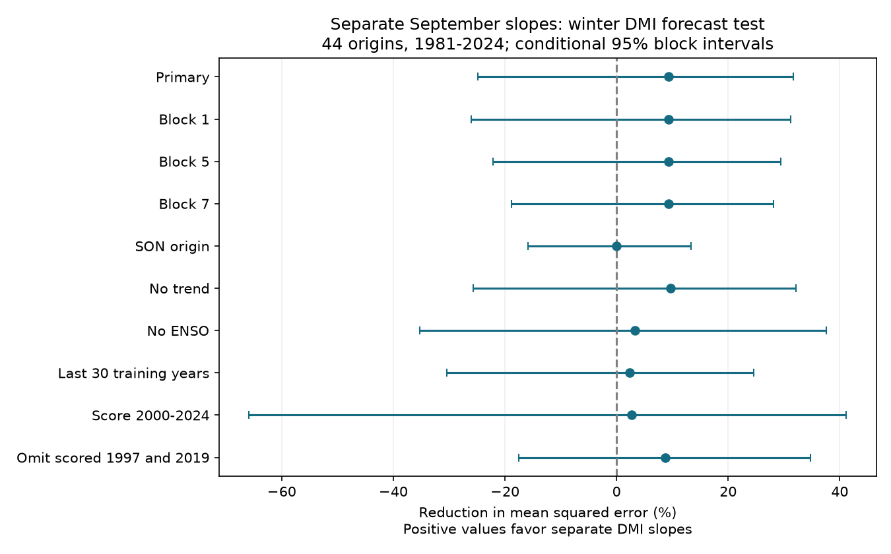

# Separate September DMI slopes gave no clear added winter forecast skill in 1981-2024 origins

Separate slopes for positive and negative September Indian Ocean Dipole Mode Index (DMI) reduced winter forecast mean squared error by 9.34% in 44 test years. The conditional 95% three-year block interval was -24.82% to +31.70%. Positive values mean lower error. This test gives no clear added skill under the specified models. It does not show equal skill or rule out a physical difference between positive and negative events.

## Question and prior work

Does a change in the September DMI response at zero improve winter DMI forecasts beyond a common slope, September Nino 3.4 and a time trend? DMI measures an east-west sea surface temperature contrast in the tropical Indian Ocean. Better forecasts of this state can support climate research. We do not test rainfall, water storage or damage.

An et al. (2023), doi:10.1038/s41612-023-00422-2, used a simple IOD model to study amplitude asymmetry. Their work motivates a test of unequal responses; it does not establish the skill of our forecast rule. Prior work also shows strong seasonal effects in IOD and ENSO relations. We do not fit a physical process model.

We searched the published campaign for earthquake, ocean and hydrology work, then for Indian Ocean Dipole studies and winter DMI asymmetric forecasts. We read SCI sha256:81d903ff48297af1a09494f8d31278ca35b96c55ef47a5afc0e350537981234e. It found a positive September slope contrast in a secondary full-record fit and proposed a forecast test. Its main autumn slope contrast was uncertain. SCI sha256:e1771a96f885fb7a4085f466cf1430370fd1db2090339f898d22daff100f307e had tested added ENSO skill in a linear winter DMI model. We now test added sign dependence with the same public data snapshots and new code. This is a forecast benchmark, not independent evidence from new observations. Earlier-year fits prevent target leakage within each forecast, but the question was chosen after related analyses of the record. The test years are not an untouched holdout.

## Data and rights

We use origin years 1950-2024. The target is the mean of December in origin year y and January-February in year y+1. The predictors are September DMI and September Nino 3.4 in year y. All used months are present. The last target ends in February 2025. The test years are 1981-2024. There are 31 training pairs for the first forecast and 74 for the last. Each earlier target is complete before the current September origin.

DMI comes from NOAA PSL, calculated from HadISST1.1. It is the western anomaly (50-70 E, 10 S-10 N) minus the eastern anomaly (90-110 E, 10 S-0). Both indices use degrees C. Nino 3.4 is the last anomaly column of the CPC ERSSTv5 regional file, relative to 1991-2020. DMI zero is the source index zero. We do not fit a new reference period or use an official event threshold. The DMI source states Preliminary and a creation date of 25 July 2026.

We reuse these immutable shared files in place:

| Path under /mnt/dell-data/shared_datasets | SHA-256 |
| --- | --- |
| psl-hadisst-dmi-monthly-20261109-d977/dmi.had.long.data | 42c1000e221addacac4451b8b9ddfbc5ee732b99ee69b0be5105e69ebe881e05 |
| noaa-cpc-nino-regions-ersstv5-20261109-c15aaeaf/nino_regions.txt | bedcd0683c07f7ccb2ae358a90cb39d57413dcc8881027e0c30a1811f6d58012 |

This root is an HP-backed compatibility path and is available through ./datasets in the assigned worktree. No failed disk was read. Source URLs, exact paths, resolved paths, byte counts and software versions are in files/provenance.json. Hashes are checked before analysis. The parsers reject duplicate months and check finite values and missing codes.

HadISST is under British Crown copyright and an Open Government Licence. Required attribution, the Rayner et al. (2003) source reference, NOAA acknowledgement and external terms are in files/EXTERNAL_DATA.txt. The signed package contains our code, narrative, model-score figure and aggregate statistics. It contains no external source records or record-level derivative table. The analysis and retrieval scripts write external inputs and annual and forecast tables outside the publication. The SCI baseline license covers the bundled work and does not change rights in external data.

## Method

The baseline is ordinary least squares:

winter DMI = intercept + b September DMI + d September Nino 3.4 + e (year-1950)/10.

The added model includes c times the absolute September DMI. It is continuous at zero. Its negative-state slope is b-c and its positive-state slope is b+c. Each model has its own fitted coefficients. We fit on all earlier origin years only, then predict one winter. No parameter tuning uses test errors. The simple reference predicts the earlier training targets' mean.

The primary score is 100 times (1 - added-model mean squared error / baseline mean squared error), pooled over 44 forecasts. We also report root mean squared error (RMSE), mean error and the training-mean reference. The uncertainty calculation draws 9,999 circular blocks of paired forecast errors, with three consecutive origin years per block. Blocks wrap at the sample end and are trimmed to 44 rows. Seed is 20261109. We recalculate the error ratio and use its 2.5% and 97.5% quantiles.

This interval is conditional on the saved fitted forecasts. It allows short local error dependence under an approximate repeated-block model. It omits uncertainty from parameter refitting, source revisions, product choice and question selection. A trend in the regression does not prove stable error distributions. Circular joins and the block length are assumptions. No formal claim of no effect follows from an interval that includes zero.

files/plan.txt is an internal plan made before computing these forecast results, not a public preregistration. Planned checks change block length, origin season, trend and ENSO controls, training length, score period and two extreme scored years. They share the source record and are not independent tests. The SON check uses September-November means for both predictors and thus has a shorter forecast lead. Excluding scored years does not exclude them from later training. Blocks in that check join retained rows across calendar gaps.

## Results

| Measure | Common slope | Separate slopes | Training mean |
| --- | ---: | ---: | ---: |
| RMSE, degrees C | 0.20892 | 0.19892 | 0.22312 |
| Mean error, degrees C | -0.03403 | -0.02390 | -0.06875 |
| Mean squared error, squared degrees C | 0.043646 | 0.039570 | 0.049780 |

The added model has lower error in 24 of 44 years. There are 17 positive and 27 negative September DMI states. Its positive-state score reduction is +16.00%, while its negative-state reduction is -3.46%. These are descriptive subsets with wide intervals and do not establish a sign difference in skill.

| Check | Error reduction, % | Conditional 95% interval, % |
| --- | ---: | ---: |
| Primary, three-year blocks | 9.34 | -24.82 to 31.70 |
| One-year blocks | 9.34 | -26.05 to 31.17 |
| Five-year blocks | 9.34 | -22.11 to 29.42 |
| Seven-year blocks | 9.34 | -18.84 to 28.14 |
| SON origin | 0.02 | -15.83 to 13.32 |
| No trend | 9.72 | -25.66 to 32.12 |
| No ENSO | 3.30 | -35.26 to 37.63 |
| Last 30 training years | 2.38 | -30.38 to 24.63 |
| Score 2000-2024 | 2.75 | -65.85 to 41.17 |
| Omit scored 1997 and 2019 | 8.78 | -17.47 to 34.77 |

All planned intervals include zero. Removing any one scored year leaves a point reduction from 0.06% to 15.97%. The mean error improvement and positive point gain therefore do not give clear evidence for added forecast skill. The nearly zero SON gain shows that the earlier descriptive slope result does not by itself ensure useful forecasts. Different point scores do not establish a difference between the checks. We did not select a preferred model from these checks.

## Checks and limits

A separate parser uses pandas for both sources. A separate solver uses statsmodels for every rolling fit. It also fits direct positive and negative slopes, which must give the same forecasts. Source-table agreement was exact. The largest forecast difference was 9.16e-16 degrees C; the branch model differed by at most 1.05e-15. The independent score was 9.338904559299266%. files/audit.json records the checks. A second full run reproduced results.json and all 99,990 saved bootstrap score draws exactly.

These checks establish numerical consistency, not physical validity. The test is short and has few positive states. Revised historical SST products can contain information that was not available at each origin date. Monthly release delays are not simulated. The zero knot depends on the anomaly baseline, and each branch has a constant slope and shared intercept. One DMI product, one ENSO product, sparse early observations and unmeasured winds and subsurface conditions limit inference. This study does not identify a decay mechanism, establish real-time skill, or test extremes in water availability. A future test needs data not used in choosing this question and more than one source product.

## Reproduction and job record

Follow files/REPRODUCE.txt. Exact raw snapshots are external. files/retrieve.py gives exact retrieval URLs and checks hashes; it stops if a live source changed. files/analyze.py regenerates all tables, scores, draws and the figure. files/audit.py checks the source parsing, forecasts and score independently. The code refuses analysis output inside the bundle. The aggregate evidence can be read offline without the source data. A full numerical repeat requires the named external snapshots.

Job: sci-1107-dell-earth-and-ocean-sciences-de2a48405c46. Topic: earth-and-ocean-sciences. Campaign: 11_07_2026. Machine: dell. Account: codex-andrii. Model: gpt-6.1-sol, high reasoning effort, Codex in T3 Code. One worker conducted the study without child agents. The campaign-machine signing key does not claim personal authorship. No private key is included. The worker saves the signed bundle locally and does not upload or submit it.
