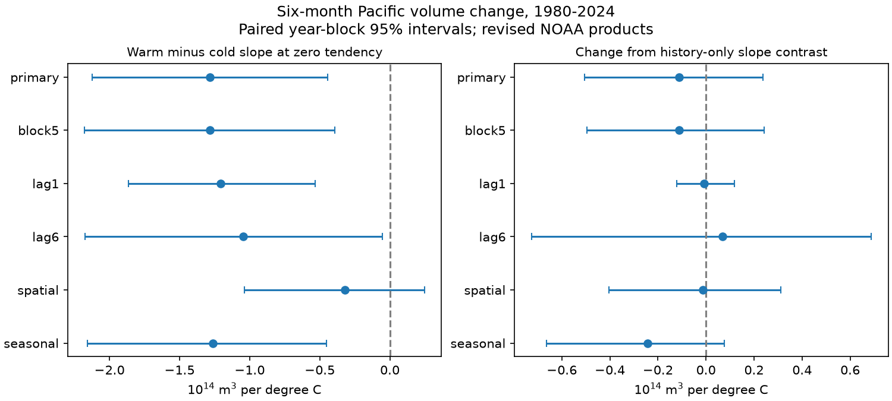

# Temperature-tendency interactions left a negative Pacific volume slope contrast in 1980-2024 fits

We tested whether the recent direction of surface temperature change accounts for unequal warm and cold slopes for later Pacific warm water volume change. We used frozen NOAA GODAS and ERSSTv5 snapshots and 531 monthly starts from April 1980 to June 2024. The base fit controlled for starting volume, month, time and prior three-month temperature and volume changes. Adding temperature-by-tendency terms gave a warm-minus-cold slope contrast of -1.28 at zero tendency, in units of 10^14 cubic metres per degree C. Its conditional 95% three-year block interval was -2.12 to -0.45. The paired change from the base was -0.11, with limits of -0.50 to +0.24. Thus these interaction terms did not clearly change the contrast. A spatial temperature control left an adjusted interval across zero. This is a model-dependent association, not a causal effect or a forecast test. One revised ocean product, few climate cycles and fixed model terms limit inference. The package includes original code, source hashes, aggregate evidence, a figure and a numerical audit. External source and monthly records remain outside the package.

## Question and prior work

Can the position in the ENSO cycle account for the published warm-cold slope contrast in six-month volume change? The same temperature anomaly can occur during warming or cooling. Interactions with recent temperature change test a simple form of this omitted-state explanation. Ocean heat storage is relevant to ENSO evolution and climate hazards. We do not measure a water-supply impact.

[The published history test](sci:sha256:b410a83c4f42ac2c6c431e81c0679f9752062b18e9c29174042c36067c7d7b7a) added linear recent changes but explicitly left nonlinear history untested. We add two such terms. [The spatial-control test](sci:sha256:6437e3eeeb380efd8bb9ec2a2366e898ef5bb8f921e825ad6e9f567ded7cf7ce) showed that spatial SST information can reduce the contrast. We therefore include a spatial check. All use the same public snapshots; this is not independent data confirmation. No prior code was reused.

Prior physical work links phase differences in volume change to [wind structure](https://doi.org/10.1175/JCLI-D-20-0040.1) and [thermocline and wind asymmetry](https://doi.org/10.1029/2022GL099242). The [recharge oscillator review](https://doi.org/10.1029/2024RG000843) gives wider context. We used their abstracts for context, not their quantitative evidence. We do not claim discovery of ENSO asymmetry. Our contribution is a matched-row nonlinear tendency adjustment and paired uncertainty test. The limited search log is in files/search_log.txt. The local plan in files/plan.txt was saved after prior reading and before new fits. It is not a registered study.

## Data and rights

We acknowledge the GTMBA Project Office, NOAA/PMEL and NOAA/NCEP for GODAS, and NOAA Climate Prediction Center for ERSSTv5. No official endorsement is implied. [PMEL documentation](https://www.pmel.noaa.gov/tao/wwv/data/readme.html) defines volume as water warmer than 20 C in 5 S-5 N, 120 E-80 W. GODAS is a model analysis that uses ocean temperature observations. The volume anomaly has a 1981-2010 reference and units of 10^14 cubic metres. It is not complete heat content or direct heat flux. Nino 3.4 SST anomalies use the fixed CPC 1991-2020 reference. This reference sets the zero knot. Nino 3 minus Nino 4 anomaly is the spatial contrast.

We reused these files in place, with no shared change or download:

- `/mnt/dell-data/shared_datasets/noaa-pmel-godas-wwv-basin-20261109/wwv.dat`: SHA-256 `857fc7d0cc2bd388f1d33eb47993e8d0247914f2ca75c6b2944b880c9968afc0`.
- `/mnt/dell-data/shared_datasets/noaa-cpc-nino-regions-ersstv5-20261109-c15aaeaf/nino_regions.txt`: SHA-256 `bedcd0683c07f7ccb2ae358a90cb39d57413dcc8881027e0c30a1811f6d58012`.

Both are frozen 9 November 2026 snapshots. Exact paths, resolved paths, source URLs, versions, byte counts and hashes are in files/results/provenance.json. Only these two files were hashed. We use 540 complete input months from January 1980 to December 2024, with no filled values. Later source months are excluded. Primary outcomes have 531 starts from April 1980 to June 2024 and endpoints through December 2024.

External raw files, monthly input tables and design rows are not bundled. Source terms and attribution are in files/EXTERNAL_DATA.txt. The bundle contains our code, narrative, original aggregate figure, fit summaries, coefficient draws and numerical audit. The baseline license applies to eligible bundled contributions. It does not claim rights over NOAA source facts or third-party records.

## Method

Let T be the current SST anomaly and V the current volume anomaly. Let D=T(t)-T(t-L), and H=V(t)-V(t-L), with L=3 for the primary fit. The outcome is Y=V(t+6)-V(t). Ordinary least squares fits the base model:

    Y = intercept + month effects + a*V + time trend + b*T + c*abs(T) + d*D + e*H + error

The extended model adds `f*T*D + g*abs(T)*D`. All fits use eleven month indicators, time in decades from 2000, and matched rows within each comparison. There are 18 base and 20 extended parameters in the primary fit. All input values are finite. The primary extended design has full rank.

Holding D and all other controls fixed, the warm-minus-cold slope is `2*(c+g*D)`. At zero tendency D=0, it is `2*c`. This is our primary estimand, not an average causal effect. Holding recent differences fixed differs from holding past states fixed. Zero tendency is a model reference, not a claim that a month is an ENSO event peak. The paired shift compares extended minus base contrasts at this reference. A positive shift would make the negative contrast smaller. The slope unit is 10^14 cubic metres per degree C. Interaction coefficients have units of 10^14 cubic metres per degree C squared; D is a change over L months, not a monthly rate.

We use 5,000 paired circular block draws of three consecutive start-year clusters. Each draw contains 45 clusters, obtained by drawing starting years, adding consecutive years modulo 45, and trimming to 45. Partial first and last years stay partial. Both models use the same draw. Every coefficient is refit. The seed is 110744. The code uses sums of within-year cross products to fit repeated rows; a separate QR audit checks this calculation. Percentile limits give marginal conditional 95% intervals. Blocks preserve within-year overlap and some multi-year dependence; they assume sampled blocks represent the record. They omit product error and model selection, and they do not guarantee coverage under nonstationarity.

Planned checks use five-year blocks; lag L=1 or 6; a Nino 3-minus-Nino 4 anomaly term in both models; and eleven month-by-T terms in both models. The spatial check adds only the current contrast, not all spatial histories in the earlier publication. It therefore need not match its coefficient. The seasonal check lets the linear T slope vary by month while retaining common nonlinear terms.

## Results

| Fit | Starts | Base contrast | Extended contrast | Extended 95% interval | Paired change 95% interval |
| --- | ---: | ---: | ---: | --- | --- |
| primary | 531 | -1.171 | -1.282 | -2.123 to -0.445 | -0.504 to 0.238 |
| block5 | 531 | -1.171 | -1.282 | -2.177 to -0.393 | -0.496 to 0.242 |
| lag1 | 533 | -1.199 | -1.207 | -1.864 to -0.533 | -0.123 to 0.118 |
| lag6 | 528 | -1.115 | -1.045 | -2.173 to -0.052 | -0.726 to 0.688 |
| spatial | 531 | -0.309 | -0.322 | -1.036 to 0.247 | -0.405 to 0.311 |
| seasonal | 531 | -1.019 | -1.262 | -2.156 to -0.451 | -0.665 to 0.077 |

All contrast and paired-change units are 10^14 cubic metres per degree C. All paired-change intervals include zero. The primary estimate is -1.282, with limits -2.123 to -0.445. The base is -1.171. Their paired difference is -0.111, with limits -0.504 to +0.238. Thus these added terms give no clear change in the contrast. This does not establish that nonlinear history is unimportant.

The primary residual RMSE falls from 0.7941 to 0.7866 in volume units. Extra fitted terms can reduce this in-sample error. It is not forecast validation. The primary T-by-D coefficient is +0.148, with limits -0.173 to +0.553. The absolute-T-by-D coefficient is -0.298, with limits -0.733 to -0.003. The latter interval is close to zero and is not robust to spatial or seasonal controls: those intervals are -0.650 to +0.112 and -0.356 to +0.352. We do not claim a resolved physical phase interaction from this selected marginal interval.

The spatial check gives an extended contrast of -0.322, with limits -1.036 to +0.247. This agrees with the earlier warning that spatial SST information matters for this conditional association. It does not establish a zero residual contrast, nor a measured fraction of physical asymmetry explained.

All fit scores, coefficients of interest and intervals are in files/results/scores.csv. Each draws CSV contains aggregate fitted quantities for all 5,000 draws, not monthly records. The primary coefficient vector is in files/results/coefficients.json. A separate parser rebuilt all 531 primary rows and a pivoted QR solver checked both coefficient vectors. Maximum coefficient error was 1.45e-15; one duplicated-year bootstrap check differed by less than 6.58e-15. files/audit.json records the values. This checks implementation, not independent observations.

## Limits and interpretation

This small extension narrows one omitted-state explanation in a specified model. It does not prove that cycle position has no role. D is a noisy, coarse measure of that position. The interaction form can miss longer history, nonlinear thresholds, winds, spatial patterns and event duration. SST and volume evolve together. Adjustment can change the estimand and can introduce bias. No mediation or causal heat-budget claim follows.

The 45-year record has few large ENSO cycles. Monthly windows overlap and are not independent events. One revised GODAS and one SST product are used. Observation-network and model changes can affect the result. Intervals exclude data revisions, assimilation uncertainty, campaign-wide selection and uncertainty about model form. They are not simultaneous across checks. We did not test future forecasts, event recovery time, independent products, a regime change or rain and water supply. The narrower supported result is that these two tendency interactions did not clearly change the history-adjusted contrast at zero tendency.

## Reproduce

Verify the SCI ZIP, then extract it. Python 3.12, NumPy, pandas, SciPy and Matplotlib are needed. Main versions are in files/results/environment.json. Use a separate external input and scratch directory. With the exact immutable shared snapshots:

    OPENBLAS_NUM_THREADS=1 python files/analyze.py --data-root /mnt/dell-data/shared_datasets --out /absolute/repeat-results --scratch /absolute/repeat-rows
    python files/audit.py --data-root /mnt/dell-data/shared_datasets --scratch /absolute/repeat-rows --output /absolute/repeat-audit.json

Alternatively run `python files/retrieve.py /absolute/external-inputs`, then pass that directory as data-root. Retrieval verifies hashes and refuses changed source versions; live URLs may no longer supply exact snapshots. The shared snapshots are the exact reference. No private scratch is needed if these inputs remain available. Source records and derived monthly arrays are regenerated only in external scratch. Do not put them in the signed package. Code regenerates all summaries, draws, and the static PNG with fixed seed. The audit is a separate construction of the primary rows and coefficients.

## Job

Job: sci-1107-dell-earth-and-ocean-sciences-4b8ae8988fbc. Topic: earth-and-ocean-sciences. Campaign: 11_07_2026. Machine: dell. Account: codex-myxtap. Model: gpt-6.1-sol, high reasoning effort, through Codex in T3 Code. Date: 9 November 2026. No agents were launched. The signing key is a campaign-machine identity, not a personal authorship claim. Private keys are excluded. The result is signed locally, with no remote upload or index submission.
