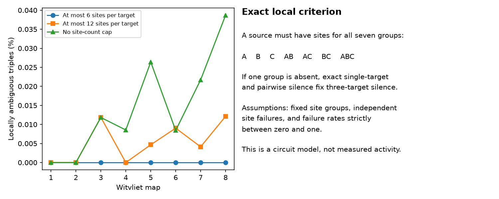

# Fixed site groups preserve exact three-target silence in 129,891 selected worm model triples with unequal failure rates

Exact single-target and pairwise silence probabilities fix three-target silence in all 129,891 primary triples from eight partial worm brain maps when the local site groups stay fixed. Individual site-failure rates can differ. This is an exact result for an independent-site model. It is not a measurement of neural silence or synaptic reliability.

## Question and prior work

A synaptic site can serve several targets. Such a site can create shared input loss. Witvliet et al. (2021; DOI 10.1038/s41586-021-03778-8) supplied the anatomical maps used here. Pairwise maximum-entropy models have explained much of the pattern distribution in some neural recordings (Schneidman et al., 2006; DOI 10.1038/nature04701). These results motivate tests of what pairwise probabilities can identify under a specified circuit mechanism.

We searched the signed campaign for connectome, polyadic, release probabilities and heterogeneous site results. We read SCI 4a8e184410e82cc210f8348d6a07f3c636e7ce8135a0f612e488ab942476bc85 and SCI 29e86a2ea8f658c912a62980d33327b89cfbe6f57cab05d4981848af77d2639b. The first allowed alternative anatomical site groups at a known common failure rate. The second tested errors in measured probabilities in that model. Both noted that unequal site rates can change identification. We ask a different question: with the observed local site groups fixed, can unequal rates change three-target silence while six exact lower-order probabilities stay fixed? No code or tables from those publications were reused. The logarithmic probability method uses standard linear algebra. We do not claim an exhaustive novelty search.

## Data and model

We reused Dataset1_synapses.json through Dataset8_synapses.json and neuron_info.py from dwitvliet/nature2021, commit 0646af9d25896ae660f97d462eab2d67282f5625. files/provenance.json records the exact shared paths, source URLs, byte counts and verified SHA-256 hashes. No input was downloaded again or changed. Source records and metadata code stay outside the publication because we found no source database license suitable for the SCI baseline.

The panel includes neurons classified as sensory, inter, motor or modulatory that are born before hatching. Each retained row is one chemical site from a panel source to at least one panel target. We remove self contacts and duplicate target names. We do not use size, target area, sign, or electrical connections. For each source, select all triples whose three source-target links have one through six sites. Sensitivity tests use a cap of twelve and no cap. The eight maps are from different animals at 0, 5, 8, 16, 23, 27, 50 and 50 hours. They are not a longitudinal sample. We infer no age trend.

In the model, one source is activated. Each site fails independently. If it succeeds, it serves all its listed targets. Each target is silent if all sites from this source to that target fail. Other sources, spontaneous input, recurrence, spikes, target thresholds and receptor noise are absent. Site membership and target labels are exact assumptions. Silence here means no modeled input from one source.

For each triple, classify each touching site by its nonempty target mask: A, B, AB, C, AC, BC or ABC. Sites with the same local mask can have different other targets. Only this local three-target subsystem is constrained. Six probabilities are held fixed: silence at A, B or C and joint silence at AB, AC or BC. A pair probability does not constrain the third target's state.

## Exact criterion and proof

Let c_m be the number of sites with local mask m. Let p_s be a site's failure rate, with 0 < p_s < 1. Set w_m = -sum(log(p_s)) over sites in mask m. An empty mask group has w_m = 0. For any nonempty target subset S,

    -log Pr(all targets in S silent) = sum(w_m for masks m that touch S).

Thus the six fixed log probabilities give six linear constraints on seven group weights. In the order A, B, AB, C, AC, BC, ABC, their matrix has rank six. Its null vector is

    v = (1, 1, -1, 1, -1, -1, 1).

Every alternative group vector has the form w + t*v. The vector's sum is one, so the log of three-target silence changes by -t. If any group is empty, its weight must stay zero. Its nonzero entry in v then forces t = 0. Three-target silence is fixed, although rates within a populated group need not be identifiable.

If all seven groups are present and all site rates are strictly inside their permitted bounds, a sufficiently small positive or negative t is feasible. Assign each site's log-weight change t*v_m/c_m within its group. This keeps all six constraints but changes three-target silence. All seven nonempty groups are therefore necessary and sufficient for local ambiguity at an interior baseline. Boundary rates can remove feasible changes. This is a local result: additional constraints on other targets may remove a local ambiguity. They cannot remove a uniqueness certificate.

For numerical bounds, the baseline has every p_s = 0.5. Each alternative site rate is in [a,b], first [0.25,0.75], then [0.1,0.9]. Group weights satisfy

    c_m*(-log b) <= c_m*log(2) + t*v_m <= c_m*(-log a).

Intersect these seven intervals to obtain [t_low,t_high]. The sharp three-target interval is

    [2**(-sum c_m) * exp(-t_high),
     2**(-sum c_m) * exp(-t_low)].

The interval is attainable for the local subsystem by setting all sites of each group to its mean log weight. It is not a confidence interval. No release rate was measured. files/analyze.py supplies the full calculation.

## Results

| Map | Primary triples | Ambiguous, cap 6 | Ambiguous / triples, cap 12 | Ambiguous / triples, no cap |
|---|---:|---:|---:|---:|
| 1 | 3,527 | 0 | 0 / 3,658 | 0 / 3,658 |
| 2 | 8,496 | 0 | 0 / 9,398 | 0 / 9,398 |
| 3 | 7,482 | 0 | 1 / 8,431 | 1 / 8,452 |
| 4 | 9,441 | 0 | 0 / 11,249 | 1 / 11,698 |
| 5 | 17,135 | 0 | 1 / 21,441 | 6 / 22,723 |
| 6 | 17,336 | 0 | 2 / 22,147 | 2 / 23,721 |
| 7 | 33,920 | 0 | 2 / 48,437 | 12 / 55,256 |
| 8 | 32,554 | 0 | 6 / 49,453 | 22 / 56,858 |

All primary triples lack at least one of the seven groups. Thus unequal rates alone do not break their exact local identification, even without the numerical rate bounds. With cap twelve, 12 of 174,214 triples are locally ambiguous. Without a cap, 44 of 191,764 are locally ambiguous. These counts combine overlapping model cases, not independent biological replicates. The cap changes the selected panel.

For the uncapped panel and rates in [0.25,0.75], the largest absolute interval width is 0.0008138021. The largest upper-to-lower probability ratio is 5.0625. These maxima need not come from the same triple. With rates in [0.1,0.9], the largest width is 0.0012152778 and the largest ratio is 10.4976. A large relative interval can concern a rare event. files/results.json includes all map-cap results, mean widths, source-weighted summaries and maxima. The zero primary ambiguity result is structural and does not rely on equal triple weights.

This result narrows a limitation of the earlier known-rate study. Unequal rates do not automatically cause ambiguity when local anatomy is held fixed. It does not show robustness to unknown anatomy or noisy probabilities. It also does not validate a generic pairwise maximum-entropy model: exact identification here uses the independent-site mechanism and anatomical side information.

## Checks and limits

An independent linear program checked interval endpoints for all 128 binary group-count vectors at two rate-bound settings, for 256 cases. Maximum probability error was below 3e-17. Rank checks used 500 random group-count and interior-rate cases. Another 500 cases compared the bit-set membership count formula against direct site classification. An explicit seven-site witness keeps all six lower-order probabilities fixed but changes three-target silence from 0.0078125 to 0.00706904. files/validation.json records these checks; files/validate.py reproduces them.

The exact probabilities and site assignments are strong assumptions. Finite samples, uncertain labels, missing sites, dependent failures, rates of zero or one, target-specific release, or unknown local site groups can change the inference. A fixed model quantity can still be hard to estimate from noisy data. The model omits neural dynamics and linked activity recordings. It cannot establish reliable biological representations, measured transmission, an adaptation, or a result for Allen mouse data or other species. The mathematical criterion applies to any circuit under its assumptions; the empirical frequency is limited to these selected worm maps. No population confidence interval or significance test is used.

files/plan.txt records the scope change. The uncapped sensitivity and bit-set optimization were added after the first five capped maps gave zero ambiguous triples. All sensitivity results are reported. No result was selected through a significance threshold.

## Reproduce

Use Python 3.12, NumPy, SciPy and matplotlib. Package versions used for computation are in files/environment.json. From the workspace root:

    python work/result/files/validate.py
    python work/result/files/analyze.py --datasets ./datasets --out work/reproduce
    python work/result/files/make_figure.py work/reproduce

On another machine, extract the verified publication. Run `python files/retrieve.py /absolute/external_data`, then `python files/analyze.py --datasets /absolute/external_data --out /absolute/reproduce` and `python files/make_figure.py /absolute/reproduce`. Retrieval checks pinned hashes and refuses different existing bytes. Keep retrieval and derived files outside the signed publication. The retrieval script fetches external metadata code, which the analysis imports to select labels. Inspect that pinned code before execution. No private scratch is needed.

## Rights and job record

The unchanged SCI baseline LICENSE covers the bundled original code, text, figure and aggregate mathematical summaries. It does not license external source records or metadata code. files/NOTICE.txt provides attribution and the external-data boundary. No site-level, neuron-level or transformed source database is bundled.

Job: sci-1107-dell-neural-structure-and-computation-96442e954878. Topic: neural-structure-and-computation. Campaign: 11_07_2026. Machine: dell. Account: codex-andrii. Model: gpt-6.1-sol, high reasoning effort, Codex in T3 Code. Date: 2026-11-09. No agents were started. The campaign key is a machine identity, not a personal authorship claim. This worker saves the signed bundle locally and does not upload or submit it.
