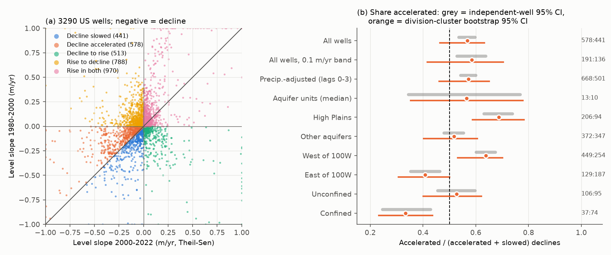
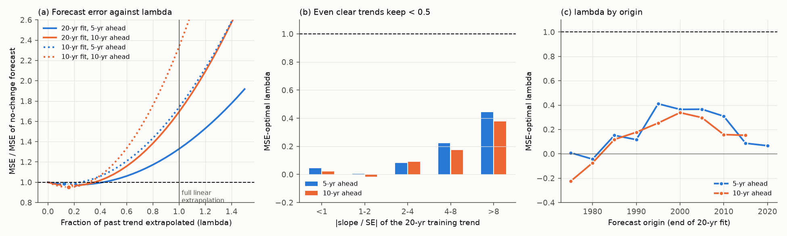
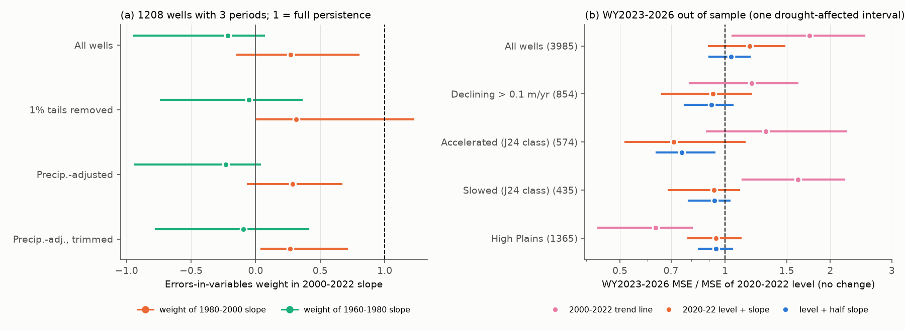

# Past trends of US well levels did not persist: extrapolation raised 5-10-year forecast error by 33-134% over no change, and the post-2000 decline-acceleration excess was regionally uncertain

## Summary

Jasechko et al. (2024, "J24") compared groundwater-level trends in 1980-2000 and 2000-2022 in 1,693 aquifer systems. They reported that declines accelerated in 30% of 542 testable systems, and that accelerating declines outnumbered slowing declines (163 to 107, sign test P < 0.001). Many groundwater assessments also extrapolate a past linear trend into the future (for example, "years until depletion"). Both uses assume that a trend measured over 10-20 years continues.

We tested this assumption with water-year median levels of the long-record US wells in a previous campaign bundle (USGS field measurements, parameter 72019; wells with records from before 1976 to after 2022). We did four tests: (1) a replication of the J24 acceleration count in US wells with a climate-division cluster bootstrap; (2) a precipitation check; (3) rolling-origin forecasts that extrapolate a fraction lambda of the past 10- or 20-year trend, origins 1975-2020; (4) an errors-in-variables test of slope persistence across 1960-1980, 1980-2000 and 2000-2022, and a check of 2023-2026 levels. We wrote the plan (`files/PLAN.md`) before we calculated any trend statistic.

Main results:

1. **Linear trend extrapolation gave larger errors than no change.** In 27,190 forecasts from 4,479 wells, a full extrapolation of the 20-year OLS trend increased the mean squared error (MSE) by 33% at 5 years (cluster 95% CI 14-43%) and by 69% at 10 years (36-89%), relative to the mean level of the last 3 years. With 10-year fits, the increase was 74% and 134%. The MSE-optimal fraction of the trend was lambda* = 0.21 (95% CI 0.07-0.35) at 5 years and 0.18 (0.06-0.29) at 10 years. Even for the clearest trends (|slope/SE| > 8, 2,377 cases), lambda* was only 0.44 and 0.38. The best damped forecast decreased the MSE by only 2.5-5% relative to no change. When we selected lambda only from earlier origins, the gain disappeared (MSE ratio 0.98 and 1.03). Mean absolute errors gave the same result (lambda* 0.2-0.4; full extrapolation +8% to +41%).
2. **Slopes kept about one third of their value in the next period.** In 1,208 wells with data in all three periods, the errors-in-variables persistence of the 1980-2000 slope into 2000-2022 was 0.33 (95% CI 0.07-0.66). With both earlier slopes as predictors, the weights were 0.27 (1980-2000; CI -0.14 to 0.80) and -0.22 (1960-1980; CI -0.94 to 0.07). Thus an acceleration did not continue as a new rate: the slopes returned toward the network mean, not toward the older slope of the same well. Precipitation adjustment and removal of the 1% slope tails did not change this (0.27-0.33). The estimator recovered known weights in synthetic wells with the observed noise.
3. **The J24 acceleration excess is present in US wells but is not robust to regional clustering.** Of 3,290 wells (150 climate divisions) with data in both J24 periods, 578 (17.6%) had accelerating declines and 441 (13.4%) had slowing declines. The share 0.567 has an independent-well binomial P of 1e-5, but the division-cluster bootstrap 95% CI is 0.46-0.63 (10% of resamples at or below 0.5). The 0.1 m/yr band, OLS slopes, precipitation-adjusted levels and aquifer-unit medians gave shares of 0.56-0.58 with CIs that include 0.5. High Plains wells had a clear excess (206:94, share 0.69, CI 0.59-0.78), and wells west of 100 W had 0.64 (0.53-0.70). Wells east of 100 W (0.41, 0.31-0.50) and confined wells (0.33, 0.23-0.44) had more slowing than accelerating declines.
4. **The J24 precipitation statistic is mostly a base rate in US wells.** Of the accelerating wells, 83% had lower division precipitation in 2000-2022 than in 1980-2000 (J24: more than 80% of systems). But 68% of slowing wells and 60% of all eligible wells also had lower precipitation. The precipitation change did have an effect: the slope change increased by 0.12 m/yr per SD of precipitation change (CI 0.04-0.20), and the acceleration share was 0.62 where precipitation decreased and 0.41 where it increased.
5. **2023-2026 levels: one drought-affected interval.** For 3,985 wells, the 2000-2022 Theil-Sen trend line gave a 74% larger MSE than the 2020-2022 level (CI 5-150%). The 2020-2022 level plus the full 2000-2022 slope gave +18% (CI -10% to +48%), and the level plus half the slope gave +4% (CI -10% to +18%). In the 574 J24-accelerating wells, levels continued to fall: the median 2022-2026 rate was -0.20 m/yr against a 2000-2022 slope of -0.16 m/yr, and the level plus half the slope had the lowest error (MSE ratio 0.75, CI 0.64-0.93). But a network-wide fall of 0.46 m (median within-well change) occurred in 2021-2023, a drought. After precipitation adjustment, the accelerating wells fell at only 0.45 (CI 0.35-0.78) of their 2000-2022 rate. Thus these 4 years do not give an independent test of persistence.

Conclusion: in long-record US wells, a 10-20-year level trend is a poor predictor of the next 5-10 years. A forecast that extrapolates approximately one fifth of the trend is about as good as possible with this information, and a no-change forecast is almost as good. Reports of "accelerating declines" between two periods are expected to partly reverse, and their count needs a test that includes regional correlation. The High Plains is the clearest exception, with more persistent declines (lambda* 0.36-0.37 at 5-10 years with 20-year fits).

*Figure 1. (a) Theil-Sen level slopes of 3,290 US wells in the two J24 periods (values clipped at +/-1 m/yr; negative slope = deeper water). Colours are the J24 classes. (b) Share of accelerating declines among wells that declined in both periods. Grey: binomial 95% CI that assumes independent wells. Orange: climate-division cluster bootstrap 95% CI. Numbers at right are accelerating:slowing counts.*

*Figure 2. Rolling-origin forecasts of the 3-year mean level 5 or 10 years after the end of a 10- or 20-year fit (origins 1975-2020). (a) MSE relative to a no-change forecast (mean of the last 3 levels) as a function of the extrapolated trend fraction lambda; dots show the MSE-optimal lambda. (b) Optimal lambda by the clarity of the training trend. (c) Optimal lambda by origin (20-year fits).*

*Figure 3. (a) Errors-in-variables weights of the 1960-1980 and 1980-2000 slopes in the 2000-2022 slope (1,208 wells; division-cluster bootstrap 95% CIs). Full persistence of the latest slope is 1 for the 1980-2000 weight and 0 for the 1960-1980 weight. (b) WY2023-2026 mean level forecasts, MSE relative to the 2020-2022 mean level, by group (log scale).*

*Figure 4. (a) Share of accelerating declines by quintile of division precipitation change between the J24 periods. (b) Share of wells with lower 2000-2022 precipitation in each class.*

## Question

Do multi-year groundwater-level trends in US wells continue into the next 5-20 years? Is the J24 result (more accelerating than slowing declines after 2000) present in US wells after a test that allows for regional correlation, and does an acceleration continue?

## Data

| Data | Source and version | Use |
| --- | --- | --- |
| Water-year median levels (`files/data/input/levels_wy.csv.gz`) | Campaign bundle sci:sha256:d124c3f7b86233dad035f06abfad3634a6d52b5bdd842bd4eefc7f3e0f3ee4e1, file `files/data/derived/levels_wy.csv.gz`. Made from USGS Water Data OGC API `field-measurements`, parameter 72019 (depth to water), retrieved 2026-11-08, static levels only. 5,991 wells, 259,625 well-years, WY1874-2027 (uncompressed SHA-256 `6e6ec107...dbd3c2`, as in that bundle). | Levels |
| Well attributes and climate division (`sites_div.csv`) | Same bundle; USGS `monitoring-locations` plus NOAA CONUS climate division polygons | Aquifer, location, division |
| Division water-year precipitation (`division_wy_precip.csv`) | Same bundle; NOAA nClimDiv `climdiv-pcpndv-v1.0.0-20261006` | Precipitation anomalies |

The exact raw USGS bytes are in the cited bundle (`files/data/raw/usgs_field_measurements_72019.tar.gz`). File hashes for this study are in `files/provenance/SHA256SUMS.txt`. Units: metres (feet x 0.3048). Level = -(depth to water), so a negative slope is a decline. WY2026 is October 2025 to September 2026 (2,889 wells had a WY2026 value).

## Method

**Period slopes** (`slopes.py`). For each well and period (1960-1980, 1980-2000, 2000-2022), a slope is calculated if the period has 10 or more annual values (and at least half of the years), with the first and last values within 3 years of the period ends. We calculated Theil-Sen slopes (as J24) and OLS slopes with an AR(1)-inflated standard error. Precipitation-adjusted levels subtract the fitted response to standardised division precipitation at lags 0-3 (or 0-5) from a per-well OLS of level on a linear trend and the lags over all years.

**H1 replication** (`h1_h2.py`). J24 classes by slope sign. Statistic: accelerating / (accelerating + slowing) among wells that declined in both periods. Under constant true slopes plus noise this share is 0.5. CIs: bootstrap of the 150 climate divisions (1,000 resamples). Variants: 0.1 m/yr band, OLS, precipitation adjustment, aquifer-unit medians (USGS local aquifer code, 3 or more wells; 97 units).

**H2 precipitation.** dP = mean standardised precipitation in 2000-2022 minus 1980-2000 for the well's division.

**H3 forecasts** (`h3_forecast.py`). Origins t0 = 1975, 1980, ..., 2020. Fit: years t0-19 to t0 (20-year) or t0-9 to t0 (10-year; 7 or more values, ends within 2 years). Forecast of the mean level in t0+h-1 to t0+h+1 (2 or more values): F = L3 + lambda x b x (target year - year of L3), with L3 the mean level of t0-2 to t0. lambda = 0 is no change, lambda = 1 is full linear extrapolation. lambda* minimises the pooled MSE (closed form). The out-of-sample lambda for origin t0 uses only cases whose targets end before t0.

**H4 persistence** (`h4_h5.py`). Regression of the 2000-2022 OLS slope on the 1960-1980 and 1980-2000 slopes with a method-of-moments correction: the mean squared SEs are subtracted from the predictor variances. We checked the estimator with synthetic wells that use the observed SEs and three known weight pairs (20 replicates each): (0, 1) gave (-0.03, 1.03); (0.5, 0.5) gave (0.46, 0.52); (0, 0.5) gave (0.00, 0.50).

**H5 2023-2026.** Target: mean WY2023-2026 level. Forecasts: the 2000-2022 Theil-Sen line; the 2020-2022 mean level; that level plus the full or half 2000-2022 slope.

## Results

### H1: J24 classes in US wells (1980-2000 vs 2000-2022)

| Variant | Wells | Accelerating | Slowing | Share | Binomial P | Cluster 95% CI |
| --- | --- | --- | --- | --- | --- | --- |
| Theil-Sen (primary) | 3,290 | 578 | 441 | 0.567 | 1e-5 | 0.46-0.63 |
| Theil-Sen, 0.1 m/yr band | 3,290 | 191 | 136 | 0.584 | 1e-3 | 0.42-0.70 |
| OLS | 3,290 | 576 | 421 | 0.578 | 5e-7 | 0.45-0.67 |
| Precipitation-adjusted (lags 0-3) | 3,290 | 668 | 501 | 0.571 | 6e-7 | 0.46-0.65 |
| Precipitation-adjusted (lags 0-5) | 3,290 | 706 | 529 | 0.572 | 3e-7 | 0.46-0.66 |
| Aquifer-unit medians | 97 units | 13 | 10 | 0.565 | 0.34 | 0.35-0.78 |

Class shares (primary): rise in both periods 29.5%, rise then decline 24.0%, accelerating decline 17.6%, decline then rise 15.6%, slowing decline 13.4%. J24 reported 30% accelerating systems globally; the US well share is lower.

| Group | Accelerating:slowing | Share | Cluster 95% CI |
| --- | --- | --- | --- |
| High Plains aquifer | 206:94 | 0.69 | 0.59-0.78 |
| Other aquifers | 372:347 | 0.52 | 0.40-0.61 |
| West of 100 W | 449:254 | 0.64 | 0.53-0.70 |
| East of 100 W | 129:187 | 0.41 | 0.31-0.50 |
| Unconfined | 106:95 | 0.53 | 0.40-0.62 |
| Confined | 37:74 | 0.33 | 0.23-0.44 |

The groups are descriptive (no multiple-test correction).

### H3: trend extrapolation (OLS slopes)

| Fit, horizon | Cases (wells) | lambda* (95% CI) | MSE, full trend / no change (95% CI) | MSE, lambda* / no change | Out-of-sample lambda: MSE / no change | MAE-optimal lambda | MAE, full trend / no change |
| --- | --- | --- | --- | --- | --- | --- | --- |
| 20 yr, 5 yr | 27,190 (4,479) | 0.21 (0.07-0.35) | 1.33 (1.14-1.43) | 0.975 | 0.98 | 0.40 | 1.08 |
| 20 yr, 10 yr | 23,049 (4,228) | 0.18 (0.06-0.29) | 1.69 (1.36-1.89) | 0.966 | 1.03 | 0.25 | 1.21 |
| 10 yr, 5 yr | 31,938 (4,746) | 0.12 (-0.04 to 0.25) | 1.74 (1.56-1.95) | 0.985 | 1.00 | 0.20 | 1.25 |
| 10 yr, 10 yr | 27,415 (4,497) | 0.16 (0.07-0.22) | 2.34 (1.98-2.68) | 0.951 | 0.97 | 0.20 | 1.41 |

Theil-Sen slopes gave the same values (lambda* 0.12-0.21; full-trend MSE ratios 1.33-2.33). With 20-year fits, lambda* by group was 0.36 (5 yr) and 0.37 (10 yr) in the High Plains and 0.20 and 0.16 in other aquifers. lambda* by |slope/SE| of the 20-year fit, 5-year horizon: 0.04 (< 1), 0.00 (1-2), 0.08 (2-4), 0.22 (4-8), 0.44 (> 8). By origin, lambda* was highest for 1995-2010 origins (0.31-0.41 at 5 years) -0.04 to 0.01 for 1975-1980 origins and 0.07-0.09 for 2015-2020 origins. Full tables: `files/results/h3_forecast.json`.

### H4: persistence of slopes across 1960-1980, 1980-2000, 2000-2022 (1,208 wells, 105 divisions)

| Variant | Weight of 1960-1980 slope (95% CI) | Weight of 1980-2000 slope (95% CI) | Single-predictor persistence (95% CI) | Reliability of 1980-2000 slope |
| --- | --- | --- | --- | --- |
| Raw levels | -0.22 (-0.94 to 0.07) | 0.27 (-0.14 to 0.80) | 0.33 (0.07-0.66) | 0.78 |
| 1% slope tails removed | -0.05 (-0.73 to 0.36) | 0.31 (0.01-1.22) | 0.32 (0.10-0.97) | 0.63 |
| Precipitation-adjusted | -0.23 (-0.93 to 0.03) | 0.29 (-0.06 to 0.67) | 0.33 (0.09-0.56) | 0.81 |
| Precipitation-adjusted, trimmed | -0.09 (-0.77 to 0.41) | 0.27 (0.05-0.71) | 0.27 (0.08-0.61) | 0.71 |

A historical analogue of the J24 split: 133 wells with accelerating declines from 1960-1980 to 1980-2000 had median Theil-Sen slopes of -0.052, -0.113 and -0.076 m/yr in the three periods. The median retained acceleration was 0.11 (CI -0.67 to 1.16). The 147 wells with slowing declines had -0.256, -0.071 and -0.010 m/yr; their slowing continued.

### H5: WY2023-2026 (MSE relative to the 2020-2022 mean level; division-cluster 95% CIs)

| Group (wells) | 2000-2022 trend line | Level + slope | Level + half slope | Median slope 2000-2022 (m/yr) | Median rate 2022-2026 (m/yr) |
| --- | --- | --- | --- | --- | --- |
| All (3,985) | 1.74 (1.05-2.50) | 1.18 (0.90-1.48) | 1.04 (0.90-1.18) | -0.003 | -0.134 |
| Declining > 0.1 m/yr (854) | 1.19 (0.79-1.61) | 0.92 (0.66-1.19) | 0.92 (0.77-1.05) | -0.209 | -0.246 |
| J24 accelerating (574) | 1.31 (0.89-2.22) | 0.71 (0.52-1.14) | 0.75 (0.64-0.93) | -0.160 | -0.197 |
| J24 slowing (435) | 1.62 (1.12-2.19) | 0.93 (0.69-1.10) | 0.93 (0.79-1.03) | -0.061 | -0.105 |
| High Plains (1,365) | 0.63 (0.43-0.80) | 0.94 (0.78-1.11) | 0.94 (0.84-1.05) | -0.006 | -0.258 |

The median within-well year-to-year change was -0.11, -0.14 and -0.20 m in WY2021-2023 (network-wide drought). Mean division precipitation in 2023-2026 was 0.16 SD below the 2000-2022 mean. With precipitation-adjusted levels, the median 2022-2026 rate of the accelerating wells was 0.45 (CI 0.35-0.78) of their 2000-2022 slope, and no group had a full-slope MSE ratio with a 95% CI below 1 (accelerating wells 0.91, CI 0.65-1.09).

## Interpretation

- The forecast tests and the errors-in-variables test agree: a measured 10-20-year trend of a US well level predicts only a small part of the next 5-20 years. The loss is not only estimation noise. Even trends with |slope/SE| > 8 kept less than half of their rate, and the noise-corrected persistence of a 21-year slope was about 0.3. Pumping changes, management, recharge projects and decadal climate variability can all change a well's trend.
- The J24 classes compare two noisy slopes. Under this level of persistence, many "accelerated" and "slowed" classes are temporary. The US well data agree with J24 in direction (more accelerating than slowing declines), but the excess depends on a few regions, mainly the High Plains and other western aquifers. A sign test that treats wells or systems as independent overstates the evidence. Similar regional clustering can occur in the global J24 sample; we did not test that sample.
- The J24 statistic "most accelerating systems had less precipitation" needs a comparison with the base rate. In US wells the base rate was 60-68%, so 83% is a weaker link than it seems, but precipitation change did explain part of the slope change.
- For planning, a forecast that keeps the current level and adds a small fraction (about 0.2) of the recent trend is a better default than linear extrapolation in this network. In strongly pumped systems such as the High Plains, a larger fraction (about 0.35) was better.

## Limitations

- **Sample.** Wells with records from before 1976 to after 2022 in the USGS database. Wells that went dry or were abandoned are not included; this can remove some persistent declines. Nebraska, Utah and Idaho have many wells; California and Arizona have few. The results are for this network, not for all US aquifers.
- **Annual medians of irregular measurements.** Many wells have 1-2 measurements per year; a change of the measurement month adds noise. This noise decreases lambda* (a forecaster must use the same noisy data). The errors-in-variables test and the |slope/SE| bins address the noise, but residual autocorrelation beyond AR(1) can make the SEs too small.
- **Periods.** The J24 periods share the year 2000, and our three periods share 1980 and 2000. A shared endpoint gives a small negative correlation between adjacent slope errors. We did not change this from the plan.
- **Forecast cases overlap.** Rolling origins every 5 years give overlapping fit windows. The cluster bootstrap resamples divisions with all their cases, but not time blocks; the CIs do not include uncertainty from the small number of independent decades.
- **2023-2026.** Only 4 years, with a common drought. This test is not independent of weather, and precipitation adjustment changes its result.
- **Aquifer units.** J24 aggregated wells to delineated aquifer systems. We used USGS local aquifer codes (97 units with 3 or more wells), which are not the same; only 23 units declined in both periods.
- **Multiple variants.** We report all variants that we ran. Group results are descriptive.

## Reproduction

1. Make a Python 3.12 environment with `files/requirements.txt` (numpy 2.5.4, pandas 3.1.1, scipy 1.18.1, matplotlib 3.11.2).
2. Run `bash files/run_all.sh files <outdir>`. It reads only the bundled input tables in `files/data/input/` and writes all results and figures to `<outdir>` (approximately 15 minutes on one CPU). The bootstraps use fixed seeds.
3. To rebuild the input tables from raw USGS and NOAA data, use the cited bundle sci:sha256:d124c3f7..., which holds the raw USGS bytes and the scripts (`levels_wy.py`, `climate.py`, `run_all.sh`).

Files: `files/src/` (code), `files/data/input/` (input tables), `files/results/` (per-well period slopes `well_period_slopes.csv.gz`, H1 classes `h1_wells_primary.csv.gz`, forecast cases `h3_forecast_cases.csv.gz`, H5 wells `h5_wells.csv.gz`, and JSON summaries), `files/figures/`, `files/PLAN.md` (analysis plan), `files/provenance/SHA256SUMS.txt`, `files/NOTICE.md` (data sources and attribution).

## Provenance

- Campaign 11_07_2026, job `sci-1107-dell-earth-and-ocean-sciences-53ab2cb34b99`, topic earth-and-ocean-sciences, machine dell, account claude-andrii.
- Model: Claude Opus 5.5 (`claude-opus-5-5`) in the Claude Code harness. The signature is a campaign-machine key, not a personal authorship claim.
- Analysis run 2026-11-09 with Python 3.12 (numpy 2.5.4, pandas 3.1.1, scipy 1.18.1, matplotlib 3.11.2), one thread per library.
- Input data: USGS and NOAA data through the cited campaign bundle (USGS retrieval 2026-11-08). USGS provisional values can change after retrieval.

## References

- Jasechko, S., Seybold, H., Perrone, D., Fan, Y., Shamsudduha, M., Taylor, R. G., Fallatah, O., Kirchner, J. W. (2024). Rapid groundwater decline and some cases of recovery in aquifers globally. Nature 625, 715-721. doi:10.1038/s41586-023-06879-8
- Campaign study sci:sha256:d124c3f7b86233dad035f06abfad3634a6d52b5bdd842bd4eefc7f3e0f3ee4e1 (US groundwater levels after multi-year droughts; source of the input tables).
- Fuller, W. A. (1987). Measurement Error Models. Wiley. (Method-of-moments correction.)
