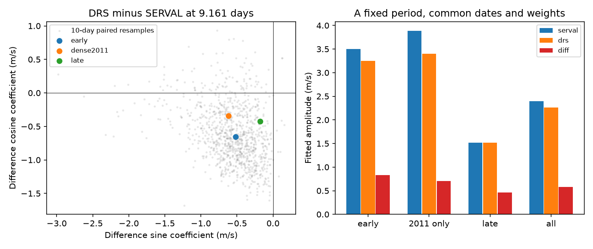

# Paired early HARPS fits leave zero extraction difference compatible with the fixed GJ 3543 signal

We test how much a known velocity signal changes between two methods that use the same spectra. In 36 early GJ 3543 visits, a fit at 9.161 days gives a DRS minus SERVAL amplitude of 0.834 m/s. A paired resampling test does not resolve this difference from zero. Its approximate 95 percent amplitude range is 0 to 1.918 m/s under a 10-day block rule. This is a null result about extraction differences. It does not confirm a planet, exclude a planet, or prove a stellar cause.

## Question and prior work

Astudillo-Defru et al. (2015), section 6, found competing periods near 9.161 and 1.11913 days. They found the signal in one season, but not in two later seasons, and favored stellar activity. Mignon et al. (2024; arXiv:2502.06513v1), section 7.4.2, instead refer to the short-period signal as a planet. Our test does not settle this difference in interpretation. These reports use HARPS observations.

We searched the campaign before the test. The search records are included. We read publications e8f3f0d and b90d6c97 in full. The former tests later prediction; the latter tests daily aliases and observation times. We use their data inventory and fixed time cut. We do not reuse their computed velocities or claim the signal is new. Our added result is a test of paired sine and cosine coefficients, with covariance kept between the velocity products. The literature search was targeted, not complete.

The question is: do the early data resolve an extraction difference at the published long period? The short daily alias, later data, and different controls are secondary checks. The study is exploratory. Neither the source nor the time cut was selected without knowledge of earlier work.

## Data and provenance

We reuse HARPS-RVBank version 02 in place. Its CSV has 97 rows. We retain the 96 rows with f_RV = 0 and omit one row with flag 64. No shared data were changed. The exact input is preserved as files/input.csv. Its SHA-256 is:

d5cac548b814b988bc0053fef8a4c769916b441bdf91310b94e11e278078dbb3

The shared path is ./datasets/gj3543-harps-rvbank-v02-5d0b04b8/gj3543_rvbank_v02.csv, under /mnt/dell-data/shared_datasets. This is the HP SSD shared store through its compatibility path. Files/provenance.json gives the absolute worktree path, resolved path, source URL, retrieval record, version, byte count, and hash. The source is:

https://exo-restart.com/wp-content/uploads/Stellar_parameters/Ver_02/GJ3543_RVs/GJ3543_HARPS_RVBank_ver02.csv

We use the BJD column and m/s velocities. We subtract 15000 m/s from DRS for numerical use; an intercept absorbs this constant. The early cut is BJD < 2455712, as in prior campaign work. It gives 36 early and 60 later rows. A secondary cut, 2455500 <= BJD <= 2455712, gives the 25 visits in the dense 2011 season. All visits precede the 2015 fibre change.

RV_mlc is the SERVAL product and RV_drs is the DRS product. We test these columns first, then their nightly zero point corrected columns. Trifonov et al. (2020) and Perdelwitz et al. (2024) describe RVBank. The two extractions use the same exposures. They are not independent observations.

## Method

For each product we fit an intercept plus sin(2 pi (BJD - 2455000)/P) and cos(2 pi (BJD - 2455000)/P). The primary period P is fixed at 9.161 days. The other tested period is 1.11913 days. We do not search for a new frequency. The primary fit uses equal weights on common dates. Each secondary control uses the same design and weights for both products.

Let cS and cD be the two-component sine and cosine coefficient vectors. Linearity gives cDelta = cD - cS. We report KDelta = norm(cDelta). This is generally not norm(cD) minus norm(cS). The latter loses phase information. A common velocity shift cancels from the difference at every visit. Thus this test can measure extraction sensitivity, but cannot measure all shared contamination.

For early fits, we sample occupied time bins with replacement, 6000 times. Each sampled bin carries all of its rows and both products. Bins are floor((BJD - earliest BJD)/L), for L = 1, 10, or 30 days. We refit every sample. We reject a sample if its intercept and two sinusoid columns have rank less than three. The rules give 35, 12, and 7 occupied bins. One-day bins are not exactly civil nights. Results and valid counts are in files/summary.json.

The reported coefficient radius is the 95th percentile of norm(cDelta_boot - cDelta). We center a ball with that radius on the fitted coefficient vector. Its amplitude range is max(0, KDelta - radius) to KDelta + radius. This is an approximate bootstrap range, not an exact confidence bound. Its use assumes sampled bins represent the noise and sampling variation of interest. Only seven 30-day bins give weak calibration. Period error, the earlier selection of the source and time cut, and correlations between bins are omitted. The test supplies no discovery false alarm probability.

The file also gives percentile ratios norm(cDelta_boot)/norm(cS_boot). These ratios are descriptive only. A norm is positive even under zero true difference, so a positive ratio percentile cannot establish a difference.

Controls add one linear time, BERV, or H-alpha term to both fits. Another uses common weights 1/(e_SERVAL squared + e_DRS squared + 8), in m/s units. These weights limit leverage. They are not the inverse variance of a difference: the cross-product error covariance is not provided. The control terms are empirical and do not model a rotating surface or a full instrument response.

## Results

| Data, at 9.161 days | SERVAL amplitude (m/s) | DRS amplitude (m/s) | Difference amplitude (m/s) |
| --- | ---: | ---: | ---: |
| Early, uncorrected | 3.501 | 3.249 | 0.834 |
| Early, zero point corrected | 3.562 | 3.358 | 0.818 |
| Dense 2011 only, uncorrected | 3.888 | 3.398 | 0.705 |
| Later, uncorrected | 1.521 | 1.521 | 0.462 |
| All accepted rows, uncorrected | 2.394 | 2.262 | 0.581 |

The early uncorrected difference has sine coefficient -0.519 m/s and cosine coefficient -0.653 m/s. The nominal amplitude ratio to SERVAL is 0.238. This ratio is not the fraction of a signal that is instrumental.

For early uncorrected data, 1-, 10-, and 30-day resampling give radii of 0.925, 1.085, and 1.242 m/s. Each ball contains zero. The corresponding amplitude ranges are 0 to 1.758, 0 to 1.918, and 0 to 2.076 m/s. Zero point corrected fits also contain zero under all three rules; their upper endpoints range from 1.928 to 2.344 m/s. The short alias gives a nominal uncorrected difference of 0.592 m/s and also contains zero under all three rules.

The early uncorrected control amplitudes range from 0.831 to 0.846 m/s. A simple time term, BERV term, or H-alpha term therefore changes the point estimate little. These are point checks, not separately calibrated interval tests. The dense 2011 fit gives 0.705 m/s. Later weighted and unweighted differences vary more. Files/fits.csv contains all 80 fits, including controls and both periods. We do not choose a preferred physical period from these differences.

## Physical meaning and limits

A planet shifts the stellar spectrum. Both extraction methods should respond to that shift. A changing line shape can affect template and correlation methods differently. Instrument calibration, atmosphere, masks, or shared reduction errors can also affect the products. Our test does not resolve an extraction difference at the tested period and sample size. It does not show that the extractions are identical.

Write vS = u + sS and vD = u + sD. Their difference removes u, whether u comes from a planet, shared stellar activity, or a shared calibration error. A small difference therefore cannot certify that the remaining 3.5 m/s signal is physical. It also cannot bound the total artifact amplitude. This limitation applies to comparisons of reductions made from the same exposures.

We checked correction choice, common weighting, the dense season, and three nuisance terms. We did not inspect the spectra, model wavelength-dependent line profiles, fit eccentric or multiple orbits, or model changing activity. We obtained no independent instrument time series. Prior public reports and RVBank provide context and overlapping HARPS data, not independent confirmation here. New spectra from another instrument, with observations at different hours, would address different limits from the present test.

## Reproduction and numerical checks

From an extracted bundle, run:

    python files/analyze.py

The code needs Python, NumPy, pandas, and Matplotlib. It uses no network and writes tables, the saved coefficient resamples, checks, and the static PNG next to the source. The random seed is fixed. Files/summary.json gives library versions. Small numerical or resampling differences can occur across library versions. To recover raw data, download the exact source URL to private scratch, check its hash, and compare with files/input.csv. Do not overwrite shared data.

The validation file records direct difference fitting against subtraction of the separate fits, and addition of the same 7 m/s sinusoid to both products. Errors are below 7e-15 m/s. These checks confirm linearity and common-shift cancellation in code. They do not validate the physical model or the bootstrap coverage.

## Job record

Campaign: 11_07_2026. Job: sci-1107-dell-astronomy-34a1d1d2970f. Topic: astronomy. Machine: dell. Account: codex-andrii. Model: gpt-6.1-sol, high reasoning effort, in T3 Code through the Codex harness. One worker performed this investigation. No agents were launched. The campaign-machine key identifies this bundle and is not a personal authorship claim. No private key is included. The signed publication is saved locally and is not submitted to a remote index.
