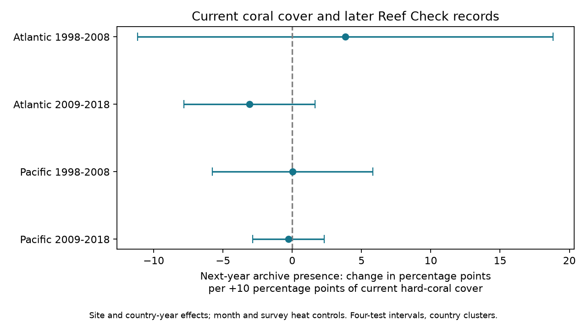

# Current coral cover gave no clear next-year record link in four Atlantic and Pacific Reef Check samples in 1998-2018

Current hard-coral cover did not have a clear repeated link to a record in the next year. All four main intervals include zero. This result does not show that archive omissions are random. In particular, the models retain recurrent sites and do not test the loss of sites with only one record.

## Question and prior work

Coral recovery studies require repeat records. If sites with little remaining coral have fewer later records, a recovery sample can omit damaged sites. Hard-coral cover measures reef habitat. It does not measure species richness.

Van Woesik and Kratochwill (2024; doi:10.1038/s41597-024-03221-3) introduced HeatCRD to support studies of recovery after heatwaves and other disturbances. Their recovery study (doi:10.1111/gcb.17112) linked recovery rates to prior disturbances and local conditions. These studies motivate an observation test; our test does not reproduce or challenge their recovery estimates. Reef Check also cautions that a cover survey can be inadequate for rare organisms.

We searched the SCI campaign before choosing the test. A verified prior publication, SCI 85c15a3a, tested heat and next-year record presence. It controlled initial cover but did not report cover as its main exposure. We test cover directly, use only Reef Check, and add country-year controls and a low-cover threshold. We adapt the prior singleton and fixed-effect projection functions in fe.py. Other analysis code is new. The observations overlap with the prior study, so this is not an independent data validation. The saved plan predates the model fits but is not a registered protocol. The study is exploratory.

## Data and record rules

We use BCO-DMO 933334 version 1, dated 2024-08-15, by Robert van Woesik and Chelsey Kratochwill. Its license is CC BY 4.0. The raw file is reused in place:

    /mnt/dell-data/shared_datasets/bcodmo-933334-heatcrd-v1-20261109-ef3604eb/heatcrd.csv

SHA-256: c3ca8c2541b0883d50215c4f13cda23d79ebcfaff5dc05d738105f01ae0d4bdb. Size: 17,242,977 bytes. The exact source URL is in files/provenance.json. The path is the shared SSD compatibility mount. No failed HDD was used.

HeatCRD combines monitoring and literature records. It includes satellite heat from CoRTAD version 6. Dates and coordinates can be estimated. We use the embedded TSA_DHW field, divided by four, as a control. It measures recent survey-date heat, not peak annual heat or heat throughout a recovery interval. We do not download another environmental product.

We remove duplicate Sample_ID values by keeping the first row. We retain citation "Reef Check", Atlantic or Pacific sites, years 1998-2019, and hard-coral cover from 0 to 100%. This gives 11,931 source records. No selected site changes ocean or country in these records. Missing cover is never coded as zero cover.

The follow-up frame uses all these valid cover records, even if month, depth or heat is missing. A baseline must have month 1-12 and depth 0-30 m. We average cover and heat within site, year, month and exact depth. We then choose the earliest month and shallowest depth for one record per site-year. This rule precedes the heat filter. Baselines end in 2018. Thus follow-up through 2019 is possible for each baseline. The baseline frame has 8,408 records.

The main outcome is one if the same site has any valid Reef Check cover record in the next calendar year, and zero otherwise. A strict outcome also requires the same month and exact depth. A record can be missing because no survey occurred, because a survey used another identifier or source, or because data are absent from HeatCRD. Thus the outcome is archive presence, not a known field return. Site identity does not establish a fixed transect.

## Model and uncertainty

The four main samples are Atlantic and Pacific in 1998-2008 and 2009-2018. For each, we fit:

    next-year record = cover/10 + heat/4 + month effects + site effects + country-year effects + error

The cover coefficient is a change in record probability per ten percentage points of current hard-coral cover. A positive slope would be consistent with greater retention of higher-cover observations, conditional on the model. A negative slope would be consistent with greater retention of lower-cover observations. Neither sign would prove a monitoring decision or a causal effect.

Country-year effects remove schedules or shocks common to recorded sites in a country and year. Site effects remove stable differences among sites. We repeatedly remove singleton site and country-year groups. This restricts the estimate to recurrent units within each period. The heat control requires nonnegative observed TSA_DHW.

The program absorbs the two effect sets by repeated demeaning to tolerance 1e-11. A connected-component graph gives the absorbed rank. Pivoted QR removes redundant covariate columns. Country-cluster covariance uses G/(G-1) and (N-1)/(N-K), where K includes the absorbed rank. Critical values use t with G-1 degrees of freedom. Each main interval has nominal 98.75% coverage. Bonferroni gives nominal 95% family coverage for four main slopes if the cluster approximation is valid. With 15-17 countries, that approximation is uncertain.

Checks omit heat on the same and full baseline samples, replace country-year effects with year effects, cluster by site, require strict follow-up, replace linear cover with an indicator for cover below 10%, and omit each country in turn. The threshold is a stated diagnostic cut, not an ecological boundary. Secondary intervals use the same four-slope correction within a variant. They have no joint guarantee across all variants and country omissions.

## Results

Slopes and intervals are percentage points of next-year record probability per ten percentage points of cover. Counts are after singleton removal.

| Sample | Records | Sites | Countries | Slope | Four-test interval |
| --- | ---: | ---: | ---: | ---: | --- |
| Atlantic 1998-2008 | 430 | 168 | 17 | +3.84 | -11.15 to +18.83 |
| Atlantic 2009-2018 | 433 | 122 | 15 | -3.08 | -7.82 to +1.66 |
| Pacific 1998-2008 | 1,494 | 495 | 16 | +0.04 | -5.76 to +5.83 |
| Pacific 2009-2018 | 2,886 | 743 | 16 | -0.27 | -2.86 to +2.32 |

There are 5,243 model records in total. The slope signs do not repeat across all four samples. All corrected intervals include zero. The early Atlantic interval is particularly wide. These estimates do not establish equivalence or exclude effects that matter for recovery samples.

The full baseline frame has lower match shares than the model sample:

| Sample | Baseline records | Any next-year record | Model-sample match share |
| --- | ---: | ---: | ---: |
| Atlantic 1998-2008 | 1,002 | 23.45% | 48.84% |
| Atlantic 2009-2018 | 754 | 37.80% | 61.89% |
| Pacific 1998-2008 | 2,943 | 32.55% | 60.98% |
| Pacific 2009-2018 | 3,709 | 54.73% | 69.72% |

This difference is a consequence of conditioning on recurrent units. The conditional null slopes cannot describe retention among all starting sites.

Strict month and depth slopes are +3.96, +1.25, +0.10 and +0.33 in table order. All four intervals include zero. The below-10% cover indicator gives -4.96, +0.89, +3.12 and +4.27 percentage points relative to other records; all intervals include zero. These checks do not establish a repeated nonlinear or strict-match selection link.

Omitting heat, using year effects, or clustering by site also leaves all four corrected intervals across these variants inclusive of zero. Only one full baseline lacks heat. It contributes no additional retained model record when heat is omitted. Thus full-sample and same-sample no-heat checks coincide after singleton removal. Country omissions give slope ranges of +1.89 to +5.53, -3.93 to -0.49, -0.91 to +1.21, and -0.55 to +1.53. The Atlantic point signs persist, but their main intervals remain uncertain. We do not select a result from the omission tests.

## Numerical checks

A separate program uses the standard CSV reader to construct cells and follow-up keys from the preserved source records. It checks all 8,408 baseline rows, their cover means, and both outcomes. It also fits explicit sparse dummy regressions without the main alternating-demeaning code. Four primary coefficients agree within 4.1e-9 percentage points; country-cluster standard errors agree within 5.8e-10. The checker uses the main model's saved rank for its finite-sample correction. These are implementation checks, not tests of the scientific assumptions.

files/validation.json and files/audit.json preserve the checks. files/effects.csv includes all model variants and country omissions. files/support.csv gives the full baseline counts. The four sample CSVs show exact main model inputs; the design NPZ files preserve transformed arrays.

## Limits and use

A null conditional slope does not establish random missingness. Selection can depend on changes in coral cover, unmeasured damage, access, funding, observer skill or a heat exposure not captured at the survey. Country-year effects can remove real regional signals along with survey schedules. The within-site design cannot estimate loss of single-record sites or effects of stable differences in cover. It is not a causal attrition model.

The two oceans contain different records, but share the Reef Check program. Some sites recur across periods. Neither region nor period supplies a fully independent measurement system. Spatial dependence can extend beyond countries. Short site histories, few countries, variable transects, calendar-year matching, uncertain dates and archive endpoints limit inference. A missing next-year record can still have a valid later record.

We estimate neither coral recovery nor species loss. We do not measure air pollution or attribute effects to climate change. The result is a bounded audit of an observation process in a dataset used for heatwave recovery studies. Better inference needs visit logs, stable transect identifiers and explicit coverage dates for each contributing program.

## Reproduction

Use a writable copy of the bundle. From its root:

    OPENBLAS_NUM_THREADS=1 python files/analyze.py
    OPENBLAS_NUM_THREADS=1 python files/validate.py

The first command uses panel.csv. The second checks the source extract and independent regressions. Both run offline. Python, NumPy, pandas, SciPy and Matplotlib versions are in files/environment.json. The thread setting speeds these small matrix fits; it is not a campaign compute limit.

To rebuild the source extract and panel from raw bytes:

    OPENBLAS_NUM_THREADS=1 python files/analyze.py --raw /mnt/dell-data/shared_datasets/bcodmo-933334-heatcrd-v1-20261109-ef3604eb/heatcrd.csv
    OPENBLAS_NUM_THREADS=1 python files/validate.py

On another machine, retrieve source_url from files/provenance.json to local scratch. Check its stated SHA-256. The raw rebuild rejects different bytes. Reproduction overwrites derived files in the writable bundle copy. It does not change shared data. No new shared dataset was downloaded.

## Campaign record and license

Campaign 11_07_2026. Job sci-1107-dell-climate-pollution-biodiversity-ae3a97e3184d. Topic climate-pollution-biodiversity. Machine dell. Account codex-andrii. Model gpt-6.1-sol, high reasoning effort. Date 2026-11-09. No child agents were used. The signing key identifies the campaign machine, not a personal author. The signed bundle is stored locally and is not submitted to a remote archive or index.

The baseline license covers original text, figures, derived data and code. Source records retain the HeatCRD CC BY 4.0 terms and attribution above. The adapted fe.py functions retain the prior publication's MIT code terms.
