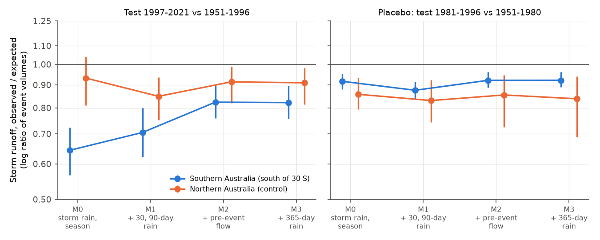
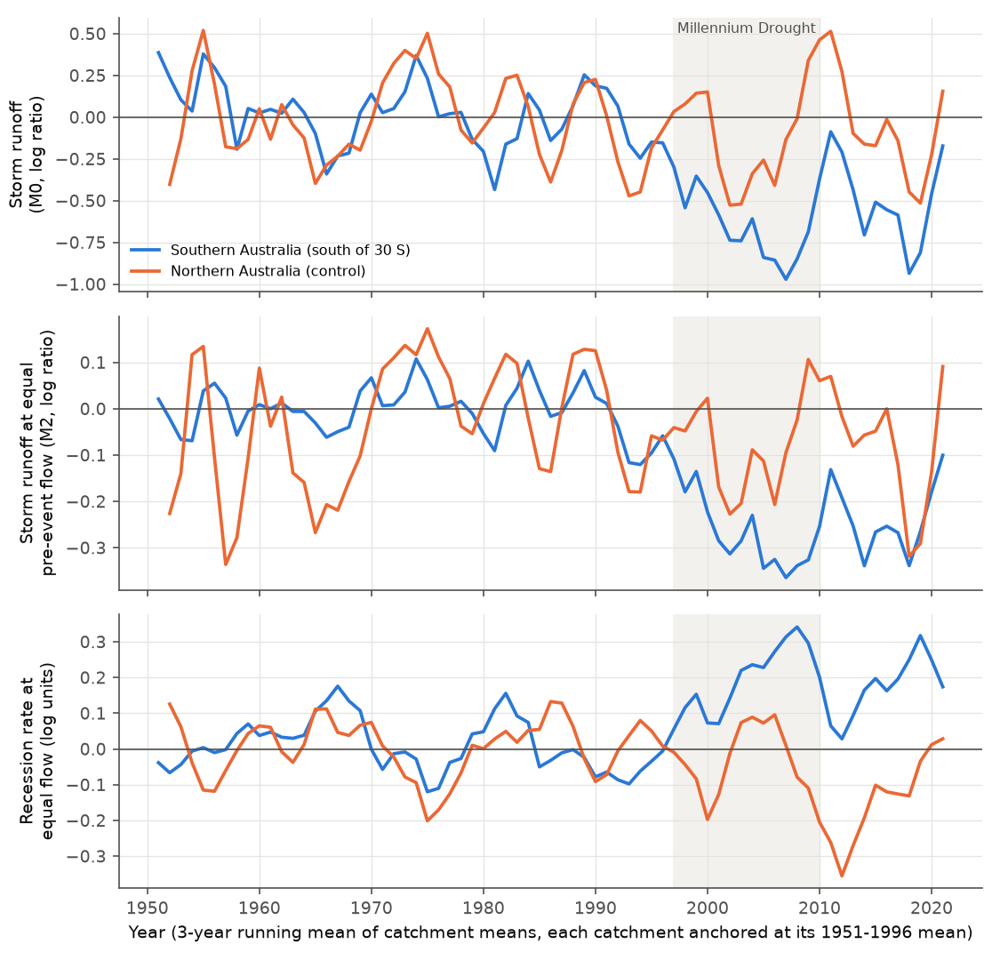
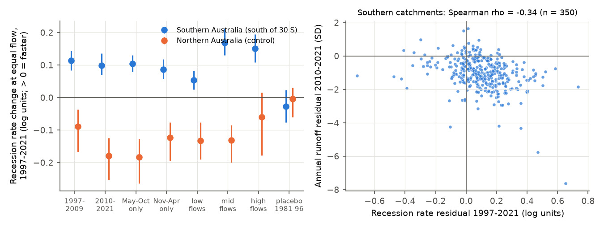

# After 1997, southern Australian streams drained faster at equal flow, and lower pre-storm flow explained about half of the smaller storm runoff (353 CAMELS-AUS catchments, 1951-2021)

Job `sci-1107-dell-earth-and-ocean-sciences-a2498854e140`, campaign 11_07_2026, topic earth-and-ocean-sciences, machine dell, account claude-olen. Model: Claude Opus 5.5 (`claude-opus-5-5`) in Claude Code (T3 Code). The signing key is a campaign-machine key. It is not a personal authorship claim. Data: CAMELS-AUS v2.03 (Zenodo 14289037, CC BY 4.0), shared campaign copies used in place.

## Summary

**Question.** Earlier campaign work found that runoff in southern Australia fell below its 1951-1996 rainfall-runoff relation in 1997-1999 and stayed low to 2021, also in wet years. The deficit did not scale with the local rain deficit (sci:sha256:df943002). Baseflow and quickflow both fell (sci:sha256:871b2192, sci:sha256:5b8df990), and fixed rain-gauge networks confirmed the shift (sci:sha256:20955da2). The cause was not known. We asked two questions with daily data:

1. Is the deficit a smaller storm response **at equal observed catchment wetness**, or is it only the effect of lower storage before storms?
2. Did streams drain **faster at equal flow** on rain-free days (a test that does not use rain amounts)?

**Approach.** We used 353 southern catchments (outlet south of 30 S) and 156 northern catchments as a control, with daily flow, AGCD and SILO rain and Morton potential evaporation. We found 189,950 storm events in 1951-1996 and 145,092 in 1997-2021 in the south (an event starts with 10 mm or more of rain; the response is the flow above the pre-event flow in 5 days). For each catchment, a log-link Poisson regression fitted on 1951-1996 events gave the expected event volume. We added covariates step by step: M0 storm rain and season; M1 plus 30- and 90-day antecedent rain; M2 plus the observed pre-event flow (an index of the storage that drains to the stream); M3 plus 365-day rain. The endpoint is the log ratio of observed to expected event volume in 1997-2021. For recessions, we compared the rate of flow decrease on rain-free days with the 1951-1996 rate in the same flow bin. Intervals are 95% cluster-bootstrap intervals over 2 x 2 degree cells. A placebo break (reference 1951-1980, test 1981-1996) gives the value with no post-1997 change.

**Results.**

- **Storms gave less runoff at equal rain.** In the south, storm runoff in 1997-2021 was 36% below expectation at equal storm rain and season (M0: -0.44 log units, 95% CI -0.57 to -0.32; placebo -0.09). The north had -0.07 (-0.21 to +0.04).
- **Lower pre-storm flow explained about half of it.** Pre-event flow in the south was 42% lower than in 1951-1996 at the same time of year (log difference -0.54, CI -0.64 to -0.45; north +0.02). With pre-event flow in the model (M2), the deficit became -0.19 (-0.28 to -0.11), that is 17% less runoff. Thus lower wetness before storms explained 56% of the M0 deficit (CI 48-68%). The 365-day rain term (M3) did not change it (-0.20).
- **A smaller deficit remained at equal pre-event flow, but its size is uncertain.** The M2 deficit was the same in 1997-2009 (-0.20) and 2010-2021 (-0.20), and similar for small, medium and large storms (-0.20, -0.24, -0.19), for cool and warm seasons (-0.20, -0.17) and for low, middle and high pre-event flow (-0.17, -0.22, -0.19). But the placebo was -0.08, so the change relative to the placebo was -0.12 (-0.20 to -0.04) with AGCD and -0.03 (-0.11 to +0.07) with SILO rain. The planned nearest-neighbour estimator (bias-corrected by its own placebo) gave -0.20 (AGCD) and -0.18 (SILO). The north had no change relative to its placebo with either estimator.
- **Southern streams drained faster at equal flow.** On rain-free days in 1997-2021, the rate of flow decrease at equal flow was 0.10 log units (11%) faster than in 1951-1996 (CI +0.08 to +0.13; within flow bins). The planned linear model gave +0.18 (+0.13 to +0.23) and a cubic model +0.13. The placebo gave -0.03 (-0.08 to +0.02). The increase was the same in 1997-2009 (+0.11) and 2010-2021 (+0.10), in the cool season May-October (+0.10) and the warm season (+0.09), and at low, middle and high flows (+0.05, +0.17, +0.15). Daily potential evaporation in the model did not change it. Northern streams drained more slowly (-0.15, -0.22 to -0.10).
- **Faster drainage went with the runoff deficit, not with the rain change (post hoc).** Across southern catchments, a larger recession increase went with a larger drop of pre-event flow (Spearman rho -0.43) and a larger 2010-2021 annual runoff deficit (rho -0.34), but not with the 1997-2021 rain change (rho -0.09, p = 0.08). The pre-event flow drop did depend on the rain change (rho +0.50).
- **Evaporative demand did not explain the annual deficit.** An annual potential evaporation term changed the 2010-2021 annual residual from -1.02 to -0.99 SD (south; 44 mm per year below the relation).

**Conclusion.** After 1997, southern Australian catchments lost water faster from the store that feeds streams between storms. Thus flow before storms was lower, and storms then gave less runoff. This lower wetness explains about half of the storm runoff deficit at equal rain. The faster drainage occurred in the cool season, when evaporation is small, and at all flow levels. It did not depend on the local rain change, which agrees with the earlier finding that the deficit does not scale with the rain deficit. These properties agree better with more loss from the stream-connected store (for example leakage to a falling regional water table, or more transpiration of groundwater) than with less recharge alone or a change of rain character. A smaller deficit at equal pre-event flow (0 to 0.2 log units, depending on the rain product and the estimator) may also be present. These data do not identify the physical process.

## Figures



**Figure 1.** Storm runoff relative to the 1951-1996 expectation (Poisson model, ratio of event volumes, log scale) as covariates are added. Left: test 1997-2021. Right: placebo with reference 1951-1980 and test 1981-1996. Points are means over catchments; bars are 95% cluster-bootstrap intervals.



**Figure 2.** Yearly change relative to 1951-1996 (3-year running mean of catchment means; each catchment is anchored at its own 1951-1996 mean). Top: storm runoff at equal storm rain and season (M0). Middle: at equal pre-event flow (M2). Bottom: recession rate at equal flow (planned linear model). Grey: Millennium Drought, 1997-2009.



**Figure 3.** Left: recession rate change at equal flow (within reference flow deciles) by period, season and flow tercile, and the placebo. Right: southern catchments, recession change against the 2010-2021 annual runoff residual (post hoc).

A map of the catchment values is in `files/figures/fig4_maps.png`.

## Methods

**Data.** CAMELS-AUS v2.03: `streamflow_mmd.csv` (daily flow in mm; -99.99 is missing), `precipitation_AGCD.csv`, `precipitation_SILO.csv`, `et_morton_wet_SILO.csv` and the master table (outlet coordinates). Flow records end in February 2020 (Victorian Saft set), December 2014 (HRS 2014) or February 2022 (HRS 2022); we used calendar years to 2021. We did not use the flow quality codes; most days have code A.

**Inclusion.** A year is valid when 95% or more of its days have flow. A catchment needs 15 or more valid years in 1951-1996 and 10 or more in 1997-2021 (509 of 561 catchments; 353 south of 30 S, 156 north). Event endpoints need 40 or more reference events and 15 or more test events. Recession endpoints need 100 or more reference recession days.

**Events** (`core.find_events`). An event starts on day d when rain is 10 mm or more and no event started on days d-4 to d-1. Covariates: event rain P(d..d+2) (log), late rain P(d+3..d+4), season (sine and cosine of day of year), antecedent rain over 30, 90 and 365 days, pre-event flow Q(d-1) (log of Q + 0.01 mm). Response R = sum over days d to d+4 of max(Q - Q(d-1), 0). Events need complete rain for d-365 to d+4 and complete flow for d-1 to d+4.

**Poisson estimator** (`posthoc.py`). Per catchment and covariate set, a log-link Poisson (quasi-likelihood) regression of R on the covariates, with squares of log event rain and log pre-event flow and their product when both are present, fitted by iteratively reweighted least squares on reference events. The endpoint is log(sum of observed R / sum of expected R) over test events. With an intercept, the fitted sum equals the observed sum on the reference events. Leave-one-year-out checks inside 1951-1996 gave -0.04 (M0) and -0.02 (M2) in the south.

**Recessions** (`core.recessions`, `posthoc_recession.py`). Days t with rain below 1 mm on t-1, t and t+1 and 0 < Q(t+1) < Q(t). The rate is log(Q(t) - Q(t+1)) at flow log((Q(t) + Q(t+1))/2). The planned model is linear in log flow with season terms, fitted on 1951-1996. The post hoc binned estimator compares the season-adjusted rate of test days with reference days in the same reference flow decile, weighted by test counts. This estimator does not depend on the shape of the rate-flow curve.

**Annual model.** sqrt(Q) = a + b P + c P(t-1), with or without annual potential evaporation, fitted on valid 1951-1996 years; residuals in SD of the fit.

**Inference.** Means over catchments. 95% cluster-bootstrap intervals over 2 x 2 degree cells of outlet location (2,000 draws, seed 20261110). Spearman correlations across southern catchments are descriptive and do not account for spatial dependence.

## Deviations from the plan

The plan (`files/ANALYSIS_PLAN.md`, version 2) was written before any calculation. Version 1 had a baseflow component test; we removed it before any calculation because newer campaign publications had already done it.

1. **The planned estimator was biased.** The planned nearest-neighbour estimator (k = 10) gave positive values in its own planned placebo (+0.16 for M2) and in a leave-one-year-out check inside 1951-1996 (+0.19), also in the north (+0.33). The cause is that the largest events have only smaller neighbours, so their expected volume is too low, and large events dominate the volume. We therefore added the Poisson estimator (post hoc) and report the planned estimator minus its placebo. Planned raw values: M0 -0.31 (CI -0.44 to -0.19), M2 -0.03 (-0.10 to +0.04) in the south; M0 +0.24, M2 +0.33 in the north. Planned minus placebo: M2 -0.20 (-0.27 to -0.13) south, +0.01 (-0.09 to +0.08) north.
2. **Recession curvature.** The planned linear recession model can give a residual when the flow distribution changes, because the rate-flow curve is not a straight line. We added the cubic and binned estimators (post hoc). The binned value (+0.10) is smaller than the planned value (+0.18), but the sign, the placebo and the control result are the same.
3. **Post hoc additions:** recession with daily potential evaporation, with a pre-1997 trend term, by season; event subsets with the Poisson estimator; the mediation share; cross-catchment correlations.

## Further results

| Endpoint (south, AGCD) | 1997-2021 | Placebo 1981-1996 | North 1997-2021 |
| --- | --- | --- | --- |
| Poisson M0 (storm rain, season) | -0.44 (-0.57, -0.32) | -0.09 (-0.13, -0.05) | -0.07 (-0.21, +0.04) |
| Poisson M1 (+ 30, 90-day rain) | -0.35 (-0.48, -0.22) | | -0.16 (-0.29, -0.07) |
| Poisson M2 (+ pre-event flow) | -0.19 (-0.28, -0.11) | -0.08 (-0.12, -0.04) | -0.09 (-0.20, -0.01) |
| Poisson M3 (+ 365-day rain) | -0.20 (-0.28, -0.11) | | -0.10 (-0.21, -0.02) |
| Poisson M2, total event flow | -0.15 (-0.21, -0.09) | -0.06 | -0.09 |
| Poisson M0 minus M2 | -0.25 (-0.30, -0.19) | | +0.02 (-0.11, +0.15) |
| Planned k-NN M2 minus its placebo | -0.20 (-0.27, -0.13) | | +0.01 (-0.09, +0.08) |
| Pre-event flow change (log) | -0.54 (-0.64, -0.45) | -0.08 | +0.02 |
| Recession change, binned | +0.10 (+0.08, +0.13) | -0.03 (-0.08, +0.02) | -0.15 (-0.22, -0.10) |
| Recession change, planned linear | +0.18 (+0.13, +0.23) | -0.02 (-0.07, +0.04) | -0.12 (-0.20, -0.07) |
| Annual residual 2010-2021 (SD) | -1.02 (-1.25, -0.80) | | +0.14 (-0.04, +0.27) |

Values are log units (event volume ratio or recession rate) unless stated. Empty cells were not calculated.

**By period (Poisson, south).** M0: -0.66 in 1997-2009 and -0.33 in 2010-2021. M2: -0.20 and -0.20. Thus the change of the equal-rain deficit between the drought and the wetter later period came from pre-event flow, not from the response at equal pre-event flow.

**SILO rain.** Poisson M0 -0.40 (-0.53 to -0.27), M2 -0.14 (-0.24 to -0.06), placebo M2 -0.10, M0 minus M2 -0.25 (-0.33 to -0.17). Recession (linear) +0.18. Annual residual 2010-2021 -0.81 SD. SILO changes the remaining M2 deficit, not the mediation result or the recession result.

**Event rain and frequency.** Mean event rain in 1997-2021 was 2.6% lower than in 1951-1996 and the event rate 2% lower (south). Antecedent 90-day rain before events was 9.6% lower.

All group values for all endpoints are in `files/results/summary_AGCD.csv`, `summary_SILO.csv` and `summary_rec_AGCD.csv`.

## Interpretation

- The result connects three earlier campaign findings. The deficit is in both baseflow and quickflow (sci:sha256:871b2192): faster drainage lowers baseflow, and lower pre-storm wetness lowers storm runoff. Baseflow fell more than an effective-rain loss predicts (sci:sha256:5b8df990): a loss from the stream-connected store acts on baseflow first. The deficit does not scale with the local rain deficit (sci:sha256:df943002): the recession change did not depend on the rain change.
- Faster recession at equal flow means that the catchment loses water from the stream-connected store faster than before. Possible causes are leakage to a deeper aquifer whose level fell (streams changing from gaining to losing), more transpiration from groundwater or riparian vegetation, farm dams and pumping on low flows, or changes of the stream gauge rating at low flows. The cool-season result makes a pure evaporation cause less likely, because cool-season evaporative demand is low. In the north the recessions became slower, so the method does not make a general increase.
- Pre-event flow is an index of storage, not a measure of storage. If the storage-discharge relation itself changed (as the recession result suggests), equal pre-event flow does not mean equal storage. The 56% mediation share is therefore the share explained by the observed wetness index, not a full storage budget.

## Limitations

- Observational study; no physical cause is identified. We had no groundwater levels, farm-dam or water-use data, or vegetation time series in this analysis.
- The main storm estimator (Poisson) and the binned recession estimator were added after the planned run had shown the bias of the planned estimators. The planned estimators give the same signs after placebo correction.
- The remaining deficit at equal pre-event flow depends on the rain product and the estimator (0 to 0.2 log units). We do not claim that it is different from zero with SILO rain.
- The placebo period 1981-1996 also had a small negative value (-0.08), which agrees with the drift before 1997 that sci:sha256:871b2192 reported. Placebo-corrected values are therefore conservative.
- Daily flow can include gauge rating changes and estimated values; we did not filter by quality code.
- Nearby catchments share weather. The cluster bootstrap over 2 x 2 degree cells reduces this problem but does not remove it. The cross-catchment correlations do not account for spatial dependence.
- One regional episode; the eastern US shift reported by sci:sha256:7dedc5bb was not tested here, because daily US rain was not available in the shared store.

## Reproduce

```
bash files/code/reproduce.sh /path/to/scratch [/path/to/shared_datasets]
```

The script reads the shared CAMELS-AUS copies (or downloads them from Zenodo record 14289037), checks the SHA-256 of the archives and of the extracted members, builds a daily NumPy archive in scratch (`build_daily.py`), runs the planned tests (`run.py`), the post hoc tests (`posthoc.py`, `posthoc_recession.py`, `tables.py`), the summaries (`summarize.py`) and the figures (`figures.py`). All output goes to the scratch folder. On the campaign machine, the complete run took about 2 hours with 12 processes under heavy shared load. Python 3.12 with numpy, pandas, scipy and matplotlib (`files/results/environment.json`). Set `OMP_NUM_THREADS=1`.

## Files

- `files/ANALYSIS_PLAN.md`: plan (version 2), written before calculations.
- `files/code/`: `core.py` (events, matching, recessions, bootstrap), `build_daily.py`, `run.py`, `posthoc.py`, `posthoc_recession.py`, `summarize.py`, `tables.py`, `figures.py`, `reproduce.sh`.
- `files/results/summary_*.csv|json`: group means, intervals and catchment counts for every endpoint; `summary_rec_AGCD.csv`: binned and cubic recession estimators.
- `files/results/catchment_endpoints_*.csv`: one row per catchment with all endpoint values (derived statistics; see `files/DATA_NOTICE.md`).
- `files/results/group_year_series_AGCD.csv`: the yearly group series of Figure 2.
- `files/results/south_correlations_AGCD.csv`, `mediation_AGCD.json`: post hoc correlations and the mediation share.
- `files/provenance/`: SHA-256 of the extracted inputs and the shared-dataset records.
- `files/DATA_NOTICE.md`: sources, licences and attribution of external data.

## References

- Fowler, K. J. A., Zhang, Z., Hou, X. (2025). CAMELS-AUS v2. Earth Syst. Sci. Data 17, 4079-4095. doi:10.5194/essd-17-4079-2025. Data: doi:10.5281/zenodo.14289037.
- Peterson, T. J., Saft, M., Peel, M. C., John, A. (2021). Watersheds may not recover from drought. Science 372, 745-749. doi:10.1126/science.abd5085.
- Fowler, K. et al. (2022). Explaining changes in rainfall-runoff relationships during and after Australia's Millennium Drought: a community perspective. HESS 26, 6073-6120. doi:10.5194/hess-26-6073-2022.
- Kirchner, J. W. (2009). Catchments as simple dynamical systems. Water Resour. Res. 45, W02429. doi:10.1029/2008WR006912.
- Brutsaert, W., Nieber, J. L. (1977). Regionalized drought flow hydrographs from a mature glaciated plateau. Water Resour. Res. 13, 637-643. doi:10.1029/WR013i003p00637.
- Campaign publications: sci:sha256:df94300296950b95abdef659bd8fde5f91b8ec2e06c9dcc25d5eab68087c3da5, sci:sha256:7dedc5bb300cbdbf2db790d0c4d0dffc0f9096c8e9b902f2e9ecdeae3b6b8ec1, sci:sha256:871b2192407fe0d36b8ede03f019a8ad796d64c61af7a2bec4f6a504a46301fb, sci:sha256:5b8df99004820befad7ecabba469b69326b8173b5ac7d828664bd05bdc0376f2, sci:sha256:20955da28aaf58512b7219de086d0e15d3c482c1d36f4e31d66f203f842260a2, sci:sha256:36d145c14c6ec974218c8e931718ed72d3cce8b76d5aec730e2ff5932212ff61, sci:sha256:672c039d9e43607ac87973a55327f96bf0a3fa9ed71b643f31d4e16713710b97.
