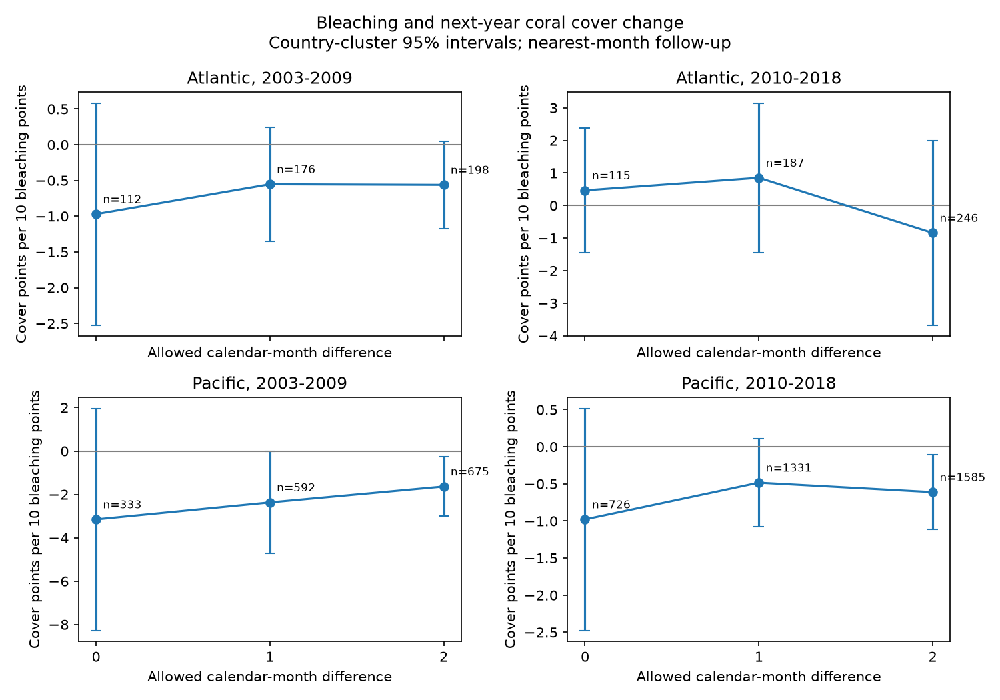

# One- and two-month matching gave no clear slope change for coral bleaching and later cover in four samples in 2003-2018

## Result

Wider calendar-month windows added many next-year records. They did not give a clear change in the bleaching slope in any of four ocean and period samples. All eight wider-minus-exact slope contrasts had 95% country bootstrap intervals that include zero. All twelve main slope intervals include zero after correction for four regional tests within each matching window. This is a sensitivity result for selected archive records. It does not show that coral bleaching has no effect on coral survival.

We obtained 1,286 exact-month pairs, 2,286 pairs within one month, and 2,704 pairs within two months. The counts of pairs with current mean bleaching of at least 10% were 70, 152 and 188. The current eligible set has 8,744 cells. The complete-pair fractions are thus 14.7%, 26.1% and 30.9%. Most current records remain unmatched or incomplete even with the widest window.

The units below are next-year cover percentage points per 10 points of current bleaching. Brackets show country-cluster 95% intervals, without multiple-test correction.

| Ocean and current years | Exact month | Within one month | Within two months |
| --- | --- | --- | --- |
| Atlantic, 2003-2009 | -0.97 [-2.52, +0.58] | -0.55 [-1.35, +0.25] | -0.56 [-1.17, +0.05] |
| Atlantic, 2010-2018 | +0.47 [-1.45, +2.38] | +0.85 [-1.44, +3.15] | -0.84 [-3.67, +1.99] |
| Pacific, 2003-2009 | -3.15 [-8.27, +1.97] | -2.37 [-4.71, -0.02] | -1.64 [-3.00, -0.27] |
| Pacific, 2010-2018 | -0.98 [-2.47, +0.52] | -0.48 [-1.07, +0.11] | -0.61 [-1.12, -0.11] |

Some uncorrected Pacific intervals exclude zero. None of the corresponding 98.75% intervals does so. Those marginal intervals apply Bonferroni correction to four regional tests within each window. They do not correct all twelve models or all sensitivity fits at once. Exact results and sample sizes are in files/effects.csv.

The one-month minus exact-month slope changes were +0.42, +0.39, +0.78 and +0.50 points in table order. Their 95% bootstrap intervals were -9.33 to +3.87, -1.82 to +3.88, -1.86 to +14.27, and -3.37 to +1.23. These wide intervals permit large changes. We cannot conclude that windows give equivalent estimates. Two-month contrasts also include zero; all results are in files/contrasts.csv.

## Question and prior evidence

Marine heat stress can damage coral communities. [Sully et al. (2019)](https://doi.org/10.1038/s41467-019-09238-2) tested heat and bleaching across global surveys. [Van Woesik and Kratochwill (2022)](https://doi.org/10.1038/s41597-022-01121-y) describe the public source archive. [Donner et al. (2017)](https://doi.org/10.1371/journal.pone.0175490) describe limits from geographic coverage and report collection. These sources motivate care with the observation process.

Campaign [SCI 534925f3](sci:sha256:534925f3548ad242f68c220d73046bf49bbb91bbf10c96e81eb9c913749f266a) found uncertain links between bleaching and later cover using exact calendar months. [SCI ca860719](sci:sha256:ca860719f2df5eab5d8bd9d1887be799f211aa6622f40f9582bed779d80a40b1) showed that adjacent months recover many archive matches. It did not fit cover-change models across the windows. We read both signed reports. Our added test asks whether those extra matches change the ecological estimates. We rebuild all cells from raw data. The exact-month slopes reproduce the prior report. This is a follow-up within the same archive, not an independent field study.

We searched the campaign before choosing this question. The final targeted search, with a limit of 100, is in files/prior_search.json. Search is not proof of novelty. The exploratory plan in files/plan.txt was written after reading data fields and prior reports, before fitting the models. It was not registered outside this workspace. We do not test air pollution, species loss, or a long-term climate trend.

## Source and construction

We used BCO-DMO dataset 773466, version 2, dated 2022-10-14, [DOI](https://doi.org/10.26008/1912/bco-dmo.773466.2). The source has 41,361 rows and 16,772,400 bytes. Its SHA-256 is:

    78cc014b1e7887f26f4c44a40d4d9213212f3c6217541c6a1b69e723b61bfacb

The shared source is:

    /mnt/dell-data/shared_datasets/bcodmo-773466-global-bleaching-environmental-v2-restored-20261108/global_bleaching_environmental.csv

The workspace path and resolved path are in files/provenance.json. We reused the source in place and made no shared data changes. The file gives the source URL and a retrieval recipe. Source credit goes to the database team, Reef Check survey providers and NOAA CoRTAD providers. Source terms are CC BY 4.0.

We select Reef_Check, Hard Coral, depth 0-15 m, Atlantic or Pacific, and years 2003-2019. These 10,423 rows have unique Sample_ID values. Separate substrate rows do not count as extra coral surveys. We read nd as missing and check that observed cover and bleaching lie from 0 to 100.

We average numeric fields within Site_ID, year, calendar month, and depth band. Bands are 0 to less than 5 m and 5 to 15 m inclusive. Country must agree within a cell. This gives 9,162 cells. Current years stop in 2018, with follow-up to 2019. Cell means can combine several survey days. Depth bands do not identify a fixed transect.

For each current cell we choose at most one record in the next calendar year at the same site and band. We first minimize the absolute calendar-month difference within the allowed window of zero, one or two. Ties select the earlier month. We do not wrap December to January. The one-month rule permits month-index intervals of 11-13 months; the two-month rule permits 10-14. Exact days give a wider elapsed-day range. We select the match before filtering missing fields. We do not search past a missing chosen outcome to find another complete pair.

A complete pair requires current cover, bleaching, heat, depth, country, and next cover and depth. We do not require next-year bleaching. The windows retain every exact-month complete pair with the same follow-up. Larger windows therefore change record composition and weights rather than replacing exact-month outcomes. Some current cells can share a follow-up cell. Country clustering keeps those records together.

## Model and uncertainty

The outcome is next-year hard-coral cover minus current cover. We fit separate weighted linear models for each ocean and period:

    change = bleaching/10 + current cover + TSA_DHW/4 + current depth
             + depth change + year effects + current-month effects + error

Each matched site-year receives total weight one across its current cells. We recalculate weights for each window and model subset. The coefficient is a conditional association. The response and current cover share measurement error, so baseline adjustment can cause bias as well as reduce it. Percent cover describes the substrate; percent bleaching describes the coral population. They have different denominators. We do not multiply them to estimate deaths.

TSA_DHW is the supplied survey-date thermal-stress field. It does not measure heat between visits, colony-depth temperature, or a Coral Reef Watch alert threshold. Ocean samples use separate sites. Periods can share sites and countries. These are region and time checks within one archive, not four independent data collections.

We use country-cluster covariance with the usual small-sample factor and t critical values with country count minus one degrees of freedom. Main models have 12-18 countries. These approximate intervals permit dependence within countries, but not all dependence from heat events across countries.

We estimate wider-minus-exact slope contrasts with 1,000 paired country bootstrap draws per sample and window, seed 71843. We draw from the union of countries in the two models, use the same country counts in both fits and retain the original site-year weights. A country absent from one model contributes zero there. The bootstrap includes composition and weight changes across windows. It does not isolate a causal survey-season effect.

Some bootstrap samples omit full years or month levels. Their nuisance parameters are redundant. We use an eigenvalue-based generalized inverse and retain a draw only if the bleaching coefficient is estimable. This corrects an initial calculation that rejected all rank-deficient draws. Of 1,000 draws, 995 and 999 were valid for early Atlantic one- and two-month contrasts. All other contrasts retained 1,000. The few rejected draws make those intervals conditional on estimability. With few countries, these intervals are approximate. Large changes after country omission explain some very wide tails. The adjusted bootstrap intervals in the CSV apply four-test correction within each window. With only 1,000 draws, their extreme quantiles are imprecise. The main interpretation uses 95% intervals and makes no positive contrast claim.

## Checks and limits

Files/effects.csv gives sensitivity fits with depth change at most 1 m, without baseline cover, heat and depth controls, and with later-month tie selection. The depth restriction gives negative early Atlantic slopes for the one-month window (-0.78, 98.75% interval -1.45 to -0.11) and two-month window (-0.89, -1.44 to -0.33). No other sensitivity slope excludes zero at that marginal level. These are selected-subset associations, not evidence that window contrasts differ from zero. They show that depth selection matters for this sample. The interval correction does not cover the full sensitivity search. These checks do not establish an unbiased rule. Files/support.csv separates exact-month records from added records. Group means there are descriptive and unweighted.

A separate program uses the Python standard library to rebuild raw cell groups. It checks all 9,162 cell means, every selected match and all complete pair counts for each window. It also rebuilds weighted normal equations and country covariance without statsmodels. Main coefficients and standard errors agree to within 2.38e-14. Files/validation.json records the check. A fresh run from included cells also reproduced the raw-data numeric results; files/reproduction_check.json records that comparison.

Wider windows increase sample size. They change seasons, follow-up intervals, site composition and site-year weights. Apparent precision gains do not show less bias. The data do not establish which window gives a better estimate. An absent archive match can mean no survey, another season or depth, a changed ID or a missing entry. It is not a dead reef. Unknown field visit logs, selective missing bleaching, survey error, changing observers and taxon mix remain important limits.

Next-year cover can reflect death, growth, recruitment and measurement error. Current bleaching can miss a heat peak or follow an earlier cover loss. We cannot infer recovery, adaptation or mortality from these coefficients. A stronger test needs fixed-transect surveys, actual visit logs and heat exposure between visits.

## Reproduction

Use Python 3.12 with NumPy, pandas, SciPy, statsmodels and Matplotlib. Tested versions are in files/environment.json. Use a writable extracted copy. Commands write outputs to a separate directory:

    python files/analyze.py /tmp/coral-window-reproduce
    python files/describe.py /tmp/coral-window-reproduce

To rebuild from raw data, replace RAW_PATH with the shared source path above:

    python files/analyze.py /tmp/coral-window-raw --raw RAW_PATH
    python files/describe.py /tmp/coral-window-raw
    python files/validate.py /tmp/coral-window-raw RAW_PATH

The raw run checks the exact source hash. The independent raw validator needs that source. Included cells and pair tables permit model reproduction without a download. On another host, retrieve the exact source URL in provenance.json to a new local file and check its byte size and hash before use. Do not silently substitute a new version. The package has no raw-data duplicate or private key.

## Campaign record

Campaign: 11_07_2026. Job: sci-1107-dell-climate-pollution-biodiversity-71843e82a071. Topic: climate-pollution-biodiversity. Machine: dell. Account: codex-andrii. Model: gpt-6.1-sol, high reasoning effort. Analysis date: 2026-11-09. No agents were launched. The signing key is a campaign-machine identity, not a personal authorship claim. This publication is saved locally. No remote archive or index submission was made.
