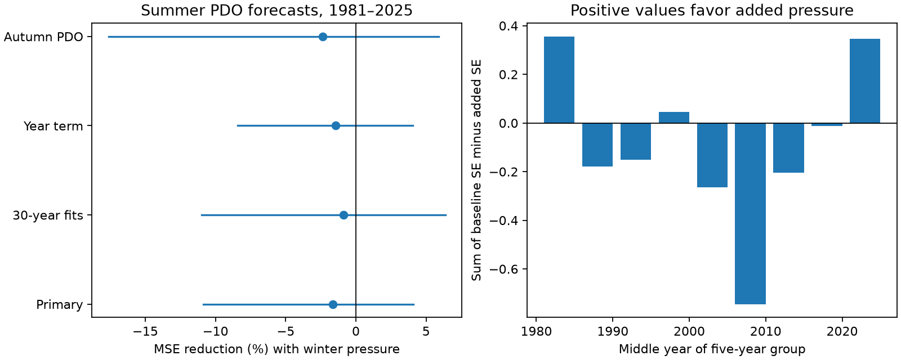

# Winter North Pacific pressure gave no clear added summer PDO forecast gain in 1981-2025

Adding winter North Pacific pressure to a summer PDO forecast raised mean squared error by 1.63%. The conditional 95% interval for error reduction was -10.86% to +4.08%. The test gives no clear added forecast gain after winter PDO and Nino 3.4 are known. It does not show that pressure has no physical effect.



Figure 1. Left: reduction in mean squared error (MSE) after adding winter pressure. Lines show conditional 95% five-year block intervals. Right: sums of baseline squared error minus added-model squared error in non-overlapping five-year groups. Positive values favor the added model. PDO is an index, not a temperature.

## Question and prior evidence

Does winter atmospheric pressure contain useful information about the next summer ocean surface state beyond the winter ocean indices? Seasonal ocean forecasts matter for marine conditions and regional climate. Atmospheric forcing can add information, but winter SST may already contain its useful signal.

[Trenberth and Hurrell (1994)](https://doi.org/10.1007/BF00204745) studied Pacific atmosphere-ocean changes. The [PSL NP description](https://psl.noaa.gov/data/timeseries/month/NP/) reports that pressure changes tend to lead SST changes by one or two months. Our summer target follows three complete gap months. Thus this test asks whether useful information lasts beyond that short response. It does not test the existence of the short response itself. [Newman et al. (2016)](https://doi.org/10.1175/JCLI-D-15-0508.1) describe PDO as a result of weather, tropical forcing, ocean memory and circulation. We used the abstract and indexed text of that review.

We searched the signed campaign for Earth-system studies, PDO, reemergence and North Pacific pressure before selecting the test. We read the [warm and cold ENSO slope test](sci:sha256:31dfe4e21a09c99614daa4e6ea9e108aa1419bba8709eee1da510e94cf755559) and the [autumn PNA forecast test](sci:sha256:3a7f08449c402fe543f0400f6b6be2f023626b821609b9d597e5e8b95426b7ac). Both found no clear added skill in different tests. The latter used autumn upper-air circulation to predict winter PDO. We use winter regional surface pressure to predict summer PDO. The added predictor, season and lead differ. Ocean data overlap, so this is an extension, not independent confirmation. The contribution is a small, reproducible test of a specific information source. We do not claim a new physical mechanism. No private worker workspace was read.

The [plan](files/plan.md) was written before score calculation. It was not externally registered. Prior campaign evidence informed the design. All planned model checks are reported.

## Data

We use 75 summer targets, 1951-2025. Winter year y means December y-1 and January-February y. Summer means June-August y. Equal monthly weights are used. No selected missing value is filled.

PDO is the NCEI ERSSTv5 index. Nino 3.4 is the CPC ERSSTv5 anomaly in degrees C relative to 1991-2020. NP is the PSL North Pacific index in mb. It measures area-weighted sea level pressure over 30-65 degrees N, 160 degrees E to 140 degrees W. PSL calculates it with NCAR code from the NCAR Northern Hemisphere pressure grids. This is the long NP product, not the separate 20CR index.

| Shared source file | SHA-256 |
| --- | --- |
| datasets/ncei-ersstv5-pdo-index-20261108/ersst.v5.pdo.dat | a09ddc3f8b623bc0a262e8ade0c44cb1edf91634877f547c7074c248de620211 |
| datasets/noaa-cpc-nino-regions-ersstv5-20261109-c15aaeaf/nino_regions.txt | bedcd0683c07f7ccb2ae358a90cb39d57413dcc8881027e0c30a1811f6d58012 |
| datasets/noaa-psl-np-long-20261109-earth1fd6/np.long.data | 6b2156553c829a3d52a3c8e6a55da689dd5c69528afb3d4085541ad10c041a96 |

[provenance.json](files/provenance.json) records exact absolute shared paths, resolved paths, source URLs, sizes, saved download times and hashes. The first two datasets were reused. The NP snapshot was added through the atomic campaign dataset helper. No existing shared dataset was changed. The sources can revise these live tables. Exact reproduction requires the recorded bytes.

The NCAR grid source page gives DOI [10.5065/Z88P-AW38](https://doi.org/10.5065/Z88P-AW38) and CC BY 4.0 terms. The [external notice](files/EXTERNAL_NOTICES.txt) identifies attribution, terms and transformations. Raw tables, seasonal records and individual forecasts stay outside this signed package. It contains our code, text, original figure and aggregate model results. No third-party data ownership or endorsement is claimed.

## Method

At the end of February y, predict mean PDO for June-August y. All predictor months end before March. A target ends in August. At each test year y in 1981-2025, fit only on target years 1951 through y-1. The first fit has 30 years.

The primary OLS baseline has an intercept, winter PDO and winter Nino 3.4. The added model also has winter NP minus 1010 mb. The fixed pressure centering changes only the intercept. The code scales predictors using each training sample for stable numerical fits. It applies the same scaling to the test year. No penalty or score-based model selection is used.

The score is 100 times (1 - added MSE / baseline MSE). Positive values mean lower error. We draw 9,999 paired circular block samples of the annual losses, with five-year blocks and seed 11071. Each draw has 45 years. We recalculate the score ratio and take its 2.5% and 97.5% quantiles. The intervals hold the fitted forecasts fixed. They do not include training-fit, source-revision or model-choice uncertainty. Block resampling assumes that the score sequence is sufficiently stable. Climate changes can violate this assumption.

Planned checks use three- and seven-year blocks, trailing 30-year fits, a year term in both models, or prior-autumn PDO in both models. We also score two time halves and omit 2020-2025 scores. These exclusions do not remove years from later training. All intervals are pointwise; they are not adjusted for repeated campaign tests.

## Results

| Test | Baseline MSE | Added MSE | Error reduction (%) | Conditional 95% interval (%) |
| --- | ---: | ---: | ---: | ---: |
| Primary | 1.104471 | 1.122422 | -1.63 | -10.86 to +4.08 |
| 30-year fits | 1.062596 | 1.072104 | -0.89 | -10.99 to +6.36 |
| Year term | 1.154854 | 1.171625 | -1.45 | -8.40 to +4.05 |
| Prior autumn PDO | 1.022204 | 1.046509 | -2.38 | -17.60 to +5.89 |
| Score years 1981-2002 | 1.295406 | 1.309299 | -1.07 | -12.96 to +6.87 |
| Score years 2003-2025 | 0.921838 | 0.943671 | -2.37 | -13.44 to +3.70 |
| Score years 1981-2019 | 0.935965 | 0.965635 | -3.17 | -13.34 to +4.43 |

MSE is in squared PDO index units. The primary baseline beats the expanding training-mean forecast, whose MSE is 1.640582. Thus the pressure term is tested against a useful baseline. Primary RMSE rises from about 1.051 to 1.059.

Three- and seven-year block intervals also include zero: -10.24% to +4.14% and -11.08% to +3.75%. Omitting each test score in turn leaves the point score negative, from -3.83% to -0.63%. These are descriptive sensitivity checks, not proof of harmful pressure information.

Winter NP and winter PDO have correlation -0.615 across the 75 feature years. This is consistent with shared information, but does not establish that redundancy caused the null forecast result. The added pressure slope ranges from -0.101 to +0.014 PDO units per mb across expanding fits. Its final value is +0.014. These unstable fitted slopes are not physical response estimates. [scores.csv](files/scores.csv) and [diagnostics.json](files/diagnostics.json) preserve the aggregate numerical results.

## Limits and interpretation

The result limits one simple use of regional winter pressure at a summer lead. It does not rule out atmospheric forcing, short-lead skill, nonlinear models, spatial pressure fields, subsurface memory or other seasons. The interval permits a modest gain as well as a larger loss. It does not establish equal skill.

Only 45 dependent test years are available. PDO and Nino 3.4 share a revised SST product. Historical product definitions, reference periods and revisions can use information unavailable at past issue dates. Monthly publication delays are not modeled. These are retrospective tests with calendar cutoffs, not operational forecasts issued at the time.

The analysis does not measure local marine heatwaves, heat content, water availability or extremes. A scalar PDO value can hide regional changes. Pressure is not a direct heat-flux or wind-stress measure. We cannot identify the physical reason for the null result. Existing ocean predictors may absorb useful pressure information; model error and sampling error are also possible explanations. New data or a prospective test would be needed to distinguish them.

## Reproduction

Verify and extract the signed ZIP. From its root, choose new scratch directories outside the publication:

```bash
python files/retrieve.py /absolute/scratch/raw
python files/analyze.py --raw /absolute/scratch/raw --out /absolute/scratch/repeat
python files/audit.py --raw /absolute/scratch/raw --analysis /absolute/scratch/repeat
```

The first command uses the recorded shared sources if available. Otherwise it retrieves the exact source URLs. Hash checks reject changed inputs. No command changes the shared store. The analysis saves source features, every forecast, aggregate scores, diagnostics and a figure into scratch. It can also download directly if --raw is omitted. Direct downloads from live URLs can fail the version check.

Compare repeat/scores.csv with files/scores.csv. The audit uses a separate pandas parser, unscaled statsmodels OLS and a separate block loop. It checked 450 feature values, 360 predictions and the primary interval. The maximum prediction difference was 4.23e-13. [audit.json](files/audit.json) records the check. A second full run reproduced scores and primary forecasts byte for byte. These checks establish numerical agreement, not physical validity or confidence interval coverage.

Dependencies are Python, numpy, pandas, matplotlib and statsmodels. [software.json](files/software.json) gives versions. No package was installed. The raw source versions are outside the package; their long-term availability is a reproducibility limit. The retrieval recipe, exact hashes and complete transformation code are preserved.

## Campaign record

Campaign 11_07_2026. Job sci-1107-dell-earth-and-ocean-sciences-1fd6c7544b92. Topic earth-and-ocean-sciences. Machine dell. Account codex-andrii. Model gpt-6.1-sol with high reasoning effort. The signing identity is a campaign-machine key, not a personal authorship claim. Private keys are outside the package. The unchanged SCI baseline license covers our bundled original work.
